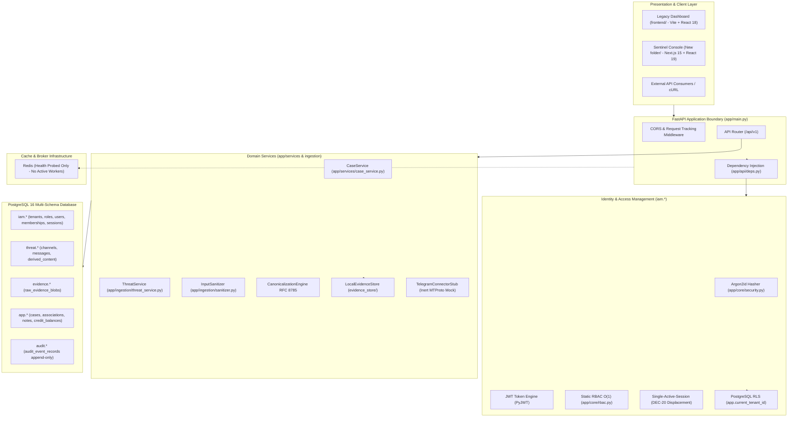

# TTI Platform Upgrade Audit (Phase 0)
**Document Version:** 1.0.0  
**Audit Date:** 2026-10-31  
**Auditor Role:** Senior Python Backend Architect, ML Engineer, Telegram Bot Developer, Full-Stack Developer & Cybersecurity Engineer  
**Scope:** Complete repository audit of `TTI` (FastAPI backend, PostgreSQL database, Alembic migrations, test suite, and frontends) against the target "Consent-Based Telegram AI Threat Intelligence & Behaviour Analytics Platform".

---

## 1. Existing Architecture

The current platform is a multi-tenant threat intelligence foundation implemented across FastAPI, SQLAlchemy 2 (asyncpg), PostgreSQL 16, and two distinct frontend iterations (`frontend/` Vite SPA and `New folder/` Next.js 15).



---

## 2. Features That Already Work

All features below have been validated through live code analysis and confirmed passing across the full test suite (**144 passed, 1 skipped, 0 failed in 29.74s**):

| Feature | Primary Files | Verification Method | Status |
|---|---|---|---|
| **Argon2id & JWT Authentication** | `app/core/security.py`, `app/api/v1/endpoints/auth.py` | Unit & integration tests (`test_runtime_iam_integration.py`, `test_iam_security_lifecycle.py`), live endpoint test | **Verified Working** |
| **Single-Session Invariant (DEC-20)** | `app/api/v1/endpoints/auth.py`, `iam.active_user_sessions` | Tests pass; 409 Conflict raised on concurrent login; force displacement verified | **Verified Working** |
| **Static RBAC (4 Roles, 19 Perms)** | `app/core/rbac.py`, `app/api/deps.py` | Tests pass; self-elevation prevention and permission gates verified | **Verified Working** |
| **PostgreSQL Tenant RLS** | Alembic migration `0004_phase1_tenant_rls.py`, `app/database/session.py` | Tests pass; `SET LOCAL app.current_tenant_id` blocks cross-tenant reads even for app role | **Verified Working** |
| **Tenant Org Lifecycle & Reactivation** | `app/core/iam_lifecycle.py`, `app/api/v1/endpoints/organizations.py` | Tests pass; DEC-15 in-place reactivation with unique constraint verified | **Verified Working** |
| **Case Management Subsystem** | `app/services/case_service.py`, `app/api/v1/endpoints/cases.py` | Tests pass; autogenerated case references, pinning/unpinning, notes, closed-case locks verified | **Verified Working** |
| **Threat Batch Ingestion Pipeline** | `app/ingestion/threat_service.py`, `app/ingestion/pipeline.py` | Tests pass; batch deduplication, tamper conflict detection, transaction rollback verified | **Verified Working** |
| **Input Sanitization Engine** | `app/ingestion/sanitizer.py` | Tests pass; NFC normalization, ANSI escape removal, script stripping, URI defanging verified | **Verified Working** |
| **Local Evidence Vault** | `app/evidence/storage.py` | Tests pass; SHA-256 fingerprinting, directory traversal prevention verified | **Verified Working** |
| **RFC 8785 Canonicalizer** | `app/reporting/canonicalization.py` | Tests pass; determinism, whitespace, framing verified | **Verified Working** |
| **Append-Only Relational Audit Ledger** | `app/database/models/audit.py`, `audit.audit_event_records` | Tests pass; immutable ledger populated on all auth, threat, and case operations | **Verified Working** |
| **Next.js Console (`New folder/`)** | `New folder/src/app` | Live dev server running on port 3000; TypeScript compiles with 0 errors; HTTP 200 confirmed | **Verified Working** |

---

## 3. Features Needing Improvement

1. **Telegram Ingestion Strategy:**
   * *Current State:* `app/connectors/telegram/stub.py` is an inert mock modeled on MTProto/TDLib scraping (`collect_channel_messages`, `participant_count`, channel scraping).
   * *Required Improvement:* Complete pivot to an **aiogram 3 webhook bot**. Must enforce Telegram privacy mode, zero channel/group scraping, and restrict ingestion strictly to (A) authorized groups and (B) consenting individuals.
2. **Consent & Privacy Enforcement:**
   * *Current State:* Zero consent checking. Messages submitted to `/threat/ingest` are accepted regardless of whether the sender opted in.
   * *Required Improvement:* Intercept updates before storage. If a message originates from a non-consenting user in an approved group, immediately drop the text and payload, keeping only anonymous aggregate counters.
3. **Detection Engine Architecture:**
   * *Current State:* `/threat/search` performs raw SQL substring matching (`ilike('%query%')`). There are no regex engines, threat taxonomies, or scoring models.
   * *Required Improvement:* Implement an externalized YAML-based threat taxonomy, rules-based pattern matching (UPI VPA, banking IFSC, OTP harvesting, phishing schemes, job scams), context classification (victim vs reporting vs facilitating), and Hinglish transliteration normalizers.
4. **AI & NLP Analysis Service:**
   * *Current State:* `app/ai/interface.py` contains only an abstract stub (`AnalysisResult`, `AIAnalysisEngineInterface`).
   * *Required Improvement:* Implement local NLP pipeline (spaCy + small multilingual ONNX model) supporting English, Hindi, Marathi, and Hinglish. Output must include evidence spans, confidence scores, and mandatory human-review flags.
5. **Alerting Lifecycle:**
   * *Current State:* `app/alerts/interface.py` is an abstract class; no alerts database model, no alert state machine, and no notification dispatcher.
   * *Required Improvement:* Dedicated `alerts` table with priorities (Critical/High/Medium/Low), deduplication suppression, analyst review status, and webhook/Telegram notification dispatchers.
6. **Background Task Processing & Concurrency:**
   * *Current State:* Redis is installed and probed in `/health`, but no Celery or background worker runs. All ingestion and sanitization run synchronously inside the FastAPI request thread.
   * *Required Improvement:* Establish Celery/Redis worker queues (`ingestion`, `nlp`, `alerts`, `behaviour`, `cleanup`) with configurable concurrency, dead-letter storage, and idempotent execution.
7. **Frontend Unification:**
   * *Current State:* Two separate frontends exist (`frontend/` Vite React 18 SPA and `New folder/` Next.js 15).
   * *Required Improvement:* Consolidate into a single maintainable dashboard reflecting the 6 target sections: Overview, Detections, Alerts, Subjects (with Behaviour tab), Cases & Reports, Settings.

---

## 4. Missing Modules Compared with Target

| Target Module | Current Status | Required Scope to Build |
|---|---|---|
| **aiogram 3 Telegram Bot** | Missing | Bot router, webhook handler, secret token verification, update deduplication (`update_id`), commands (`/start`, `/help`, `/privacy`, `/consent`, `/submit`, `/analyse`, `/myactivity`, `/myalerts`, `/export`, `/revoke`, `/delete_me`). |
| **Consent Engine** | Missing | `consent_records` & `telegram_subjects` tables, versioned consent schemas, consent verification middleware, revocation cascade, deletion workflow. |
| **Threat Rules & Taxonomy Engine** | Missing | Version-controlled YAML taxonomy file, rule compiler (exact, phrase, regex, per-language dictionary), context discriminator (reporter vs victim vs facilitator), explainability payload. |
| **Hinglish/Multilingual NLP Service** | Missing | Local spaCy / ONNX pipeline, language identification (EN, HI, MR, Hinglish), Named Entity Recognition (NER for UPI, IFSC, crypto addresses, URLs), statement extraction. |
| **Behaviour Analytics Service** | Missing | Consented-only aggregation, hourly/daily/weekly frequency baselines, interval statistics, rolling average deviation, timeline reconstruction. |
| **Group Monitoring & Anonymization** | Missing | `monitored_chats` table, membership event tracking, non-consenting member message drop logic, anonymous aggregate counters. |
| **Alert Subsystem** | Missing | `alerts` table, priority engine (Critical/High/Medium/Low), duplicate alert suppression, analyst triage, false-positive marking. |
| **Celery / Redis Worker Mesh** | Missing | Celery application factory, 10 named queues, retry policies with exponential backoff, dead-letter table (`system_jobs`), graceful shutdown hooks. |
| **Evidentiary Report Exporter** | Missing | Automated PDF and CSV generation with RFC 8785 canonical hash attachment, export audit logging, retention policy enforcement. |

---

## 5. Security Issues Ranked by Severity

### 🔴 High Severity
1. **Unchecked Data Ingestion Without Consent (Privacy Non-Compliance):**
   * *Location:* `app/ingestion/threat_service.py` (`ingest_batch`)
   * *Risk:* Telemetry containing usernames, text, and sequence IDs from channels/groups is stored in PostgreSQL and `evidence_store/` without verifying subject consent. This directly violates the project's non-negotiable privacy charter.
   * *Remediation:* Enforce consent validation middleware at the ingestion boundary before persisting records. Drop content for unconsented senders.
2. **Missing Distributed Rate Limiting on Authentication & Ingestion:**
   * *Location:* `app/api/v1/endpoints/auth.py` (`/login`), `app/api/v1/endpoints/threat.py` (`/ingest`)
   * *Risk:* Authentication is susceptible to credential stuffing and brute-force attacks. Large batch ingestion can overwhelm PostgreSQL connections synchronously.
   * *Remediation:* Wire Redis-backed sliding-window rate limiters across `/auth/login` and `/threat/ingest`.

### 🟡 Medium Severity
3. **Hardcoded Fallback Development Secrets:**
   * *Location:* `app/core/config.py` (lines 24, 29, 34)
   * *Risk:* `TTI_SECRET_KEY="dev_insecure_secret_key_must_be_changed_in_production_min32chars!"` and `POSTGRES_PASSWORD="tti_dev_password_change_in_production"` serve as defaults if `.env` fails to load.
   * *Remediation:* Enforce strict validation in production mode (`TTI_ENV=production`) ensuring the application refuses to start if fallback strings are detected.
4. **Permissive CORS Configuration:**
   * *Location:* `app/main.py` (lines 42–49)
   * *Risk:* `allow_methods=["*"]` and `allow_headers=["*"]` provide excessive surface when exposed outside a private reverse proxy.
   * *Remediation:* Explicitly whitelist HTTP methods (`GET`, `POST`, `PATCH`, `DELETE`, `OPTIONS`) and specific authorization headers.
5. **Synchronous Request-Thread Ingestion Bottleneck:**
   * *Location:* `app/ingestion/threat_service.py` (`ingest_batch`)
   * *Risk:* File disk I/O, hash computations, and database transactions occur synchronously in the FastAPI endpoint loop, creating worker starvation under load.
   * *Remediation:* Offload batch processing to Celery background workers; return HTTP 202 Accepted with job status URL.

### 🟢 Low Severity
6. **Starlette Deprecation Warning:**
   * *Location:* `app/api/v1/endpoints/threat.py` (line 91)
   * *Risk:* `HTTP_422_UNPROCESSABLE_ENTITY` triggers a Starlette deprecation warning favoring `HTTP_422_UNPROCESSABLE_CONTENT`.
   * *Remediation:* Update status code token to current Starlette standard.
7. **Known Test Credentials in Seeding Script:**
   * *Location:* `scripts/seed_forensic_telemetry.py`
   * *Risk:* Static sample passwords (`VigilantForensic@2026!Ops`) exist in source repository.
   * *Remediation:* Maintain separation between local synthetic seed scripts and production deployment initializers.

---

## 6. Duplicated, Unused or Tightly Coupled Code

1. **Frontend Codebase Duplication:**
   * `frontend/` contains a Vite + React 18 + React Router 7 application.
   * `New folder/` contains a Next.js 15.5 + React 19 application with duplicate components, models, and API clients.
   * *Action:* Archive or deprecate `frontend/` and standardize on `New folder/` (renaming it cleanly to `frontend/`), or vice versa, to eliminate technical debt.
2. **Phase 0 Prototype Models Coexisting with Canonical Schemas:**
   * `app/database/models/intelligence.py` retains `CollectedThread` (`public.collected_threads`) and `RawArtifact` (`public.raw_artifacts`).
   * `app/database/models/tenant.py` retains `Tenant` (`public.tenants`).
   * `app/database/models/audit.py` retains `AuditEvent` (`public.audit_events`).
   * *Action:* Maintain these tables strictly for backward compatibility as specified in migration 0002, but ensure all new code exclusively targets the canonical schemas (`iam`, `threat`, `evidence`, `app`, `audit`).
3. **Tight Coupling in Threat Ingestion:**
   * `ThreatService` directly instantiates `LocalEvidenceStore` (`self.evidence_store = evidence_store or LocalEvidenceStore()`) and interacts with file paths directly inside database transaction logic.
   * *Action:* Extract evidence vault operations behind an abstract repository interface (`EvidenceRepositoryProtocol`) to adhere to SOLID.
4. **Inert Scraper Stubs:**
   * `app/connectors/darkweb/` and `app/connectors/telegram/` represent dead code from a prior MTProto scraping concept that conflicts with Bot API privacy invariants.
   * *Action:* Refactor `app/connectors/telegram/` into the official `aiogram 3` bot adapter.

---

## 7. Breaking-Change Risks and What Must Be Preserved

### What MUST Be Preserved (Zero Disruption)
* **IAM Database Foundation:** `iam.tenant_organizations`, `iam.roles`, `iam.user_profiles`, `iam.tenant_memberships`, and `iam.active_user_sessions`.
* **Alembic Migration Chain:** Migrations `0001` through `0006` must remain immutable. All new tables must be added in sequential migrations (`0007_...`, etc.).
* **Single-Session Enforcement (DEC-20):** Session displacement logic and audit logging must not be modified or broken.
* **Case Management Domain:** `app.investigative_cases`, `CaseService`, and `/api/v1/cases` endpoints (100% test-verified).
* **Cryptographic & Evidence Invariants:** RFC 8785 canonicalizer, SHA-256 evidence vault layout, and `audit.audit_event_records` append-only constraints.
* **Input Sanitization:** `InputSanitizer` must remain the primary defensive layer for untrusted text.

### Breaking-Change Risks
* **Ingestion API Contract:** Adding mandatory consent checks to `/threat/ingest` would break existing tests if not handled gracefully. Tests must be updated with fixtures providing consented subject records.
* **Database RLS Policies:** Introducing new tables in the `app` schema requires configuring `app.current_tenant_id` RLS policies in Alembic migrations to prevent data leakage.
* **Docker Service Configuration:** Renaming or changing frontend paths affects `docker-compose.yml`.

---

## 8. Files to Modify and New Files Required

```
TTI/
├── backend/
│   ├── app/
│   │   ├── adapters/                        [NEW: External Adapters]
│   │   │   ├── telegram_bot.py              [NEW: aiogram 3 bot lifecycle & handlers]
│   │   │   ├── nlp_engine.py                [NEW: spaCy/ONNX multilingual extractor]
│   │   │   └── alert_notifier.py            [NEW: Telegram & Webhook notification dispatcher]
│   │   ├── api/v1/endpoints/
│   │   │   ├── telegram_webhook.py          [NEW: Webhook receiver with secret token check]
│   │   │   ├── consent.py                   [NEW: Consent management & revocation endpoints]
│   │   │   ├── detections.py                [NEW: Keyword & fraud detection query API]
│   │   │   ├── behaviour.py                 [NEW: Consented activity analytics API]
│   │   │   ├── alerts.py                    [NEW: Alert triage & review API]
│   │   │   ├── threat.py                    [MODIFY: Add consent verification hook]
│   │   │   └── reports.py                   [NEW: Evidentiary PDF/CSV export API]
│   │   ├── core/
│   │   │   ├── config.py                    [MODIFY: Add Bot token, Webhook secrets, Celery vars]
│   │   │   └── rbac.py                      [MODIFY: Add consent & alert permissions]
│   │   ├── database/models/
│   │   │   ├── consent.py                   [NEW: telegram_subjects, consent_records, deletion_requests]
│   │   │   ├── detection.py                 [NEW: threat_categories, keyword_rules, detections, url_indicators]
│   │   │   ├── behaviour.py                 [NEW: activity_aggregates, behaviour_events]
│   │   │   ├── alerts.py                    [NEW: alerts, analyst_feedback]
│   │   │   └── chats.py                     [NEW: monitored_chats, chat_membership_events]
│   │   ├── services/
│   │   │   ├── consent_service.py           [NEW: Consent verification & revocation workflows]
│   │   │   ├── threat_engine.py             [NEW: YAML taxonomy & rules matching engine]
│   │   │   ├── nlp_service.py               [NEW: Language ID, entity recognition & spans]
│   │   │   ├── behaviour_service.py         [NEW: Consented statistical anomaly calculator]
│   │   │   ├── alert_service.py             [NEW: Priority calculation & duplicate suppression]
│   │   │   └── report_service.py            [NEW: PDF/CSV RFC 8785 evidence packager]
│   │   └── workers/                         [NEW: Celery Task Workers]
│   │       ├── celery_app.py                [NEW: Celery instance & queue configurations]
│   │       └── tasks/                       [NEW: Ingestion, NLP, alert, & cleanup tasks]
│   ├── alembic/versions/                    [NEW: Migration 0007_consent_and_bot_core.py]
│   ├── rules/taxonomy.yaml                  [NEW: Externalized threat rules & keywords]
│   └── tests/                               [NEW: Tests for bot, consent, NLP, rules, alerts]
├── New folder/                              [MODIFY: Standardize as primary frontend]
│   └── src/
│       ├── app/(console)/
│       │   ├── detections/page.tsx          [NEW: Detections feed with filter by scam type]
│       │   ├── alerts/page.tsx              [NEW: Alert review & triage workbench]
│       │   └── subjects/page.tsx            [NEW: Consented subjects & behaviour analytics tab]
│       └── components/                      [NEW: Modular tables, filters, and charts]
└── docs/AUDIT.md                            [THIS DOCUMENT]
```

---

## 9. Revised Phase Plan (Smallest Working Vertical Slice First)

To achieve continuous working functionality, the roadmap prioritizes building a complete end-to-end slice early: **Bot -> Consent -> Detection -> Alert -> Dashboard**.

```mermaid
flowchart LR
    P0["Phase 0: Audit & Architecture (CURRENT)"] --> P1["Phase 1: Foundation & Worker Mesh"]
    P1 --> P2["Phase 2: Telegram Bot & Consent Engine"]
    P2 --> P3["Phase 3: Threat & Fraud Rules Engine"]
    P3 --> P4["Phase 4: Alerts & Minimal Unified Dashboard"]
    P4 --> P5["Phase 5: Local NLP & Entity Extraction"]
    P5 --> P6["Phase 6: Behaviour Analytics & Group Monitoring"]
    P6 --> P7["Phase 7: Cases & Evidentiary Reporting"]
    P7 --> P8["Phase 8: Scale, Hardening & 24x7 Deployment"]
```



### Phase 1: Foundation, Queues & Celery Worker Mesh
* **Objective:** Establish Celery background processing, Redis queue topology, configuration hardening, and test infrastructure without breaking existing APIs.
* **Scope:**
  * Add `aiogram`, `celery`, `flower` to `pyproject.toml` and `requirements.txt`.
  * Configure Celery app with queues: `ingestion`, `processing`, `detection`, `nlp`, `alerts`, `behaviour`, `reports`, `cleanup`.
  * Add dead-letter task failure tracking in database.
  * Standardize environment configuration (`TTI_TELEGRAM_BOT_TOKEN`, `TTI_WEBHOOK_SECRET`, Celery brokers).
* **Acceptance Criteria & Tests:**
  * Celery worker boots and acknowledges ping on Redis broker.
  * Failed tasks retry with exponential backoff and record to dead-letter storage.
  * Existing 144 unit tests continue to pass with 0 regressions.

### Phase 2: Telegram Bot & Consent Service (Smallest Working Ingestion Slice)
* **Objective:** Replace inert scraper with official `aiogram 3` bot and build strict, revocable consent service.
* **Scope:**
  * Implement bot router with all 11 statutory commands: `/start`, `/help`, `/privacy`, `/consent`, `/submit`, `/analyse`, `/myactivity`, `/myalerts`, `/export`, `/revoke`, `/delete_me`.
  * Create `consent_records`, `telegram_subjects`, and `deletion_requests` tables via Alembic migration `0007`.
  * FastAPI webhook endpoint verifying `X-Telegram-Bot-Api-Secret-Token`.
  * Ingestion consent middleware: automatically drop message content for non-consenting users in authorized groups (recording only anonymous aggregate counts).
  * Automated deletion workflow when `/revoke` or `/delete_me` is invoked.
* **Acceptance Criteria & Tests:**
  * Unit tests simulating Telegram webhook payloads.
  * Test verifying update deduplication via `update_id`.
  * Test verifying non-consenting message text is rejected from storage.
  * Test verifying consent revocation cascades and purges subject records.

### Phase 3: Threat & Fraud Detection Rules Engine
* **Objective:** Deterministic, explainable scam detection based on version-controlled YAML rules.
* **Scope:**
  * Externalized `rules/taxonomy.yaml` covering: UPI fraud, banking fraud, OTP theft, phishing, fake job scams, investment scams, identity fraud, malware indicators, harassment.
  * Multi-language pattern matcher (English, Hindi, Marathi, Hinglish).
  * Role discriminator: distinguish between scam reporters, scam victims, and potential facilitators.
  * Store detections in `detections` table with rule ID, match span, severity, and plain-language explanation.
* **Acceptance Criteria & Tests:**
  * Synthetic dataset test suite evaluating Precision, Recall, and F1 on scam categories.
  * False-positive rate benchmarked below target threshold on benign colloquial conversations.

### Phase 4: Alerting Subsystem & Unified Dashboard
* **Objective:** Deliver the visual management interface connecting detections to real-time alerts.
* **Scope:**
  * Alert state machine: Critical, High, Medium, Low priorities.
  * Duplicate alert suppression (collapsing repeated hits within configurable time window).
  * Consolidate frontend on Next.js 15 with 6 core sections:
    1. **Overview:** Total authorized submissions, processed messages, pending alerts, open cases, system status.
    2. **Detections:** Filterable real-time scam and threat feed.
    3. **Alerts:** Analyst review, assignment, false-positive marking.
    4. **Subjects:** Profile view with consent status and activity records.
    5. **Cases & Reports:** Existing case dossier workspace.
    6. **Settings:** Tenant and channel management.
* **Acceptance Criteria & Tests:**
  * Alert generated and assigned on Critical detection.
  * Duplicate alerts within suppression window increment hit count without duplicate notifications.
  * Dashboard displays live data across Overview, Detections, and Alerts.

### Phase 5: Local NLP & Multilingual Entity Extraction
* **Objective:** Add deep semantic entity recognition without making external cloud API calls.
* **Scope:**
  * Local spaCy / ONNX multilingual pipeline (CPU and <=3 GB VRAM constrained).
  * Entity extraction: UPI IDs (`@paytm`, `@okhdfcbank`), Indian bank IFSC codes, phone numbers, crypto wallet addresses, defanged URLs.
  * Language identification (English, Hindi, Marathi, Hinglish).
  * Every result schema includes model name, version, confidence, evidence text span, and review status.
* **Acceptance Criteria & Tests:**
  * Multilingual extraction test cases for Hindi, Marathi, and Hinglish.
  * Inference latency benchmarked under 150ms per message on CPU.

### Phase 6: Behaviour Analytics & Group Monitoring
* **Objective:** Descriptive analytics for consented individuals and aggregate statistics for approved groups.
* **Scope:**
  * Calculate message frequency, diurnal hourly patterns, interval distributions.
  * Anomaly detection measuring deviation from the subject's *own* historical baseline (no cross-person stereotyping).
  * Approved group monitoring: `monitored_chats`, eligible membership events, community threat summaries.
* **Acceptance Criteria & Tests:**
  * Tests proving non-consenting group members are excluded from individual behaviour profiles.
  * Baseline deviation calculations verified against reference statistical models.

### Phase 7: Cases & Evidentiary Reporting Subsystem
* **Objective:** Court-admissible reports under Section 39 BSA / ISO/IEC 27037.
* **Scope:**
  * Integrate existing `CaseService` with consent retention rules.
  * RFC 8785 canonical hash generation for evidence bundles.
  * PDF and CSV export generation with cryptographic checksums.
  * Access audit logging tracking every analyst inspection of personal data.
* **Acceptance Criteria & Tests:**
  * Export generation test verifying hash match against original storage blobs.
  * Audit ledger verification confirming access event recorded for every export.

### Phase 8: 24x7 Hardening, Deployment & Observability
* **Objective:** Production-readiness with Docker Compose, Nginx, and Prometheus metrics.
* **Scope:**
  * Docker Compose setup running Backend, Celery Workers, Beat, Redis, PostgreSQL, and Next.js.
  * Graceful shutdown handling SIGTERM across worker queues.
  * Prometheus metrics exporter (`/metrics`) and Grafana monitoring dashboard.
  * Basic load testing validating queue backpressure and memory limits.
* **Acceptance Criteria & Tests:**
  * Zero event loss during simulated worker container restart.
  * Load test passing sustained concurrency without OOM or DB connection pool exhaustion.

---

## 10. Architectural Questions for User Clarification

Before starting Phase 1, please clarify the following architectural decisions where the codebase offers options:

1. **Frontend Consolidation Choice:**  
   The repository currently contains both `frontend/` (Vite + React 18 SPA) and `New folder/` (Next.js 15.5 Dark-Ops console). Do you approve standardizing permanently on the Next.js 15 application (and moving it into `frontend/`), or would you prefer the simpler Vite SPA?
2. **Telegram Bot Deployment in Local Development:**  
   During local development on Windows, will you be running the Telegram Bot using **webhook mode with an ngrok/cloudflared tunnel**, or should Phase 2 support a fallback **polling mode (`dp.start_polling()`)** strictly for local development before enforcing webhooks in staging/production?
3. **Telegram Bot Token & Test Environment:**  
   Do you already have an official Telegram Bot Token registered via `@BotFather`, or should the initial Phase 2 test suite execute against a local mock bot server / synthetic update dispatcher?
4. **Celery vs. Lightweight Async Queue (Arq/Redis):**  
   The specification mentions Celery + Redis. Given our Windows development environment and 4 GB VRAM limit, Celery on Windows requires specific pool configurations (e.g. `--pool=gevent` or `--pool=threads` or running inside Docker). Do you prefer standard Celery, or would an async-native Redis queue like Arq be acceptable if simpler?
5. **Anonymous Aggregate Counters in Groups:**  
   For non-consenting users in approved groups, we must drop message text and store only anonymous aggregate counters. Do you prefer these aggregate metrics stored at the `monitored_chats` level (e.g., total hourly message volume, total media count) without any Telegram user identifier attached?
6. **Local NLP Model Selection:**  
   For Hindi, Marathi, and Hinglish NER/classification, do you prefer a lightweight spaCy multilingual pipeline (`xx_ent_wiki_sm` / custom regex rules) or a quantized HuggingFace ONNX model (e.g., `indic-bert` quantized to int8) to ensure it stays well within your 3 GB VRAM / CPU budget?
7. **Legacy Table Migration vs Retention:**  
   Phase 0 created prototype tables in `public` (`collected_threads`, `raw_artifacts`, `tenants`, `audit_events`). Should these remain untouched in the database for backward compatibility, or would you like a clean migration deprecating them once the new schemas are fully active?
8. **External Cloud AI Exemption:**  
   The charter mandates local processing as default. Are there any external APIs (e.g. Google Gemini, OpenAI, Claude) that should be configurable as optional opt-in fallbacks, or should external network calls be completely absent from the codebase?

---

*Phase 0 Audit Complete. All work has ceased. Awaiting your review and approval before proceeding to Phase 1.*

