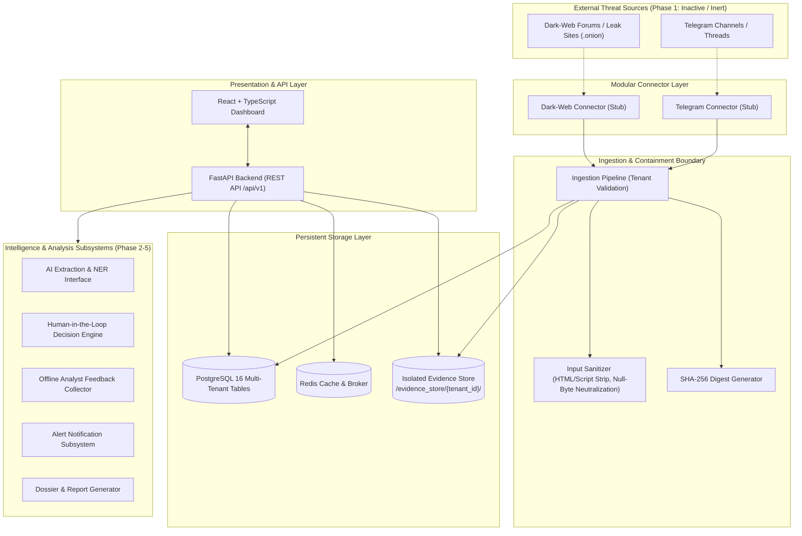

# TTI (Telegram Threat Intelligence) — System Architecture

## 1. Executive Summary

**TTI (Telegram Threat Intelligence)** is a modular, multi-tenant cyber threat intelligence platform engineered to ingest, sanitize, analyze, and prioritize thread data from external platforms (specifically Telegram public/restricted intelligence channels and dark-web onion forum/paste sources).

The system is designed with strict domain boundaries, defensible multi-tenancy, untrusted input containment, and immutable evidence integrity.

---

## 2. High-Level System Architecture

---

## 3. Modular Architecture Breakdown

### 3.1 Backend Service (`backend/app/`)
- **`api/`**: Asynchronous FastAPI endpoints partitioned by version (`/api/v1`). Includes dependencies (`deps.py`) enforcing request-level tenant extraction.
- **`core/`**: Application configuration using `pydantic-settings`, structured JSON logging with tenant context propagation, security baseline, and custom domain exceptions.
- **`connectors/`**: Sandboxed data collectors adhering to `BaseConnector`. Each source (Telegram, DarkWeb) maintains independent contracts, data transfer models, and safe inert stubs.
- **`ingestion/`**: Untrusted payload parsing, Unicode NFC normalization, null-byte stripping, script tag neutralization, and SHA-256 fingerprinting.
- **`evidence/`**: Segregated physical storage abstraction ensuring raw intelligence artifacts are never served through public web routes.
- **`database/`**: SQLAlchemy 2.0 async engine and declarative models incorporating `TenantAwareModel` for universal `tenant_id` partitioning.
- **`observability/`**: Health status diagnostic probes evaluating database, cache, and filesystem integrity with graceful degradation.
- **`ai/`, `decision/`, `learning/`, `alerts/`, `reports/`**: Clear contract interfaces defining future phases with strict human-in-the-loop governance.

### 3.2 Frontend Service (`frontend/`)
- Built with Vite, React 18, and TypeScript.
- Provides a high-contrast Cyber-Intelligence operational dashboard.
- Displays real-time API connectivity, subsystem health states, connector statuses, and architectural baseline adherence.

---

## 4. Multi-Tenant Isolation Strategy

Tenant isolation is an **architectural invariant**:

1. **Database Level**:
   - Every entity representing collected intelligence (`CollectedThread`, `RawArtifact`, `AuditEvent`) inherits from `TenantAwareModel`.
   - `tenant_id` is indexed and marked `nullable=False`.
   - Direct queries omitting `tenant_id` filtering are prohibited.
2. **Evidence Storage Level**:
   - Physical evidence directories are partitioned by tenant UUID:
     `{storage_root}/{tenant_id}/{artifact_id}_{sha256_short}.raw`
   - Strict path traversal guards prevent access outside the specific tenant boundary.
3. **API Level**:
   - All inbound requests must resolve a valid `TenantContext` via the `X-Tenant-ID` header.
   - Malformed tenant headers are rejected with HTTP 400.

---

## 5. Phased Roadmap

- **Phase 1 (Current)**: Foundation initialization, working FastAPI health probe, React dashboard, PostgreSQL & Redis configs, Alembic migrations, modular connector interfaces (inert mode), input sanitizer, evidence store abstraction, basic tests, and Git governance.
- **Phase 2**: Production-ready authentication (JWT), RBAC backend enforcement, tenant provisioning workflows, and controlled connector sandboxing.
- **Phase 3**: Active connector development under compliance policies (Telegram MTProto/TDLib client, Tor SOCKS5 proxy rotation, rate-limiting backoff).
- **Phase 4**: Threat extraction pipeline (IOC extraction, thread classification, entity recognition) with human-in-the-loop analyst workbench.
- **Phase 5**: Intelligence report generation, automated alert dispatch, and offline analyst feedback fine-tuning loop.
