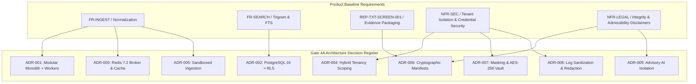

# TTI Gate 4A — Architecture Decision Register (ADR)

**Document Identifier:** `TTI-ARCH-GATE4A-ADR`  
**Status:** DRAFT / PROPOSED ARCHITECTURE  
**Target Milestone:** Gate 4A (System Context & Subsystem Decomposition)  
**Parent Blueprint:** [system_context.md](file:///d:/TTI/docs/architecture/gate_4a/system_context.md) | [subsystem_decomposition.md](file:///d:/TTI/docs/architecture/gate_4a/subsystem_decomposition.md) | [trust_boundaries_and_data_flows.md](file:///d:/TTI/docs/architecture/gate_4a/trust_boundaries_and_data_flows.md)  
**Author:** Principal Software Architect & Security Architect (VFRA TTI Platform)  
**Date:** October 2026  

---

## 1. Register Overview & Governance

This Architecture Decision Register (ADR) records the foundational architectural decisions governing the Telegram Threat Intelligence (TTI) platform for Release 1 MVP and future releases. 

### Governance & Approval Distinction
- **Engineering Recommendations & Architectural Proposals:** Unless backed by an explicit stakeholder confirmation in the canonical Product Baseline (such as requirement `REP-TXT-SCREEN-001` in `ADR-006`), all technical architectures, frameworks, databases, and deployment topologies (e.g., FastAPI, Celery, Redis, PostgreSQL 16, pg_trgm, MinIO/S3, and the Modular Monolith style) are **Engineering Recommendations**. They represent proposed designs subject to implementation validation and empirical testing, not finalized stakeholder approvals.
- **Provisional Status:** Storage immutability, retention purging, and credential policies that intersect open stakeholder decisions (`DEC-06`, `DEC-08`) are marked **Provisional** pending formal legal and executive resolution.

Each record captures:
- **Status:** Proposed Architectural Recommendation, Provisional, Accepted, or Superseded.
- **Context & Problem Statement:** Forces, constraints, and business/technical drivers.
- **Decision:** The concrete architectural choice proposed.
- **Alternatives Considered:** Evaluated options and reasons for rejection.
- **Consequences:** Positive benefits, trade-offs, and negative consequences.
- **Traceability:** Links to Product Baseline requirements ([FR](file:///d:/TTI/docs/product/product_baseline/functional_requirements.md), [NFR](file:///d:/TTI/docs/product/product_baseline/non_functional_requirements.md)), Stakeholder Decisions ([DEC](file:///d:/TTI/docs/product/product_baseline/decision_and_traceability_matrix.md)), and Open Questions.

---

## 2. Summary Index of Decisions

| ADR ID | Decision Title | Status | Primary Driver / Target |
| :--- | :--- | :--- | :--- |
| **ADR-001** | Deployment Topology: Modular Monolith with Asynchronous Worker Pools | **PROPOSED RECOMMENDATION** | Cost efficiency, team velocity, and clear failure domains |
| **ADR-002** | Data Persistence & Search Topology: PostgreSQL 16 + RLS + Trigram Search | **PROPOSED RECOMMENDATION** | Strict tenant isolation, ACID case data, low operational overhead |
| **ADR-003** | Ingestion Message Broker & Cache: Redis 7.2 with Celery Task Queues | **PROPOSED RECOMMENDATION** | Low-latency queueing, rate-limit backoff coordination, tenant caching |
| **ADR-004** | Multi-Tenancy Scoping: Shared Threat Store + Isolated Case Schemas with RLS | **PROPOSED RECOMMENDATION** | Global threat intelligence sharing without cross-tenant case leakage |
| **ADR-005** | Connector Sandboxing: Decoupled Base Interface with Egress-Only Workers | **PROPOSED RECOMMENDATION** | Operational security, leak prevention, and connector testability |
| **ADR-006** | Cryptographic Evidence Integrity: SHA-256 Package Manifests (REP-TXT-SCREEN-001) | **PROPOSED RECOMMENDATION (REP APPROVED)** | Tamper detection across transit; storage immutability provisional |
| **ADR-007** | Sensitive Data Protection: Heuristic Masking & AES-256 Field Encryption | **PROPOSED RECOMMENDATION** | Rejection of plaintext storage; raw evidence vs derived data separation |
| **ADR-008** | Observability & Telemetry Sanitization: Query Hashing & PII Redaction | **PROPOSED RECOMMENDATION** | Zero search-target leakage into operational log aggregators |
| **ADR-009** | AI Integration Boundary: Offline Advisory Subsystem with Human-in-the-Loop | **PROPOSED RECOMMENDATION** | Core pipeline determinism, provenance integrity, and hallucination containment |

---

## 3. Architectural Decision Records

### ADR-001: Deployment Topology — Modular Monolith with Asynchronous Worker Pools

* **Status:** PROPOSED ARCHITECTURAL RECOMMENDATION (Awaiting Implementation Validation)  
* **Context:**  
  The TTI platform must handle interactive search and case management queries from LEA and enterprise SOC analysts while concurrently processing background Telegram stream ingestion, rate-limit backoff delays, and headless browser screenshot rendering. The engineering team is in early-stage development, and operational infrastructure complexity must be minimized without sacrificing horizontal scaling of high-cost compute workloads.
* **Decision:**  
  Recommend a **Modular Monolith** architecture implemented in Python (FastAPI/ASGI) coupled with **Asynchronous Worker Pools** (Celery over Redis). The core application runs as a unified service with strictly isolated internal module namespaces (`core/auth`, `search/`, `cases/`, `reports/`, `ingestion/`). Asynchronous workloads (polling, normalization, Playwright screenshot capture) run in dedicated worker pools deployed on separate compute instances. This topology is an engineering recommendation, pending validation during implementation and testing.
* **Alternatives Considered:**
  1. *Microservices Mesh (Rejected):* Decomposing the system into 8+ independent microservices from Day 1 introduces distributed transaction overhead, network latency, complex CI/CD pipelines, and severe operational overhead unjustified for Release 1 scale.
  2. *Single-Process Monolith without Asynchronous Workers (Rejected):* Running Playwright browser rendering and Telegram MTProto polling inside the ASGI web process blocks the event loop and leads to severe latency spikes and worker starvation.
* **Consequences:**  
  *Positive:* Unified codebase, rapid local developer setup, direct in-memory calls between modules without network serialization, independent auto-scaling of rendering and ingestion worker pools.  
  *Negative / Trade-offs:* Requires rigorous code-review discipline to maintain module boundaries and prevent spaghetti imports; shared database migrations require coordinated deployments.  
* **Traceability:** [FR-INGEST-001](file:///d:/TTI/docs/product/product_baseline/functional_requirements.md#fr-ingest-001), [NFR-PERF-001](file:///d:/TTI/docs/product/product_baseline/non_functional_requirements.md#nfr-perf-001), [NFR-MAINT-001](file:///d:/TTI/docs/product/product_baseline/non_functional_requirements.md#nfr-maint-001).

---

### ADR-002: Data Persistence & Search Topology — PostgreSQL 16 with RLS and pg_trgm Search

* **Status:** PROPOSED ARCHITECTURAL RECOMMENDATION (Awaiting Implementation Validation)  
* **Context:**  
  Investigative case data requires strict ACID guarantees and enforceable multi-tenant isolation. Concurrently, analysts require fast sub-second search across Telegram message bodies, channels, and usernames. A full distributed search cluster (e.g., Elasticsearch or OpenSearch) introduces high RAM baselines (minimum 8-16 GB dedicated memory) and complex cluster administration.
* **Decision:**  
  For Release 1 MVP, recommend **PostgreSQL 16** as the unified persistence engine:
  - Utilize **Row-Level Security (RLS)** for strict tenant isolation across case workspaces and notes.
  - Utilize **`pg_trgm` (trigram) and GIN indexes** on message bodies and usernames for fast substring and full-text search.
  - Abstract search queries behind a decoupled `SearchRepository` interface so that an OpenSearch cluster can be introduced in Release 2 if corpus size exceeds 10 million messages.
  This persistence and search topology is an engineering recommendation, pending empirical load testing and validation during development.
* **Alternatives Considered:**
  1. *Dual Database Setup (PostgreSQL + OpenSearch Cluster) in Release 1 (Deferred):* While OpenSearch offers superior relevance ranking and typo tolerance, running and managing a 3-node cluster in MVP inflates hosting costs and introduces data synchronization / dual-write lag.
  2. *Document Database (MongoDB) (Rejected):* Lacks robust native relational integrity for complex case-evidence relationships and lacks native SQL Row-Level Security.
* **Consequences:**  
  *Positive:* Single database technology to deploy, backup, and monitor; atomic transactions across cases and evidence; low memory footprint (<2 GB); robust RLS support.  
  *Negative / Trade-offs:* Trigram index updates on high-velocity ingestion streams consume noticeable write I/O; complex NLP scoring or semantic search is deferred.  
* **Traceability:** [FR-SEARCH-001](file:///d:/TTI/docs/product/product_baseline/functional_requirements.md#fr-search-001), [NFR-SEC-001](file:///d:/TTI/docs/product/product_baseline/non_functional_requirements.md#nfr-sec-001), [NFR-SCALE-001](file:///d:/TTI/docs/product/product_baseline/non_functional_requirements.md#nfr-scale-001).

---

### ADR-003: Ingestion Message Broker & Cache — Redis 7.2 with Celery

* **Status:** PROPOSED ARCHITECTURAL RECOMMENDATION (Awaiting Implementation Validation)  
* **Context:**  
  The platform requires an asynchronous task broker to coordinate channel polling schedules, message normalization, headless screenshot generation, and circuit breaker rate-limit delays. It also requires distributed caching for tenant sessions and thread reconstruction queries.
* **Decision:**  
  Recommend deploying **Redis 7.2** (with AOF persistence enabled) as both the primary Celery task queue broker and the application cache. Mandate strict namespace segregation: task queues use dedicated Redis logical databases (`db=0`), while application caching uses (`db=1`) with mandatory tenant-prefixed keys (`tenant:{tenant_id}:{subsystem}:{key}`). This broker and caching setup represents an engineering recommendation pending operational validation.
* **Alternatives Considered:**
  1. *Apache Kafka (Rejected):* Unjustified architectural complexity and operational burden for Release 1 workloads (<500 messages/sec).
  2. *RabbitMQ (Rejected):* Excellent message broker, but lacks native caching and key-value store capabilities, necessitating an additional Redis instance and increasing infrastructure sprawl.
* **Consequences:**  
  *Positive:* Minimal infrastructure footprint; fast in-memory execution; native support for distributed locking, rate limiting, and delayed task execution.  
  *Negative / Trade-offs:* In-memory storage requires careful memory monitoring and eviction policy configuration to prevent task queue starvation; AOF disk sync adds slight I/O overhead.  
* **Traceability:** [FR-INGEST-001](file:///d:/TTI/docs/product/product_baseline/functional_requirements.md#fr-ingest-001), [NFR-REL-001](file:///d:/TTI/docs/product/product_baseline/non_functional_requirements.md#nfr-rel-001).

---

### ADR-004: Multi-Tenancy Scoping — Shared Threat Store + Isolated Case Workspaces with RLS

* **Status:** PROPOSED ARCHITECTURAL RECOMMENDATION (Aligned with DEC-05 Option B)  
* **Context:**  
  TTI serves multiple distinct customer organizations (competing LEA divisions and corporate SOCs). Public/semi-public Telegram threat intelligence should be collected once and shared across tenants to minimize upstream scraping footprint and API costs. However, private case files, search histories, tagged suspects, and evidence packages must remain strictly confidential and completely invisible across tenants.
* **Decision:**  
  Implement a **Hybrid Multi-Tenancy Model**:
  - **Shared Global Threat Schema (`threat`):** Contains normalized channels, messages, thread hierarchies, sequence discontinuities, and public threat media. Read-only for tenant investigators.
  - **Tenant-Isolated Workspace Tables (`cases`, `case_items`, `tags`, `reports`):** Reside in the application schema with mandatory `tenant_id` foreign keys and PostgreSQL Row-Level Security (RLS) policies.
  - Application middleware enforces session-level tenant context (`SET LOCAL app.current_tenant_id = :tenant_id`). Direct queries lacking tenant context fail closed with `HTTP 403`.
  - Cache keys enforce tenant prefixing. Raw media existence queries return `HTTP 404` unless linked to an authorized case.
* **Alternatives Considered:**
  1. *Separate Database per Tenant (Rejected for MVP):* Maximum isolation, but makes cross-tenant threat intelligence sharing impossible without complex cross-database replication pipelines.
  2. *Single Schema without RLS (Application-Only Filtering) (Rejected):* High risk of accidental developer error where a missing `WHERE tenant_id = ?` clause causes catastrophic cross-tenant data leakage.
* **Consequences:**  
  *Positive:* Optimal storage efficiency; single-collection threat pipeline; database-level defense-in-depth against data leakage via RLS.  
  *Negative / Trade-offs:* Requires database connection pooling configurations that properly reset local session variables between requests (`DISCARD ALL` or explicit context setting).  
* **Traceability:** [NFR-SEC-001](file:///d:/TTI/docs/product/product_baseline/non_functional_requirements.md#nfr-sec-001), [DEC-05](file:///d:/TTI/docs/product/product_baseline/decision_and_traceability_matrix.md#dec-05).

---

### ADR-005: Connector Sandboxing — Decoupled Base Interface with Egress-Only Workers

* **Status:** PROPOSED ARCHITECTURAL RECOMMENDATION (Awaiting Implementation Validation)  
* **Context:**  
  The ingestion layer connects to external, untrusted Telegram MTProto and Bot API endpoints. Ingestion worker code must be isolated from internal database credentials and web-tier sessions, and connector logic must be testable without live network connections.
* **Decision:**  
  - Define an abstract `BaseConnector` Python interface with mockable fixtures (`InertTestConnector`).
  - Deploy ingestion workers in an **egress-only network zone**. Workers initiate outbound TLS connections to Telegram IP blocks but expose zero inbound listening ports.
  - Ingestion workers do NOT connect directly to the primary PostgreSQL database; they write raw payloads solely to the Redis ingestion queue, from which normalization workers dequeue, validate, and persist data.
* **Alternatives Considered:**
  1. *Direct Ingestion Worker-to-Database Persistence (Rejected):* Exposing primary database credentials to workers directly communicating with untrusted Telegram endpoints increases blast radius if a dependency or parser vulnerability is exploited.
* **Consequences:**  
  *Positive:* Strong defense-in-depth; workers can be isolated or restarted without touching database connections; unit and integration testing can execute entirely offline using simulated JSON fixtures.  
  *Negative / Trade-offs:* Adds one queue hop (Redis) before data reaches PostgreSQL.  
* **Traceability:** [FR-INGEST-001](file:///d:/TTI/docs/product/product_baseline/functional_requirements.md#fr-ingest-001), [NFR-SEC-002](file:///d:/TTI/docs/product/product_baseline/non_functional_requirements.md#nfr-sec-002).

---

### ADR-006: Cryptographic Evidence Integrity — SHA-256 Package Manifests (REP-TXT-SCREEN-001)

* **Status:** PROPOSED ARCHITECTURAL RECOMMENDATION (Deliverable Structure Approved by VFRA; Storage Immutability Provisional)  
* **Context:**  
  Investigative reports must be exportable for courtroom and internal corporate presentations. Stakeholders formally approved [REP-TXT-SCREEN-001](file:///d:/TTI/docs/product/product_baseline/functional_requirements.md#rep-txt-screen-001), requiring a plain UTF-8 TXT report accompanied by individual-message screenshots and thread-context screenshots under a shared reference with an authoritative integrity manifest. However, the operational capture trigger modality (manual vs automated vs hybrid), storage retention schedules, and formal courtroom admissibility standards remain explicitly pending stakeholder decisions.
* **Decision:**  
  - **Approved Reporting Deliverable Scope:** Package each approved report as a sealed ZIP archive containing `report.txt`, screenshot images (`msg_{id}_focus.png`, `msg_{id}_thread_context.png`), and an authoritative `manifest.json`.
  - The `manifest.json` catalogs canonical SHA-256 hashes of every individual file, generation timestamp (UTC), platform commit hash, and signing metadata.
  - The packaging engine explicitly embeds an evidence disclaimer in both `report.txt` and `manifest.json`:
    > *"Cryptographic SHA-256 hashes detect subsequent alteration of exported files. They do not independently verify upstream message authenticity, origin truthfulness, or legal admissibility."*
  - Release 2 adds an optional pluggable RFC 3161 Time-Stamp Authority (TSA) signing provider.
  - **Storage Immutability & Retention Reconciliation (Provisional):**
    - The proposal for WORM (Write Once, Read Many) or S3 Object Lock storage is explicitly **PROVISIONAL PENDING RESOLUTION OF DEC-08 AND RELEVANT LEGAL REVIEW**.
    - *Unresolved Design Trade-Off:* The platform must balance technical tamper resistance and courtroom evidence integrity against authorized retention expiry schedules, data protection / right to erasure requests, court-ordered expungements, and the emergency removal of unlawfully collected material (e.g., non-consensual imagery or CSAM).
    - *Policy Prerequisite:* Neither Governance Mode, application-level immutability, nor an administrative override workflow is declared approved by default. Selection of the final storage immutability mechanism requires a formally authorized retention policy (`DEC-08`), legal counsel review, and audited dual-control access governance. Legal review is identified as a necessary dependency without claiming that any particular law automatically mandates a specific technical solution.
* **Alternatives Considered:**
  1. *PDF-Only Export (Rejected):* Fails compliance with approved stakeholder requirement [REP-TXT-SCREEN-001](file:///d:/TTI/docs/product/product_baseline/functional_requirements.md#rep-txt-screen-001); PDF binaries are prone to parsing discrepancies and hidden tampering.
  2. *Claiming Cryptographic Legal Admissibility (Rejected):* Legally false and technically inaccurate; downstream courtroom admissibility requires chain-of-custody verification beyond hash verification.
  3. *Unconditional Hardware Compliance WORM Mode (Rejected):* Directly impairs compliance with court-ordered expungements and data protection laws; rejected pending legal review.
* **Consequences:**  
  *Positive:* Full compliance with VFRA approval; lightweight, human-readable text output; deterministic verification; robust tamper detection across transit.  
  *Negative / Trade-offs:* Generating multiple PNG screenshots via headless Playwright consumes 2-4 seconds per message, requiring asynchronous worker orchestration; storage retention mechanics remain provisional until policy sign-off.  
* **Traceability:** [REP-TXT-SCREEN-001](file:///d:/TTI/docs/product/product_baseline/functional_requirements.md#rep-txt-screen-001), [FR-EXPORT-001](file:///d:/TTI/docs/product/product_baseline/functional_requirements.md#fr-export-001), [NFR-LEGAL-001](file:///d:/TTI/docs/product/product_baseline/non_functional_requirements.md#nfr-legal-001), [DEC-07](file:///d:/TTI/docs/product/product_baseline/decision_and_traceability_matrix.md#dec-07), [DEC-08](file:///d:/TTI/docs/product/product_baseline/decision_and_traceability_matrix.md#dec-08).

---

### ADR-007: Sensitive Data Protection — Heuristic Masking & Tiered Data Separation

* **Status:** PROPOSED ARCHITECTURAL RECOMMENDATION (Rejection of Plaintext Confirmed; Masking Proposed)  
* **Context:**  
  Threat intelligence channels frequently circulate compromised credentials, dumps, API keys, and personal identifying information (PII). Plaintext storage of compromised passwords creates a severe corporate liability and internal threat vector. Concurrently, forensic integrity requires that original collected evidence must never be silently mutated or corrupted.
* **Decision:**  
  - **Permanent Plaintext Password Storage Rejection:** The platform permanently rejects storing unmasked credentials in user-facing tables, caches, or logs (`DEC-06 Option A` rejected).
  - **Separation of Original Evidence from Derived Data:**
    1. *Original Evidence Tier:* Raw message payloads and attachments are collected and retained only where authorized, necessary, and proportionate to the approved investigative purpose. When stored, original evidence is retained verbatim without destructive text masking and cryptographically hashed upon ingestion (`FR-EVI-002`). Transformations must never silently overwrite or mutate original evidence. Sensitive raw credential dumps are encrypted at rest using tenant-specific AES-256-GCM keys.
    2. *Derived Searchable & Display Tier:* The normalization engine applies heuristic regex rules to detect credentials and generates masked representations (`P@ssw****`) used strictly for search indexing (`pg_trgm`, FTS) and default user-interface presentation views. Unmasking raw strings requires explicit `CREDENTIAL_UNMASK` RBAC permissions, high-privilege credentials, and creates a high-severity immutable audit event.
    3. *Operational Telemetry Tier:* System and worker logs must avoid raw secrets and unnecessary sensitive case data, adhering strictly to sanitization rules in `ADR-008`.
* **Alternatives Considered:**
  1. *Storing Ingested Chat Bodies Unfiltered (Rejected):* Violates security best practices and exposes platform databases to regulatory non-compliance.
  2. *Permanent Destructive Scrubbing of Original Payloads (Rejected):* Destroys potential court-ordered forensic evidence needed by LEA partners. Masking derived representations while encrypting raw evidence balances security and forensic fidelity.
* **Consequences:**  
  *Positive:* Zero exposure of cleartext passwords in default UI views, search indexes, or system logs; verifiable provenance and forensic integrity preserved; cryptographically compliant storage.  
  *Negative / Trade-offs:* Regex heuristic processing adds minimal CPU latency (~1-2 ms per message) during ingestion normalization; managing field encryption keys requires KMS integration.  
* **Traceability:** [FR-SEC-001](file:///d:/TTI/docs/product/product_baseline/functional_requirements.md#fr-sec-001), [NFR-SEC-002](file:///d:/TTI/docs/product/product_baseline/non_functional_requirements.md#nfr-sec-002), [DEC-06](file:///d:/TTI/docs/product/product_baseline/decision_and_traceability_matrix.md#dec-06).

---

### ADR-008: Observability & Telemetry Sanitization — Query Hashing & PII Redaction

* **Status:** PROPOSED ARCHITECTURAL RECOMMENDATION (Awaiting Implementation Validation)  
* **Context:**  
  Law-enforcement and corporate SOC investigators frequently search for highly sensitive targets (undercover identifiers, confidential suspects, executive names, phone numbers). Standard logging libraries record full HTTP request URIs and query parameters into centralized log sinks (Datadog, CloudWatch, ELK), risking catastrophic leaks of active operational investigations.
* **Decision:**  
  - Implement a mandatory **Sanitizing Log Middleware**:
    - Query strings containing search targets are stripped of raw values; the system logs only parameter keys and an HMAC/SHA-256 hash of the query value (`query_hash = sha256(val)`).
    - Case titles, private investigator notes, and message bodies are excluded from application log streams.
    - Application logs emit strictly in structured JSON format with validated tenant context.
* **Alternatives Considered:**
  1. *Standard Framework Logging (Rejected):* Emits full query strings and URL parameters into standard out, causing immediate leak of confidential investigative targets.
  2. *Disabling Search Logging Entirely (Rejected):* Prevents operational debugging, performance analysis, and mandatory compliance auditing.
* **Consequences:**  
  *Positive:* Zero risk of leaking sensitive investigative targets into third-party APM or logging infrastructure; enables full performance monitoring without privacy violations.  
  *Negative / Trade-offs:* Developers cannot see exact search terms in debug logs and must rely on investigator-assisted reproduction via query hashes.  
* **Traceability:** [NFR-SEC-001](file:///d:/TTI/docs/product/product_baseline/non_functional_requirements.md#nfr-sec-001), [NFR-AUDIT-001](file:///d:/TTI/docs/product/product_baseline/non_functional_requirements.md#nfr-audit-001).

---

### ADR-009: AI Integration Boundary — Offline Advisory Subsystem with Human-in-the-Loop

* **Status:** PROPOSED ARCHITECTURAL RECOMMENDATION (Advisory Subsystem Boundary)  
* **Context:**  
  While Large Language Models (LLMs) can assist analysts with message summarization, language translation, and entity extraction, generative models are prone to hallucinations, non-deterministic outputs, and latency. The core TTI threat intelligence pipeline must remain 100% deterministic, auditable, and court-admissible.
* **Decision:**  
  - **Strict Architectural Separation:** The AI subsystem is isolated as an optional, asynchronous advisory component. The core ingestion, normalization, thread reconstruction, and evidence packaging pipelines have zero runtime dependency on AI models.
  - **Human-in-the-Loop Requirement:** AI-generated summaries, translations, or tag suggestions are explicitly flagged with `is_ai_generated=True` and cannot be added to an official evidence report without explicit investigator review and approval.
  - **Zero Data Retraining:** External LLM calls (if used) strictly enforce zero-retention enterprise agreements; sensitive investigator queries or case notes are never forwarded to public LLM endpoints.
* **Alternatives Considered:**
  1. *Real-Time AI Processing in Core Ingestion Pipeline (Rejected):* Introduces severe latency bottlenecks (hundreds of milliseconds per message), high API costs, and non-deterministic failure modes into the collection pipeline.
  2. *Autonomous AI Report Finalization (Rejected):* Fails evidentiary standards and risks introducing hallucinated facts into legal proceedings.
* **Consequences:**  
  *Positive:* Ingestion pipeline remains fast, deterministic, and highly resilient; AI capabilities can be toggled on/off per tenant without affecting core platform functionality.  
  *Negative / Trade-offs:* Advanced semantic search and entity extraction remain post-processing features rather than real-time stream filters.  
* **Traceability:** [FR-AI-001](file:///d:/TTI/docs/product/product_baseline/functional_requirements.md#fr-ai-001), [NFR-LEGAL-001](file:///d:/TTI/docs/product/product_baseline/non_functional_requirements.md#nfr-legal-001).

---

## 4. Alignment & Review Traceability

All nine architectural decisions documented in this register have been evaluated against the Product Baseline and Gate 3B deliverables:

*Next Architecture Step:* [gate_4a_review_report.md](file:///d:/TTI/docs/architecture/gate_4a/gate_4a_review_report.md)
