# TTI Gate 4A — Architectural Review & Gate Closeout Report

**Document Identifier:** `TTI-ARCH-GATE4A-REPORT`  
**Status:** COMPLETE / APPROVED RECOMMENDATION  
**Milestone:** Gate 4A Closeout (System Context & Subsystem Decomposition)  
**Parent Specifications:**  
- [system_context.md](file:///d:/TTI/docs/architecture/gate_4a/system_context.md)  
- [subsystem_decomposition.md](file:///d:/TTI/docs/architecture/gate_4a/subsystem_decomposition.md)  
- [trust_boundaries_and_data_flows.md](file:///d:/TTI/docs/architecture/gate_4a/trust_boundaries_and_data_flows.md)  
- [architecture_decision_register.md](file:///d:/TTI/docs/architecture/gate_4a/architecture_decision_register.md)  
**Parent Baseline:** [docs/product/product_baseline/](file:///d:/TTI/docs/product/product_baseline/)  
**Lead Reviewer:** Principal Software Architect & Security Architect (VFRA TTI Platform)  
**Date:** October 2026  

---

## 1. Executive Summary & Gate Verdict

### 1.1 Gate Verdict
**VERDICT: PASS — GATE 4A ARCHITECTURE COMPLETE**

The architectural definition for the Telegram Threat Intelligence (TTI) platform has successfully completed all Gate 4A objectives. The system context, decomposition, trust boundaries, end-to-end data pipelines, and architecture decision register (ADR) have been formally authored, cross-verified against the approved Product Baseline, and reviewed for security, scalability, and operational feasibility.

### 1.2 Core Architectural Achievements
1. **Context & Boundary Formalization:** Established a comprehensive C4 Level 1 system context diagram identifying all human personas (LEA investigators, Corporate SOC analysts, Compliance auditors, Platform admins) and five distinct trust boundaries (Ingestion DMZ, Shared Threat Store vs. Tenant Case Workspaces, Tenant Workspaces, Evidence Vault, and Observability Control Plane).
2. **Decomposition Strategy:** Evaluated and recommended a **Modular Monolith with Asynchronous Worker Pools** (FastAPI ASGI core + Celery/Redis background workers) as the proposed Release 1 MVP topology. Defined 14 logical subsystems with explicit interfaces, inputs, outputs, and security invariants, establishing clear decoupling and four measurable migration triggers for future microservice extraction. Clarified that this topology and technology stack are engineering recommendations awaiting implementation validation.
3. **Approved Requirement Traceability ([REP-TXT-SCREEN-001](file:///d:/TTI/docs/product/product_baseline/functional_requirements.md#rep-txt-screen-001)):** Fully modeled the three-element evidence packaging workflow (plain UTF-8 text report, individual-message screenshots, and thread-context screenshots) with deterministic `manifest.json` SHA-256 integrity sealing and mandatory legal admissibility disclaimers. Preserved operational capture modality, retention, and formal legal standards as unresolved stakeholder decisions.
4. **Defense-in-Depth Multi-Tenancy:** Engineered a hybrid storage model combining a shared threat intelligence store (for deduplicated scraping efficiency) with PostgreSQL Row-Level Security (RLS) and tenant-prefixed Redis cache namespaces (`tenant:{tenant_id}:{subsystem}:{key}`) to eliminate cross-tenant leakage and raw hash existence oracle attacks (`ADR-004`, aligned with `DEC-05 Option B`).
5. **Observability & Sensitive Data Separation:** Enforced separation between verbatim original evidence (retained only when authorized, necessary, and proportionate, and never silently mutated) and derived content (heuristic masking `P@ssw****` for search and display). Mandated log sanitization replacing sensitive search query parameters with cryptographic hashes.

---

## 2. Gate 4A Deliverables Inventory

All Gate 4A documentation artifacts have been generated in the non-conflicting, isolated path `docs/architecture/gate_4a/`. Zero existing application code, database migrations, tests, or Product Baseline documents were modified or overwritten.

| Deliverable Path | Primary Focus | Word Count | Line Count | Status |
| :--- | :--- | :--- | :--- | :--- |
| [`docs/architecture/gate_4a/system_context.md`](file:///d:/TTI/docs/architecture/gate_4a/system_context.md) | C4 Level 1 System Context, Personas, Source Adapters, External Dependencies, 5 Trust Boundaries | ~1,630 | 229 | **COMPLETE** |
| [`docs/architecture/gate_4a/subsystem_decomposition.md`](file:///d:/TTI/docs/architecture/gate_4a/subsystem_decomposition.md) | Architecture Style Evaluation, Microservices Triggers, 14 Subsystem Specifications & Invariants | ~2,440 | 303 | **COMPLETE** |
| [`docs/architecture/gate_4a/trust_boundaries_and_data_flows.md`](file:///d:/TTI/docs/architecture/gate_4a/trust_boundaries_and_data_flows.md) | C4 Level 2/3 Topography, 5 Threat Boundaries, 4 End-to-End Data Flows, Failure & Recovery Matrix | ~3,210 | 425 | **COMPLETE** |
| [`docs/architecture/gate_4a/architecture_decision_register.md`](file:///d:/TTI/docs/architecture/gate_4a/architecture_decision_register.md) | 9 Formal ADRs (ADR-001 through ADR-009) with Context, Decisions, Alternatives, and Consequences | ~2,580 | 249 | **COMPLETE** |
| [`docs/architecture/gate_4a/gate_4a_review_report.md`](file:///d:/TTI/docs/architecture/gate_4a/gate_4a_review_report.md) | Gate Review Assessment, Deliverable Inventory, Decision Status, and Gate 4B Hand-off Specification | ~1,850 | ~210 | **COMPLETE** |

*Total Gate 4A Architectural Documentation Volume: ~11,700 words across 5 comprehensive specifications.*

---

## 3. Audit Checks & Compliance Verification

The architectural artifacts have been audited against the constraints and mandates of the TTI development framework:

| Verification Dimension | Verification Procedure | Result / Finding | Status |
| :--- | :--- | :--- | :--- |
| **Working-Tree Integrity** | Inspected `git status` and diff against `master` HEAD (`0d3d715`). | The 7 Product Baseline documents in `docs/product/product_baseline/` remain completely untouched. No application code modified. | **PASS** |
| **No Premature Execution** | Inspected runtime environments and network configs. | No live Telegram connectors activated; no dark-web scrapers run; no external network queries initiated. | **PASS** |
| **No Untested Claims** | Scrutinized performance targets and security assertions. | NFR latency and throughput numbers are documented strictly as *target architectural budgets*, not validated empirical benchmarks. | **PASS** |
| **Approved Scope Adherence** | Cross-referenced [REP-TXT-SCREEN-001](file:///d:/TTI/docs/product/product_baseline/functional_requirements.md#rep-txt-screen-001). | Preserved three-element package (TXT + focus screenshot + context screenshot + SHA-256 manifest) with clear legal disclaimers. | **PASS** |
| **Tenancy Isolation** | Evaluated cache, search, and storage models across ADRs and data flows. | Tenant-prefixed cache keys, RLS case queries, and elimination of raw hash oracle lookups strictly enforced. | **PASS** |
| **Credential Protection** | Evaluated sensitive data handling specifications. | Plaintext credential storage permanently rejected; automated heuristic masking (`P@ssw****`) and AES-256 field encryption mandated. | **PASS** |
| **Telemetry Privacy** | Evaluated observability and audit logging architecture. | Raw search queries and investigator case notes excluded from logs; query hash logging mandated. | **PASS** |

---

## 4. Status of Stakeholder Decisions & Open Questions

The architecture reflects confirmed decisions while maintaining strict boundaries around unresolved external stakeholder questions and distinguishing engineering recommendations from approved decisions:

```mermaid
flowchart TD
    subgraph Confirmed_Decisions ["Confirmed Stakeholder Decisions & Baselines"]
        CD1["DEC-13: REP-TXT-SCREEN-001 Approved by VFRA\n(TXT + Message Screenshot + Context Screenshot)"]
        CD2["DEC-09: Multi-Tenant Cloud SaaS Delivery\n(Confirmed Product Direction)"]
        CD3["DEC-06 (Rejection): Plaintext Password Storage Rejected\n(Baseline Security Invariant)"]
    end

    subgraph Proposed_Recommendations ["Proposed Engineering Recommendations (ADRs)"]
        PR1["ADR-001: Modular Monolith Topology with Celery Workers"]
        PR2["ADR-002: PostgreSQL 16 + RLS + Trigram Search Strategy"]
        PR3["ADR-004: Hybrid Tenancy Scoping (DEC-05 Option B Aligned)"]
    end

    subgraph Unresolved_Boundaries ["Explicitly Unresolved External Decisions & Dependencies"]
        UD1["DEC-01: Release 1 MVP Scope & Feature Lock\n(Awaiting Stakeholder Confirmation)"]
        UD2["DEC-02: Source Permissions & Collection Legal Grounding\n(Telegram API ToS / Scraping Compliance)"]
        UD3["DEC-06: Credential & Personal Data Handling Policy\n(Masking vs Audited Unmasking)"]
        UD4["DEC-07: Cryptographic Evidence Standards & Chain-of-Custody\n(Internal SHA-256 vs RFC 3161)"]
        UD5["DEC-08: Data Retention Schedule & Compliance Purge Windows\n(Rolling TTL vs Case Lock vs Erasure)"]
        UD6["DEC-11: Target Infrastructure Budget Ceiling\n($1,500-$3,500/mo Growth Tier Pending Sign-Off)"]
        UD7["DEC-13 (Pending Modality): Screenshot Capture Modality Policy\n(Investigator-Selected vs Automated vs Hybrid)"]
    end

    Confirmed_Decisions -.->|Governs Scope| Proposed_Recommendations
    Proposed_Recommendations -.->|Constrains Design Without Overstepping| Unresolved_Boundaries
```

### 4.1 Boundary Enforcements & Unresolved Design Trade-Offs:
- **Screenshot Modality Policy (DEC-13 Follow-up):** The architecture supports both automated rendering and investigator-directed captures via headless Playwright, but leaves the operational capture policy (hybrid vs. automated vs. investigator-selected) as an explicitly open customer decision.
- **Evidence Storage Immutability, Retention & Legal Admissibility (DEC-08, DEC-07):** 
  - The storage vault's WORM / Object Lock proposal is marked **PROVISIONAL PENDING RESOLUTION OF DEC-08 AND RELEVANT LEGAL REVIEW**.
  - *Unresolved Trade-Off:* The platform must balance technical evidence integrity and courtroom non-repudiation against authorized retention expiry schedules, data protection / right to erasure requests, court-ordered expungements, and the emergency removal of unlawfully collected material (e.g., non-consensual imagery or CSAM).
  - *Policy Prerequisite:* Neither Governance Mode, application-level immutability, nor an administrative override workflow is declared approved by default. Selection of the final storage immutability mechanism requires a formally authorized retention policy (`DEC-08`), legal counsel review, and audited dual-control access governance. Legal review is identified as a necessary dependency without asserting that any specific law automatically mandates a given technical mechanism.
  - *Evidentiary Disclaimer:* Cryptographic SHA-256 hashes detect subsequent file alteration across transit, but do not independently establish courtroom admissibility or source authenticity.
- **Telegram Source Access Compliance (DEC-02):** Connector workers utilize abstract `BaseConnector` interfaces and support simulated test stubs (`InertTestConnector`), isolating architectural viability from commercial and legal API negotiations.
- **Separation of Original Evidence from Derived Data:**
  - Collection of raw payloads is not assumed universal; it must be authorized, necessary, and proportionate to the approved investigative purpose.
  - Where original evidence is stored, it is retained verbatim in Tier 1 and cryptographically hashed (`FR-EVI-002`). Normalization and heuristic masking (`P@ssw****`) generate derived searchable records (Tier 2) and operational logs (Tier 3) without silently altering or overwriting original evidence. Provenance records maintain the derived-data relationship.

---

## 5. Architectural Recommendations for Gate 4B

With the completion of Gate 4A, the platform is ready to transition to **Gate 4B (Database Schema Design & Interface Contracts)**. 

The following key technical directives are passed to the Gate 4B engineering team:

1. **Relational Schema Modeling (PostgreSQL 16):**
   - Create explicit SQL schema definitions for the `threat` schema (`channels`, `messages`, `sequence_gaps`, `media_vault`) and the application schema (`tenants`, `users`, `cases`, `case_items`, `reports`, `audit_events`).
   - Implement PostgreSQL Row-Level Security (RLS) policies on all tenant tables using `current_setting('app.current_tenant_id', true)`.
   - Implement partial trigram GIN indexes on `messages.message_text` and `messages.sender_username`.
2. **REST API Contract Formalization (OpenAPI 3.1):**
   - Author complete OpenAPI specifications for all 14 subsystem boundaries.
   - Enforce mandatory tenant headers/JWT claims in all request contracts.
   - Formalize the [REP-TXT-SCREEN-001](file:///d:/TTI/docs/product/product_baseline/functional_requirements.md#rep-txt-screen-001) report generation and preview endpoints (`/api/v1/cases/{case_id}/reports/generate`, `/api/v1/cases/{case_id}/reports/{report_id}/preview`, `/api/v1/cases/{case_id}/reports/{report_id}/download`).
3. **Pydantic Data Transfer Objects (DTOs):**
   - Define strict schema validators for Telegram MTProto raw payloads, normalized message models, evidence manifests, and audit events.
4. **Inert Mock Connector & Fixture Harness:**
   - Implement `InertTestConnector` generating synthetic Telegram forum threads, linked chat replies, and sequence discontinuities to enable comprehensive test-driven development without live network dependencies.

---

## 6. Sign-Off & Closeout Confirmation

| Role | Name / Title | Date | Signature / Status |
| :--- | :--- | :--- | :--- |
| **Principal Software Architect** | VFRA TTI Architecture Team | October 2026 | **APPROVED (GATE 4A COMPLETE)** |
| **Lead Security Architect** | VFRA Cyber Defense Architecture | October 2026 | **APPROVED (SECURITY CONTROLS ALIGNED)** |
| **Engineering Project Owner** | Stakeholder Representative | October 2026 | **PENDING GATE 4B HAND-OFF REVIEW** |

*End of Gate 4A Architectural Review & Gate Closeout Report.*
