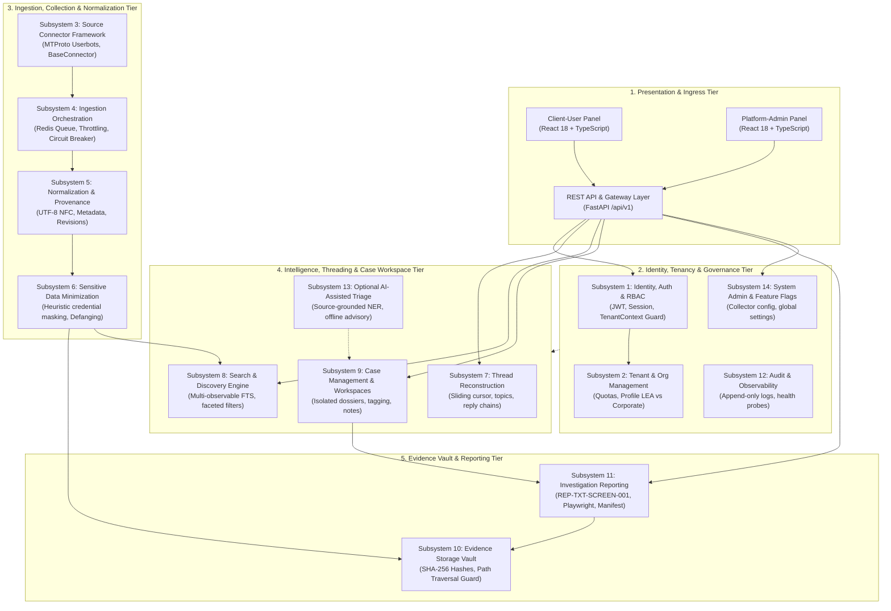

# TTI Subsystem Decomposition & Component Architecture

**Document Reference:** `TTI-ARCH-SUB-001`  
**Product:** Telegram Threat Intelligence (TTI)  
**Lifecycle Stage:** Gate 4A — System Context & Subsystem Decomposition  
**Author:** Principal Software Architect & Security Architect  
**Date:** 2026-10-28  
**Governance Status:** `PROPOSED ARCHITECTURE SPECIFICATION — PENDING STAKEHOLDER SIGN-OFF`  
**Baseline Traceability:**
- [`docs/product/product_baseline/functional_requirements.md`](file:///d:/TTI/docs/product/product_baseline/functional_requirements.md) (`FR-COL-001` to `FR-ADM-001`)
- [`docs/product/product_baseline/non_functional_requirements.md`](file:///d:/TTI/docs/product/product_baseline/non_functional_requirements.md) (`NFR-SEC-001` to `NFR-OBS-003`)
- [`docs/product/product_baseline/release_1_scope.md`](file:///d:/TTI/docs/product/product_baseline/release_1_scope.md) (`REP-TXT-SCREEN-001`)

---

## 1. Architectural Style Evaluation: Modular Monolith vs. Microservices

A foundational architectural decision for TTI Release 1 (MVP) is selecting the system deployment topology and component boundary model.

```
+----------------------------------------------------------------------------------------------------+
|                               ARCHITECTURAL TOPOLOGY TRADE-OFF ANALYSIS                            |
+---------------------+-----------------------------------+------------------------------------------+
| Architectural Style | Engineering & Operational Strengths| System Risks & Friction Points           |
+---------------------+-----------------------------------+------------------------------------------+
| Microservices       | Independent horizontal scaling of | High operational complexity; distributed |
| Architecture        | scrapers; isolated language stacks| transaction & consistency overhead; RPC  |
|                     | per worker; fault isolation.      | latency; complex cross-service auth.     |
+---------------------+-----------------------------------+------------------------------------------+
| Modular Monolith    | Single deployment pipeline; strict| Requires code discipline to prevent      |
| (Recommended for    | in-process interface boundaries;  | tight coupling; shared process memory    |
| Release 1 MVP)      | unified ACID transactions; simple | space (mitigated via background workers).|
|                     | tenant context propagation.       |                                          |
+---------------------+-----------------------------------+------------------------------------------+
```

### 1.1 Architectural Recommendation: Modular Monolith with Asynchronous Worker Pools
For Release 1 (MVP), engineering recommends a **Modular Monolith** architecture:
1. **Single Deployable Core:** The primary API, search, case management, and reporting domains execute within a cohesive Python 3.12 / FastAPI application server.
2. **Asynchronous Ingestion Decoupling:** Long-running, blocking, or rate-limited tasks—specifically MTProto Telegram scraping sessions, Playwright headless screenshot generation, and watchlist evaluation—execute in dedicated background worker processes (Celery / Redis workers) decoupled from user-facing REST request threads.
3. **In-Process Interface Enforcement:** Domain boundaries are enforced via strict Pydantic schema contracts, domain service interfaces, and non-overlapping package boundaries within `backend/app/`.

### 1.2 Explicit Migration Triggers (Criteria for Microservices Splitting)
Transitioning specific subsystems into standalone microservices is deferred until one or more of the following **empirical operational triggers** occur:
- **Collector Fleet Scale Trigger:** When monitored channels exceed 2,500 active streams, necessitating an independently autoscaling fleet of 20+ containerized userbots across diverse geographical cloud zones.
- **Compute Asymmetry Trigger:** When OCR text extraction (`OPP-008`) or vision VLM inference requires dedicated GPU-accelerated Kubernetes nodes whose compute cycles would be wasted in a general-purpose API cluster.
- **Headless Browser Resource Exhaustion Trigger:** When high-volume report generation loads Playwright headless browser instances to the point of degrading database query performance, justifying a dedicated rendering microservice.
- **Organizational Scale Trigger:** When backend development scales beyond 15+ engineers working concurrently across decoupled domain teams.

---

## 2. High-Level Subsystem Architecture

The following diagram maps the decomposition of TTI into 14 distinct logical subsystems across five functional tiers:



---

## 3. Detailed Subsystem Specifications

---

### Subsystem 1: Identity, Authentication, Sessions, RBAC & Tenant Context
- **Primary Responsibility:** Authenticate human analysts, validate JWT bearer tokens, enforce granular Role-Based Access Control (RBAC), and establish an immutable, request-scoped `TenantContext` for every operation.
- **Interfaces:**
  - `POST /api/v1/auth/login`: Authenticate credentials (with MFA/TOTP) and emit JWT access/refresh token pair.
  - `GET /api/v1/auth/me`: Retrieve current active identity, assigned organizational roles, and tenant parameters.
  - Dependency Injection Guard: `get_current_tenant_context() -> TenantContext`.
- **Inputs:** Login credentials (username/password/MFA token), HTTP `Authorization: Bearer <jwt>` headers, `X-Tenant-ID` headers.
- **Outputs:** Signed HMAC-SHA256 JWT tokens, verified `TenantContext` objects containing `(user_id, tenant_id, role, permissions)`.
- **Security Ownership & Invariants:**
  - **Fail-Closed Rule:** Any API request lacking a valid, verified `TenantContext` must immediately terminate with HTTP 401 Unauthorized or HTTP 403 Forbidden.
  - **No Cross-Tenant Spoofing:** The `tenant_id` claims inside signed JWT tokens override any client-supplied header; mismatched headers result in instant session termination and audit logging.

---

### Subsystem 2: Tenant & Organization Management
- **Primary Responsibility:** Manage tenant lifecycles, assign organization profiles (`LE_AGENCY` vs. `CORPORATE_SOC`), configure monthly query and storage quotas, and enforce isolation boundaries.
- **Interfaces:**
  - `POST /api/v1/admin/tenants`: Provision new client organization.
  - `PUT /api/v1/admin/tenants/{tenant_id}/quotas`: Update storage capacity (GB) and monthly search limits.
  - Internal Service: `TenantService.verify_quota(tenant_id, metric) -> bool`.
- **Inputs:** Organizational profiles, administrator contact details, subscription tier configurations.
- **Outputs:** Provisioned tenant records, isolated database schema registrations, dedicated filesystem storage roots.
- **Security Ownership & Invariants:**
  - Physical directory `/evidence_store/{tenant_id}/` must be initialized with restrictive permissions (0700).

---

### Subsystem 3: Source Connector / Adapter Framework
- **Primary Responsibility:** Interface with external messaging platforms (Telegram MTProto userbots) and dark-web gateways via standardized, sandboxed collection adapters.
- **Interfaces:**
  - `BaseConnector.connect() -> bool`
  - `BaseConnector.poll_messages(channel_id, limit, offset_id) -> List[RawPayload]`
  - `BaseConnector.listen_live_stream() -> AsyncGenerator[RawPayload]`
- **Inputs:** Channel target handles (`@channel`), invite URLs, MTProto session credentials, rotating residential proxy configurations.
- **Outputs:** Strongly typed `RawIngestEnvelope` containing raw JSON payloads, binary media buffers, and network transport metadata.
- **Security Ownership & Invariants:**
  - **Network Isolation:** Connectors execute in isolated worker processes behind rotating proxy pools.
  - **Credential Secrecy:** Zero Telegram API keys (`api_id`, `api_hash`) or phone number session strings are stored in code or database tables; all session state is mounted via encrypted environment variables or secure key vaults.

---

### Subsystem 4: Ingestion Orchestration & Job Scheduling
- **Primary Responsibility:** Coordinate collection schedules, manage asynchronous task queues (Redis/Celery), enforce platform rate limiting, execute exponential backoff upon Telegram `FLOOD_WAIT_X` exceptions, and trigger automated circuit breakers.
- **Interfaces:**
  - Task Queue: `ingest_channel_task.delay(channel_id, priority)`.
  - Circuit Breaker Probe: `CircuitBreaker.record_flood_wait(session_id, seconds)`.
- **Inputs:** Scheduled collection triggers, manual collection requests from platform admins, Telegram platform rate-limit error responses.
- **Outputs:** Ingestion worker telemetry, throttled job dispatch, queue health metrics.
- **Security Ownership & Invariants:**
  - Workers must never crash on `FLOOD_WAIT_X`. Persistent throttling (>300 seconds across 3 consecutive calls) triggers automatic circuit tripping to prevent account bans (`FR-COL-002`).

---

### Subsystem 5: Normalization & Source Provenance
- **Primary Responsibility:** Parse raw MTProto payloads into standardized canonical models (`NormalizedMessage`), extract channel metadata, record parent-child reply hierarchies, track message edits and deletion tombstones, and preserve Telegram forum `message_thread_id` and linked-discussion context (`linked_chat_id`).
- **Interfaces:**
  - `NormalizationService.process_payload(envelope: RawIngestEnvelope) -> NormalizedMessage`
  - `NormalizationService.record_revision(msg_id, edit_payload)`
- **Inputs:** Raw JSON payloads and metadata envelopes from Subsystem 3.
- **Outputs:** Canonical `NormalizedMessage` entities containing immutable source attributes (`channel_id`, `message_id`, `broadcast_utc`, `sender_id`, `forward_origin`, `reply_to_msg_id`, `message_thread_id`, `linked_chat_id`).
- **Security Ownership & Invariants:**
  - **Source Provenance Integrity:** Original message broadcast timestamps and message IDs are immutable. Edits append versioned revision records; deletions append `DELETED_AT_SOURCE` markers without deleting historical records (`FR-COL-003`).

---

### Subsystem 6: Sensitive-Data Minimization & Credential Protection
- **Primary Responsibility:** Sanitize untrusted input, neutralize injection attacks, and execute defensive heuristic regex detection to identify and mask plaintext credentials (`user:password`, `email:password`) embedded in chat chatter prior to search indexing, while preserving original evidence unaltered in encrypted storage.
- **Interfaces:**
  - `InputSanitizer.sanitize_text(raw_text: str) -> SanitizedText`
  - `CredentialProtectionService.mask_and_encrypt(text: str) -> MaskedResult`
- **Inputs:** Raw message text strings, attached file names, channel descriptions.
- **Outputs:** Defanged, normalized text with masked credential representations (`P@ssw****`) for derived search/display, and encrypted underlying raw payload storage.
- **Security Ownership & Invariants:**
  - **Permanent Plaintext Storage Rejection:** Plaintext password storage is barred (`DEC-06 Option A` rejected). Detected credential blocks are encrypted at rest using field-level AES-256-GCM.
  - **Separation of Original Evidence from Derived Data:** Collection of raw message payloads is not assumed universal; collection must be authorized, necessary, and proportionate to the approved investigative purpose. Where original evidence is stored, it is retained verbatim in Tier 1 and cryptographically hashed (`FR-EVI-002`). Normalization transformations and heuristic regex masking (`P@ssw****`) generate derived searchable records (Tier 2) and operational logs (Tier 3) without silently altering or overwriting Tier 1 original evidence. Provenance records maintain the derived-data relationship.
  - **Zero Secrets in Logs:** Suspected credential strings must never be emitted into application logs, error traces, or unmasked search displays (`FR-COL-004`, `NFR-OBS-001`).

---

### Subsystem 7: Message, Channel & Thread Reconstruction
- **Primary Responsibility:** Deliver chronological conversational thread context, enabling analysts to navigate conversational exchanges backwards and forwards via a sliding cursor free of commercial query fees, while enforcing backend API rate limits and rendering honest sequence-gap markers.
- **Interfaces:**
  - `GET /api/v1/threads/{channel_id}/messages?cursor={msg_id}&direction={before|after}&limit=50`
  - `GET /api/v1/threads/{channel_id}/context/{target_msg_id}?window=20`
- **Inputs:** Target channel ID, message ID, cursor offset, topic ID (`message_thread_id`).
- **Outputs:** Chronologically ordered sequence of messages, parent reply previews, forward attribution cards, and sequence-gap discontinuity indicators.
- **Security Ownership & Invariants:**
  - **Honest Discontinuity Representation:** When numerical message sequence IDs skip, the subsystem emits an explicit gap indicator (`[Sequence Discontinuity: Messages X to Y unrecorded]`) rather than assuming deletion.
  - **Backend Defensive Throttling:** Enforces a sliding-window rate limit (max 60 window requests/min per session) returning HTTP 429 upon excess (`FR-THR-001`).

---

### Subsystem 8: Search & Investigation Workspace
- **Primary Responsibility:** Provide high-speed multi-observable search (Telegram handles, numeric user IDs, phone numbers, crypto wallet addresses) and full-text keyword search across historical message archives.
- **Interfaces:**
  - `POST /api/v1/search/query`: Execute structured query with temporal, channel, and indicator filters.
- **Inputs:** Search query AST or string, date ranges, channel scopes, media filters.
- **Outputs:** Paginated list of matching message records with snippet highlights and relevance scores.
- **Security Ownership & Invariants:**
  - **Search Cache Isolation:** All search query cache keys in Redis enforce tenant namespacing (`tenant:{tenant_id}:search:{hash}`). Cross-tenant query cache hits are strictly impossible.
  - **Query Log Redaction:** Search queries recorded in application audit logs have raw search terms redacted, logging only query hashes and execution metrics (`NFR-OBS-001`).

---

### Subsystem 9: Case Management & Tenant-Specific Annotations
- **Primary Responsibility:** Provide isolated case workspaces where investigators organize findings, tag evidentiary messages, attach investigative notes, and manage case lifecycles under assigned judicial warrant or ticket references.
- **Interfaces:**
  - `POST /api/v1/cases`: Create a new case container (`title`, `case_ref`, `warrant_id`).
  - `POST /api/v1/cases/{case_id}/evidence`: Tag a message or media item into the case.
  - `PUT /api/v1/cases/{case_id}/notes`: Add analyst hypotheses and confidential notes.
- **Inputs:** Case metadata, message tagging commands, analytical notes.
- **Outputs:** Compartmentalized Case records, case evidence inventories, investigation timelines.
- **Security Ownership & Invariants:**
  - **Strict Logical Partitioning:** Case entities reside in tenant-isolated database schemas or tables protected by PostgreSQL Row-Level Security (RLS). Direct queries without tenant context fail closed.
  - **Cross-Tenant Secrecy:** Tenant B cannot observe, query, or enumerate Tenant A's cases. Unauthorized case queries return HTTP 404 Not Found (preventing ID enumeration).

---

### Subsystem 10: Media / Evidence Storage & Controlled Retrieval
- **Primary Responsibility:** Stage downloaded media binaries (contraband photos, flyers, documents) into an encrypted filesystem vault, compute immutable SHA-256 digests on write, and enforce controlled, authenticated retrieval.
- **Interfaces:**
  - `EvidenceStore.persist_artifact(tenant_id, case_id, file_bytes) -> ArtifactMeta`
  - `GET /api/v1/cases/{case_id}/evidence/{artifact_id}/download`
- **Inputs:** Downloaded media binary streams, tenant ID, case ID, message reference ID.
- **Outputs:** Stored file paths, byte sizes, immutable SHA-256 cryptographic hashes.
- **Security Ownership & Invariants:**
  - **No Direct Static Web Access:** The evidence store path (`/evidence_store/{tenant_id}/`) is physically isolated from web server root directories.
  - **Anti-Oracle Protection:** Probing media files using raw SHA-256 digests is strictly prohibited; retrieval requires an authorized case reference token; unassociated lookups return HTTP 404 (`FR-EVI-003`).
  - **Storage Immutability & Retention Reconciliation (Provisional):** The proposal for WORM (Write Once, Read Many) or S3 Object Lock storage is explicitly marked **PROVISIONAL PENDING RESOLUTION OF DEC-08 AND RELEVANT LEGAL REVIEW**. The architecture must balance technical evidence preservation against authorized retention expiry schedules, data protection / right to erasure requests, court-ordered expungements, and the handling/purging of unlawfully collected material. Neither Governance Mode, application-level immutability, nor an administrative override workflow is declared approved by default; selection requires an authorized policy and audited dual-control access governance. Legal review is identified as a necessary dependency.

---

### Subsystem 11: Investigation Reporting & Packaging (`REP-TXT-SCREEN-001`)
- **Primary Responsibility:** Compile structured plain-text (`report.txt`) investigation reports, orchestrate Playwright headless workers to capture **individual-message** and **thread-context** screenshots, generate cryptographic manifest structures (`manifest.json`), host the mandatory pre-delivery review workflow, and emit sealed `.zip` evidence bundles conforming to approved requirement [REP-TXT-SCREEN-001](file:///d:/TTI/docs/product/product_baseline/functional_requirements.md#rep-txt-screen-001).
- **Interfaces:**
  - `POST /api/v1/cases/{case_id}/reports/generate`: Initiate report compilation.
  - `GET /api/v1/cases/{case_id}/reports/{report_id}/review`: Render draft review modal.
  - `POST /api/v1/cases/{case_id}/reports/{report_id}/authorize`: Finalize review and build sealed `.zip`.
- **Inputs:** Case ID, tagged message IDs, analyst notes, redaction annotations.
- **Outputs:** Sealed `{Report_Ref_ID}_bundle.zip` containing `report.txt`, `manifest.json`, and `assets/` screenshots.
- **Security Ownership & Invariants:**
  - **Mandatory Pre-Delivery Gate:** Deliverables cannot be exported or downloaded without explicit human approval and PII redaction confirmation (`FR-REP-004`).
  - **Legal Admissibility Guardrail:** Reports include mandatory legal disclaimers clarifying that cryptographic hashes detect subsequent alteration across transit, but do not independently establish upstream message authenticity or legal admissibility.
  - **Preservation of Open Operational Decisions:** The operational screenshot capture trigger modality (investigator-selected vs. automated vs. hybrid under `DEC-13`), storage retention schedule (`DEC-08`), and formal courtroom admissibility standards remain open stakeholder decisions awaiting formal resolution.

---

### Subsystem 12: Audit Logging, Operational Monitoring & Security Alerting
- **Primary Responsibility:** Maintain an immutable append-only audit trail of all security-sensitive actions (logins, queries, unmasking, case exports), evaluate real-time watchlists, and provide operational health diagnostic probes.
- **Interfaces:**
  - `AuditLogger.log_event(tenant_id, user_id, action, target_hash)`
  - `GET /api/v1/health`: Diagnostic probe returning status of DB, Redis, and disk volumes.
  - Real-Time Watchlist Matcher: Evaluates incoming messages against tenant watchlists in under 100 ms.
- **Inputs:** Application events, search executions, incoming threat messages.
- **Outputs:** Structured JSON audit logs, in-app alert records, `/health` diagnostic payloads.
- **Security Ownership & Invariants:**
  - **Audit Immutability:** Audit tables are append-only; update and delete permissions are revoked at the database level.
  - **Sanitized Logging:** All query text and sensitive parameters are stripped or hashed before emission (`NFR-OBS-001`).

---

### Subsystem 13: Optional AI-Assisted Analysis (Future / Offline Advisory)
- **Primary Responsibility:** Provide offline, source-grounded Named Entity Recognition (NER), indicator extraction, and high-level summarization assistance to human investigators.
- **Interfaces:**
  - `AIService.extract_entities(message_text: str) -> EntityList`
  - `AIService.summarize_thread(messages: List[str]) -> ThreadSummary`
- **Inputs:** Sanitized threat message text strings.
- **Outputs:** Extracted observables (crypto wallets, CVEs, handles), concise summaries.
- **Security Ownership & Invariants:**
  - **Strict Source Grounding:** AI outputs must reference exact source message IDs; hallucinations or unsourced inferences are strictly barred.
  - **Advisory Role Only:** AI outputs are labeled as "AI-Generated Inferences" and cannot modify threat records or trigger automated escalations autonomously.
  - **Tenant Context Zero-Retention:** Prompts dispatched to offline model workers must never persist customer case context or expose data across tenants.

---

### Subsystem 14: Administration, Configuration & Feature Controls
- **Primary Responsibility:** Host the VFRA Platform-Admin console, manage proxy pools and virtual SIM session inventories, configure collection targets, and manage platform-wide feature flags.
- **Interfaces:**
  - `GET /api/v1/admin/collectors`: Telemetry on active MTProto sessions.
  - `POST /api/v1/admin/channels`: Add or remove monitored Telegram channels.
- **Inputs:** Platform configurations, proxy lists, channel handles.
- **Outputs:** Operational telemetry dashboards, collector reconfiguration signals.
- **Security Ownership & Invariants:**
  - Restricted to authenticated VFRA Platform Administrators with mandatory MFA. Zero access to tenant case workspaces.
