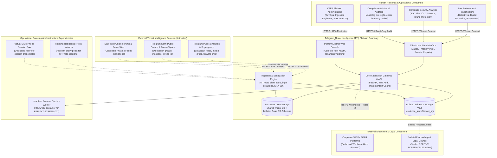

# TTI System Context & Environmental Boundaries

**Document Reference:** `TTI-ARCH-CTX-001`  
**Product:** Telegram Threat Intelligence (TTI)  
**Lifecycle Stage:** Gate 4A — System Context & Subsystem Decomposition  
**Author:** Principal Software Architect & Security Architect  
**Date:** 2026-10-28  
**Governance Status:** `PROPOSED ARCHITECTURE SPECIFICATION — PENDING STAKEHOLDER SIGN-OFF`  
**Baseline Traceability:**
- [`docs/product/product_baseline/product_vision.md`](file:///d:/TTI/docs/product/product_baseline/product_vision.md) (`TTI-DOC-BSL-VIS-001`)
- [`docs/product/product_baseline/release_1_scope.md`](file:///d:/TTI/docs/product/product_baseline/release_1_scope.md) (`TTI-DOC-BSL-SCP-001`)
- [`docs/product/product_baseline/security_and_evidence_requirements.md`](file:///d:/TTI/docs/product/product_baseline/security_and_evidence_requirements.md) (`TTI-DOC-BSL-SEC-001`)

---

## 1. Executive Architecture Charter & Objective

The objective of **Gate 4A** is to establish a rigorous, production-grade architectural baseline for the **Telegram Threat Intelligence (TTI)** platform. 

TTI is engineered to ingest, sanitize, reconstruct, analyze, and preserve conversational threat telemetry originating from external messaging ecosystems (primarily Telegram channels, supergroups, and forum topics) and affiliated dark-web sources, delivering defensible forensic intelligence to Law Enforcement Agencies (LEAs) and Corporate Cybersecurity Operations Centers (SOCs).

This document defines the **System Context (C4 Level 1)**, cataloging external actors, external threat sources, outbound integrations, operational infrastructure dependencies, and foundational trust boundaries, while explicitly distinguishing confirmed requirements from open strategic decisions.

---

## 2. System Context (C4 Level 1)

The following diagram illustrates TTI situated within its operational environment, defining interactions with external human actors, source platforms, operational infrastructure, and evidence consumers:



---

## 3. External Entities & Actor Catalog

### 3.1 Primary Human Actors
1. **Law Enforcement Investigators (LEAs):**
   - *Role:* Detectives, cybercrime investigators, and forensic analysts investigating illicit distribution, narcotics trafficking, extortion, and cyber conspiracies.
   - *System Interactions:* Query indexed threat archives, navigate conversation threads across time, stage messages into isolated Case workspaces, and compile defensible `REP-TXT-SCREEN-001` report bundles.
   - *Security Expectation:* Hard case compartmentalization, tamper-evident SHA-256 evidence manifests, zero cross-investigator leakage.
2. **Corporate Cybersecurity Analysts (SOC/CTI):**
   - *Role:* Threat intelligence analysts, brand protection specialists, and SOC responders at enterprise organizations.
   - *System Interactions:* Configure domain and brand watchlists, triage real-time alerts from Telegram chatter, inspect conversational context around corporate mentions, and export incident records.
   - *Security Expectation:* Strict multi-tenant isolation, data minimization, masked credential display, rapid triage.
3. **Compliance & Internal Auditors:**
   - *Role:* Agency internal affairs officers, corporate compliance officers, and legal data protection officers.
   - *System Interactions:* Inspect append-only search query audit logs, user login records, and export authorizations.
   - *Security Expectation:* Read-only administrative access; zero access to operational case notes.
4. **Platform Administrators (VFRA Operations):**
   - *Role:* VFRA infrastructure engineers, collector reliability leads, and senior threat intelligence analysts.
   - *System Interactions:* Monitor MTProto collector fleet health, observe flood-wait throttling states, provision tenant accounts, configure storage quotas, and author managed intelligence advisories.
   - *Security Expectation:* System-level administrative oversight; strictly barred from inspecting confidential customer case workspaces.

### 3.2 External Threat Intelligence Sources (Untrusted Boundary)
1. **Public Telegram Channels & Supergroups:**
   - Monitored passively via MTProto client sessions.
   - Emits message bodies, broadcast UTC timestamps, forward provenance (`forward_from_chat_id`), channel metadata, and attached media binaries.
2. **Semi-Public Telegram Groups & Forum Topics:**
   - Supergroups with topic branches partitioned by `message_thread_id`, or linked discussion groups (`linked_chat_id`).
   - Requires userbot presence; strictly subject to Telegram flood wait limits and platform moderation policies.
3. **Dark-Web & Underground Leak Sources (Phase 2 Roadmap Candidate):**
   - Tor hidden services (`.onion`), illicit paste boards, and cybercrime leak sites.
   - Ingestion is conditionally planned for Release 2, subject to source-specific legal clearance (`DEC-02`) and aggregator agreements.
4. **Permanent Prohibitions & Out-of-Scope Sources:**
   - **Telegram Secret Chats (E2EE):** Strictly prohibited and technically impossible to intercept (device-to-device Diffie-Hellman key exchange).
   - **Offensive Infiltration / Hacking:** TTI never deploys active exploits, remote access trojans (RATs), or intrusive interception tooling.

### 3.3 External Integration & Evidence Consumers
1. **Judicial & Legal Authorities:**
   - Consumers of sealed evidence deliverables (`{Report_Ref_ID}_bundle.zip`) containing `report.txt`, `manifest.json`, individual-message screenshots, and thread-context screenshots.
2. **Enterprise SIEM / SOAR Platforms (Phase 2):**
   - Outbound HTTPS webhook consumers ingesting structured JSON alerts (e.g., Palo Alto Cortex XSOAR, Splunk SOAR, Microsoft Sentinel).
3. **External Tip Platforms & Transforms (Phase 3 Roadmap):**
   - Future TAXII 2.1 STIX servers and Maltego Transform Hub packages (`DEF-02`, `DEF-03`).

### 3.4 Operational Infrastructure Dependencies
1. **Rotating Residential Proxy Pool (`DEC-03`, `DEC-11`):**
   - External proxy routing layer masking MTProto client connections to distribute request volume across varied IP blocks and prevent subnet-level Telegram bans.
2. **Virtual SIM / Phone Number Inventory:**
   - Dedicated physical or virtual SIM credentials providing valid telephone numbers for Telegram API session registration.
3. **Headless Browser Rendering Engine:**
   - Sandboxed container service (e.g., Playwright / Chromium) executing server-side rendering to capture deterministic screenshots of target messages and thread context under `REP-TXT-SCREEN-001`.

---

## 4. Operational Boundaries: Confirmed Requirements vs. Unresolved Decisions

To ensure architectural integrity, system boundaries are strictly mapped against decision states:

```
+----------------------------------------------------------------------------------------------------+
|                                OPERATIONAL BOUNDARY GOVERNANCE MATRIX                              |
+--------------------------+-----------------------+-------------------------------------------------+
| Architectural Area       | Governance Status     | Architecture Boundary Definition                |
+--------------------------+-----------------------+-------------------------------------------------+
| Target Market Personas   | CONFIRMED DECISION    | Dual-market: Law Enforcement & Corporate SOC    |
| Telegram Intelligence    | CONFIRMED DECISION    | Public channels, supergroups, forum topics      |
| Dual Panel Modalities    | CONFIRMED DECISION    | Platform-Admin Panel vs. Client-User Panel      |
| Reporting Package Scope  | APPROVED BY VFRA      | REP-TXT-SCREEN-001: TXT + Dual Screenshots      |
| Plaintext Password Store | PERMANENTLY REJECTED  | Option A rejected; Option B (Masked) baseline   |
+--------------------------+-----------------------+-------------------------------------------------+
| Release 1 MVP Boundary   | PROPOSED (DEC-01)     | LEA-Weighted Core + Corporate Watchlist Pilot   |
| Collection Legal Model   | OPEN (DEC-02)         | In-house Telegram + Partnered Tor feeds         |
| Channel Scale Capacity   | PROPOSED (DEC-04)     | 500-1,500 (Growth) vs. 100-300 (Bootstrap)      |
| Multi-Tenancy Design     | PROPOSED (DEC-05)     | Shared Threat Store + Isolated Case Schemas     |
| Credential Storage Policy| OPEN (DEC-06)         | Encrypted storage + audited unmasking workflow  |
| Evidence Hashing Standard| PROPOSED (DEC-07)     | Internal SHA-256 manifest; RFC 3161 in Phase 2  |
| Data Retention & Purge   | OPEN (DEC-08)         | 180-day rolling TTL vs. Case Evidence Lock      |
| Managed Service Staffing | UNSTAFFED (DEC-09)    | Platform delivers tooling; 24/7 SLAs unstaffed  |
| Monthly Budget Ceiling   | OPEN (DEC-11)         | Growth Tier ($1,500-$3,500/mo) pending CFO sign |
| Screenshot Trigger Policy| OPEN (DEC-13)         | Investigator-selected on demand (Proposed)      |
+--------------------------+-----------------------+-------------------------------------------------+
```

> [!NOTE] Architecture Governance Note
> All proposed technology selections (FastAPI, Celery, Redis, PostgreSQL 16, pg_trgm, Playwright, MinIO/S3) and the Modular Monolith style are **Engineering Recommendations / Proposals** awaiting empirical validation during implementation, not confirmed stakeholder decisions. Furthermore, evidence storage immutability (WORM / Object Lock) is explicitly marked **PROVISIONAL PENDING RESOLUTION OF DEC-08 AND RELEVANT LEGAL REVIEW**, balancing tamper detection against retention expiry schedules, court-ordered expungements, erasure requests, and the emergency purging of unlawfully collected material. Selection of the final immutability mechanism requires a formally authorized policy and audited dual-control access governance.

---

## 5. Primary Trust Boundaries

The system architecture enforces five primary trust boundaries:

```mermaid
flowchart LR
    subgraph Untrusted_External["Trust Zone 0: Untrusted Internet"]
        RawTG["Raw Telegram Payloads\n(Malicious scripts, exploits, combo dumps)"]
    end

    subgraph Ingestion_DMZ["Trust Zone 1: Ingestion Sandbox"]
        Connector["MTProto Collector"] --> Sanitize["InputSanitizer\n(Defang, normalize, length guard)"]
    end

    subgraph Core_Threat_Store["Trust Zone 2: Shared Public Threat Layer"]
        ThreatDB[("Shared Read-Only Threat DB\n(Normalized messages, forward provenance)")]
    end

    subgraph Tenant_Workspace["Trust Zone 3: Tenant Isolated Enclave"]
        CaseDB[("Tenant Case Schemas\n(Private notes, suspect tags, watchlists)")]
        Vault[("Evidence Vault\n/evidence_store/{tenant_id}/")]
    end

    subgraph Admin_Control["Trust Zone 4: Platform Administration"]
        AdminCore["Platform Admin Controls\n(Tenant quotas, worker orchestration)"]
    end

    RawTG -->|Trust Boundary 1: Untrusted Ingress| Connector
    Sanitize -->|Trust Boundary 2: Normalized Storage| ThreatDB
    ThreatDB -.->|Trust Boundary 3: Read-Only Query| Tenant_Workspace
    Tenant_Workspace <-->|Trust Boundary 4: Strict Tenant Isolation| CaseDB
    AdminCore -.->|Trust Boundary 5: System Oversight (No Case Read)| Tenant_Workspace
```

1. **Trust Boundary 1 (Untrusted Ingress):**
   - Demarcates the open Telegram network from the ingestion workers.
   - *Threat Vectors:* Terminal injection, null-byte truncation, stored XSS payloads, malformed unicode homoglyphs, memory exhaustion DoS.
   - *Mitigation:* Mandatory centralized sanitization pipeline (`InputSanitizer`) enforcing length limits (1,000,000 characters), NFC normalization, control character stripping, and protocol defanging.
2. **Trust Boundary 2 (Public Threat Store):**
   - Separates ingestion workers from persistent database storage.
   - *Constraint:* Ingestion workers write raw payloads with SHA-256 digests. Threat records are read-only to client tenants.
3. **Trust Boundary 3 (Cross-Tenant Case Isolation):**
   - Separates shared threat intelligence from private customer case workspaces.
   - *Invariant:* Zero cross-tenant data leakage. Tenant A cannot observe, query, or infer Tenant B's active cases, target observables, notes, or search history.
4. **Trust Boundary 4 (Evidence Vault & API Boundary):**
   - Separates web clients from raw evidence binaries.
   - *Invariant:* No direct filesystem access or public static web URLs. Files are accessed strictly via authenticated, tenant-scoped API routes. Raw SHA-256 existence lookups are barred to prevent oracle attacks.
5. **Trust Boundary 5 (Administrative Oversight Boundary):**
   - Separates VFRA platform operators from confidential customer case data.
   - *Invariant:* Platform administrators can monitor worker health and set quotas, but cannot access customer case schemas or private notes.
