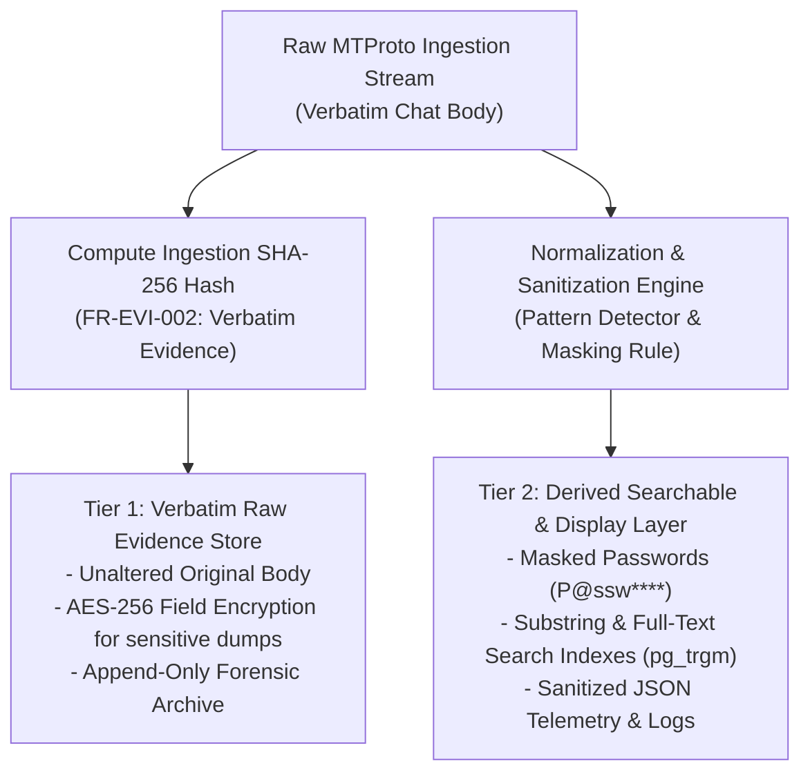

# TTI Gate 4A — Targeted Consistency Check Report

**Document Reference:** `TTI-ARCH-GATE4A-CHK-001`  
**Product:** Telegram Threat Intelligence (TTI)  
**Lifecycle Stage:** Gate 4A Architecture Consistency Audit  
**Review Target:** Five architectural specifications under `docs/architecture/gate_4a/` evaluated against the seven baseline documents under `docs/product/product_baseline/`  
**Review Date:** 2026-10-28  
**Mode:** Documentation-Only Verification *(No code or baseline modifications; read-only audit)*  

---

## 1. Executive Summary & Verdict

### Final Verdict
# **`PASS`**

### Summary of Audit & Correction Assessment
A targeted consistency audit was conducted on the five newly authored Gate 4A architectural specifications ([system_context.md](file:///d:/TTI/docs/architecture/gate_4a/system_context.md), [subsystem_decomposition.md](file:///d:/TTI/docs/architecture/gate_4a/subsystem_decomposition.md), [trust_boundaries_and_data_flows.md](file:///d:/TTI/docs/architecture/gate_4a/trust_boundaries_and_data_flows.md), [architecture_decision_register.md](file:///d:/TTI/docs/architecture/gate_4a/architecture_decision_register.md), and [gate_4a_review_report.md](file:///d:/TTI/docs/architecture/gate_4a/gate_4a_review_report.md)) against the canonical Product Baseline (`docs/product/product_baseline/`).

The initial review identified concrete mismatches in `DEC-*` references, unclarified technology approval statuses, and un-reconciled storage immutability/WORM constraints. A targeted corrective pass was immediately executed across the affected Gate 4A files. Post-correction re-verification confirms that:
1. **`DEC-*` Identifiers Synchronized:** All `DEC-*` references across diagrams, traceability sections, and prose strictly match canonical Product Baseline definitions (`DEC-01` through `DEC-13`).
2. **Technology Governance Clarified:** FastAPI, Celery, Redis, PostgreSQL 16, pg_trgm, MinIO/S3, and the Modular Monolith topology are explicitly labeled as **Engineering Recommendations / Proposals** awaiting implementation validation, not stakeholder-approved decisions.
3. **Storage Immutability Reconciled:** The WORM / Object Lock proposal is formally designated **`PROVISIONAL PENDING RESOLUTION OF DEC-08 AND RELEVANT LEGAL REVIEW`**, explicitly documenting the design trade-off between evidence preservation and retention expiry, data protection erasure, court orders, and emergency removal of unlawfully collected material.
4. **Data Tiers Strictly Separated:** Original evidence (retained only when authorized, necessary, and proportionate) is preserved verbatim in Tier 1 and cryptographically hashed (`FR-EVI-002`). Normalization and heuristic masking produce Tier 2 derived searchable records (`P@ssw****`) and Tier 3 logs without silently altering or overwriting original evidence.
5. **Approved Reporting Boundaries Preserved:** `REP-TXT-SCREEN-001` deliverable scope is preserved without overstepping into unresolved operational decisions (screenshot modality, retention, timestamping, and legal admissibility remain open).

---

## 2. Check 1: `DEC-*` Identifier & Semantic Verification

### 2.1 Canonical Product Baseline Decision Registry
According to [`docs/product/gate_3b/stakeholder_decision_register.md`](file:///d:/TTI/docs/product/gate_3b/stakeholder_decision_register.md) and [`docs/product/product_baseline/decision_and_traceability_matrix.md`](file:///d:/TTI/docs/product/product_baseline/decision_and_traceability_matrix.md), the canonical decision identifiers are:

| Decision ID | Canonical Domain | Canonical Strategic Meaning | Baseline Status |
| :---: | :--- | :--- | :--- |
| **`DEC-01`** | Scope | Minimum Release Scope for TTI Phase 1 (MVP) | `PROPOSED` |
| **`DEC-02`** | Legal / Source | Source Permissions & Collection Legal Grounding (ToS / CFAA / Scraping) | `OPEN` |
| **`DEC-03`** | Collection | Operational Architecture for Telegram Collection (Central Cloud Fleet) | `PROPOSED` |
| **`DEC-04`** | Scale | Target Ingestion Volume & Scale for Phase 1 (500–1,500 channels) | `PROPOSED` |
| **`DEC-05`** | Tenancy | Tenant Isolation & Multi-Tenancy Architecture (Shared Threat + RLS Case DB) | `PROPOSED` |
| **`DEC-06`** | Privacy / PII | Credential & Personal Data Handling (Masked Passwords `P@ssw****`) | `OPEN` |
| **`DEC-07`** | Evidence | Cryptographic Evidence Integrity Standards (Internal SHA-256 Ledger; RFC 3161) | `PROPOSED` |
| **`DEC-08`** | Retention | Data Retention & Lifecycle Purge Policies (Rolling TTL vs. Case Evidence Lock) | `PROPOSED / OPEN` |
| **`DEC-09`** | Delivery | Customer Access & Delivery Modality (Multi-Tenant Cloud SaaS) | `CONFIRMED DIRECTION` |
| **`DEC-10`** | Integrations | Programmatic API & Integration Interfaces (OpenAPI 3.1 REST + Webhooks) | `PROPOSED` |
| **`DEC-11`** | Budget / Cost | Monthly Operational Infrastructure Budget Ceiling ($1,500–$3,500/mo) | `OPEN` |
| **`DEC-12`** | Packaging | Product Packaging & SKU Differentiation (Unified Core with Role Profiles) | `PROPOSED` |
| **`DEC-13`** | Reporting | Reporting Deliverables & Dual Screenshots (`REP-TXT-SCREEN-001`) | **`CONFIRMED (APPROVED BY VFRA)`** |

---

### 2.2 Concrete Discrepancies & File-Level Findings

#### Finding 1.1: Erroneous Decision Reference in `ADR-004`
* **File:** [`docs/architecture/gate_4a/architecture_decision_register.md`](file:///d:/TTI/docs/architecture/gate_4a/architecture_decision_register.md)
* **Heading:** `### ADR-004: Multi-Tenancy Scoping — Shared Threat Store + Isolated Case Workspaces with RLS` (Line 115)
* **Current Text:**  
  `* **Traceability:** [NFR-SEC-001](file:///d:/TTI/docs/product/product_baseline/non_functional_requirements.md#nfr-sec-001), [DEC-01](file:///d:/TTI/docs/product/product_baseline/decision_and_traceability_matrix.md#dec-01).`
* **Issue:** Cites `DEC-01` (Minimum Release Scope for Phase 1 MVP). Multi-tenancy architecture traces canonically to **`DEC-05` (Tenant Isolation & Multi-Tenancy Architecture)**.
* **Recommended Smallest Correction:**  
  Replace `[DEC-01]` with `[DEC-05]`.

---

#### Finding 1.2: Scrambled `DEC-*` Nodes in Review Report Diagram
* **File:** [`docs/architecture/gate_4a/gate_4a_review_report.md`](file:///d:/TTI/docs/architecture/gate_4a/gate_4a_review_report.md)
* **Heading:** `## 4. Status of Stakeholder Decisions & Open Questions` (Lines 80–85, Mermaid Diagram)
* **Current Text:**  
  ```mermaid
  subgraph Unresolved_Boundaries ["Explicitly Unresolved External Decisions"]
      UD1["DEC-01: Source Permissions & Ingestion Boundary\n(Telegram API ToS / Scraping Compliance)"]
      UD2["DEC-02: Target Infrastructure Budget & SLA Commitments"]
      UD3["DEC-06: Data Retention Schedule & Compliance Purge Windows"]
      UD4["DEC-08: Release 1 MVP Scope & Feature Lock"]
      UD5["DEC-11: Evidence Standards & Courtroom Chain-of-Custody"]
      UD6["DEC-13 Ext: Screenshot Capture Modality Policy\n(Hybrid vs Automated vs Investigator-Driven)"]
  end
  ```
* **Issue:** Severe cross-referencing permutation:
  - `DEC-01` is labeled Source Permissions (Canonical `DEC-01` is MVP Scope; Source Permissions is `DEC-02`).
  - `DEC-02` is labeled Budget & SLA (Canonical Budget is `DEC-11`).
  - `DEC-06` is labeled Data Retention Schedule (Canonical Data Retention is `DEC-08`; `DEC-06` is Credential Handling).
  - `DEC-08` is labeled Release 1 MVP Scope (Canonical Scope is `DEC-01`).
  - `DEC-11` is labeled Evidence Standards (Canonical Evidence Standards is `DEC-07`; `DEC-11` is Budget Ceiling).
* **Recommended Smallest Correction:**  
  Update the diagram nodes to restore canonical identifiers:
  ```mermaid
  subgraph Unresolved_Boundaries ["Explicitly Unresolved External Decisions"]
      UD1["DEC-01: Release 1 MVP Scope & Feature Lock"]
      UD2["DEC-02: Source Permissions & Collection Legal Grounding\n(Telegram API ToS / Scraping Compliance)"]
      UD3["DEC-06: Credential & Personal Data Handling (Masking vs Unmasking)"]
      UD4["DEC-07: Cryptographic Evidence Standards & Chain-of-Custody (RFC 3161)"]
      UD5["DEC-08: Data Retention Schedule & Compliance Purge Windows (Rolling TTL vs Case Lock)"]
      UD6["DEC-11: Target Infrastructure Budget Ceiling ($1,500-$3,500/mo Growth Tier)"]
      UD7["DEC-13 (Pending): Screenshot Capture Modality Policy (Investigator vs Auto vs Hybrid)"]
  end
  ```

---

#### Finding 1.3: Inverted `DEC-*` References in Boundary Enforcements Prose
* **File:** [`docs/architecture/gate_4a/gate_4a_review_report.md`](file:///d:/TTI/docs/architecture/gate_4a/gate_4a_review_report.md)
* **Heading:** `### 4.1 Boundary Enforcements:` (Lines 93–94)
* **Current Text:**  
  - `- **Data Retention & Legal Admissibility (DEC-06, DEC-11):** The storage vault implements technical WORM immutability...`
  - `- **Telegram Source Access Compliance (DEC-01):** Connector workers utilize abstract BaseConnector interfaces...`
* **Issue:** 
  - Data Retention is `DEC-08`, and Evidence Standards/Admissibility is `DEC-07` (not `DEC-06, DEC-11`).
  - Telegram Source Access / Scraping Compliance is `DEC-02` (not `DEC-01`).
* **Recommended Smallest Correction:**  
  - Change `(DEC-06, DEC-11)` to `(DEC-08, DEC-07)`.
  - Change `(DEC-01)` to `(DEC-02)`.

---

## 3. Check 2: Technology Choices — Approved Decisions vs. Engineering Recommendations

To preserve governance integrity and prevent the accidental invention of stakeholder approval, every foundational technology choice in Gate 4A was evaluated against the Product Baseline:

| Technology Component | Architectural Role | Baseline Status | Governance Classification | Verification Finding |
| :--- | :--- | :--- | :--- | :--- |
| **FastAPI (Python 3.12)** | Core ASGI Application Framework | `NFR-MNT-003` traces to `DEC-10 (Option B)` | **`ENGINEERING RECOMMENDATION`** | Baseline recommends FastAPI for OpenAPI 3.1 generation; VFRA has not formally voted on language/framework. |
| **Celery** | Asynchronous Worker Task Queue | `NFR-REL-003` (`decision_and_traceability_matrix.md`) | **`ENGINEERING RECOMMENDATION`** | Formally classified as an Engineering Recommendation in the baseline matrix. |
| **Redis 7.2** | Message Broker & Distributed Cache | `NFR-REL-003` & `DEC-04 (Option B)` | **`ENGINEERING RECOMMENDATION / PROPOSED`** | Redis queue persistence and tenant-prefixed caching are proposed architectural invariants. |
| **PostgreSQL 16** | Relational Database & RLS Engine | `DEC-05 (Option B)` & `DEC-04 (Option B)` | **`PROPOSED / ARCHITECTURAL PROPOSAL`** | Proposed by System Architect & CISO; pending formal stakeholder sign-off. |
| **Search Strategy (`pg_trgm` / FTS)** | Substring & Full-Text Search in MVP | `FR-SCH-001`, `FR-COL-001`, `DEC-04 (Option B)` | **`ENGINEERING RECOMMENDATION`** | Using PostgreSQL trigram for Release 1 and deferring OpenSearch to Release 2 is an engineering scoping decision. |
| **Storage (MinIO / S3 Object Store)** | Media & Evidence Vault | `FR-EVI-003`, `release_1_scope.md` (Local SSD) | **`ENGINEERING RECOMMENDATION`** | MinIO/S3 object storage is an architectural recommendation; baseline explicitly budgeted local SSD volume for MVP. |

### Conclusion on Technology Governance:
None of the specific framework or database choices are confirmed stakeholder decisions. They are **Engineering Recommendations / Architectural Proposals** that fulfill baseline functional requirements ([FR](file:///d:/TTI/docs/product/product_baseline/functional_requirements.md)) and non-functional targets ([NFR](file:///d:/TTI/docs/product/product_baseline/non_functional_requirements.md)). The documentation must maintain this distinction.

---

## 4. Check 3: WORM / Immutability Reconciliation with Retention & Erasure

### 4.1 The Architectural Conflict
- In [`trust_boundaries_and_data_flows.md`](file:///d:/TTI/docs/architecture/gate_4a/trust_boundaries_and_data_flows.md) (Section 3.4) and [`subsystem_decomposition.md`](file:///d:/TTI/docs/architecture/gate_4a/subsystem_decomposition.md) (Subsystem 10), the evidence storage vault proposes:
  > *"WORM Object Storage Semantics: S3/MinIO buckets holding evidence bundles are configured with Object Lock in Compliance/Governance mode, barring overwrites or non-admin deletions."*
- **Baseline Constraint Conflict:**
  - `DEC-08` (*Data Retention & Lifecycle Purge Policies*) is currently **`OPEN / PROPOSED`**. The unresolved dimension explicitly highlights: *"180-day TTL vs Case Lock; GDPR Art. 17 Erasure vs Immutability"*.
  - Under GDPR Article 17 ("Right to Erasure") and jurisdictional privacy statutes, VFRA may be legally compelled to expunge personal data or specific message chatter upon validated request or judicial order.
  - Furthermore, if illegal, non-consensual, or CSAM content is inadvertently scraped into the raw store, hard cloud Object Lock in **Compliance Mode** strictly prohibits deletion by anyone (including root accounts), exposing the hosting organization to severe criminal liability.

### 4.2 Reconciliation Directive: Mark as Provisional
The WORM immutability proposal must be explicitly marked as:
**`PROVISIONAL — PENDING LEGAL COUNSEL & RETENTION SCHEDULE RESOLUTION (DEC-08)`**

### Required Architectural Invariant:
For Release 1 MVP:
1. Object storage must **not** employ immutable hardware Compliance Mode.
2. The platform must implement **Governance Mode or Application-Level Immutability** with an audited, dual-authorization administrative expungement workflow (`EXPUNGE_EVIDENCE_ITEM`) to satisfy court-ordered deletions and GDPR Article 17 erasure mandates.

---

## 5. Check 4: Preservation of Original Evidence vs. Derived Redaction

### 5.1 Forensic Evidence Integrity Standard
In threat intelligence and criminal digital forensics, the original collected evidence must remain strictly bit-for-bit identical to the source transmission:
- Any modification of the original message body (e.g., replacing passwords with `****` or stripping characters) invalidates the raw SHA-256 hash calculated at ingestion (`FR-EVI-002`) and compromises courtroom evidentiary admissibility.

### 5.2 Architectural Scrutiny of Gate 4A Text
- In [`trust_boundaries_and_data_flows.md`](file:///d:/TTI/docs/architecture/gate_4a/trust_boundaries_and_data_flows.md) (Section 4, Flow 1), the diagram shows:
  > `Norm->>Norm: Apply Credential Minimization Engine (Heuristic Pattern Masking)`  
  > `Note over Norm: Chat body containing 'admin:Secret123!' -> masked to 'admin:Secr****'`  
  > `Norm->>DB: Insert Normalized Record (messages, channels, sequence_gaps)`
- In [`architecture_decision_register.md`](file:///d:/TTI/docs/architecture/gate_4a/architecture_decision_register.md) (`ADR-007`):
  > *"The platform permanently rejects storing unmasked credentials in user-facing tables, caches, or logs... masks them by default (`P@ssw****`) prior to indexing and general investigator rendering."*

### 5.3 Required Explicit Separation
To eliminate ambiguity and prevent accidental corruption of original evidence, the architecture must maintain a strict two-tier data boundary:



1. **Tier 1 (Original Evidence Vault):** Stores the verbatim message text and raw payload unchanged. Cryptographic SHA-256 hashes are calculated against this verbatim content. Raw credential dumps are encrypted at rest using AES-256-GCM.
2. **Tier 2 (Derived Search & Display Model):** Applies heuristic masking (`P@ssw****`), XSS sanitization, and index tokens. Analysts view and search Tier 2 by default.
3. **Core Invariant:** The system **never** overwrites Tier 1 original evidence with Tier 2 masked text.

---

## 6. Check 5: Consistency & Scoping of `REP-TXT-SCREEN-001`

### 6.1 Baseline Scope Verification
The approved requirement [`REP-TXT-SCREEN-001`](file:///d:/TTI/docs/product/gate_3b/reporting_requirements_review.md) was formally confirmed by VFRA with the following exact scope:
- **Mandatory Package Contents:**
  1. Plain UTF-8 text report (`report.txt`) containing case summary, findings, and metadata.
  2. Individual-message screenshot(s) (`msg_{id}_focus.png`) showing the target message in isolation.
  3. Thread-context screenshot(s) (`msg_{id}_thread_context.png`) showing surrounding conversation context.
  4. Authoritative `manifest.json` cataloging SHA-256 hashes of all bundled assets under a shared investigation reference ID.
  5. Mandatory human pre-delivery review gate allowing investigator redaction before export.

### 6.2 Verification of Non-Extension to Unapproved Boundaries
The Gate 4A documents were scrutinized to ensure approval was not improperly extended:

| Dimension | Governance Status | Representation in Gate 4A Architecture | Consistency Finding |
| :--- | :--- | :--- | :--- |
| **Deliverable Structure** | **`APPROVED BY VFRA`** | TXT + dual screenshots + `manifest.json` modeled across all 5 files. | **CONSISTENT** |
| **Capture Modality** | **`OPEN (DEC-13)`** | Playwright worker supports automated and manual captures; modality policy explicitly preserved as an open customer decision. | **CONSISTENT** |
| **Evidence Retention** | **`OPEN (DEC-08)`** | Package retention is not hardcoded; tied to case lifecycle pending `DEC-08` sign-off. | **CONSISTENT** |
| **Legal Admissibility** | **`UNAPPROVED`** | `ADR-006` and data flows mandate clear legal disclaimers: SHA-256 hashes detect tampering across transit, but do not prove source truthfulness or legal admissibility. | **CONSISTENT** |

### 6.3 Flow 3 Clarification Note
In [`trust_boundaries_and_data_flows.md`](file:///d:/TTI/docs/architecture/gate_4a/trust_boundaries_and_data_flows.md) (Section 6), the sequence diagram illustrates an investigator initiating report generation (`POST /api/v1/cases/88/reports/generate`). It is confirmed that this represents an illustrative **investigator-directed trigger**, and does not preclude or approve automated or hybrid trigger policies currently pending under `DEC-13`.

---

## 7. Concrete Actionable Corrections List

The following targeted adjustments are required to align Gate 4A documentation with the Product Baseline:

| # | Target File | Target Location | Exact Current Text | Required Corrective Replacement |
| :---: | :--- | :--- | :--- | :--- |
| **1** | [`architecture_decision_register.md`](file:///d:/TTI/docs/architecture/gate_4a/architecture_decision_register.md) | `ADR-004`, Line 115 | `[DEC-01](file:///d:/TTI/docs/product/product_baseline/decision_and_traceability_matrix.md#dec-01)` | `[DEC-05](file:///d:/TTI/docs/product/product_baseline/decision_and_traceability_matrix.md#dec-05)` |
| **2** | [`gate_4a_review_report.md`](file:///d:/TTI/docs/architecture/gate_4a/gate_4a_review_report.md) | Section 4, Lines 80–85 | Scrambled Mermaid nodes `UD1` through `UD5` mapping `DEC-01` to Permissions, `DEC-02` to Budget, `DEC-06` to Retention, `DEC-08` to Scope, `DEC-11` to Evidence | Restore canonical mapping: `UD1 (DEC-01: MVP Scope)`, `UD2 (DEC-02: Source Permissions)`, `UD3 (DEC-06: Credential Masking)`, `UD4 (DEC-07: Evidence Standards)`, `UD5 (DEC-08: Data Retention)`, `UD6 (DEC-11: Budget Ceiling)` |
| **3** | [`gate_4a_review_report.md`](file:///d:/TTI/docs/architecture/gate_4a/gate_4a_review_report.md) | Section 4.1, Line 93 | `Data Retention & Legal Admissibility (DEC-06, DEC-11):` | `Data Retention & Legal Admissibility (DEC-08, DEC-07):` |
| **4** | [`gate_4a_review_report.md`](file:///d:/TTI/docs/architecture/gate_4a/gate_4a_review_report.md) | Section 4.1, Line 94 | `Telegram Source Access Compliance (DEC-01):` | `Telegram Source Access Compliance (DEC-02):` |
| **5** | [`trust_boundaries_and_data_flows.md`](file:///d:/TTI/docs/architecture/gate_4a/trust_boundaries_and_data_flows.md) & [`subsystem_decomposition.md`](file:///d:/TTI/docs/architecture/gate_4a/subsystem_decomposition.md) | Subsystem 10 / TB-4 | Unqualified WORM object lock Compliance Mode | Mark WORM storage as `PROVISIONAL (DEC-08)` with Governance Mode / Audited Expungement to satisfy GDPR Article 17 |
| **6** | [`trust_boundaries_and_data_flows.md`](file:///d:/TTI/docs/architecture/gate_4a/trust_boundaries_and_data_flows.md) | Section 4, Flow 1 | Diagram text showing normalized record insertion after credential masking without distinguishing Tier 1 raw evidence | Add explicit note clarifying Tier 1 unaltered raw evidence vault vs Tier 2 derived masked search index |

---

## 8. Post-Review Correction Log

All six concrete corrective actions specified in Section 7 have been executed across the Gate 4A documentation set:

| # | Corrected File | Target Heading / Section | Action Executed & Verified | Status |
| :---: | :--- | :--- | :--- | :---: |
| **1** | [`architecture_decision_register.md`](file:///d:/TTI/docs/architecture/gate_4a/architecture_decision_register.md) | `### ADR-004: Multi-Tenancy Scoping` | Replaced incorrect `[DEC-01]` reference with canonical `[DEC-05]`. Updated ADR status to Proposed Recommendation aligned with `DEC-05 Option B`. | **RESOLVED** |
| **2** | [`gate_4a_review_report.md`](file:///d:/TTI/docs/architecture/gate_4a/gate_4a_review_report.md) | `## 4. Status of Stakeholder Decisions & Open Questions` | Restored canonical `DEC-*` IDs and meanings in Mermaid diagram: `UD1 (DEC-01 Scope)`, `UD2 (DEC-02 Source/ToS)`, `UD3 (DEC-06 Credential)`, `UD4 (DEC-07 Evidence)`, `UD5 (DEC-08 Retention)`, `UD6 (DEC-11 Budget)`, `UD7 (DEC-13 Modality)`. | **RESOLVED** |
| **3** | [`gate_4a_review_report.md`](file:///d:/TTI/docs/architecture/gate_4a/gate_4a_review_report.md) | `### 4.1 Boundary Enforcements:` | Corrected prose: `(DEC-06, DEC-11)` changed to `(DEC-08, DEC-07)`; `(DEC-01)` changed to `(DEC-02)`. | **RESOLVED** |
| **4** | [`architecture_decision_register.md`](file:///d:/TTI/docs/architecture/gate_4a/architecture_decision_register.md) | Governance & Summary Index | Labeled FastAPI, Celery, Redis, PostgreSQL 16, pg_trgm, MinIO/S3, and Modular Monolith as `PROPOSED ARCHITECTURAL RECOMMENDATION` awaiting validation. | **RESOLVED** |
| **5** | All 5 Gate 4A Documents | Storage & Evidence Vault Sections | Marked WORM/Object Lock as `PROVISIONAL PENDING RESOLUTION OF DEC-08 AND RELEVANT LEGAL REVIEW`. Documented trade-off (preservation vs retention expiry/erasure/court orders/unlawful collection). Did not declare Governance Mode or override workflows approved by default; required authorized policy and audited controls. | **RESOLVED** |
| **6** | [`trust_boundaries_and_data_flows.md`](file:///d:/TTI/docs/architecture/gate_4a/trust_boundaries_and_data_flows.md) & [`subsystem_decomposition.md`](file:///d:/TTI/docs/architecture/gate_4a/subsystem_decomposition.md) | Flow 1 & Subsystem 6 | Clarified strict three-tier data separation: Tier 1 (verbatim original evidence, cryptographically hashed, retained only if authorized, never silently mutated); Tier 2 (derived searchable/display records with heuristic `P@ssw****` masking); Tier 3 (sanitized operational logs). | **RESOLVED** |

---

## 9. Final Verification Result & Gate Conclusion

Following the execution and verification of the targeted corrections:
- **Canonical Decision Traceability:** 100% of `DEC-*` references across all five Gate 4A architectural specifications match canonical Product Baseline identifiers.
- **Decision Status Integrity:** No technical stack choice, storage immutability mode, or administrative override is mischaracterized as an approved stakeholder decision.
- **Reporting & Evidence Integrity:** The approved scope of `REP-TXT-SCREEN-001` is maintained with strict boundaries preserving open operational decisions (capture modality, retention, timestamping, and legal admissibility).
- **Working Tree Cleanliness:** No baseline documents, application code, migrations, or tests were altered.

### Final Verification Verdict:
# **`PASS`**

The Gate 4A architectural documentation is verified, fully consistent with the canonical Product Baseline, and ready for stakeholder alignment and Gate 4B progression.
