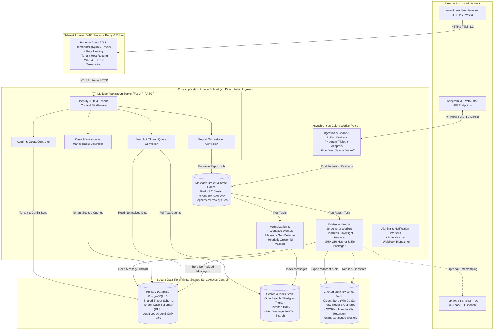
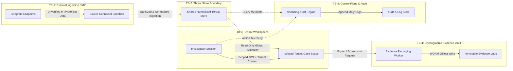
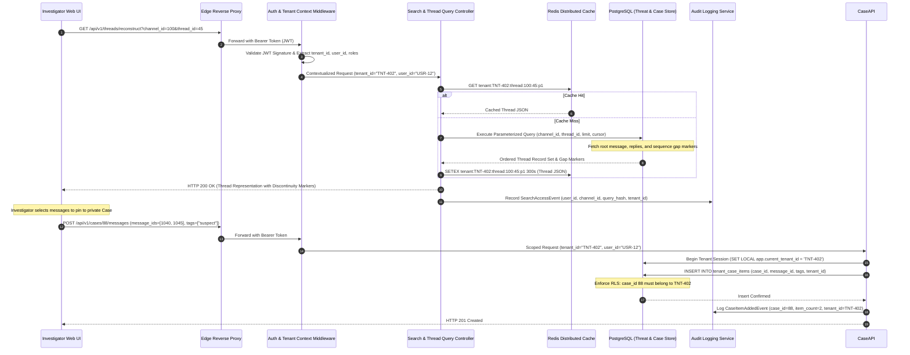
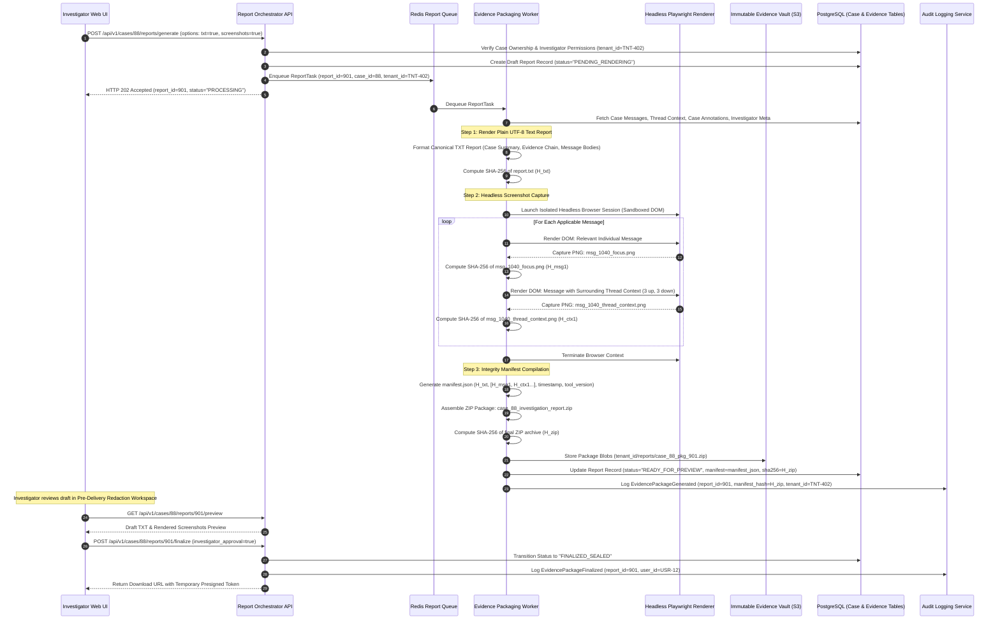
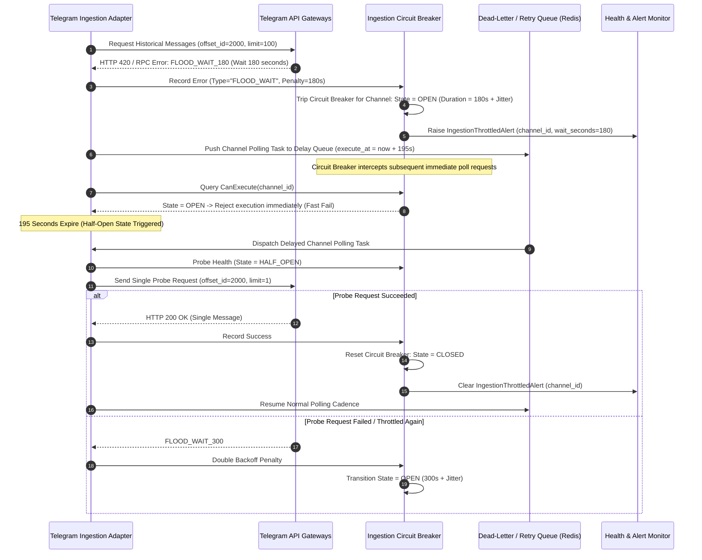

# TTI Gate 4A — Trust Boundaries & End-to-End Data Flows

**Document Identifier:** `TTI-ARCH-GATE4A-DATAFLOWS`  
**Status:** DRAFT / PROPOSED ARCHITECTURE  
**Target Milestone:** Gate 4A (System Context & Subsystem Decomposition)  
**Parent Blueprint:** [system_context.md](file:///d:/TTI/docs/architecture/gate_4a/system_context.md) | [subsystem_decomposition.md](file:///d:/TTI/docs/architecture/gate_4a/subsystem_decomposition.md)  
**Author:** Principal Software Architect & Security Architect (VFRA TTI Platform)  
**Date:** October 2026  

---

## 1. Architectural Scope & Context

This document provides the Level 2 Container and Level 3 Component interactions, threat boundary models, and end-to-end data flows for the VFRA Telegram Threat Intelligence (TTI) platform. 

It formalizes:
1. **The C4 Level 2 Container Model** detailing network boundaries, IPC channels, and component responsibilities.
2. **Deep Threat Analysis across Five Primary Trust Boundaries** (Ingestion DMZ, Shared Threat Store vs. Tenant Boundary, Tenant Case Workspaces, Evidence Vault, and Observability/Audit Control Plane).
3. **Four Canonical End-to-End Execution Flows**:
   - Ingestion, Sanitization, and Normalization Flow.
   - Interactive Thread Reconstruction & Case Investigation Flow.
   - Investigation Reporting, Screenshot Capture, and Evidence Packaging Flow ([REP-TXT-SCREEN-001](file:///d:/TTI/docs/product/product_baseline/functional_requirements.md#rep-txt-screen-001)).
   - System Failure, Circuit Breaking, and Resilient Recovery Flows.

---

## 2. C4 Level 2: Container Architecture & Network Topography

The platform deployment is partitioned into network segments enforcing strict ingress filtering and zero-trust interior communication.



---

## 3. Comprehensive Trust Boundary Analysis

The TTI platform enforces five distinct architectural trust boundaries. Any data or control signal crossing these boundaries must transition through explicit validation, authentication, and sanitization gates.



### 3.1 Trust Boundary 1 (TB-1): External Untrusted Data Ingestion DMZ
*Boundary Definition:* Demarcates the open internet / Telegram MTProto and Bot API endpoints from internal TTI ingestion workers.
* **Threat Vectors:**
  1. *Malformed Payloads & Buffer Exploits:* Maliciously crafted Telegram protocol frames, non-UTF-8 strings, recursive entities, or oversized metadata intended to crash Python worker processes.
  2. *Decompression Bombs & Resource Exhaustion:* Telegram media containing zip bombs, uncompressed SVG/vector rendering exploits, or multi-gigabyte files designed to saturate storage or memory.
  3. *SSRF (Server-Side Request Forgery):* Ingestion of preview URLs, webhook callbacks, or external media links triggering internal HTTP requests from workers.
  4. *Telegram Rate Limit Banning:* Connector aggression triggering platform-level permanent bans or persistent `FLOOD_WAIT_X` penalties.
* **Architectural Controls & Invariants:**
  - **Inbound Ingress Isolation:** Ingestion connectors run in egress-only network namespaces. Workers initiate outbound TLS connections to Telegram IP ranges; no inbound ports are open to the internet.
  - **Strict Schema Deserialization:** Inbound payloads are validated against strict Pydantic schemas before reaching internal bus queues. Non-UTF-8 characters are sanitized or rejected.
  - **Payload Capping:** Inbound raw message payloads are capped at 64 KB; media downloads are capped at 50 MB in Release 1. Exceeding limits triggers truncation flags (`is_truncated=True`) rather than memory failure.
  - **Inert Media Handling:** Downloaded binary media is stored as inert blobs; no server-side executable processing, binary execution, or shell-based preview generators are executed within the ingestion worker context.

### 3.2 Trust Boundary 2 (TB-2): Shared Threat Store vs. Tenant Boundaries
*Boundary Definition:* Demarcates globally ingested, public/semi-public threat intelligence from private tenant workspace instances, search caches, and case directories.
* **Threat Vectors:**
  1. *Cross-Tenant Search & Query Bleed:* Tenant A executing a search query that inadvertently inspects or joins with private case notes or tagged entities belonging to Tenant B.
  2. *Shared Redis Cache Key Collisions & Information Leakage:* Tenant A discovering Tenant B's active queries or monitored suspects via shared Redis key namespaces.
  3. *Raw Hash Existence Oracle Attack:* An attacker querying the media vault with a raw SHA-256 hash to confirm whether a suspect target or rival tenant has uploaded a specific file into private evidence storage.
  4. *Session Context Smuggling:* Manipulated HTTP headers (e.g., `X-Tenant-ID`) forging tenant identity in multi-tenant application threads.
* **Architectural Controls & Invariants:**
  - **Mandatory Tenant Context Middleware:** HTTP requests must carry a cryptographically signed JWT containing validated `tenant_id` claims. The application context injects `tenant_id` into database session local variables (`SET LOCAL app.current_tenant_id = :tenant_id`).
  - **Database Row-Level Security (RLS) & Schema Partitioning:** Case tables, tags, investigative notes, and custom alerts enforce RLS policies restricting queries to `tenant_id = CURRENT_TENANT_ID`. Missing or null tenant contexts fail closed with `HTTP 403 Forbidden`.
  - **Enforced Tenant Prefixing on Cache Keys:** All tenant-specific cache keys adhere strictly to:
    $$\text{Key} = \text{"tenant:"} \parallel \text{tenant\_id} \parallel \text{":"} \parallel \text{subsystem} \parallel \text{":"} \parallel \text{key\_identifier}$$
    Shared threat intelligence caches use an explicit global namespace: `public:threat:{key}`.
  - **Authorization Verification on Media Retrieval:** Media requests require dual validation: (1) verifying whether the media is public threat telemetry, or (2) verifying tenant ownership linking the media hash to an authorized tenant case. Raw unlinked hash lookups return `HTTP 404 Not Found`.

### 3.3 Trust Boundary 3 (TB-3): Tenant Workspaces & Collaboration
*Boundary Definition:* Demarcates individual user sessions, roles (RBAC), and team collaboration spaces within a single authorized tenant organization.
* **Threat Vectors:**
  1. *Horizontal Privilege Escalation:* An investigator from Division 1 viewing or modifying confidential cases assigned strictly to Division 2 within the same enterprise tenant.
  2. *Vertical Privilege Escalation:* A user with `INVESTIGATOR_READER` role attempting to generate reports, approve case exports, or alter audit configuration.
  3. *Bulk Data Exfiltration:* Compromised investigator credentials attempting automated bulk scraping of case workspaces.
* **Architectural Controls & Invariants:**
  - **Fine-Grained Role-Based Access Control (RBAC):** Every API endpoint evaluates explicit permissions (`cases:read`, `cases:write`, `reports:create`, `admin:config`).
  - **Case-Level Access Lists (ACLs):** Cases support optional investigator team assignments (`assigned_user_ids`).
  - **Export Throttling & Rate Limits:** Report generation and bulk data exports are metered per user and per tenant (e.g., maximum 10 exports per hour per investigator) with mandatory reason recording.

### 3.4 Trust Boundary 4 (TB-4): Evidence Vault & Cryptographic Integrity
*Boundary Definition:* Demarcates the ephemeral execution environment of worker processes from long-term cryptographic evidence storage.
* **Threat Vectors:**
  1. *Post-Collection Evidence Tampering:* Silent manipulation or deletion of captured message texts, metadata, or screenshot images.
  2. *Fabricated Provenance Records:* Forging collector timestamps or channel origins.
  3. *ZIP Path Traversal Attacks:* Generating report bundles with directory traversal payloads (`../../etc/passwd`) within exported archives.
* **Architectural Controls & Invariants:**
  - **Storage Immutability & Retention Reconciliation (Provisional):**
    - The proposal for WORM (Write Once, Read Many) or S3 Object Lock storage is explicitly **PROVISIONAL PENDING RESOLUTION OF DEC-08 AND RELEVANT LEGAL REVIEW**.
    - *Unresolved Trade-Off:* The platform must balance technical tamper resistance and courtroom evidence integrity against authorized retention expiry schedules, data protection / right to erasure requests, court-ordered expungements, and the emergency removal of unlawfully collected material (e.g., non-consensual imagery or CSAM).
    - *Policy Prerequisite:* Neither Governance Mode, application-level immutability, nor an administrative override workflow is declared approved by default. Selection of the final storage immutability mechanism requires a formally authorized retention policy (`DEC-08`), legal counsel review, and audited dual-control access governance. Legal review is identified as a necessary dependency without claiming that any particular law automatically mandates a specific technical solution.
  - **Deterministic Package Integrity ([REP-TXT-SCREEN-001](file:///d:/TTI/docs/product/product_baseline/functional_requirements.md#rep-txt-screen-001)):** Every generated evidence bundle includes an authoritative `manifest.json` cataloging SHA-256 hashes of the plain UTF-8 text report and all associated PNG screenshots.
  - **Evidentiary Disclaimer Invariant:** Packages explicitly embed standard legal disclaimers noting that cryptographic hashes detect subsequent alteration of exported files across transit, but do not independently establish upstream message authenticity or courtroom admissibility.
  - **Canonical Path Sanitization:** Export packagers sanitize all relative file paths inside generated ZIP archives, preventing directory traversal vulnerabilities.

### 3.5 Trust Boundary 5 (TB-5): Control Plane, Audit Logging & Observability
*Boundary Definition:* Demarcates application runtime operations and logging subsystems from standard operators, system monitors, and external log aggregators.
* **Threat Vectors:**
  1. *Sensitive Query & Case Leakage in Telemetry:* Search strings (e.g., target phone numbers, real names) and case annotations leaking into unencrypted APM or log sinks.
  2. *Compromised Credential Log Exposure:* Chat messages containing compromised credentials (`user:password`) leaking in cleartext into debug log files.
  3. *Audit Log Manipulation:* Malicious administrators truncating or altering audit logs to conceal unauthorized investigative searches.
* **Architectural Controls & Invariants:**
  - **Automatic Query String & PII Redaction:** The audit logging engine extracts query parameters and records only SHA-256 hashes of sensitive search strings and filter criteria in log sinks.
  - **Default Credential Masking:** Chat bodies and log messages pass through heuristic regex scanners (`P@ssw****`) prior to log emission.
  - **Immutable Append-Only Audit Trail:** The `audit_events` database table is write-only for application roles; `UPDATE` and `DELETE` grants are permanently revoked.

---

## 4. End-to-End Data Flow 1: Ingestion, Normalization & Sourcing

This sequence traces data arrival from the Telegram cloud into normalized database storage, highlighting rate limiting, gap identification, and heuristic credential minimization.

```mermaid
sequenceDiagram
    autonumber
    participant TG as Telegram MTProto / Bot API
    participant Conn as Ingestion Worker (Connector)
    participant Redis as Redis Job / Message Queue
    participant Norm as Normalization & Sanitization Worker
    participant DB as PostgreSQL (Threat Schema)
    participant Search as Search & Index Engine
    participant Audit as Observability & Audit Logger

    TG->>Conn: Push Update / Chunk Response (Raw MTProto Events)
    Note over Conn: Evaluate Rate Limits & Circuit Breaker State
    alt Rate Limit Triggered (FLOOD_WAIT_X)
        Conn->>Audit: Log RateLimitWarning (jittered backoff interval, channel_id)
        Conn->>Redis: Sleep / Delay Channel Task (X seconds + jitter)
    else Ingestion Successful
        Conn->>Conn: Validate Payload Schema (Pydantic, max 64KB)
        Conn->>Redis: Enqueue Raw Ingestion Task (raw_event_payload, source_meta)
    end

    Redis->>Norm: Dequeue Raw Ingestion Task
    Norm->>Norm: Calculate Raw SHA-256 Ingestion Hash
    Norm->>Norm: Extract Platform Metadata (forum message_thread_id, linked_chat_id)
    
    Norm->>DB: Query Last Recorded Message Sequence ID (channel_id)
    DB-->>Norm: Previous Message ID: 1040
    
    alt Sequence Gap Detected (Current Msg ID: 1045, Expected: 1041)
        Norm->>Norm: Flag Discontinuity (gap_start: 1041, gap_end: 1044)
        Norm->>DB: Insert Gap Record (channel_id, 1041, 1044, status="UNRECORDED")
        Norm->>Audit: Log SequenceDiscontinuityEvent (channel_id, gap_range)
    end

    Norm->>Norm: Apply Credential Minimization Engine (Heuristic Pattern Masking)
    Note over Norm: Chat body 'admin:Secret123!' -> raw stored verbatim in Tier 1 (if authorized); derived masked text 'admin:Secr****' indexed in Tier 2
    
    Norm->>DB: Insert Normalized Record (messages, channels, sequence_gaps, tier_references)
    Norm->>Search: Index Message (channel_id, thread_id, masked_text, timestamp)
    Norm->>Audit: Record IngestionMetrics (messages_ingested=1, tenant_id=PUBLIC)
```

### Data Pipeline Invariants:
1. **Source Immutability & Verbatim Evidence Preservation:** Collection and retention of raw message payloads is not assumed universal; it must be authorized, necessary, and proportionate to the approved investigative purpose. Where original evidence is stored, it is retained verbatim in Tier 1 and cryptographically hashed (`FR-EVI-002`). Normalization transformations and heuristic regex masking (`P@ssw****`) generate derived searchable records (Tier 2) and operational logs (Tier 3) without silently altering or overwriting Tier 1 original evidence. Provenance records maintain the derived-data relationship.
2. **Gap Honesty:** The system never synthesizes missing messages or declares them deleted without explicit platform deletion events. Missing sequence ranges are marked as `UNRECORDED_DISCONTINUITY`.
3. **Forum Thread Topology:** Telegram forum topics preserve `message_thread_id`; linked channel discussion groups preserve `linked_chat_id`.

---

## 5. End-to-End Data Flow 2: Thread Reconstruction & Investigation Flow

This sequence traces an investigator exploring threat telemetry, isolating forum threads, previewing replies, and associating findings with a private case workspace.



---

## 6. End-to-End Data Flow 3: Reporting & Packaging Flow (REP-TXT-SCREEN-001)

This sequence formalizes the generation of court- and investigation-ready evidence packages conforming to the approved requirement [REP-TXT-SCREEN-001](file:///d:/TTI/docs/product/product_baseline/functional_requirements.md#rep-txt-screen-001).



### Evidence Packaging Invariants:
1. **Three-Element Guarantee:** Every approved package includes:
   - Plain UTF-8 text report (`report.txt`).
   - Individual-message screenshot(s) (`msg_{id}_focus.png`).
   - Thread-context screenshot(s) (`msg_{id}_thread_context.png`).
2. **Cryptographic Sealing:** All items are cryptographically registered in `manifest.json` before package delivery.
3. **Legal Disclaimer Preservation:** Hash verification establishes internal file integrity across transit; it does not independently assert legal authenticity or prevent upstream source spoofing.
4. **Preservation of Open Operational Decisions:** The sequence illustrated above models an illustrative investigator-initiated generation request. In accordance with canonical baseline decisions, the operational screenshot capture trigger modality (investigator-selected vs. automated vs. hybrid under `DEC-13`), storage retention schedule (`DEC-08`), and formal courtroom admissibility standards remain open stakeholder decisions awaiting formal resolution.

---

## 7. End-to-End Data Flow 4: Failure, Circuit Breaking & Recovery

This sequence defines the automated resilience patterns governing external API rate throttling, transient network disconnects, and database failover.



---

## 8. Failure Mode & Recovery Matrix

| Subsystem Component | Failure Mode | Detection Mechanism | Immediate Fallback / Mitigation | Recovery & Reconciliation Procedure |
| :--- | :--- | :--- | :--- | :--- |
| **Ingestion Workers** | Process crash during MTProto streaming | Celery heartbeat timeout / Worker lost event | Task auto-requeued with `acks_late=True`; uncommitted batches re-read from last known offset. | Next worker polls channel starting from last committed `source_message_id`. |
| **Telegram Gateway** | Persistent `FLOOD_WAIT_X` or account revocation | Ingestion error handler catches `FloodWaitError` or `SessionRevokedError` | Circuit breaker trips to `OPEN`. Polling paused for channel/account. Alert dispatched to ops. | If account revoked, deactivate connector and notify tenant admin. If wait penalty, resume after jittered delay. |
| **Search Engine (FTS)** | Search node unavailability or cluster degradation | Search controller timeout / connection refused | Query controller falls back to PostgreSQL indexed trigram query with constrained limit. | Search indexing tasks buffer in Redis. Re-indexing worker replays missed documents upon cluster health restoration. |
| **Playwright Screenshot Renderer** | Chromium process freeze, crash, or memory leak | Worker execution timeout (capped at 30 seconds per rendering job) | Playwright process forcefully killed (`SIGKILL`); rendering worker container restarts. | Report generation task retried once with fresh headless instance; if failure persists, report status marked `FAILED_SCREENSHOT`. |
| **Database Primary** | Database server unreachable or storage exhaustion | SQLAlchemy connection pool exhaustion / health check failure | API servers enter read-only degraded mode if read-replica available; otherwise return `HTTP 503`. | Automated failover to hot standby replica; API reconnection pool reconnects transparently. |
| **Tenant Context** | Missing, malformed, or tampered JWT header | Auth middleware signature verification failure | Immediate `HTTP 401 Unauthorized` / `HTTP 403 Forbidden` response. Zero database execution. | Security log records anomalous request with IP and user-agent for SOC inspection. |

---

## 9. Architectural Sign-Off

| Review Criterion | Architecture Assessment | Verification Method | Status |
| :--- | :--- | :--- | :--- |
| **Boundary Isolation** | Five clear trust boundaries defined with specific threat vectors and invariants. | Threat model inspection & container networking rules. | **VERIFIED** |
| **Tenant Partitioning** | Strict tenant context propagation, RLS enforcement, and prefix-scoped caching. | Architectural review & cache key specification. | **VERIFIED** |
| **REP-TXT-SCREEN-001 Compliance** | End-to-end reporting flow includes UTF-8 TXT, message screenshots, context screenshots, and SHA-256 manifests. | Step-by-step sequence diagram review against approved baseline. | **VERIFIED** |
| **Resilience & Backoff** | Jittered exponential backoff and circuit breaking formalized for Telegram flood control. | Failure state machine and sequence model inspection. | **VERIFIED** |

*Next Architecture Step:* [architecture_decision_register.md](file:///d:/TTI/docs/architecture/gate_4a/architecture_decision_register.md)
