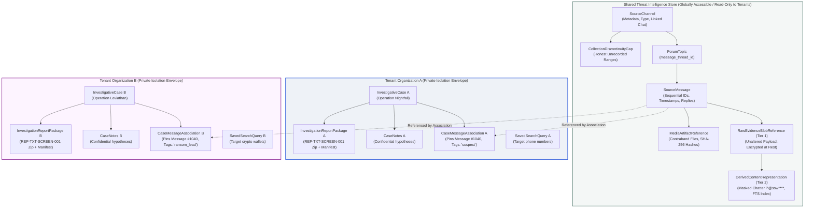

# TTI Gate 4B.1 — Entity-Relationship Diagrams

**Document Reference:** `TTI-ARCH-ERD-001`  
**Product:** Telegram Threat Intelligence (TTI)  
**Lifecycle Stage:** Gate 4B.1 — Logical Data Architecture  
**Author:** Principal Data Architect & Security Architect  
**Date:** October 2026  
**Parent Specification:** [`docs/architecture/gate_4b_1/logical_data_model.md`](file:///d:/TTI/docs/architecture/gate_4b_1/logical_data_model.md)  

---

## 1. Overview & Diagram Organization

This document provides visual Entity-Relationship Diagrams (ERDs) representing the logical data model defined in [`logical_data_model.md`](file:///d:/TTI/docs/architecture/gate_4b_1/logical_data_model.md). 

To ensure complete conceptual coverage without sacrificing visual readability, the model is presented in three complementary architectural diagrams:
1. **Diagram 1: Core Domain ERD (Identity, Shared Threat Telemetry & Tenant Workspaces)** — Models multi-tenancy, ingestion sources, channel/topic/message hierarchies, sequence gaps, cases, and private annotations.
2. **Diagram 2: Evidence Provenance, Media & Reporting ERD (`REP-TXT-SCREEN-001`)** — Models Tier 1 verbatim original evidence, Tier 2 derived searchable text, media assets, Playwright focus/context screenshots, report packages, manifests, and audit logging.
3. **Diagram 3: Boundary & Data Ownership Topography** — Structural diagram visualizing how tenant isolation envelopes partition private case records while allowing read-only access to shared threat intelligence.

---

## 2. Diagram 1: Core Domain ERD (Tenants, Threat Store & Cases)

```mermaid
erDiagram
    %% Identity, Access & Tenancy
    TENANT_ORGANIZATION ||--o{ TENANT_MEMBERSHIP : "employs"
    USER_PROFILE ||--o{ TENANT_MEMBERSHIP : "participates_in"
    TENANT_MEMBERSHIP ||--|{ ROLE_PERMISSION : "grants"

    %% Shared Threat Intelligence Ingestion
    SOURCE_CONNECTOR ||--o{ INGESTION_JOB_RUN : "executes"
    INGESTION_JOB_RUN ||--o{ SOURCE_CHANNEL : "polls"
    SOURCE_CHANNEL ||--o{ FORUM_TOPIC : "branches_into"
    SOURCE_CHANNEL ||--o{ SOURCE_MESSAGE : "contains"
    FORUM_TOPIC ||--o{ SOURCE_MESSAGE : "scopes"
    SOURCE_CHANNEL ||--o{ COLLECTION_DISCONTINUITY_GAP : "records"
    SOURCE_MESSAGE ||--o{ MESSAGE_REVISION_RECORD : "tracks_edits"

    %% Tenant Workspace & Private Cases
    TENANT_ORGANIZATION ||--o{ INVESTIGATIVE_CASE : "owns"
    TENANT_ORGANIZATION ||--o{ SAVED_SEARCH_QUERY : "configures"
    TENANT_ORGANIZATION ||--o{ WATCHLIST_RULE : "maintains"
    
    INVESTIGATIVE_CASE ||--o{ CASE_NOTE : "contains"
    INVESTIGATIVE_CASE ||--o{ CASE_MESSAGE_ASSOCIATION : "pins"
    
    %% Bridge: Case Pinning Shared Message
    SOURCE_MESSAGE ||--o{ CASE_MESSAGE_ASSOCIATION : "referenced_by"

    %% Watchlists
    WATCHLIST_RULE ||--o{ WATCHLIST_ALERT_EVENT : "triggers"
    SOURCE_MESSAGE ||--o{ WATCHLIST_ALERT_EVENT : "matched_in"

    TENANT_ORGANIZATION {
        string tenant_id PK "UUID canonical identifier"
        string organization_name "Legal entity title"
        string market_profile "LAW_ENFORCEMENT or CORP_SOC"
        string account_status "ACTIVE, SUSPENDED, DEPROVISIONED"
        timestamp created_at_utc "Creation timestamp"
    }

    USER_PROFILE {
        string user_id PK "UUID identifier"
        string email_address "Corporate or agency email"
        string full_name "Analyst badge name"
        string account_state "ACTIVE, LOCKED, INVITED"
        boolean mfa_enforced "MFA compliance flag"
    }

    TENANT_MEMBERSHIP {
        string membership_id PK "Composite key"
        string tenant_id FK "Owning tenant"
        string user_id FK "Associated user"
        string assigned_role "ADMIN, LEAD, INVESTIGATOR, READER"
        string membership_status "ACTIVE, REVOKED"
    }

    SOURCE_CONNECTOR {
        string connector_id PK "Connector identifier"
        string connector_type "MTPROTO, BOT_API, INERT_STUB"
        string operational_state "HEALTHY, THROTTLED, DISABLED"
        int consecutive_flood_waits "Rate limit circuit breaker"
    }

    SOURCE_CHANNEL {
        bigint channel_id PK "Canonical channel ID"
        bigint platform_native_id "Telegram numeric ID"
        string channel_title "Display title"
        string channel_handle "Username handle (@name)"
        string channel_type "BROADCAST, FORUM, DISCUSSION"
        bigint linked_discussion_chat_id "Linked chat ID"
        boolean is_monitored "Collection flag"
    }

    FORUM_TOPIC {
        string topic_id PK "Composite channel + thread ID"
        bigint channel_id FK "Parent channel"
        int message_thread_id "Telegram topic root ID"
        string topic_title "Topic name"
    }

    SOURCE_MESSAGE {
        string message_id PK "Composite channel + seq ID"
        bigint channel_id FK "Parent channel"
        int source_sequence_id "Native message sequential ID"
        int message_thread_id "Optional topic reference"
        bigint sender_native_id "Author numeric ID"
        string sender_username "Author username"
        timestamp broadcast_timestamp_utc "Broadcast timestamp"
        int reply_to_message_id "Parent reply sequence ID"
        bigint forward_origin_chat_id "Forward origin ID"
        boolean has_media "Media attachment flag"
        boolean is_tombstone "Deletion marker"
    }

    COLLECTION_DISCONTINUITY_GAP {
        string gap_id PK "UUID"
        bigint channel_id FK "Parent channel"
        int gap_start_sequence_id "First missing ID"
        int gap_end_sequence_id "Last missing ID"
        timestamp gap_detected_at_utc "Detection timestamp"
        string gap_status "UNRECORDED_DISCONTINUITY"
    }

    MESSAGE_REVISION_RECORD {
        string revision_id PK "UUID"
        string message_id FK "Associated message"
        int revision_sequence "Edit index (1, 2...)"
        timestamp detected_at_utc "Detection timestamp"
        string derived_edited_text "Masked edited text"
    }

    INVESTIGATIVE_CASE {
        string case_id PK "UUID canonical reference"
        string tenant_id FK "Owning tenant"
        string case_title "Investigative title"
        string internal_agency_ref "Warrant or docket ID"
        string case_status "ACTIVE, LOCKED, ARCHIVED"
        string lead_investigator_id FK "Assigned investigator"
        timestamp created_at_utc "Creation timestamp"
    }

    CASE_MESSAGE_ASSOCIATION {
        string association_id PK "Composite case + message"
        string case_id FK "Owning case"
        string message_id FK "Referenced message"
        string investigator_tags "JSON array of tags"
        string analyst_annotation "Confidential notes"
        timestamp pinned_at_utc "Association timestamp"
    }

    CASE_NOTE {
        string note_id PK "UUID"
        string case_id FK "Parent case"
        string author_user_id FK "Author analyst"
        string note_title "Topic heading"
        string note_content "Private analytical body"
        timestamp created_at_utc "Creation timestamp"
    }

    SAVED_SEARCH_QUERY {
        string saved_query_id PK "UUID"
        string tenant_id FK "Owning tenant"
        string query_label "Observable title"
        string raw_query_string "Search query terms"
        string query_hash "SHA-256 for logging"
    }

    WATCHLIST_RULE {
        string watchlist_id PK "UUID"
        string tenant_id FK "Owning tenant"
        string rule_name "Alert rule name"
        string match_pattern "Observable regex/keyword"
        boolean is_active "Active flag"
    }

    WATCHLIST_ALERT_EVENT {
        string alert_event_id PK "UUID"
        string watchlist_id FK "Parent rule"
        string matched_message_id FK "Triggering message"
        timestamp triggered_at_utc "Alert timestamp"
        string triage_status "NEW, INVESTIGATING, CLOSED"
    }
```

---

## 2. Diagram 2: Evidence Provenance, Media & Reporting ERD (`REP-TXT-SCREEN-001`)

```mermaid
erDiagram
    %% Core Message to Evidence / Provenance
    SOURCE_MESSAGE ||--o| RAW_EVIDENCE_BLOB : "captured_as_verbatim"
    RAW_EVIDENCE_BLOB ||--|| DERIVED_CONTENT : "normalized_and_masked_into"
    SOURCE_MESSAGE ||--o{ MEDIA_ARTIFACT : "contains_binary"

    %% Case to Reporting Deliverables (REP-TXT-SCREEN-001)
    INVESTIGATIVE_CASE ||--o{ INVESTIGATION_REPORT_PACKAGE : "generates"
    INVESTIGATION_REPORT_PACKAGE ||--|| TEXT_REPORT_DOCUMENT : "bundles_plain_text"
    INVESTIGATION_REPORT_PACKAGE ||--o{ MESSAGE_SCREENSHOT : "bundles_focus_screenshots"
    INVESTIGATION_REPORT_PACKAGE ||--o{ THREAD_CONTEXT_SCREENSHOT : "bundles_context_screenshots"
    INVESTIGATION_REPORT_PACKAGE ||--|| EVIDENCE_PACKAGE_MANIFEST : "cryptographically_sealed_by"

    %% Link between Screenshots and Source Message
    SOURCE_MESSAGE ||--o{ MESSAGE_SCREENSHOT : "visually_captured_in"
    SOURCE_MESSAGE ||--o{ THREAD_CONTEXT_SCREENSHOT : "centered_in"

    %% Governance & Audit
    TENANT_ORGANIZATION ||--o{ AUDIT_EVENT_RECORD : "scoped_to"
    INVESTIGATIVE_CASE ||--o| RETENTION_POLICY_ASSIGNMENT : "governed_by"

    RAW_EVIDENCE_BLOB {
        string raw_blob_id PK "UUID or Content Digest"
        string source_message_id FK "Associated message"
        string payload_sha256_hash "SHA-256 of raw bytes"
        bigint byte_size "Payload size"
        string payload_storage_locator "Encrypted vault locator"
        string encryption_key_ref "KMS key reference"
        timestamp ingestion_timestamp_utc "Acquisition timestamp"
    }

    DERIVED_CONTENT {
        string derived_id PK "UUID"
        string source_message_id FK "Associated message"
        string provenance_raw_blob_id FK "Pointer to Tier 1 blob"
        string masked_message_text "Heuristically masked text"
        int detected_credential_count "Masked patterns count"
        string sanitization_flags "JSON filter flags"
        timestamp transformation_timestamp_utc "Derivation timestamp"
    }

    MEDIA_ARTIFACT {
        string artifact_id PK "UUID or SHA-256 Digest"
        string source_message_id FK "Originating message"
        string media_sha256_hash "SHA-256 of media bytes"
        string mime_type "Content type (image, pdf)"
        bigint byte_size "Byte size (capped 50MB)"
        string storage_vault_locator "Isolated vault locator"
        string thumbnail_locator "Sanitized preview pointer"
    }

    INVESTIGATION_REPORT_PACKAGE {
        string report_package_id PK "Shared investigation reference"
        string case_id FK "Parent case"
        string package_sha256_hash "SHA-256 of sealed ZIP"
        string package_status "DRAFT, PREVIEW, SEALED"
        string compiled_by_user_id "Investigator actor"
        timestamp generated_at_utc "Creation timestamp"
        timestamp finalized_at_utc "Pre-delivery sign-off"
    }

    TEXT_REPORT_DOCUMENT {
        string text_doc_id PK "UUID"
        string report_package_id FK "Parent report package"
        string document_sha256_hash "SHA-256 of report.txt"
        string mandatory_summary_body "UTF-8 structured text"
    }

    MESSAGE_SCREENSHOT {
        string focus_shot_id PK "UUID"
        string report_package_id FK "Parent report package"
        string target_message_id FK "Target message"
        string image_sha256_hash "SHA-256 of msg_focus.png"
        string image_storage_locator "Vault storage pointer"
        timestamp capture_timestamp_utc "Rendering timestamp"
        string renderer_version_meta "Playwright version"
    }

    THREAD_CONTEXT_SCREENSHOT {
        string context_shot_id PK "UUID"
        string report_package_id FK "Parent report package"
        string target_message_id FK "Target message"
        int context_window_size "Messages before/after"
        string image_sha256_hash "SHA-256 of msg_context.png"
        string image_storage_locator "Vault storage pointer"
    }

    EVIDENCE_PACKAGE_MANIFEST {
        string manifest_id PK "UUID"
        string report_package_id FK "Parent report package"
        string manifest_sha256_hash "SHA-256 of manifest.json"
        string cataloged_items "JSON array of file hashes"
        string legal_disclaimer_text "Admissibility disclaimer"
    }

    AUDIT_EVENT_RECORD {
        string audit_event_id PK "UUID or Monotonic ID"
        string tenant_id FK "Scoped tenant organization"
        string user_id FK "Actor user"
        string action_type "CASE_VIEW, UNMASK, EXPORT"
        string target_identifier_hash "SHA-256 of query target"
        timestamp event_timestamp_utc "Immutable timestamp"
        string client_ip_address "Network origin"
    }

    RETENTION_POLICY_ASSIGNMENT {
        string policy_assignment_id PK "UUID (Provisional)"
        string target_entity_type "CASE or THREAT_FEED"
        string target_entity_id "Associated entity ID"
        string retention_schedule_type "TTL_180, CASE_LOCK"
        timestamp expiry_timestamp_utc "Disposal timestamp"
        string expungement_auth_ref "Legal warrant/court order"
    }
```

---

## 3. Diagram 3: Boundary & Data Ownership Topography

This diagram illustrates how data entities reside within clear operational security boundaries:

### Key Ownership Insights from Topography:
1. **Single Threat Record, Independent Tenant Context:** `SourceMessage #1040` exists exactly once in the shared layer. Tenant A can associate it with `Case A` (tagging it "suspect") while Tenant B concurrently associates it with `Case B` (tagging it "ransom_lead"). Neither tenant can observe that the other has pinned or analyzed that message.
2. **Derived Text vs. Original Payload:** Search queries execute against `DerivedContentRepresentation (Tier 2)` where credentials are masked. The underlying `RawEvidenceBlobReference (Tier 1)` remains immutable and encrypted.
3. **No Cross-Boundary Foreign Key Mutations:** Tenant operations can never insert, update, or delete rows in the `Shared_Global_Boundary`. Tenant actions write strictly to their own scoped tables.

---

*Next Logical Model Deliverable:* [`tenant_isolation_and_data_ownership.md`](file:///d:/TTI/docs/architecture/gate_4b_1/tenant_isolation_and_data_ownership.md)
