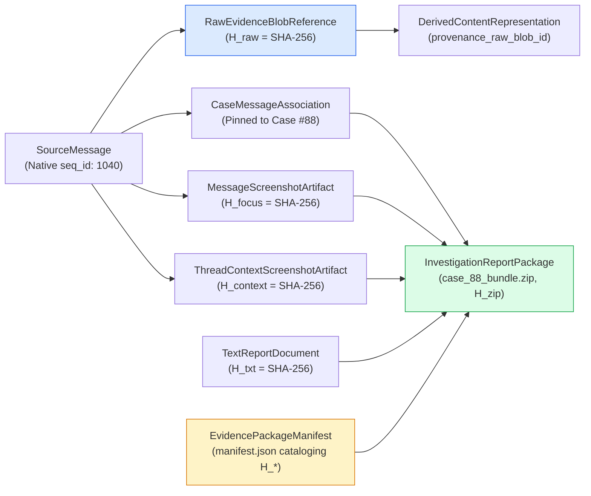
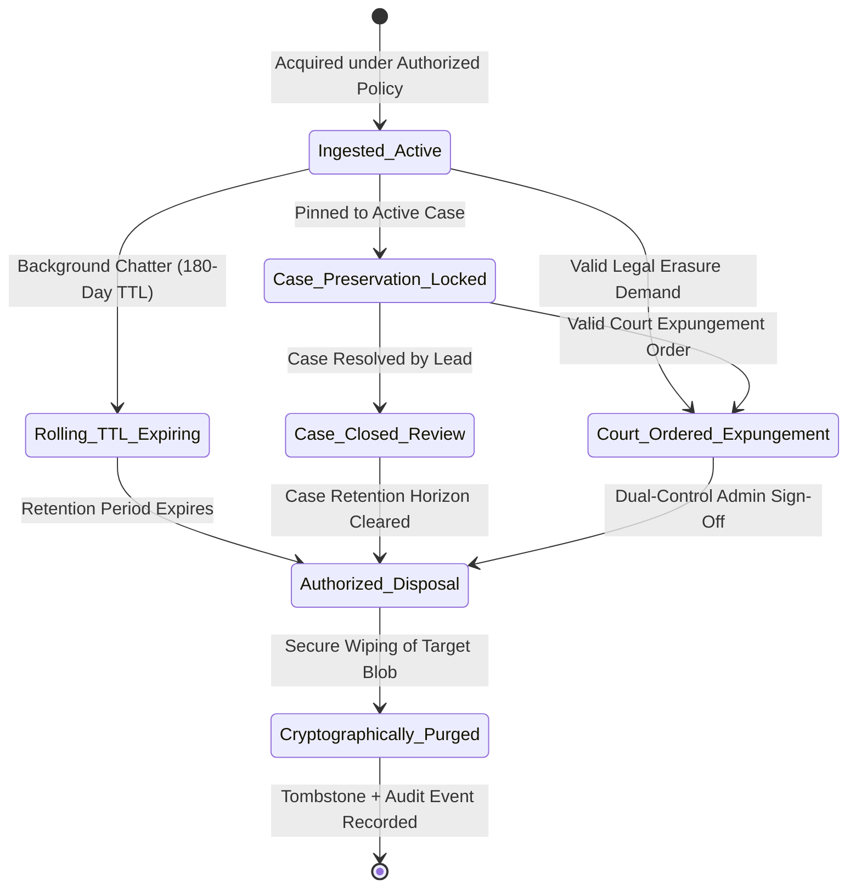

# TTI Gate 4B.1 — Evidence Provenance & Retention Model

**Document Reference:** `TTI-ARCH-PROV-001`  
**Product:** Telegram Threat Intelligence (TTI)  
**Lifecycle Stage:** Gate 4B.1 — Logical Data Architecture  
**Author:** Principal Data Architect & Security Architect  
**Date:** October 2026  
**Parent Specifications:**  
- [`docs/architecture/gate_4b_1/logical_data_model.md`](file:///d:/TTI/docs/architecture/gate_4b_1/logical_data_model.md)  
- [`docs/architecture/gate_4a/trust_boundaries_and_data_flows.md`](file:///d:/TTI/docs/architecture/gate_4a/trust_boundaries_and_data_flows.md)  
- [`docs/product/product_baseline/security_and_evidence_requirements.md`](file:///d:/TTI/docs/product/product_baseline/security_and_evidence_requirements.md)  
- [`docs/product/gate_3b/reporting_requirements_review.md`](file:///d:/TTI/docs/product/gate_3b/reporting_requirements_review.md)  

---

## 1. Executive Summary & Forensic Principles

Digital threat intelligence evidence must withstand rigorous scrutiny in corporate compliance reviews and judicial criminal proceedings. Concurrently, data architecture must comply with strict privacy principles of **data minimization**, **proportionality**, and **lawful basis**.

This document formalizes:
1. **The Strict Three-Tier Evidence Separation Model**, ensuring that original source artifacts are preserved verbatim without silent mutation or contamination by derived search representations.
2. **Deterministic Provenance Chains**, linking every derivative search token, masked display string, focus screenshot, context screenshot, and export bundle back to its originating source transmission.
3. **Approved Requirement Traceability ([REP-TXT-SCREEN-001](file:///d:/TTI/docs/product/product_baseline/functional_requirements.md#rep-txt-screen-001))**, formalizing the plain-text summary, dual screenshots, and cryptographic manifest container.
4. **The Retention & Disposal Model**, explicitly reconciling evidence preservation goals with unresolved stakeholder decisions (`DEC-08`), legal expungement mandates, and the emergency purging of unlawfully collected content.

---

## 2. The Three-Tier Evidence & Data Separation Architecture

To guarantee forensic defensibility while enforcing sensitive data minimization, the logical data model separates evidence into three distinct conceptual tiers:

```mermaid
flowchart TD
    subgraph External_Source ["External Source Acquisition"]
        RawTelegramWire["Telegram MTProto / Bot API Transmission\n(Wire-Format Protocol Buffer / JSON)"]
    end

    subgraph Tier1 ["Tier 1: Verbatim Original Evidence Vault"]
        RawBlob["RawEvidenceBlobReference\n- Verbatim source payload (unaltered)\n- SHA-256 computed on raw bytes\n- Encrypted at rest (AES-256-GCM)\n- Retained ONLY if authorized & proportionate"]
        MediaBlob["MediaArtifactReference\n- Downloaded contraband binary files\n- SHA-256 computed on file bytes\n- Isolated from web roots"]
    end

    subgraph Tier2 ["Tier 2: Derived Searchable & Display Layer"]
        DerivedText["DerivedContentRepresentation\n- Heuristically masked chatter (P@ssw****)\n- Normalized Unicode (NFC), XSS stripped\n- Full-Text Search Tokens (tsvector, pg_trgm)\n- Explicit pointer: provenance_raw_blob_id"]
    end

    subgraph Tier3 ["Tier 3: Operational Telemetry & Log Layer"]
        AuditRecord["AuditEventRecord\n- Actor user_id, action, timestamp\n- Redacted query string -> target_identifier_hash\n- Zero cleartext passwords or search targets"]
    end

    RawTelegramWire -->|Ingestion Hash Computed (FR-EVI-002)| RawBlob
    RawTelegramWire -->|Binary Download| MediaBlob

    RawBlob -->|Derivation & Masking Pipeline (FR-COL-004)| DerivedText
    
    DerivedText -.->|Analyst Interaction| AuditRecord
    RawBlob -.->|Unmasking Audit Event| AuditRecord
```

### 2.1 Tier 1: Verbatim Original Evidence
* **Collection Policy Prerequisite:** The platform does **not** assume that every raw payload must be collected or retained. Collection and retention must be legally authorized, necessary, and proportionate to the approved investigative mission (`DEC-02`).
* **Verbatim Immutability Rule:** When original evidence is stored, it is stored exactly as received from the source wire protocol. Normalization, string trimming, heuristic credential masking, or encoding changes are **strictly prohibited** within Tier 1.
* **Cryptographic Ingestion Hash (`FR-EVI-002`):** A SHA-256 digest is calculated immediately across the verbatim raw bytes upon arrival:
  $$H_{\text{raw}} = \text{SHA-256}(\text{Raw Payload Bytes})$$
* **Storage Encryption (`NFR-SEC-004`):** Tier 1 raw evidence payloads and credential dumps are encrypted at rest using AES-256-GCM with tenant-managed or platform-managed KMS keys.

### 2.2 Tier 2: Derived Searchable & Display Layer
* **Defensive Purpose:** Enables fast full-text searching (`FR-SCH-001`) and interactive analyst thread navigation (`FR-THR-001`) without exposing investigators or system operators to unmasked cleartext credentials or malicious script injection.
* **Heuristic Masking Rule (`DEC-06 Option B Aligned`):** The normalization engine detects credential patterns (`user:password`, `API keys`) and transforms them into masked tokens (`P@ssw****`).
* **Non-Overwriting Invariant:** Transformations generate new derived representations in Tier 2. **They must never overwrite or mutate Tier 1 original evidence.**
* **Mandatory Provenance Pointer:** Every `DerivedContentRepresentation` contains a persistent, immutable pointer (`provenance_raw_blob_id`) linking it back to the exact Tier 1 record from which it was derived.

### 2.3 Tier 3: Operational Telemetry & Log Layer
* **Log Sanitization Invariant (`ADR-008`, `NFR-OBS-001`):** Application log streams must never contain raw passwords, sensitive search targets (e.g., target phone numbers, suspect names), or private case notes.
* **Cryptographic Query Hashing:** The logging engine replaces raw search terms with cryptographic HMAC/SHA-256 hashes (`target_identifier_hash`), allowing operational debugging and performance profiling without leaking active investigative targets.

---

## 3. End-to-End Cryptographic Provenance Chain

Every deliverable generated by the platform traces back through a deterministic, unbroken cryptographic chain of custody:



### 3.1 Provenance Verification Algorithm
Any downstream judicial authority or defense examiner can verify package integrity via the following deterministic workflow:
1. **Archive Hash Check:** Compute $\text{SHA-256}(\text{case\_88\_bundle.zip})$ and verify equality with `package_sha256_hash`.
2. **Manifest Integrity Check:** Unpack the archive; compute $\text{SHA-256}(\text{manifest.json})$ and verify against the signature record.
3. **Item-Level Verification:** For every file cataloged in `manifest.json` (`report.txt`, `assets/msg_1040_focus.png`, `assets/msg_1040_thread_context.png`), compute its SHA-256 digest and verify exact equality with the corresponding hash recorded in the manifest.
4. **Source Attribution Check:** Cross-reference the message identifiers and timestamps in `report.txt` against the native Telegram sequence metadata cataloged during collection.

---

## 4. Approved Reporting Deliverable Model (`REP-TXT-SCREEN-001`)

The reporting pipeline formalizes the approved requirements of [`REP-TXT-SCREEN-001`](file:///d:/TTI/docs/product/gate_3b/reporting_requirements_review.md).

### 4.1 Mandatory Deliverable Components
Every formal investigation report package generated by TTI bundles four mandatory, inseparable elements:

| Component | Logical Entity | File Representation | Core Functional Purpose |
| :--- | :--- | :--- | :--- |
| **1. Plain-Text Report** | `TextReportDocument` | `report.txt` | Human-readable, machine-parseable UTF-8 document containing executive summary, case references, findings, and evidence cross-references. |
| **2. Relevant-Message Screenshots** | `MessageScreenshotArtifact` | `assets/msg_{id}_focus.png` | Sandboxed headless browser capture isolating the target message, verifying its visual appearance and formatting. |
| **3. Thread-Context Screenshots** | `ThreadContextScreenshotArtifact` | `assets/msg_{id}_thread_context.png` | Panoramic capture showing the target message surrounded by chronological context (3 messages before, 3 messages after). |
| **4. Integrity Manifest** | `EvidencePackageManifest` | `manifest.json` | Authoritative cryptographic catalog binding all components together with SHA-256 digests and legal disclaimers. |

### 4.2 Separation of Mandatory vs. Source-Dependent Fields
To maintain forensic defensibility, the reporting engine enforces a strict boundary between mandatory guaranteed fields and source-dependent fields:

* **Mandatory Guaranteed Fields (Guaranteed by TTI):**
  - Unique Report Reference ID (`report_package_id`).
  - Parent Case Identifier (`case_id`).
  - Report Generation Timestamp (UTC) & Local Offset.
  - Generating Analyst Identifier (`user_id`).
  - Target Observable / Query Seed.
  - Collector Provenance Metadata (Collector ID, Session Timestamp).
  - Cryptographic Screenshot Manifest Table.
  - Non-Completeness & Admissibility Disclaimers.
* **Source-Dependent Fields (Included ONLY when exposed by Telegram):**
  - Author Display Name and Username handle.
  - Author Numeric User ID (masked if hidden by privacy settings).
  - Forward Origin Chat ID and Forward Original Message ID.
  - Reply-To Parent Message Sequence ID.
  - Attached Media Filenames and File Hashes.

### 4.3 Mandatory Legal Disclaimers
In compliance with `NFR-LEGAL-001`, every generated `report.txt` and `manifest.json` embeds the following standard legal notice:
> *"Cryptographic SHA-256 hashes detect subsequent alteration of exported files across transit. They do not independently establish upstream message authenticity, origin truthfulness, or courtroom admissibility. Downstream judicial admissibility requires independent corroboration and chain-of-custody verification."*

---

## 5. Storage Immutability, Retention & Disposal Model

### 5.1 The Fundamental Architectural Trade-Off
A critical unresolved challenge in threat intelligence data architecture is reconciling two opposing imperatives:
1. **Evidentiary Tamper-Proofing:** Investigators require guarantees that seized digital evidence cannot be altered, overwritten, or prematurely deleted before a criminal trial concludes.
2. **Lawful Disposal & Expungement Obligations:** Compliance regulations, data protection frameworks, court-ordered expungements, and the accidental ingestion of unlawful content (e.g., non-consensual imagery, CSAM, or unauthorized personal data) mandate the ability to permanently erase specific records.

### 5.2 Status: Provisional Pending Resolution of `DEC-08`
The proposal for hardware/cloud WORM (Write Once, Read Many) or S3 Object Lock storage is formally designated:
# **`PROVISIONAL PENDING RESOLUTION OF DEC-08 AND RELEVANT LEGAL REVIEW`**

### 5.3 Governance & Policy Invariants:
1. **No Default Approval of Compliance Mode:** Configuring storage buckets in un-reversible cloud "Compliance Mode" (which prevents deletion by anyone, including cloud root administrators) is **strictly rejected for MVP**. If unlawful material were ingested, Compliance Mode would prevent mandatory legal purging.
2. **No Default Approval of Governance Mode or Override Workflows:** Neither Governance Mode, application-level immutability flags, nor administrative override workflows are declared approved by default. Selection of the final storage immutability mechanism requires:
   - Formal executive resolution of `DEC-08` (*Data Retention & Lifecycle Purge Policies*).
   - Formal Legal Counsel review regarding data protection expungement obligations.
   - Audited, dual-control cryptographic access governance.
3. **Legal Review Dependency:** Legal review is identified as a necessary architectural dependency. The architecture does **not** assert that GDPR or any specific statute automatically dictates a particular technical mechanism.

### 5.4 Conceptual Disposal Lifecycle
When `DEC-08` is formally resolved, disposal workflows will adhere to the following conceptual state model:



* **Dual-Control Erasure:** Expunging an active evidence item requires two independent authorized signatures (`TENANT_ADMIN` + `LEGAL_COMPLIANCE_OFFICER`).
* **Audit Trail Preservation:** When an evidence blob is purged, its physical bytes are erased, but an immutable tombstone record in `AuditEventRecord` records the authorization reference, the hash of the deleted item, the acting administrators, and the timestamp.

---

## 6. Traceability of Unresolved Operational Decisions

To ensure absolute governance integrity, the operational dimensions governing this model remain explicitly tracked as **Pending Stakeholder Decisions**:

| Operational Dimension | Governing Decision Ref | Current Governance Status | Architecture Handling |
| :--- | :---: | :---: | :--- |
| **Screenshot Capture Modality** | `DEC-13` (Modality) | `OPEN` | Architecture supports automated, manual, and hybrid rendering; operational policy remains open. |
| **Data Retention Horizons** | `DEC-08` | `OPEN / PROPOSED` | Storage immutability marked provisional; 180-day rolling TTL vs. case lock pending sign-off. |
| **Cryptographic Standards** | `DEC-07` | `PROPOSED` | Internal SHA-256 ledger approved for MVP; external RFC 3161 TSA deferred to Release 2. |
| **Source Collection Authority** | `DEC-02` | `OPEN` | Raw payload collection requires authorized, necessary, and proportionate legal grounding. |
| **Courtroom Admissibility** | Legal Governance | `UNAPPROVED` | Platform provides tamper-detection manifests; legal admissibility requires judicial corroboration. |

---

*Next Logical Model Deliverable:* [`gate_4b_1_review_report.md`](file:///d:/TTI/docs/architecture/gate_4b_1/gate_4b_1_review_report.md)
