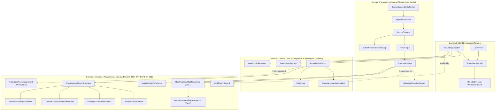

# TTI Gate 4B.1 — Logical Data Model Specification

**Document Reference:** `TTI-ARCH-LOGMOD-001`  
**Product:** Telegram Threat Intelligence (TTI)  
**Lifecycle Stage:** Gate 4B.1 — Logical Data Architecture  
**Author:** Principal Data Architect & Security Architect  
**Date:** October 2026  
**Governance Status:** `PROPOSED LOGICAL MODEL — PENDING ARCHITECTURE REVIEW`  
**Parent Specifications:**  
- [`docs/product/product_baseline/functional_requirements.md`](file:///d:/TTI/docs/product/product_baseline/functional_requirements.md)  
- [`docs/product/product_baseline/non_functional_requirements.md`](file:///d:/TTI/docs/product/product_baseline/non_functional_requirements.md)  
- [`docs/product/product_baseline/security_and_evidence_requirements.md`](file:///d:/TTI/docs/product/product_baseline/security_and_evidence_requirements.md)  
- [`docs/architecture/gate_4a/system_context.md`](file:///d:/TTI/docs/architecture/gate_4a/system_context.md)  
- [`docs/architecture/gate_4a/subsystem_decomposition.md`](file:///d:/TTI/docs/architecture/gate_4a/subsystem_decomposition.md)  
- [`docs/architecture/gate_4a/trust_boundaries_and_data_flows.md`](file:///d:/TTI/docs/architecture/gate_4a/trust_boundaries_and_data_flows.md)  
- [`docs/architecture/gate_4a/architecture_decision_register.md`](file:///d:/TTI/docs/architecture/gate_4a/architecture_decision_register.md)  
- [`docs/architecture/gate_4a/targeted_consistency_check.md`](file:///d:/TTI/docs/architecture/gate_4a/targeted_consistency_check.md)  

---

## 1. Modeling Principles & Domain Partitioning

### 1.1 Purpose & Technology-Neutral Scope
This specification defines the implementation-independent **Logical Data Model** for the Telegram Threat Intelligence (TTI) platform. It formalizes:
1. Core conceptual entities, logical attributes, business keys, and relationship cardinalities required for the approved Release 1 MVP scope.
2. The strict structural partition between **Shared Threat Intelligence Data** (globally collected public/semi-public chatter) and **Tenant-Owned Case Workspaces** (confidential customer investigations, notes, tags, and reports).
3. Explicit **Evidence Provenance & Transformation Boundaries**, guaranteeing that verbatim original evidence is never mutated or overwritten by derived search indexes or masked text.
4. Retention policy associations and audit telemetry.

This document deliberately avoids physical database constructs: it does not prescribe SQL table names, specific indexing engines, ORM entity mappings, partitioning schemes, or physical storage vendors.

### 1.2 Domain Partitioning Architecture
The logical data model is organized into four discrete, cohesive data domains:



---

## 2. Domain 1: Identity, Access & Tenant Organization

This domain models organizational clients, user identities, fine-grained access roles, and tenancy scoping.

### 2.1 Entity: `TenantOrganization`
* **Purpose & Ownership:** Represents a discrete legal customer entity (e.g., a specific police department, state cyber division, or corporate SOC enterprise). Platform administration owns tenant provisioning.
* **Conceptual Identifier:** `tenant_id` (UUID / Canonical String, e.g., `TNT-7049-LEA`).
* **Important Logical Attributes:**
  - `organization_name`: Official legal or operational entity title.
  - `market_profile`: Classification (`LAW_ENFORCEMENT`, `CORPORATE_SOC`, `MANAGED_SERVICE`).
  - `account_status`: Operational state (`PENDING_APPROVAL`, `ACTIVE`, `SUSPENDED`, `DEPROVISIONED`). Default newly registered organizations enter `PENDING_APPROVAL` pending verification (`DEC-22`).
  - `retention_tier`: Default retention horizon reference (subject to `DEC-08`).
  - `created_at_utc`: Timestamp of organization registration.
* **Relationships & Cardinalities:**
  - `1:N` with `TenantMembership` (One tenant has multiple member users).
  - `1:N` with `InvestigativeCase` (One tenant owns zero or more confidential cases).
  - `1:N` with `SavedSearchQuery` (One tenant owns zero or more automated queries).
  - `1:N` with `WatchlistRule` (One tenant owns zero or more real-time watchlists).
  - `1:N` with `AuditEventRecord` (All tenant actions emit tenant-scoped audit records).
* **Data Classification:** Tenant Operational Metadata.
* **Integrity & Authorization Constraints:** Missing or null `tenant_id` in application context must fail closed with immediate access denial.
* **Traceability:** [`FR-TEN-001`](file:///d:/TTI/docs/product/product_baseline/functional_requirements.md#fr-ten-001), [`NFR-SEC-001`](file:///d:/TTI/docs/product/product_baseline/non_functional_requirements.md#nfr-sec-001), [`DEC-05`](file:///d:/TTI/docs/product/product_baseline/decision_and_traceability_matrix.md#dec-05).

---

### 2.2 Entity: `UserProfile`
* **Purpose & Ownership:** Represents an individual human investigator, analyst, or administrator.
* **Conceptual Identifier:** `user_id` (UUID / Canonical String, e.g., `USR-1042`).
* **Important Logical Attributes:**
  - `email_address`: Unique corporate or departmental email.
  - `full_name`: Investigator name or badge handle.
  - `account_state`: Security status (`ACTIVE`, `LOCKED`, `INVITED`).
  - `mfa_enforced`: Boolean indicating mandatory multi-factor authentication compliance.
  - `last_login_utc`: Telemetry timestamp of last authenticated session.
* **Relationships & Cardinalities:**
  - `1:N` with `TenantMembership` (A user may belong to one or more tenants, e.g., a multi-agency task force).
  - `1:N` with `CaseNote` (Author of case annotations).
  - `1:N` with `AuditEventRecord` (Actor in audit trails).
* **Data Classification:** Tenant Operational Metadata.
* **Traceability:** [`FR-TEN-002`](file:///d:/TTI/docs/product/product_baseline/functional_requirements.md#fr-ten-002), [`NFR-SEC-005`](file:///d:/TTI/docs/product/product_baseline/non_functional_requirements.md#nfr-sec-005).

---

### 2.3 Entity: `TenantMembership`
* **Purpose & Ownership:** Associates a `UserProfile` with a `TenantOrganization`, defining their authorized operational role and scope within that organization.
* **Conceptual Identifier:** `membership_id` (Composite: `tenant_id` + `user_id`).
* **Important Logical Attributes:**
  - `assigned_role`: High-level operational role (`TENANT_ADMIN`, `INVESTIGATOR_LEAD`, `INVESTIGATOR`, `READ_ONLY_ANALYST`).
  - `membership_status`: Status (`ACTIVE`, `REVOKED`, `PENDING_ACCEPTANCE`).
  - `granted_at_utc`: Timestamp of role assignment.
* **Relationships & Cardinalities:**
  - `N:1` with `TenantOrganization`.
  - `N:1` with `UserProfile`.
  - `1:N` with `RoleDefinition` (Maps to explicit permission grants).
* **Data Classification:** Tenant Security Metadata.
* **Integrity Constraints:** Role changes immediately invalidate active authorization tokens for that membership.
* **Traceability:** [`FR-TEN-002`](file:///d:/TTI/docs/product/product_baseline/functional_requirements.md#fr-ten-002), [`DEC-12`](file:///d:/TTI/docs/product/product_baseline/decision_and_traceability_matrix.md#dec-12).

---

### 2.4 Entity: `RoleDefinition` & `PermissionGrant`
* **Purpose & Ownership:** Defines granular permission tokens (`cases:create`, `evidence:export`, `credential:unmask`, `reports:sign`) assigned to roles.
* **Conceptual Identifier:** `permission_id` (String token, e.g., `cases:read_all`).
* **Important Logical Attributes:**
  - `permission_domain`: Target subsystem (`CASES`, `SEARCH`, `EVIDENCE`, `ADMIN`).
  - `action_type`: Permitted operation (`READ`, `WRITE`, `EXPORT`, `UNMASK`, `ADMIN`).
  - `is_sensitive_action`: Boolean requiring elevated multi-factor approval or high-severity audit logging.
* **Data Classification:** Platform Security Policy.
* **Traceability:** [`FR-TEN-002`](file:///d:/TTI/docs/product/product_baseline/functional_requirements.md#fr-ten-002), [`NFR-SEC-001`](file:///d:/TTI/docs/product/product_baseline/non_functional_requirements.md#nfr-sec-001).

---

## 3. Domain 2: Ingestion & Shared Threat Store (Global Layer)

This domain models public and semi-public threat data collected from external channels. Ingested records in this domain are **globally accessible (read-only)** to authorized tenants, collected once to avoid duplicate network load, and immutable to customer actions.

### 3.1 Entity: `SourceConnectorDefinition`
* **Purpose & Ownership:** Configures an ingestion pipeline instance (e.g., MTProto client worker, Bot API poller, or simulated offline test fixture). Owned by Platform Administration.
* **Conceptual Identifier:** `connector_id` (String, e.g., `CONN-MTPROTO-POOL-01`).
* **Important Logical Attributes:**
  - `connector_type`: Adapter classification (`TELEGRAM_MTPROTO`, `TELEGRAM_BOT_API`, `INERT_TEST_FIXTURE`).
  - `operational_state`: Health state (`HEALTHY`, `THROTTLED_BACKOFF`, `DISABLED`, `SESSION_REVOKED`).
  - `consecutive_flood_waits`: Rate-limit circuit breaker metric.
  - `current_backoff_until_utc`: Timestamp until which polling is suspended.
* **Relationships & Cardinalities:**
  - `1:N` with `IngestionJobRun`.
  - `1:N` with `SourceChannel` (Connector assigned to poll specific channels).
* **Data Classification:** Operational Infrastructure Metadata.
* **Traceability:** [`FR-COL-001`](file:///d:/TTI/docs/product/product_baseline/functional_requirements.md#fr-col-001), [`FR-COL-002`](file:///d:/TTI/docs/product/product_baseline/functional_requirements.md#fr-col-002), [`DEC-03`](file:///d:/TTI/docs/product/product_baseline/decision_and_traceability_matrix.md#dec-03).

---

### 3.2 Entity: `IngestionJobRun`
* **Purpose & Ownership:** Records an individual execution batch of a collector polling a channel.
* **Conceptual Identifier:** `job_run_id` (UUID).
* **Important Logical Attributes:**
  - `execution_start_utc` / `execution_end_utc`: Timing window.
  - `messages_polled_count`: Volume retrieved.
  - `status_code`: Outcome (`SUCCESS`, `PARTIAL_GAP_DETECTED`, `FLOOD_WAIT_ENCOUNTERED`, `FAILED`).
  - `flood_wait_penalty_seconds`: Recorded Telegram penalty interval (if throttled).
* **Relationships & Cardinalities:**
  - `N:1` with `SourceConnectorDefinition`.
  - `N:1` with `SourceChannel`.
* **Data Classification:** Operational Provenance Telemetry.
* **Traceability:** [`FR-COL-002`](file:///d:/TTI/docs/product/product_baseline/functional_requirements.md#fr-col-002), [`FR-ADM-001`](file:///d:/TTI/docs/product/product_baseline/functional_requirements.md#fr-adm-001).

---

### 3.3 Entity: `SourceChannel`
* **Purpose & Ownership:** Represents an external monitored Telegram broadcast channel, supergroup, or discussion forum.
* **Conceptual Identifier:** `channel_id` (Internal BigInt / Canonical Hash, e.g., `CHN-100184920394`).
* **Important Logical Attributes:**
  - `platform_native_id`: Telegram numeric channel ID (e.g., `-100184920394`).
  - `channel_title`: Display title captured at collection time.
  - `channel_handle`: Public username handle (`@threat_actor_leaks`), if exposed.
  - `channel_type`: Structure (`BROADCAST_CHANNEL`, `SUPERGROUP_FORUM`, `LINKED_DISCUSSION`).
  - `linked_discussion_chat_id`: Reference to associated discussion group (`linked_chat_id`), if configured.
  - `is_monitored`: Boolean operational collection flag.
  - `first_observed_utc` / `last_polled_utc`: Temporal collection boundaries.
* **Relationships & Cardinalities:**
  - `1:N` with `ForumTopic` (For supergroups organized by topics).
  - `1:N` with `SourceMessage` (One channel contains many messages).
  - `1:N` with `CollectionDiscontinuityGap` (Discontinuities detected within channel sequence).
* **Data Classification:** Shared Global Threat Intelligence.
* **Traceability:** [`FR-COL-001`](file:///d:/TTI/docs/product/product_baseline/functional_requirements.md#fr-col-001), [`FR-THR-002`](file:///d:/TTI/docs/product/product_baseline/functional_requirements.md#fr-thr-002).

---

### 3.4 Entity: `ForumTopic`
* **Purpose & Ownership:** Captures Telegram forum supergroup thread topics partitioned by `message_thread_id`.
* **Conceptual Identifier:** `topic_id` (Composite: `channel_id` + `message_thread_id`).
* **Important Logical Attributes:**
  - `message_thread_id`: Native Telegram integer identifying the topic root.
  - `topic_title`: Human-readable title of the topic partition.
  - `is_closed`: Boolean topic state flag.
* **Relationships & Cardinalities:**
  - `N:1` with `SourceChannel`.
  - `1:N` with `SourceMessage` (Messages posted within this forum topic).
* **Data Classification:** Shared Global Threat Intelligence.
* **Traceability:** [`FR-COL-001`](file:///d:/TTI/docs/product/product_baseline/functional_requirements.md#fr-col-001), [`FR-THR-001`](file:///d:/TTI/docs/product/product_baseline/functional_requirements.md#fr-thr-001).

---

### 3.5 Entity: `SourceMessage`
* **Purpose & Ownership:** Represents an individual Telegram message broadcast or discussion reply.
* **Conceptual Identifier:** `message_id` (Composite: `channel_id` + `source_sequence_id`).
* **Important Logical Attributes:**
  - `channel_id`: Parent channel reference.
  - `source_sequence_id`: Native platform sequential message ID.
  - `message_thread_id`: Optional forum topic root reference.
  - `sender_native_id`: Numeric identifier of author account (where exposed).
  - `sender_username`: Username string (e.g., `@leak_broker`), if available.
  - `broadcast_timestamp_utc`: Broadcast timestamp recorded by Telegram.
  - `reply_to_message_id`: Native sequence ID of parent message in reply chain.
  - `forward_origin_chat_id`: Platform ID of original source if forwarded.
  - `forward_origin_msg_id`: Message ID in original channel if forwarded.
  - `has_media`: Boolean indicating attached media assets.
  - `has_revisions`: Boolean indicating subsequent message edits.
  - `is_tombstone`: Boolean indicating platform deletion notification received.
* **Relationships & Cardinalities:**
  - `N:1` with `SourceChannel`.
  - `N:1` with `ForumTopic` (Optional).
  - `1:N` with `MessageRevisionRecord` (Edit history).
  - `1:1` with `RawEvidenceBlobReference` (Verbatim payload, where authorized and collected).
  - `1:1` with `DerivedContentRepresentation` (Masked/searchable text representation).
  - `1:N` with `MediaArtifactReference` (Zero or more attached media files).
  - `1:N` with `CaseMessageAssociation` (Referenced by zero or more tenant cases).
* **Data Classification:** Shared Global Threat Intelligence.
* **Integrity Constraints:** `SourceMessage` entities cannot be updated or deleted by tenant investigators. Edits append to `MessageRevisionRecord`; deletions set `is_tombstone = True`.
* **Traceability:** [`FR-COL-001`](file:///d:/TTI/docs/product/product_baseline/functional_requirements.md#fr-col-001), [`FR-COL-003`](file:///d:/TTI/docs/product/product_baseline/functional_requirements.md#fr-col-003), [`FR-THR-002`](file:///d:/TTI/docs/product/product_baseline/functional_requirements.md#fr-thr-002).

---

### 3.6 Entity: `CollectionDiscontinuityGap`
* **Purpose & Ownership:** Records a detected missing range of sequential message IDs within a channel.
* **Conceptual Identifier:** `gap_id` (UUID).
* **Important Logical Attributes:**
  - `channel_id`: Channel in which discontinuity occurred.
  - `gap_start_sequence_id`: First unrecorded sequence ID.
  - `gap_end_sequence_id`: Last unrecorded sequence ID.
  - `gap_detected_at_utc`: Timestamp when sequence skip was detected.
  - `gap_status`: State (`UNRECORDED_DISCONTINUITY`, `RECONCILED`).
* **Relationships & Cardinalities:**
  - `N:1` with `SourceChannel`.
* **Data Classification:** Shared Global Threat Intelligence / Provenance Integrity.
* **Honesty Invariant:** The system never synthesizes missing messages or assumes deletion without explicit platform deletion events; gaps are presented honestly as unrecorded sequence ranges.
* **Traceability:** [`FR-COL-003`](file:///d:/TTI/docs/product/product_baseline/functional_requirements.md#fr-col-003), [`FR-THR-001`](file:///d:/TTI/docs/product/product_baseline/functional_requirements.md#fr-thr-001).

---

### 3.7 Entity: `MessageRevisionRecord`
* **Purpose & Ownership:** Preserves historical edits to a message, ensuring analysts can observe changes made by threat actors.
* **Conceptual Identifier:** `revision_id` (UUID).
* **Important Logical Attributes:**
  - `message_id`: Associated source message reference.
  - `revision_sequence`: Monotonically increasing edit index (1, 2, ...).
  - `detected_at_utc`: Timestamp when revision event was ingested.
  - `raw_edited_payload_ref`: Reference to raw edited payload blob.
  - `derived_edited_text`: Masked text of revised content.
* **Relationships & Cardinalities:**
  - `N:1` with `SourceMessage`.
* **Data Classification:** Shared Global Threat Intelligence.
* **Traceability:** [`FR-COL-003`](file:///d:/TTI/docs/product/product_baseline/functional_requirements.md#fr-col-003).

---

## 4. Domain 3: Tenant Case Management & Workspace (Isolated Layer)

Entities in this domain belong **exclusively to a single tenant organization**. They are completely invisible across tenants and contain private investigative work, hypotheses, tags, and custom queries.

### 4.1 Entity: `InvestigativeCase`
* **Purpose & Ownership:** Represents a compartmentalized investigation workspace created by an analyst or law enforcement team. Owned strictly by `TenantOrganization`.
* **Conceptual Identifier:** `case_id` (UUID / Canonical Reference, e.g., `CASE-2026-088`).
* **Important Logical Attributes:**
  - `tenant_id`: Mandatory owning organization identifier.
  - `case_title`: Investigator-assigned case name (e.g., `Operation Nightfall`).
  - `internal_agency_ref`: Optional warrant, docket, or enterprise incident ticket ID.
  - `case_status`: Lifecycle state (`ACTIVE`, `PENDING_REVIEW`, `FINALIZED_LOCKED`, `ARCHIVED`).
  - `lead_investigator_id`: `UserProfile` reference of the primary assigned investigator.
  - `created_at_utc` / `closed_at_utc`: Lifecycle timestamps.
* **Relationships & Cardinalities:**
  - `N:1` with `TenantOrganization`.
  - `1:N` with `CaseMessageAssociation` (Pinned evidence messages).
  - `1:N` with `CaseNote` (Analytical hypotheses and private log entries).
  - `1:N` with `InvestigationReportPackage` (Formal evidence export packages).
  - `0..1:1` with `RetentionPolicyAssignment` (Optional case evidence preservation lock).
* **Data Classification:** Tenant Confidential Case Data.
* **Authorization Invariants:** Queries against `InvestigativeCase` without matching `tenant_id` return `HTTP 404 Not Found` (preventing ID enumeration).
* **Traceability:** [`FR-EVI-001`](file:///d:/TTI/docs/product/product_baseline/functional_requirements.md#fr-evi-001), [`NFR-SEC-001`](file:///d:/TTI/docs/product/product_baseline/non_functional_requirements.md#nfr-sec-001), [`DEC-05`](file:///d:/TTI/docs/product/product_baseline/decision_and_traceability_matrix.md#dec-05).

---

### 4.2 Entity: `CaseMessageAssociation`
* **Purpose & Ownership:** The bridge entity linking a globally shared `SourceMessage` into a private `InvestigativeCase`. Allows investigators to tag, annotate, and flag threat messages without mutating the underlying shared record or revealing their interest to other tenants.
* **Conceptual Identifier:** `association_id` (Composite: `case_id` + `message_id`).
* **Important Logical Attributes:**
  - `case_id`: Owning case reference (implicitly bound to `tenant_id`).
  - `message_id`: Shared message reference.
  - `investigator_tags`: Array of tenant-specific taxonomy tags (e.g., `["suspect_wallet", "ransomware_coordination"]`).
  - `analyst_annotation`: Private text notes explaining the evidentiary relevance of this message to the case.
  - `pinned_at_utc`: Timestamp when message was associated with case.
  - `pinned_by_user_id`: Reference to investigator who pinned the message.
* **Relationships & Cardinalities:**
  - `N:1` with `InvestigativeCase`.
  - `N:1` with `SourceMessage`.
* **Data Classification:** Tenant Confidential Case Data.
* **Cross-Tenant Secrecy Invariant:** The existence of an association between `Case A` and `Message M` is completely inaccessible and invisible to `Tenant B`, even though `Message M` is visible in global search.
* **Traceability:** [`FR-EVI-001`](file:///d:/TTI/docs/product/product_baseline/functional_requirements.md#fr-evi-001), [`NFR-SEC-001`](file:///d:/TTI/docs/product/product_baseline/non_functional_requirements.md#nfr-sec-001).

---

### 4.3 Entity: `CaseNote`
* **Purpose & Ownership:** Free-text investigative memos, hypotheses, interview notes, or timeline analyses attached to a case.
* **Conceptual Identifier:** `note_id` (UUID).
* **Important Logical Attributes:**
  - `case_id`: Parent case reference.
  - `author_user_id`: Author reference.
  - `note_title`: Brief topic heading.
  - `note_content`: Private analysis body.
  - `created_at_utc` / `updated_at_utc`: Temporal tracking.
* **Relationships & Cardinalities:**
  - `N:1` with `InvestigativeCase`.
* **Data Classification:** Tenant Confidential Case Data.
* **Telemetry Sanitization Invariant:** Note contents are strictly barred from operational log streams (`ADR-008`).
* **Traceability:** [`FR-EVI-001`](file:///d:/TTI/docs/product/product_baseline/functional_requirements.md#fr-evi-001), [`NFR-OBS-001`](file:///d:/TTI/docs/product/product_baseline/non_functional_requirements.md#nfr-obs-001).

---

### 4.4 Entity: `SavedSearchQuery`
* **Purpose & Ownership:** Tenant-defined search observable queries (e.g., target crypto wallets, suspect phone numbers, corporate domain names) saved for recurring investigation.
* **Conceptual Identifier:** `saved_query_id` (UUID).
* **Important Logical Attributes:**
  - `tenant_id`: Owning organization identifier.
  - `query_label`: User-facing title.
  - `raw_query_string`: Structured observable search query.
  - `query_hash`: SHA-256 hash of query terms (used for operational logging and cache keys).
  - `created_by_user_id`: Creator reference.
* **Relationships & Cardinalities:**
  - `N:1` with `TenantOrganization`.
* **Data Classification:** Tenant Confidential Case Data.
* **Traceability:** [`FR-SCH-001`](file:///d:/TTI/docs/product/product_baseline/functional_requirements.md#fr-sch-001), [`NFR-OBS-001`](file:///d:/TTI/docs/product/product_baseline/non_functional_requirements.md#nfr-obs-001).

---

### 4.5 Entity: `WatchlistRule` & `WatchlistAlertEvent`
* **Purpose & Ownership:** Automated real-time rules evaluating incoming message streams against tenant observables, and records of matches.
* **Conceptual Identifier:** `watchlist_id` (UUID) and `alert_event_id` (UUID).
* **Important Logical Attributes (`WatchlistRule`):**
  - `tenant_id`: Owning organization.
  - `rule_name`: Display name.
  - `match_pattern`: Target keyword or observable regex.
  - `is_active`: Boolean evaluation flag.
* **Important Logical Attributes (`WatchlistAlertEvent`):**
  - `watchlist_id`: Parent rule reference.
  - `matched_message_id`: Reference to triggering `SourceMessage`.
  - `triggered_at_utc`: Timestamp of match evaluation.
  - `triage_status`: Workflow state (`NEW`, `INVESTIGATING`, `FALSE_POSITIVE`, `CLOSED`).
* **Relationships & Cardinalities:**
  - `N:1` with `TenantOrganization`.
  - `1:N` between `WatchlistRule` and `WatchlistAlertEvent`.
  - `N:1` between `WatchlistAlertEvent` and `SourceMessage`.
* **Data Classification:** Tenant Confidential Case Data.
* **Traceability:** [`FR-ALT-001`](file:///d:/TTI/docs/product/product_baseline/functional_requirements.md#fr-alt-001).

---

## 5. Domain 4: Evidence Provenance, Media & Reporting (`REP-TXT-SCREEN-001`)

This domain models evidence preservation, derived representations, media binaries, and the court-ready packaging pipeline approved under [`REP-TXT-SCREEN-001`](file:///d:/TTI/docs/product/product_baseline/functional_requirements.md#rep-txt-screen-001).

### 5.1 Entity: `RawEvidenceBlobReference` (Tier 1: Verbatim Original Evidence)
* **Purpose & Ownership:** References the verbatim, unmodified source payload (e.g., exact MTProto JSON or wire-format binary).
* **Collection Policy Prerequisite:** Collection and retention of raw message payloads is **not assumed universal**; raw payloads are collected and retained only where authorized, necessary, and proportionate to the approved investigative purpose (`DEC-02`).
* **Conceptual Identifier:** `raw_blob_id` (UUID / Content Hash).
* **Important Logical Attributes:**
  - `source_message_id`: Associated message reference.
  - `payload_sha256_hash`: Canonical SHA-256 digest calculated against verbatim source bytes (`FR-EVI-002`).
  - `byte_size`: Size in bytes.
  - `payload_storage_locator`: Logical pointer to encrypted storage vault.
  - `encryption_key_ref`: Logical reference to field/blob encryption key (KMS identifier).
  - `ingestion_timestamp_utc`: Verifiable UTC acquisition timestamp.
* **Integrity Invariant:** **Never Silently Overwritten.** Transformations, normalizations, or masking routines must never mutate or overwrite Tier 1 raw evidence.
* **Data Classification:** Original Forensics / Evidence Tier.
* **Traceability:** [`FR-EVI-002`](file:///d:/TTI/docs/product/product_baseline/functional_requirements.md#fr-evi-002), [`NFR-SEC-002`](file:///d:/TTI/docs/product/product_baseline/non_functional_requirements.md#nfr-sec-002), [`DEC-07`](file:///d:/TTI/docs/product/product_baseline/decision_and_traceability_matrix.md#dec-07).

---

### 5.2 Entity: `DerivedContentRepresentation` (Tier 2: Masked Search & Display)
* **Purpose & Ownership:** Represents the normalized, sanitized, and heuristically masked version of message chatter used for full-text search indexing (`tsvector`, `pg_trgm`) and default analyst UI presentation.
* **Conceptual Identifier:** `derived_id` (UUID).
* **Important Logical Attributes:**
  - `source_message_id`: Associated source message reference.
  - `provenance_raw_blob_id`: Explicit logical pointer back to ancestor `RawEvidenceBlobReference`.
  - `masked_message_text`: Chat body with credentials heuristically masked (`P@ssw****`).
  - `detected_credential_count`: Count of credential patterns masked.
  - `sanitization_flags`: Array of applied filters (`["XSS_STRIPPED", "UNICODE_NFC", "PASS_MASKED"]`).
  - `transformation_timestamp_utc`: Timestamp when derivation was executed.
* **Data Classification:** Derived Threat Telemetry / Search Index.
* **Traceability:** [`FR-COL-004`](file:///d:/TTI/docs/product/product_baseline/functional_requirements.md#fr-col-004), [`FR-SCH-001`](file:///d:/TTI/docs/product/product_baseline/functional_requirements.md#fr-sch-001), [`DEC-06`](file:///d:/TTI/docs/product/product_baseline/decision_and_traceability_matrix.md#dec-06).

---

### 5.3 Entity: `MediaArtifactReference`
* **Purpose & Ownership:** Represents downloaded external binary files (contraband images, leaked PDFs, archive files).
* **Conceptual Identifier:** `artifact_id` (UUID / Canonical Digest).
* **Important Logical Attributes:**
  - `source_message_id`: Originating message.
  - `media_sha256_hash`: Canonical SHA-256 digest of media binary.
  - `mime_type`: Content type (e.g., `image/png`, `application/pdf`).
  - `byte_size`: File size in bytes (capped at 50 MB in Release 1).
  - `storage_vault_locator`: Logical pointer to isolated media vault.
  - `thumbnail_locator`: Optional low-resolution sanitized preview thumbnail.
* **Integrity & Access Constraints:**
  - Probing media via raw SHA-256 hash without an authorized case context is barred; unassociated lookups return `HTTP 404` (blocking existence oracle probing).
* **Data Classification:** Shared Threat Media / Case Evidence.
* **Traceability:** [`FR-EVI-003`](file:///d:/TTI/docs/product/product_baseline/functional_requirements.md#fr-evi-003), [`NFR-SEC-002`](file:///d:/TTI/docs/product/product_baseline/non_functional_requirements.md#nfr-sec-002).

---

### 5.4 Entity: `InvestigationReportPackage`
* **Purpose & Ownership:** The master deliverable container defined by approved requirement [`REP-TXT-SCREEN-001`](file:///d:/TTI/docs/product/product_baseline/functional_requirements.md#rep-txt-screen-001). Owned by the originating `InvestigativeCase`.
* **Conceptual Identifier:** `report_package_id` (Shared Investigation Reference, e.g., `REP-2026-CASE88-001`).
* **Important Logical Attributes:**
  - `case_id`: Parent case identifier (implicitly bound to `tenant_id`).
  - `package_sha256_hash`: Cryptographic hash of final sealed export archive (`.zip`).
  - `package_status`: State (`DRAFT_GENERATING`, `READY_FOR_PREVIEW`, `FINALIZED_SEALED`, `DELIVERED`).
  - `compiled_by_user_id`: Generating investigator reference.
  - `generated_at_utc`: Generation timestamp.
  - `finalized_at_utc`: Timestamp when investigator completed pre-delivery review.
* **Relationships & Cardinalities:**
  - `N:1` with `InvestigativeCase`.
  - `1:1` with `TextReportDocument`.
  - `1:N` with `MessageScreenshotArtifact`.
  - `1:N` with `ThreadContextScreenshotArtifact`.
  - `1:1` with `EvidencePackageManifest`.
* **Data Classification:** Tenant Confidential Case Export.
* **Pre-Delivery Review Gate Invariant:** Deliverables cannot transition to `FINALIZED_SEALED` or permit download without recorded human investigator approval and redaction review (`FR-REP-004`).
* **Traceability:** [`REP-TXT-SCREEN-001`](file:///d:/TTI/docs/product/product_baseline/functional_requirements.md#rep-txt-screen-001), [`FR-REP-001`](file:///d:/TTI/docs/product/product_baseline/functional_requirements.md#fr-rep-001) to [`FR-REP-004`](file:///d:/TTI/docs/product/product_baseline/functional_requirements.md#fr-rep-004), [`DEC-13`](file:///d:/TTI/docs/product/product_baseline/decision_and_traceability_matrix.md#dec-13).

---

### 5.5 Entity: `TextReportDocument`
* **Purpose & Ownership:** The plain UTF-8 text report (`report.txt`) mandated by `REP-TXT-SCREEN-001`.
* **Conceptual Identifier:** `text_doc_id` (UUID).
* **Important Logical Attributes:**
  - `report_package_id`: Parent package reference.
  - `document_sha256_hash`: SHA-256 digest of plain text file bytes.
  - `mandatory_summary_body`: Plain UTF-8 body containing:
    - Shared report reference ID.
    - Parent case & investigator metadata.
    - Generation UTC timestamp.
    - Target observable / query seed.
    - Collection provenance metadata (collector ID, session time).
    - Evidentiary cross-reference table mapping messages to screenshots.
    - Mandatory non-completeness and legal admissibility disclaimers.
* **Traceability:** [`FR-REP-001`](file:///d:/TTI/docs/product/product_baseline/functional_requirements.md#fr-rep-001), [`REP-TXT-SCREEN-001`](file:///d:/TTI/docs/product/product_baseline/functional_requirements.md#rep-txt-screen-001).

---

### 5.6 Entity: `MessageScreenshotArtifact`
* **Purpose & Ownership:** Visual capture of a single relevant message in isolation (`msg_{id}_focus.png`) under `REP-TXT-SCREEN-001`.
* **Conceptual Identifier:** `focus_shot_id` (UUID).
* **Important Logical Attributes:**
  - `report_package_id`: Parent package reference.
  - `target_message_id`: Associated source message reference.
  - `image_sha256_hash`: SHA-256 digest of captured PNG image.
  - `image_storage_locator`: Logical storage vault pointer.
  - `capture_timestamp_utc`: Rendering timestamp.
  - `renderer_version_meta`: Headless browser engine version string.
* **Traceability:** [`FR-REP-002`](file:///d:/TTI/docs/product/product_baseline/functional_requirements.md#fr-rep-002), [`REP-TXT-SCREEN-001`](file:///d:/TTI/docs/product/product_baseline/functional_requirements.md#rep-txt-screen-001).

---

### 5.7 Entity: `ThreadContextScreenshotArtifact`
* **Purpose & Ownership:** Visual capture showing the target message in its conversational thread context (`msg_{id}_thread_context.png`) under `REP-TXT-SCREEN-001`.
* **Conceptual Identifier:** `context_shot_id` (UUID).
* **Important Logical Attributes:**
  - `report_package_id`: Parent package reference.
  - `target_message_id`: Associated source message reference.
  - `context_window_size`: Number of messages captured before and after target.
  - `image_sha256_hash`: SHA-256 digest of panoramic PNG image.
  - `image_storage_locator`: Logical storage vault pointer.
* **Traceability:** [`FR-REP-002`](file:///d:/TTI/docs/product/product_baseline/functional_requirements.md#fr-rep-002), [`REP-TXT-SCREEN-001`](file:///d:/TTI/docs/product/product_baseline/functional_requirements.md#rep-txt-screen-001).

---

### 5.8 Entity: `EvidencePackageManifest`
* **Purpose & Ownership:** The authoritative machine-readable inventory (`manifest.json`) cataloging all files bundled in an evidence package.
* **Conceptual Identifier:** `manifest_id` (UUID).
* **Important Logical Attributes:**
  - `report_package_id`: Parent package reference.
  - `manifest_sha256_hash`: Digest of `manifest.json`.
  - `cataloged_items`: Array of cryptographic entries:
    ```json
    [
      {"file": "report.txt", "sha256": "H_txt", "type": "TEXT_SUMMARY"},
      {"file": "assets/msg_1040_focus.png", "sha256": "H_msg1", "type": "FOCUS_SCREENSHOT"},
      {"file": "assets/msg_1040_thread_context.png", "sha256": "H_ctx1", "type": "CONTEXT_SCREENSHOT"}
    ]
    ```
  - `legal_disclaimer_text`: Verbatim evidentiary disclaimer stating hashes detect subsequent alteration but do not prove source truthfulness or legal admissibility.
* **Traceability:** [`FR-REP-003`](file:///d:/TTI/docs/product/product_baseline/functional_requirements.md#fr-rep-003), [`NFR-LEGAL-001`](file:///d:/TTI/docs/product/product_baseline/non_functional_requirements.md#nfr-legal-001).

---

### 5.9 Entity: `AuditEventRecord`
* **Purpose & Ownership:** Append-only ledger of security-sensitive operations (logins, queries, credential unmasking, evidence exports, case views).
* **Conceptual Identifier:** `audit_event_id` (UUID / Monotonic Counter).
* **Important Logical Attributes:**
  - `tenant_id`: Scoped organization reference.
  - `user_id`: Actor identifier.
  - `action_type`: Executed action (`CASE_VIEW`, `SEARCH_QUERY`, `CREDENTIAL_UNMASK`, `REPORT_EXPORT`).
  - `target_identifier_hash`: Cryptographic SHA-256 hash of query terms or viewed suspect identifier (raw search targets never logged in cleartext).
  - `event_timestamp_utc`: Immutable UTC timestamp.
  - `client_ip_address`: Network origin address.
* **Integrity Invariant:** Append-only; `UPDATE` and `DELETE` operations are permanently revoked.
* **Data Classification:** Security & Compliance Audit Log.
* **Traceability:** [`NFR-OBS-001`](file:///d:/TTI/docs/product/product_baseline/non_functional_requirements.md#nfr-obs-001), [`NFR-OBS-003`](file:///d:/TTI/docs/product/product_baseline/non_functional_requirements.md#nfr-obs-003).

---

### 5.10 Entity: `RetentionPolicyAssignment` (Provisional)
* **Purpose & Ownership:** Associates a case or threat collection scope with a lifecycle disposal schedule.
* **Status:** **`PROVISIONAL PENDING RESOLUTION OF DEC-08 AND RELEVANT LEGAL REVIEW`**.
* **Conceptual Identifier:** `policy_assignment_id` (UUID).
* **Important Logical Attributes:**
  - `target_entity_type`: Target (`CASE_WORKSPACE`, `SHARED_THREAT_FEED`).
  - `target_entity_id`: Reference identifier.
  - `retention_schedule_type`: Schedule (`ROLLING_180_DAY_TTL`, `CASE_PRESERVATION_LOCK`, `EXPUNGE_PENDING`).
  - `expiry_timestamp_utc`: Calculated disposal date.
  - `expungement_authorization_ref`: Reference to court order or legal request authorizing erasure.
* **Unresolved Trade-Off:** The platform must balance technical evidence preservation against authorized retention expiry schedules, data protection / right to erasure requests, court-ordered expungements, and emergency removal of unlawfully collected material.
* **Traceability:** [`DEC-08`](file:///d:/TTI/docs/product/product_baseline/decision_and_traceability_matrix.md#dec-08).

---

## 6. Deferred Capabilities & Future Roadmap Entities

To prevent speculative complexity, the following entities are explicitly cataloged as **Deferred Beyond Release 1 MVP**:

| Deferred Entity | Functional Domain | Target Milestone | Rationale for Exclusion from MVP Scope |
| :--- | :--- | :---: | :--- |
| `TorHiddenServiceNode` | Dark-Web Tor Crawling | Release 2 | High proxy/infrastructure cost; requires separate legal review (`DEC-02`). |
| `StealerComboCredential` | Infostealer Dump Ingestion | Release 2 | Credential schema depends on legal resolution of `DEC-06` and aggregator licensing. |
| `VisualGraphNode` & `Edge` | Entity Link Analysis | Release 2 / 3 | Graph database engine excluded from MVP budget (`DEC-11`). |
| `RFC3161TimestampToken` | External TSA Signatures | Release 2 | Requires third-party commercial TSA subscription; internal SHA-256 approved for MVP. |
| `TAXIICollectionEndpoint` | Threat Intel Sharing (STIX) | Release 3 | Enterprise integration deferred until core SaaS traction is proven. |

---

## 7. Entity Classification & Governance Summary Matrix

| Logical Entity | Domain | Data Classification | Primary Ownership | Traceability ID |
| :--- | :--- | :--- | :--- | :--- |
| `TenantOrganization` | IAM | Tenant Metadata | Platform Admin | `FR-TEN-001`, `DEC-05` |
| `UserProfile` | IAM | Tenant Metadata | User / Tenant Admin | `FR-TEN-002` |
| `TenantMembership` | IAM | Security Metadata | Tenant Admin | `FR-TEN-002` |
| `RoleDefinition` & `Permission`| IAM | Security Policy | Platform Admin | `FR-TEN-002` |
| `SourceConnectorDefinition` | Ingestion | Operational Metadata | Platform Admin | `FR-COL-001`, `DEC-03` |
| `IngestionJobRun` | Ingestion | Provenance Telemetry | Automated Collector | `FR-COL-002`, `FR-ADM-001` |
| `SourceChannel` | Threat Store | Shared Global Intel | Automated Collector | `FR-COL-001`, `FR-THR-002` |
| `ForumTopic` | Threat Store | Shared Global Intel | Automated Collector | `FR-COL-001`, `FR-THR-001` |
| `SourceMessage` | Threat Store | Shared Global Intel | Automated Collector | `FR-COL-001`, `FR-COL-003` |
| `CollectionDiscontinuityGap`| Threat Store | Shared Global Intel | Ingestion Engine | `FR-COL-003`, `FR-THR-001` |
| `MessageRevisionRecord` | Threat Store | Shared Global Intel | Ingestion Engine | `FR-COL-003` |
| `InvestigativeCase` | Case Space | Tenant Confidential | Tenant Investigator | `FR-EVI-001`, `DEC-05` |
| `CaseMessageAssociation` | Case Space | Tenant Confidential | Tenant Investigator | `FR-EVI-001`, `NFR-SEC-001` |
| `CaseNote` | Case Space | Tenant Confidential | Tenant Investigator | `FR-EVI-001`, `NFR-OBS-001` |
| `SavedSearchQuery` | Workspace | Tenant Confidential | Tenant Investigator | `FR-SCH-001` |
| `WatchlistRule` & `Alert` | Workspace | Tenant Confidential | Tenant Investigator | `FR-ALT-001` |
| `RawEvidenceBlobReference` | Evidence | Original Forensic Blob | Ingestion Engine | `FR-EVI-002`, `DEC-07` |
| `DerivedContentRepresentation`| Search/Display| Derived Telemetry | Ingestion Engine | `FR-COL-004`, `DEC-06` |
| `MediaArtifactReference` | Evidence | Threat Media Asset | Ingestion Engine | `FR-EVI-003` |
| `InvestigationReportPackage` | Reporting | Tenant Confidential | Tenant Investigator | `REP-TXT-SCREEN-001` |
| `TextReportDocument` | Reporting | Tenant Confidential | Export Engine | `REP-TXT-SCREEN-001` |
| `MessageScreenshotArtifact`| Reporting | Tenant Confidential | Playwright Renderer | `REP-TXT-SCREEN-001` |
| `ThreadContextScreenshot` | Reporting | Tenant Confidential | Playwright Renderer | `REP-TXT-SCREEN-001` |
| `EvidencePackageManifest` | Reporting | Tenant Confidential | Export Engine | `REP-TXT-SCREEN-001` |
| `AuditEventRecord` | Audit | Security Audit Trail | System / Security | `NFR-OBS-001`, `NFR-OBS-003` |
| `RetentionPolicyAssignment`| Retention | Compliance Metadata | Compliance Lead | `DEC-08` (Provisional) |

---

*Next Logical Model Deliverable:* [`entity_relationship_diagram.md`](file:///d:/TTI/docs/architecture/gate_4b_1/entity_relationship_diagram.md)
