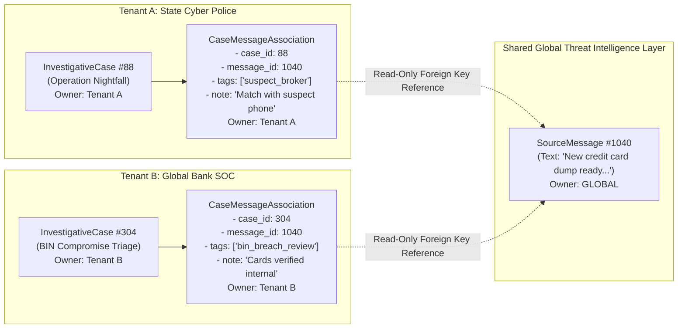
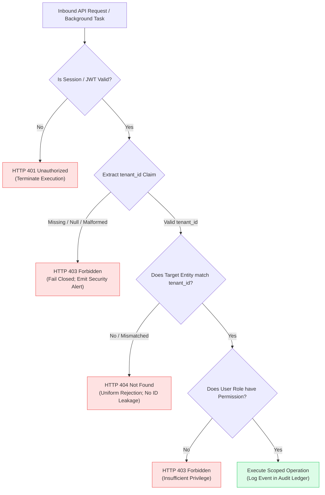

# TTI Gate 4B.1 — Tenant Isolation & Data Ownership Model

**Document Reference:** `TTI-ARCH-TENISO-001`  
**Product:** Telegram Threat Intelligence (TTI)  
**Lifecycle Stage:** Gate 4B.1 — Logical Data Architecture  
**Author:** Principal Data Architect & Security Architect  
**Date:** October 2026  
**Parent Specifications:**  
- [`docs/architecture/gate_4b_1/logical_data_model.md`](file:///d:/TTI/docs/architecture/gate_4b_1/logical_data_model.md)  
- [`docs/architecture/gate_4a/trust_boundaries_and_data_flows.md`](file:///d:/TTI/docs/architecture/gate_4a/trust_boundaries_and_data_flows.md)  
- [`docs/architecture/gate_4a/architecture_decision_register.md`](file:///d:/TTI/docs/architecture/gate_4a/architecture_decision_register.md)  

---

## 1. Executive Overview & Isolation Principles

The Telegram Threat Intelligence (TTI) platform operates in a **dual-market multi-tenant environment**, concurrently serving competing law-enforcement divisions, intelligence bureaus, and enterprise corporate SOCs. 

In this environment, a data disclosure across tenants represents a catastrophic security failure:
- If a corporate client discovers that law enforcement has created an active case monitoring one of their corporate executives, the criminal investigation is blown.
- If an enterprise client observes another enterprise's custom watchlist observables (e.g., secret project codenames, executive personal phone numbers), proprietary corporate secrets are exposed.

This document establishes the **Logical Tenant Isolation & Data Ownership Model**, formalizing ownership rules, cross-boundary referencing, fail-closed enforcement, and anti-leakage invariants across synchronous and asynchronous subsystems.

---

## 2. Data Ownership Classification Taxonomy

Every entity within the logical data model belongs strictly to one of three governance classes:

```
+----------------------------------------------------------------------------------------------------+
|                                DATA OWNERSHIP CLASSIFICATION MATRIX                                |
+-----------------------+---------------------------------------+------------------------------------+
| Classification Class  | Typical Entities                      | Read / Write Governance Rules      |
+-----------------------+---------------------------------------+------------------------------------+
| Class 1:              | SourceChannel, ForumTopic,            | - Write: Platform Ingestion Engine |
| Shared Global Threat  | SourceMessage, CollectionDiscontinuity|   only.                            |
| Intelligence          | Gap, MessageRevisionRecord,           | - Read: Globally accessible to all |
|                       | MediaArtifactReference (Public).      |   authenticated tenant users.      |
|                       |                                       | - Tenants CANNOT mutate or delete. |
+-----------------------+---------------------------------------+------------------------------------+
| Class 2:              | InvestigativeCase, CaseNote,          | - Write: Owning Tenant only.       |
| Tenant-Owned Private  | CaseMessageAssociation, SavedSearch   | - Read: Strictly isolated to users |
| Workspace Data        | Query, WatchlistRule, AlertEvent,     |   belonging to the owning tenant.  |
|                       | InvestigationReportPackage.           | - Completely invisible to others.  |
+-----------------------+---------------------------------------+------------------------------------+
| Class 3:              | UserProfile, TenantMembership,        | - Write: Platform Admin or Tenant  |
| Security, IAM & Audit | RoleDefinition, AuditEventRecord,     |   Admin (for their membership).    |
| Telemetry             | RetentionPolicyAssignment.            | - Read: Role-gated and scoped.     |
|                       |                                       | - Audit records are append-only.   |
+-----------------------+---------------------------------------+------------------------------------+
```

---

## 3. The Bridge Pattern: Tenant Annotations on Shared Records

A central architectural challenge in TTI is allowing an investigator from Tenant A to pin, tag, and annotate a globally shared message (`SourceMessage`) without:
1. Mutating the shared message entity.
2. Incurring storage duplication of massive message bodies.
3. Revealing to Tenant B that Tenant A has shown investigative interest in that message.

### 3.1 The `CaseMessageAssociation` Bridge Entity
This challenge is resolved through the `CaseMessageAssociation` bridge entity:



### 3.2 Operational Invariants:
1. **Zero Contamination:** When Tenant A creates `AssocA`, no column or state on `SourceMessage #1040` is modified.
2. **Absolute Non-Enumeration:** When Tenant B queries `SourceMessage #1040`, the query returns the message text and source metadata; it performs zero joins against `CaseMessageAssociation` entities belonging to other tenants. Tenant B has zero mathematical mechanism to detect `AssocA`.
3. **Cascading Case Lifecycle:** If Tenant A deletes or archives `InvestigativeCase #88`, `AssocA` is deleted or archived within Tenant A's private partition; `SourceMessage #1040` remains intact in the shared intelligence store.

---

## 4. Media Retrieval & Anti-Oracle Protections

Downloaded media binaries (contraband PDFs, fraud flyers, illicit software tools) stored under `MediaArtifactReference` represent a critical attack surface for **Existence Oracle Probing**.

### 4.1 The Existence Oracle Threat Vector
If an adversary compromised an analyst account in Tenant B and suspected that Tenant A had seized a specific confidential document with known cryptographic hash $H$, the adversary could submit a request:
$$\text{GET } /api/v1/evidence/by-hash/H$$
If the system responds with `HTTP 200 OK` (File Exists), the adversary confirms that the target file has been acquired by the platform or another agency, leaking active operational intelligence.

### 4.2 Enforced Logical Authorization Invariants for Media Retrieval
To eliminate existence oracle vulnerabilities:
1. **Raw Hash Probing is Prohibited:** The API exposes **no endpoint** allowing direct file retrieval by SHA-256 hash alone (`GET /evidence/{sha256}` is barred).
2. **Mandatory Dual-Context Resolution:** Every media retrieval request must supply a contextual case reference and execute under an authenticated user session:
   $$\text{GET } /api/v1/cases/\{case\_id\}/evidence/\{artifact\_id\}/download$$
3. **Two-Stage Validation Logic:**
   - *Stage 1 (Case Ownership Check):* The system validates that `case_id` belongs to the requesting user's `tenant_id`. If `case_id` does not exist or belongs to another tenant, the system returns `HTTP 404 Not Found` immediately, before inspecting the storage vault.
   - *Stage 2 (Evidentiary Link Check):* The system validates that `artifact_id` is linked to an authorized `SourceMessage` pinned to that specific case via `CaseMessageAssociation`.
4. **Uniform Rejection:** Any unauthorized attempt to probe media yields a uniform `HTTP 404 Not Found`, giving an attacker zero differential timing or status information.

---

## 5. Tenancy Isolation Across Asynchronous Boundaries

Multi-tenancy risks are highest when data transitions from synchronous HTTP request threads into background worker pools, distributed caches, and export packagers.

### 5.1 Asynchronous Background Jobs & Task Brokers
When an investigator enqueues a long-running report generation job or watchlist alert evaluation:
1. **Mandatory Envelope Scoping:** Background job payloads must explicitly encapsulate validated tenancy claims:
   ```json
   {
     "task_id": "TSK-89201",
     "tenant_id": "TNT-7049-LEA",
     "user_id": "USR-1042",
     "action": "RENDER_REPORT_PACKAGE",
     "case_id": "CASE-2026-088"
   }
   ```
2. **Context Re-Hydration & Re-Validation:** When an asynchronous worker picks up a job from the queue, it must re-hydrate the security context. If `tenant_id` is missing or mismatched with `case_id` in the persistent store, the worker aborts execution and logs a high-severity security alert.
3. **Queue Namespacing:** Background tasks for sensitive tenant actions (e.g., report packaging) must execute in isolated worker queues segregated from global ingestion pipelines.

### 5.2 Distributed Caching Isolation
Caching message bodies or search queries in shared memory systems introduces severe risk of cross-tenant key collisions.
* **Tenant-Prefixed Key Mandate:** All cache keys referencing tenant-specific entities, searches, or session state must strictly prepend the tenant identifier:
  $$\text{Key}_{\text{tenant}} = \text{"tenant:"} \parallel \text{tenant\_id} \parallel \text{":"} \parallel \text{subsystem} \parallel \text{":"} \parallel \text{key\_hash}$$
  *Example:* `tenant:TNT-7049-LEA:search:8f4c2b9a10`
* **Shared Telemetry Key Mandate:** Caches holding public Telegram chatter must use an explicit global prefix with zero tenant metadata:
  $$\text{Key}_{\text{global}} = \text{"public:threat:"} \parallel \text{channel\_id} \parallel \text{":"} \parallel \text{thread\_id}$$
  *Example:* `public:threat:100184920394:45:p1`
* **Zero Cross-Namespace Read:** Tenant request threads cannot query the cache without their active `tenant_id` injected into the key generator.

### 5.3 Export Packaging & Sealed Bundles
During report compilation under [`REP-TXT-SCREEN-001`](file:///d:/TTI/docs/product/product_baseline/functional_requirements.md#rep-txt-screen-001):
1. **Isolated Scratch Directory:** Rendering and zipping workers execute within ephemeral, tenant-isolated sandbox directories (`/tmp/export_{tenant_id}_{report_id}/`).
2. **Immediate Cleanup:** Uncompressed temporary artifacts are wiped immediately upon computing the final archive SHA-256 hash.
3. **Storage Vault Scoping:** Export archives are written into tenant-partitioned object paths (`/vault/{tenant_id}/reports/{report_id}.zip`).

---

## 6. The Fail-Closed Security Policy

In all operational scenarios, missing, ambiguous, or corrupted tenancy context triggers immediate rejection:



### Invariants:
1. **No Default Fallback:** The platform possesses no "default tenant" or wildcard administrative bypass in user-facing endpoints.
2. **Uniform 404 on Foreign Objects:** Inquiries attempting to access another tenant's `InvestigativeCase`, `CaseNote`, or `SavedSearchQuery` return `HTTP 404 Not Found` rather than `HTTP 403 Forbidden` to prevent object identifier enumeration.

---

## 7. Status of Physical Implementation Mechanisms

To maintain architectural honesty and prevent unsupported claims:

> [!IMPORTANT] Implementation Architecture vs. Verified Controls
> 1. **PostgreSQL Row-Level Security (RLS) & Schema Separation:** Evaluated in Gate 4A (`ADR-004`) as the **proposed architectural recommendation** for physical database enforcement. However, RLS is a *candidate implementation pattern*, **not a verified or implemented control**.
> 2. **Application-Level Filtering is Insufficient:** Relying purely on application-level `WHERE tenant_id = ?` clauses in software repositories provides zero defense-in-depth and is explicitly rejected as insufficient proof of tenant isolation.
> 3. **Validation Dependency:** The isolation model documented here must be formally verified in Gate 5 via automated multi-tenant penetration test suites and RLS bypass test fixtures prior to production certification.

---

*Next Logical Model Deliverable:* [`evidence_provenance_and_retention_model.md`](file:///d:/TTI/docs/architecture/gate_4b_1/evidence_provenance_and_retention_model.md)
