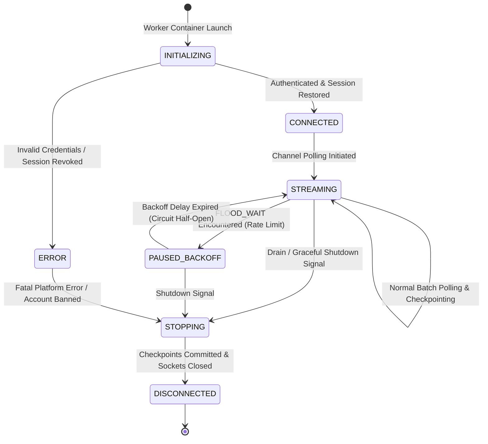
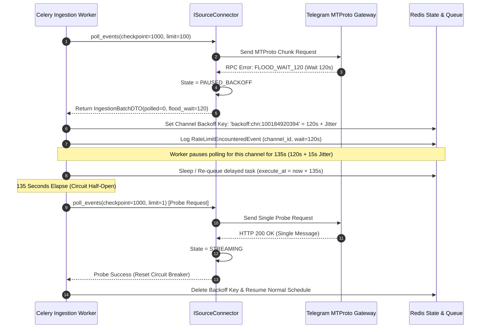

# TTI Gate 4B.2 — Source Connector Interface Contract

**Document Reference:** `TTI-ARCH-CONN-001`  
**Product:** Telegram Threat Intelligence (TTI)  
**Lifecycle Stage:** Gate 4B.2 — Interface Contracts  
**Author:** Principal Data Architect & Security Architect  
**Date:** October 2026  
**Governance Status:** `PROPOSED CONNECTOR CONTRACT — PENDING TECHNICAL REVIEW`  
**Parent Specifications:**  
- [`docs/architecture/gate_4a/system_context.md`](file:///d:/TTI/docs/architecture/gate_4a/system_context.md)  
- [`docs/architecture/gate_4a/subsystem_decomposition.md`](file:///d:/TTI/docs/architecture/gate_4a/subsystem_decomposition.md)  
- [`docs/architecture/gate_4a/architecture_decision_register.md`](file:///d:/TTI/docs/architecture/gate_4a/architecture_decision_register.md) (`ADR-005`)  
- [`docs/architecture/gate_4b_1/logical_data_model.md`](file:///d:/TTI/docs/architecture/gate_4b_1/logical_data_model.md)  

---

## 1. Architectural Scope & Connector Decoupling

In accordance with architectural decision [`ADR-005`](file:///d:/TTI/docs/architecture/gate_4a/architecture_decision_register.md#adr-005), the ingestion layer connects to external networks and untrusted source platforms. To isolate application core logic from platform-specific protocol implementations and legal permission uncertainties (`DEC-02`), all collection workloads operate behind an abstract, source-neutral connector interface.

### Foundational Invariants:
1. **Source-Neutral Abstraction:** The core ingestion pipeline interacts exclusively with `ISourceConnector`. It has zero hardcoded dependencies on Telethon, Pyrogram, Telegram Bot API, or Tor scraping libraries.
2. **Credential Decoupling:** Connector configurations contain zero plaintext API hashes, session strings, or passwords. Authentication materials are injected dynamically via encrypted key management vaults (AWS KMS / HashiCorp Vault) into egress-only worker containers.
3. **Egress-Only Sandbox:** Collector processes execute in network zones with outbound-only routing to authorized platform IP blocks. No inbound ports are exposed to the open internet.
4. **Safety & Non-Execution:** This document specifies logical contracts and an offline test harness. **It does not implement live Telegram connections, scrapers, or dark-web crawlers, and assumes no unverified source access permissions.**

---

## 2. Connector Lifecycle & State Machine

Every connector instance transitions through a formal, deterministic lifecycle state machine:



### 2.1 State Definitions:
* `INITIALIZING`: Container bootstrapping, configuration decryption, and local state validation.
* `CONNECTED`: Active MTProto session or API connection established with source gateway.
* `STREAMING`: Active ingestion window; polling channels, pulling message chunks, and evaluating gaps.
* `PAUSED_BACKOFF`: Circuit breaker tripped due to rate limiting (`FLOOD_WAIT_X`); polling suspended.
* `STOPPING`: Graceful shutdown requested; current chunk processing completing; pending checkpoints committing.
* `DISCONNECTED`: Session terminated cleanly; all locks released.
* `ERROR`: Unrecoverable exception (e.g., session revoked, proxy failure, ban).

---

## 3. The `ISourceConnector` Logical Interface

```
interface ISourceConnector {
    initialize(config: ConnectorConfigDTO) -> InitializationResultDTO
    connect() -> ConnectionStateDTO
    discover_capabilities() -> ConnectorCapabilitiesDTO
    poll_events(checkpoint: IngestionCheckpointDTO, batch_limit: Integer) -> IngestionBatchDTO
    checkpoint_state(checkpoint: IngestionCheckpointDTO) -> Void
    disconnect(drain_timeout_ms: Integer) -> DisconnectionReceiptDTO
}
```

### 3.1 Method Contracts & Specification

#### 3.1.1 `initialize(config: ConnectorConfigDTO) -> InitializationResultDTO`
* **Purpose:** Validates configuration parameters, resolves proxy routing paths, and verifies local cryptographic keys.
* **Inputs:** `ConnectorConfigDTO`:
  - `connector_id`: String identifier (e.g., `CONN-MTPROTO-01`).
  - `adapter_type`: Adapter classification (`TELEGRAM_MTPROTO`, `TELEGRAM_BOT_API`, `INERT_TEST_FIXTURE`).
  - `proxy_routing_ref`: Optional reference to rotating residential proxy pool (`DEC-03`).
  - `rate_limit_policy`: Configured maximum requests per minute.
* **Outputs:** Status (`READY` or `CONFIGURATION_ERROR`).
* **Security Guard:** Never accepts plaintext credentials; references secret tokens via KMS handles.

---

#### 3.1.2 `discover_capabilities() -> ConnectorCapabilitiesDTO`
* **Purpose:** Queries the connector to discover platform features supported by this adapter.
* **Outputs:** `ConnectorCapabilitiesDTO`:
  ```json
  {
    "can_stream_historical": true,
    "can_track_message_edits": true,
    "can_download_media": true,
    "max_media_size_bytes": 52428800,
    "supports_forum_topics": true,
    "supports_linked_discussions": true,
    "rate_limit_reporting": "EXACT_SECONDS_WAIT"
  }
  ```

---

#### 3.1.3 `poll_events(checkpoint: IngestionCheckpointDTO, batch_limit: Integer) -> IngestionBatchDTO`
* **Purpose:** Pulls an incremental chunk of events (messages, edits, deletions, gap indicators) from the target channel starting from the last confirmed sequence checkpoint.
* **Inputs:**
  - `checkpoint`: Last successfully committed `source_sequence_id` and timestamp.
  - `batch_limit`: Maximum items to retrieve in this poll cycle (default 100).
* **Outputs:** `IngestionBatchDTO`:
  ```json
  {
    "channel_id": 100184920394,
    "polled_count": 50,
    "has_more": true,
    "events": [
      {
        "event_type": "NEW_MESSAGE",
        "sequence_id": 1040,
        "message_thread_id": 45,
        "broadcast_utc": "2026-10-28T14:22:10Z",
        "sender_id": 982014,
        "raw_payload_bytes": "eydtc2dfaWQiOjEwNDAs...",
        "raw_sha256": "4b227777d4dd1fc61c6f884f48641d02b4d121d3fd328cb08b5531fcacdabf8a"
      }
    ],
    "highest_observed_sequence_id": 1040,
    "detected_sequence_gap": null
  }
  ```
* **Failure Handling:**
  - If rate limited (e.g., Telegram RPC error `FLOOD_WAIT_180`), the method catches the error, sets connector state to `PAUSED_BACKOFF`, records the penalty, and returns an empty batch with `rate_limit_wait_seconds: 180`.

---

#### 3.1.4 `checkpoint_state(checkpoint: IngestionCheckpointDTO) -> Void`
* **Purpose:** Commits the highest successfully processed and normalized sequence ID to persistent storage.
* **Idempotency:** Strictly monotonic. Checkpoints lower than the current database state are ignored.

---

#### 3.1.5 `disconnect(drain_timeout_ms: Integer) -> DisconnectionReceiptDTO`
* **Purpose:** Gracefully terminates the network session, flushes uncommitted buffer telemetry, and closes proxy sockets.

---

## 4. Rate-Limit Handling & Circuit Breaking Protocol

The connector contract formalizes automated resilience against Telegram platform flood penalties:



---

## 5. Offline Test Harness: `InertTestConnector`

To enable comprehensive integration testing of normalization, thread reconstruction, and case association workflows **without live Telegram accounts or external network access**, the platform specifies an `InertTestConnector`:

### 5.1 Test Fixture Capabilities
The `InertTestConnector` implements `ISourceConnector` using deterministic, simulated test scripts:
1. **Synthetic Channel & Topic Topography:** Emits simulated broadcast channels (`CHN-TEST-001`), forum supergroups with active `message_thread_id` topics, and linked discussion groups.
2. **Deterministic Sequence Discontinuity Generator:** Configurable to emit deliberate message sequence skips (e.g., jumping from sequence ID 100 to 105) to verify that `CollectionDiscontinuityGap` records are correctly created and displayed.
3. **Simulated Rate Limit Trips:** Simulates `FLOOD_WAIT` exceptions on demand to test worker backoff and circuit breaker state transitions.
4. **Simulated Revision & Deletion Events:** Emits message edit payloads and `is_tombstone` deletion markers to verify historical edit tracking without altering original evidence.
5. **Zero Network Egress:** Executes 100% in-memory using bundled JSON fixtures; generates zero external network traffic.

---

## 6. Security & Traceability Summary

| Security Dimension | Contract Enforcement Mechanism | Traceability ID |
| :--- | :--- | :--- |
| **Network Isolation** | Outbound egress-only workers; zero inbound listening ports. | [`NFR-SEC-002`](file:///d:/TTI/docs/product/product_baseline/non_functional_requirements.md#nfr-sec-002) |
| **Credential Protection** | Abstract configuration; keys resolved via KMS; zero plaintext secrets. | [`NFR-SEC-004`](file:///d:/TTI/docs/product/product_baseline/non_functional_requirements.md#nfr-sec-004) |
| **Verbatim Evidence Provenance** | Connector computes SHA-256 over raw wire bytes before normalization. | [`FR-EVI-002`](file:///d:/TTI/docs/product/product_baseline/functional_requirements.md#fr-evi-002) |
| **Gap Honesty** | Connector detects sequence skips and surfaces them as explicit gaps. | [`FR-COL-003`](file:///d:/TTI/docs/product/product_baseline/functional_requirements.md#fr-col-003) |
| **Resilience to Bans** | Mandatory exponential backoff and half-open probe circuit breaker. | [`FR-COL-002`](file:///d:/TTI/docs/product/product_baseline/functional_requirements.md#fr-col-002), [`NFR-REL-002`](file:///d:/TTI/docs/product/product_baseline/non_functional_requirements.md#nfr-rel-002) |

---

*Next Interface Specification:* [`gate_4b_2_review_report.md`](file:///d:/TTI/docs/architecture/gate_4b_2/gate_4b_2_review_report.md)
