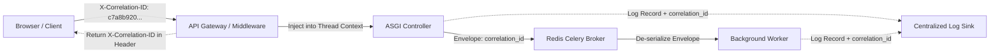

# TTI Gate 4B.2 — Error Handling & Pagination Conventions

**Document Reference:** `TTI-ARCH-ERR-001`  
**Product:** Telegram Threat Intelligence (TTI)  
**Lifecycle Stage:** Gate 4B.2 — Interface Contracts  
**Author:** Principal Data Architect & Security Architect  
**Date:** October 2026  
**Governance Status:** `PROPOSED PROTOCOL CONVENTIONS — PENDING TECHNICAL REVIEW`  
**Parent Specifications:**  
- [`docs/architecture/gate_4b_2/api_contracts.md`](file:///d:/TTI/docs/architecture/gate_4b_2/api_contracts.md)  
- [`docs/architecture/gate_4b_1/tenant_isolation_and_data_ownership.md`](file:///d:/TTI/docs/architecture/gate_4b_1/tenant_isolation_and_data_ownership.md)  

---

## 1. Overview & Protocol Governance

This document establishes the uniform error handling, telemetry correlation, rate limiting, and pagination standards for all external API endpoints and internal subsystem communication across the TTI platform.

### Core Protocol Principles:
1. **RFC 9457 Compliance:** Error payloads adhere strictly to RFC 9457 (*Problem Details for HTTP APIs*), providing structured, machine-parseable diagnostics.
2. **Anti-Enumeration & Secrecy:** Error messages and status codes are carefully designed to prevent object enumeration or cross-tenant existence inference.
3. **Traceable Correlation:** Every transaction carries an immutable `X-Correlation-ID` propagated from API gateways through asynchronous Celery workers to persistent audit logs.
4. **Resilient Pagination:** High-velocity message and thread queries utilize opaque, cursor-based pagination that remains deterministic even as new messages stream in continuously.

---

## 2. Uniform Error Response Schema (RFC 9457)

All error responses (`4xx` and `5xx`) return an `application/problem+json` payload structured as follows:

```json
{
  "type": "https://api.tti.vfra.io/errors/RESOURCE_NOT_FOUND",
  "title": "Resource Not Found",
  "status": 404,
  "detail": "The requested case workspace does not exist or you do not have permission to access it.",
  "instance": "/api/v1/cases/CASE-2026-999",
  "error_code": "CASE_NOT_FOUND",
  "correlation_id": "c7a8b920-4e31-4e2b-98f1-289d012480a1",
  "timestamp_utc": "2026-10-28T17:00:00Z",
  "invalid_params": []
}
```

### 2.1 Schema Field Definitions:
* `type` (URI): Stable reference URI identifying the error category.
* `title` (String): Short, human-readable summary of problem type.
* `status` (Integer): Standard HTTP status code matching the response header.
* `detail` (String): Context-specific explanation of the failure (sanitized; zero secrets or raw database syntax).
* `instance` (URI): The request URI path that originated the problem.
* `error_code` (String): Canonical machine-parseable error token.
* `correlation_id` (UUID): Diagnostic trace identifier.
* `timestamp_utc` (ISO 8601): UTC timestamp when error was generated.
* `invalid_params` (Array): Field-level validation breakdown (used for `422 Unprocessable Entity`).

---

## 3. Canonical Error Codes & HTTP Mapping Catalogue

| HTTP Status | Error Code | Canonical Description / Trigger Condition | Anti-Leakage / Security Behavior |
| :---: | :--- | :--- | :--- |
| **`400`** | `BAD_REQUEST` | Malformed JSON syntax or missing mandatory HTTP headers. | No server stack traces exposed. |
| **`401`** | `AUTH_TOKEN_MISSING` | Missing `Authorization` Bearer header. | Fails closed before routing. |
| **`401`** | `AUTH_TOKEN_EXPIRED` | JWT signature expired; requires token refresh. | Prompts client-side refresh workflow. |
| **`401`** | `AUTH_CREDENTIALS_INVALID` | Invalid email or password on login. | Constant-time response to prevent timing attacks. |
| **`403`** | `TENANT_CONTEXT_MISSING` | Valid JWT lacks mandatory `tenant_id` claim. | Fails closed; high-severity security alert emitted. |
| **`403`** | `INSUFFICIENT_PERMISSIONS` | User role lacks required permission token. | Explicitly states missing permission token. |
| **`403`** | `MFA_CHALLENGE_REQUIRED` | Login requires second-factor OTP code. | Returns temporary MFA challenge token. |
| **`404`** | `RESOURCE_NOT_FOUND` | Generic non-existent resource. | Standard 404. |
| **`404`** | `CASE_NOT_FOUND` | Case does not exist OR belongs to another tenant. | **Uniform 404:** Emitted for foreign cases to block ID enumeration. |
| **`404`** | `EVIDENCE_ORACLE_BLOCKED` | Attempted media lookup without authorized case link. | Blocks raw SHA-256 existence probe attacks. |
| **`409`** | `RESOURCE_CONFLICT` | Resource already exists (e.g., channel already registered). | Returns existing entity identifier. |
| **`422`** | `VALIDATION_FAILED` | Pydantic schema validation error on request body. | Returns `invalid_params` array with specific field errors. |
| **`429`** | `RATE_LIMIT_EXCEEDED` | Client exceeded session or tenant request quota. | Returns `Retry-After` header with seconds to wait. |
| **`429`** | `CIRCUIT_BREAKER_OPEN` | Ingestion connector suspended due to platform flood wait. | Internal worker deferral; queues task with jittered delay. |
| **`451`** | `LEGAL_EXPUNGEMENT_PENDING` | Target content is temporarily restricted under legal review. | Used when items are sequestered pending `DEC-08` review. |
| **`500`** | `INTERNAL_SERVER_ERROR` | Unhandled system exception. | Emits generic detail; full trace logged with `correlation_id`. |
| **`503`** | `SERVICE_UNAVAILABLE` | Database or Redis probe failure during `/health` check. | Triggers orchestrator failover. |

---

## 4. Tenant Isolation & Anti-Enumeration Rules in Errors

A primary vector for cross-tenant intelligence leaks is **differential error responses**:

### 4.1 The Uniform 404 Mandate
When a client from Tenant A requests a resource ID (such as `case_id`, `report_id`, or `note_id`) that belongs to Tenant B:
* **The Vulnerable Pattern (Rejected):** Returning `HTTP 403 Forbidden` confirms that the case ID is valid and active in another organization's workspace.
* **The Enforced Pattern (Adopted):** The system returns `HTTP 404 Not Found` with code `CASE_NOT_FOUND` and identical generic text:
  > *"The requested case workspace does not exist or you do not have permission to access it."*
* **Security Result:** An adversary scanning UUIDs or integer sequences learns zero information about whether an object exists in another tenant's workspace.

### 4.2 Error Masking on Media Existence Probing
* When an unauthenticated or unauthorized user requests media by hash or ID, the response is uniformly `HTTP 404 Not Found` (`EVIDENCE_ORACLE_BLOCKED`), masking whether the target contraband binary has been ingested into the evidence vault.

---

## 5. Rate Limiting, Throttling & Retry Conventions

### 5.1 HTTP Header Conventions
When rate limits are triggered on client endpoints:
* **Status Code:** `HTTP 429 Too Many Requests`.
* **Headers Emitted:**
  - `Retry-After: 30` (Number of seconds before client may retry).
  - `X-RateLimit-Limit: 60` (Maximum permitted operations in active window).
  - `X-RateLimit-Remaining: 0` (Remaining permitted operations).
  - `X-RateLimit-Reset: 1698537630` (UTC epoch timestamp of window reset).

### 5.2 Client Retry Algorithm: Exponential Jittered Backoff
Clients interacting with TTI APIs (and internal workers polling Telegram) must implement exponential backoff with full jitter:
$$T_{\text{sleep}} = \text{random}(0, \, \min(T_{\max}, \, T_{\text{base}} \times 2^{\text{attempt}}))$$
* **$T_{\text{base}}$:** 1.0 second.
* **$T_{\max}$:** 60.0 seconds (or exact value of `Retry-After` if specified by upstream server).
* **Jitter:** Full random uniform distribution prevents synchronization stampedes ("thundering herd" problem).

---

## 6. Correlation ID Propagation

Every operational transaction carries a unique `X-Correlation-ID` across all tier boundaries:



### Rules:
1. **Edge Generation:** If the client omits `X-Correlation-ID`, edge middleware generates a fresh UUIDv4.
2. **Asynchronous Task Envelope:** Celery task payloads must serialize `correlation_id` into their headers.
3. **Audit Ledger Binding:** Every entry in `AuditEventRecord` records the active `correlation_id`.

---

## 7. Pagination Conventions

To support high-velocity, append-heavy data streams while preventing memory exhaustion and tenant leakage, TTI defines two explicit pagination standards.

### 7.1 Standard 1: Opaque Cursor-Based Pagination (Default for Streams)
Applied to `SourceMessage`, thread navigation, search results, and `AuditEventRecord`.

#### Request Parameters:
* `limit`: Integer (Default 50, Minimum 1, Maximum 100).
* `cursor`: Opaque base64-encoded string representing the positional bookmark.
* `direction`: Optional stream direction (`BEFORE` or `AFTER`).

#### Cursor Design (Internal Composition):
The cursor is serialized and encrypted/hashed to prevent client-side tampering:
$$\text{Cursor} = \text{Base64URL}(\text{JSON}(\{\text{"seq\_id"}: 1040, \, \text{"ts"}: 1698537600\}))$$

#### Response Envelope:
```json
{
  "items": [ /* Array of records */ ],
  "pagination": {
    "limit": 50,
    "next_cursor": "eyJzZXFfaWQiOjEwMzksInRzIjoxNjk4NTM3NTgwfQ==",
    "prev_cursor": "eyJzZXFfaWQiOjEwNDEsInRzIjoxNjk4NTM3NjIwfQ==",
    "has_more": true
  }
}
```

#### Advantages for TTI:
1. **Zero Shift Anomalies:** Unlike `offset`/`limit`, cursor pagination is immune to duplicate or missing records when new messages stream into the channel concurrently.
2. **Instant Sub-Second Querying:** Executes using indexed range scans (`WHERE (seq_id, ts) < (cursor_seq_id, cursor_ts)`), avoiding catastrophic full-table scans.

---

### 7.2 Standard 2: Offset / Page-Based Pagination (Bounded Metadata Collections)
Applied strictly to bounded, slowly changing tenant metadata collections (`InvestigativeCase`, `SavedSearchQuery`, `WatchlistRule`).

#### Request Parameters:
* `page`: Integer (1-indexed, Default 1).
* `page_size`: Integer (Default 20, Maximum 50).

#### Response Envelope:
```json
{
  "items": [ /* Array of case summaries */ ],
  "pagination": {
    "current_page": 1,
    "page_size": 20,
    "total_pages": 3,
    "total_items": 48
  }
}
```

### 7.3 Anti-Leakage Pagination Invariant
* **Tenant Scoping of Total Counts:** In offset pagination, `total_items` and `total_pages` must be evaluated **strictly within the tenant's isolated case schema** (`WHERE tenant_id = :tenant_id`). Aggregated total counts must never leak the existence or volume of other tenants' cases.

---

*Next Interface Specification:* [`connector_contract.md`](file:///d:/TTI/docs/architecture/gate_4b_2/connector_contract.md)
