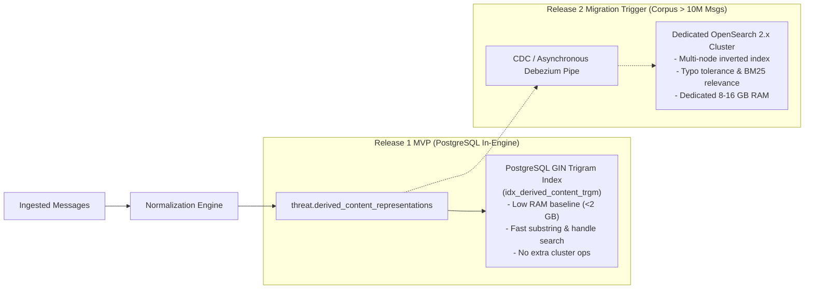

# TTI Gate 4B.3A — Indexing & Query Design Review

**Document Reference:** `TTI-ARCH-IDX-001`  
**Product:** Telegram Threat Intelligence (TTI)  
**Lifecycle Stage:** Gate 4B.3A — Physical Database Design Review  
**Author:** Principal Data Architect & Security Architect  
**Date:** October 2026  
**Governance Status:** `PROPOSED INDEXING DESIGN — PENDING IMPLEMENTATION AUTHORIZATION`  
**Provisional Target:** Relational SQL Indexes (PostgreSQL 16 B-Tree, GIN, Trigram per `ADR-002`)  
**Parent Specifications:**  
- [`docs/architecture/gate_4b_3a/physical_schema_design.md`](file:///d:/TTI/docs/architecture/gate_4b_3a/physical_schema_design.md)  
- [`docs/architecture/gate_4b_2/api_contracts.md`](file:///d:/TTI/docs/architecture/gate_4b_2/api_contracts.md)  
- [`docs/product/product_baseline/functional_requirements.md`](file:///d:/TTI/docs/product/product_baseline/functional_requirements.md)  

---

## 1. Indexing Principles & Workload Characteristics

### 1.1 Ingestion vs. Query Workload Asymmetry
The TTI database operates under a distinct dual-workload profile:
1. **High-Velocity Append Stream (Ingestion):** Background Celery workers continuously poll hundreds of Telegram channels, streaming messages, edits, and gap records into the `threat` schema.
2. **Interactive Low-Latency Queries (Investigation):** Human analysts execute concurrent full-text searches, cursor-based thread sliding-window scrolls, and case tagging operations requiring sub-second responsiveness.

> [!CAUTION] Over-Indexing & Write Amplification Risk
> Ingesting thousands of messages per minute while maintaining excessive GIN or B-tree indexes causes severe **Write Amplification**, saturates disk I/O, and inflates WAL (Write-Ahead Log) generation. Therefore, indexes in this specification are **strictly confined to documented Release 1 query patterns**. Speculative indexes for future features are rejected.

### 1.2 Provisional Technology Framing
PostgreSQL B-Tree, GIN, and Trigram (`pg_trgm`) index definitions are documented as **Provisional Engineering Recommendations** in alignment with Gate 4A [`ADR-002`](file:///d:/TTI/docs/architecture/gate_4a/architecture_decision_register.md#adr-002). They do not represent approved stakeholder decisions, and this document presents **zero invented performance benchmarks**.

---

## 2. Release 1 Query Pattern Indexing Catalogue

```
+----------------------------------------------------------------------------------------------------+
|                                 RELEASE 1 PROPOSED INDEX CATALOGUE                                 |
+---------------------+-------------------------------+-------------------+--------------------------+
| Target Table        | Proposed Index Name           | Index Structure   | Indexed Columns          |
+---------------------+-------------------------------+-------------------+--------------------------+
| threat.             | idx_source_messages_thread    | B-Tree Composite  | (channel_id,             |
| source_messages     |                               |                   |  source_sequence_id DESC)|
+---------------------+-------------------------------+-------------------+--------------------------+
| threat.             | idx_source_messages_forum     | Partial B-Tree    | (channel_id,             |
| source_messages     |                               |                   |  message_thread_id,      |
|                     |                               |                   |  source_sequence_id DESC)|
|                     |                               |                   | WHERE thread_id IS NOT NULL
+---------------------+-------------------------------+-------------------+--------------------------+
| threat.derived_     | idx_derived_content_trgm      | GIN (Trigram)     | masked_message_text      |
| content_reps        |                               |                   | gin_trgm_ops             |
+---------------------+-------------------------------+-------------------+--------------------------+
| threat.             | idx_source_messages_sender    | B-Tree Partial    | sender_username          |
| source_messages     |                               |                   | WHERE username IS NOT NULL
+---------------------+-------------------------------+-------------------+--------------------------+
| app.investigative_  | idx_cases_tenant_status       | B-Tree Composite  | (tenant_id, case_status, |
| cases               |                               |                   |  created_at_utc DESC)    |
+---------------------+-------------------------------+-------------------+--------------------------+
| app.case_message_   | idx_cma_case_pinned           | B-Tree Composite  | (case_id, pinned_at_utc) |
| associations        |                               |                   |                          |
+---------------------+-------------------------------+-------------------+--------------------------+
| app.case_message_   | idx_cma_tenant_message        | B-Tree Composite  | (tenant_id, message_id)  |
| associations        |                               |                   |                          |
+---------------------+-------------------------------+-------------------+--------------------------+
| evidence.           | idx_media_message             | B-Tree            | source_message_id        |
| media_artifacts     |                               |                   |                          |
+---------------------+-------------------------------+-------------------+--------------------------+
| app.investigation_  | idx_reports_case              | B-Tree Composite  | (case_id, generated_at)  |
| report_packages     |                               |                   |                          |
+---------------------+-------------------------------+-------------------+--------------------------+
| audit.              | idx_audit_tenant_time         | B-Tree Composite  | (tenant_id,              |
| audit_event_records |                               |                   |  event_timestamp_utc DESC|
+---------------------+-------------------------------+-------------------+--------------------------+
```

---

## 3. Deep Analysis of Core Query Patterns

### 3.1 Pattern 1: Continuous Cursor Thread Navigation (`FR-THR-001`)
* **Endpoint:** [`GET /api/v1/threads/{channel_id}/messages`](file:///d:/TTI/docs/architecture/gate_4b_2/api_contracts.md#331-get-apiv1threadschannel_idmessages)
* **Underlying SQL Query Pattern:**
  ```sql
  SELECT message_id, source_sequence_id, sender_username, broadcast_timestamp_utc, reply_to_message_id
  FROM threat.source_messages
  WHERE channel_id = :channel_id
    AND source_sequence_id < :cursor_sequence_id
  ORDER BY source_sequence_id DESC
  LIMIT 50;
  ```
* **Proposed Index:**
  ```sql
  CREATE INDEX idx_source_messages_thread 
  ON threat.source_messages (channel_id, source_sequence_id DESC);
  ```
* **Technical Trade-Off:**
  - *Read Efficiency:* High. The composite B-tree provides an immediate range scan with zero temporary disk sorts (`Backward Index Scan`).
  - *Write Impact:* Low. Appending monotonically increasing sequence IDs inserts cleanly into the rightmost leaf page of the B-Tree with minimal page splits.

---

### 3.2 Pattern 2: Telegram Forum Topic Scoping (`FR-THR-001`, `FR-COL-001`)
* **Endpoint:** `GET /api/v1/threads/{channel_id}/messages?topic_id=45`
* **Underlying SQL Query Pattern:**
  ```sql
  SELECT message_id, source_sequence_id, sender_username, broadcast_timestamp_utc
  FROM threat.source_messages
  WHERE channel_id = :channel_id
    AND message_thread_id = :topic_id
    AND source_sequence_id < :cursor_sequence_id
  ORDER BY source_sequence_id DESC
  LIMIT 50;
  ```
* **Proposed Partial Index:**
  ```sql
  CREATE INDEX idx_source_messages_forum 
  ON threat.source_messages (channel_id, message_thread_id, source_sequence_id DESC)
  WHERE message_thread_id IS NOT NULL;
  ```
* **Technical Trade-Off:**
  - *Index Size Optimization:* Standard broadcast channels have `message_thread_id = NULL`. Using a **Partial Index** (`WHERE message_thread_id IS NOT NULL`) excludes 70–80% of rows from the index, saving RAM buffer pool space and eliminating write overhead for non-forum channels.

---

### 3.3 Pattern 3: Multi-Observable & Substring Search (`FR-SCH-001`)
* **Endpoint:** [`POST /api/v1/search/query`](file:///d:/TTI/docs/architecture/gate_4b_2/api_contracts.md#321-post-apiv1searchquery)
* **Underlying SQL Query Pattern:**
  ```sql
  SELECT m.message_id, m.broadcast_timestamp_utc, d.masked_message_text
  FROM threat.derived_content_representations d
  JOIN threat.source_messages m ON d.source_message_id = m.message_id
  WHERE d.masked_message_text ILIKE '%breach database%'
    AND m.broadcast_timestamp_utc >= :date_from
  ORDER BY m.broadcast_timestamp_utc DESC
  LIMIT 50;
  ```
* **Proposed Trigram Index:**
  ```sql
  CREATE INDEX idx_derived_content_trgm 
  ON threat.derived_content_representations 
  USING gin (masked_message_text gin_trgm_ops);
  ```
* **Technical Trade-Off:**
  - *Search Quality:* Trigram GIN indexes allow fast wildcard searches (`%keyword%`, regex, handles, phone numbers) which standard B-Tree indexes cannot service.
  - *Write Amplification Trade-off:* GIN index updates are CPU- and write-heavy. Ingesting a 500-word chat body creates dozens of 3-character trigram postings. To maintain throughput, PostgreSQL's `fastupdate = on` is recommended, buffering pending GIN inserts in memory before flushing in batches.

---

### 3.4 Pattern 4: Case Pinned Evidence Retrieval (`FR-EVI-001`)
* **Endpoint:** `GET /api/v1/cases/{case_id}`
* **Underlying SQL Query Pattern:**
  ```sql
  SELECT cma.association_id, cma.message_id, cma.investigator_tags, cma.analyst_annotation,
         m.sender_username, m.broadcast_timestamp_utc, d.masked_message_text
  FROM app.case_message_associations cma
  JOIN threat.source_messages m ON cma.message_id = m.message_id
  JOIN threat.derived_content_representations d ON m.message_id = d.source_message_id
  WHERE cma.case_id = :case_id
  ORDER BY cma.pinned_at_utc DESC;
  ```
* **Proposed Index:**
  ```sql
  CREATE INDEX idx_cma_case_pinned 
  ON app.case_message_associations (case_id, pinned_at_utc DESC);
  ```
* **Technical Trade-Off:**
  - Enforces instant retrieval of pinned items for a case workspace without scanning the global association table.

---

### 3.5 Pattern 5: Tenant Audit Ledger Stream (`NFR-OBS-003`)
* **Endpoint:** `GET /api/v1/audit/events`
* **Underlying SQL Query Pattern:**
  ```sql
  SELECT audit_event_id, user_id, action_type, target_identifier_hash, event_timestamp_utc
  FROM audit.audit_event_records
  WHERE tenant_id = :current_tenant_id
    AND event_timestamp_utc < :cursor_timestamp
  ORDER BY event_timestamp_utc DESC
  LIMIT 50;
  ```
* **Proposed Index:**
  ```sql
  CREATE INDEX idx_audit_tenant_time 
  ON audit.audit_event_records (tenant_id, event_timestamp_utc DESC);
  ```
* **Technical Trade-Off:**
  - Provides strict tenant partition filtering before sorting audit events chronologically.

---

## 4. Search Strategy Evaluation: Trigram FTS vs. Dedicated Cluster

In accordance with Gate 4A [`ADR-002`](file:///d:/TTI/docs/architecture/gate_4a/architecture_decision_register.md#adr-002), the search topology balances operational cost against corpus scale:



### Recommendation Rationale:
* **Release 1 MVP:** PostgreSQL GIN trigram indexing is sufficient for up to 1,500 channels (~1,000,000 messages/month per `DEC-04 Option B`). It avoids deploying, clustering, and monitoring an external OpenSearch cluster during early product validation.
* **Release 2 Scaling Trigger:** If message velocity exceeds 10,000,000 total stored messages, or if complex AST boolean queries (`FR-SCH-003`) saturate database I/O, the architecture cleanly decouples search behind `ISearchRepository` to introduce OpenSearch without altering user-facing contracts.

---

*Next Design Document:* [`migration_and_rollback_strategy.md`](file:///d:/TTI/docs/architecture/gate_4b_3a/migration_and_rollback_strategy.md)
