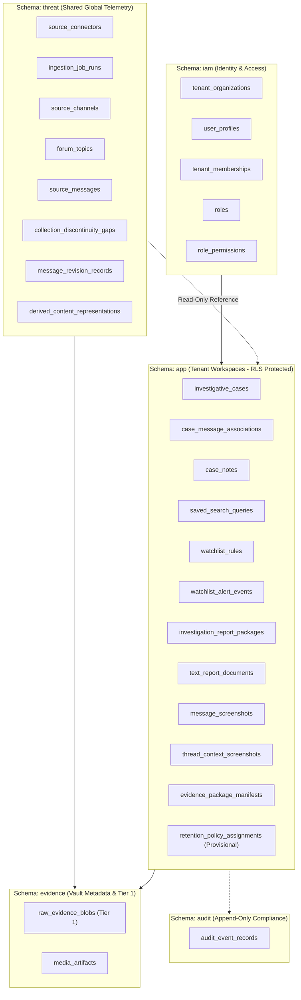

# TTI Gate 4B.3A — Physical Relational Database Schema Design Review

**Document Reference:** `TTI-ARCH-PHY-001`  
**Product:** Telegram Threat Intelligence (TTI)  
**Lifecycle Stage:** Gate 4B.3A — Physical Database Design Review  
**Author:** Principal Data Architect & Security Architect  
**Date:** October 2026  
**Governance Status:** `PROPOSED PHYSICAL DESIGN — PENDING IMPLEMENTATION AUTHORIZATION`  
**Provisional Target:** Relational SQL Engine (PostgreSQL 16 as provisional design target per `ADR-002`)  
**Parent Specifications:**  
- [`docs/architecture/gate_4b_1/logical_data_model.md`](file:///d:/TTI/docs/architecture/gate_4b_1/logical_data_model.md)  
- [`docs/architecture/gate_4b_1/tenant_isolation_and_data_ownership.md`](file:///d:/TTI/docs/architecture/gate_4b_1/tenant_isolation_and_data_ownership.md)  
- [`docs/architecture/gate_4b_1/evidence_provenance_and_retention_model.md`](file:///d:/TTI/docs/architecture/gate_4b_1/evidence_provenance_and_retention_model.md)  
- [`docs/architecture/gate_4b_2/api_contracts.md`](file:///d:/TTI/docs/architecture/gate_4b_2/api_contracts.md)  
- [`docs/architecture/gate_4b_2/subsystem_interface_contracts.md`](file:///d:/TTI/docs/architecture/gate_4b_2/subsystem_interface_contracts.md)  

---

## 1. Architectural Scope & Provisional Target Notice

### 1.1 Scope and Objective
This document translates the approved Gate 4B.1 logical data model into a concrete, reviewable **Physical Relational Database Schema Design** for Release 1 MVP.

> [!IMPORTANT] Provisional Technology Notice
> The use of **PostgreSQL 16** is assumed strictly as a **Provisional Design Target** in accordance with Gate 4A [`ADR-002`](file:///d:/TTI/docs/architecture/gate_4a/architecture_decision_register.md#adr-002). It represents an engineering recommendation subject to operational validation and separate implementation authorization. This document is a design and review specification; it does **not** create executable DDL, SQL migrations, ORM entities, or application code.

### 1.2 Schema Namespace Partitioning Topography
To enforce strict boundary isolation between global intelligence, tenant workspaces, forensic evidence, and compliance logging, the relational database is partitioned into five logical database schemas:

---

## 2. Domain 1: IAM & Tenancy Schema (`iam`)

### 2.1 Table: `iam.tenant_organizations`
* **Logical Entity:** [`TenantOrganization`](file:///d:/TTI/docs/architecture/gate_4b_1/logical_data_model.md#21-entity-tenantorganization)
* **Purpose:** Defines customer organizations (law enforcement agencies, corporate SOCs).
* **Data Classification:** Tenant Operational Metadata.
* **Proposed Columns:**

| Column Name | Conceptual Data Type | Nullable | Default | Description & Constraints |
| :--- | :--- | :---: | :---: | :--- |
| `tenant_id` | `UUID` | No | None | Primary Key. Canonical organization identifier. |
| `organization_name` | `VARCHAR(255)` | No | None | Unique corporate or departmental name. |
| `market_profile` | `VARCHAR(50)` | No | None | `CHECK (market_profile IN ('LAW_ENFORCEMENT', 'CORPORATE_SOC', 'MANAGED_SERVICE'))`. |
| `account_status` | `VARCHAR(30)` | No | `'PENDING_APPROVAL'` | `CHECK (account_status IN ('PENDING_APPROVAL', 'ACTIVE', 'SUSPENDED', 'DEPROVISIONED'))`. |
| `created_at_utc` | `TIMESTAMPTZ` | No | `CURRENT_TIMESTAMP` | Registration timestamp. |
| `updated_at_utc` | `TIMESTAMPTZ` | No | `CURRENT_TIMESTAMP` | Modification timestamp. |

* **Constraints:** `PRIMARY KEY (tenant_id)`, `UNIQUE (organization_name)`.
* **Traceability:** [`FR-TEN-001`](file:///d:/TTI/docs/product/product_baseline/functional_requirements.md#fr-ten-001), [`AC-REQ-002`](file:///d:/TTI/docs/product/product_baseline/functional_requirements.md#ac-req-002), [`DEC-05`](file:///d:/TTI/docs/product/product_baseline/decision_and_traceability_matrix.md#dec-05), [`DEC-22`](file:///d:/TTI/docs/product/product_baseline/decision_and_traceability_matrix.md#dec-22).

---

### 2.2 Table: `iam.user_profiles`
* **Logical Entity:** [`UserProfile`](file:///d:/TTI/docs/architecture/gate_4b_1/logical_data_model.md#22-entity-userprofile)
* **Purpose:** Master investigator and administrator user records.
* **Data Classification:** User Metadata.
* **Proposed Columns:**

| Column Name | Conceptual Data Type | Nullable | Default | Description & Constraints |
| :--- | :--- | :---: | :---: | :--- |
| `user_id` | `UUID` | No | None | Primary Key. Canonical user identifier. |
| `email_address` | `VARCHAR(320)` | No | None | Unique login email address. |
| `full_name` | `VARCHAR(255)` | No | None | Investigator name or badge handle. |
| `password_hash` | `VARCHAR(255)` | No | None | Argon2id cryptographic hash (zero plaintext). |
| `account_state` | `VARCHAR(30)` | No | `'ACTIVE'` | `CHECK (account_state IN ('ACTIVE', 'LOCKED', 'INVITED'))`. |
| `mfa_enforced` | `BOOLEAN` | No | `TRUE` | MFA compliance flag. |
| `mfa_secret_encrypted` | `BYTEA` | Yes | `NULL` | Encrypted TOTP seed (AES-256-GCM). |
| `last_login_utc` | `TIMESTAMPTZ` | Yes | `NULL` | Telemetry timestamp. |
| `created_at_utc` | `TIMESTAMPTZ` | No | `CURRENT_TIMESTAMP` | Account creation timestamp. |

* **Constraints:** `PRIMARY KEY (user_id)`, `UNIQUE (email_address)`.
* **Traceability:** [`FR-TEN-002`](file:///d:/TTI/docs/product/product_baseline/functional_requirements.md#fr-ten-002), [`NFR-SEC-005`](file:///d:/TTI/docs/product/product_baseline/non_functional_requirements.md#nfr-sec-005).

---

### 2.3 Table: `iam.tenant_memberships`
* **Logical Entity:** [`TenantMembership`](file:///d:/TTI/docs/architecture/gate_4b_1/logical_data_model.md#23-entity-tenantmembership)
* **Purpose:** Maps users to tenant organizations and assigns operational roles.
* **Data Classification:** Tenant Security Metadata.
* **Proposed Columns:**

| Column Name | Conceptual Data Type | Nullable | Default | Description & Constraints |
| :--- | :--- | :---: | :---: | :--- |
| `membership_id` | `UUID` | No | None | Primary Key. |
| `tenant_id` | `UUID` | No | None | FK to `iam.tenant_organizations(tenant_id)` ON DELETE RESTRICT. |
| `user_id` | `UUID` | No | None | FK to `iam.user_profiles(user_id)` ON DELETE RESTRICT. |
| `assigned_role` | `VARCHAR(50)` | No | None | `CHECK (assigned_role IN ('TENANT_ADMIN', 'INVESTIGATOR_LEAD', 'INVESTIGATOR', 'READ_ONLY_ANALYST'))`. |
| `membership_status` | `VARCHAR(30)` | No | `'PENDING_ACCEPTANCE'` | `CHECK (membership_status IN ('PENDING_ACCEPTANCE', 'ACTIVE', 'REVOKED'))`. |
| `granted_at_utc` | `TIMESTAMPTZ` | No | `CURRENT_TIMESTAMP` | Grant timestamp. |
| `updated_at_utc` | `TIMESTAMPTZ` | No | `CURRENT_TIMESTAMP` | State update timestamp. |

* **Constraints:** `PRIMARY KEY (membership_id)`, `UNIQUE (tenant_id, user_id)`.
* **Traceability:** [`FR-TEN-002`](file:///d:/TTI/docs/product/product_baseline/functional_requirements.md#fr-ten-002), [`AC-REQ-001`](file:///d:/TTI/docs/product/product_baseline/functional_requirements.md#ac-req-001), [`AC-REQ-004`](file:///d:/TTI/docs/product/product_baseline/functional_requirements.md#ac-req-004), [`DEC-12`](file:///d:/TTI/docs/product/product_baseline/decision_and_traceability_matrix.md#dec-12), [`DEC-15`](file:///d:/TTI/docs/product/product_baseline/decision_and_traceability_matrix.md#dec-15).

---

### 2.4 Table: `iam.roles`
* **Logical Entity:** `RoleDefinition`
* **Purpose:** Canonical dictionary of operational roles.
* **Data Classification:** System Configuration Metadata.
* **Proposed Columns:**

| Column Name | Conceptual Data Type | Nullable | Default | Description & Constraints |
| :--- | :--- | :---: | :---: | :--- |
| `role_id` | `VARCHAR(50)` | No | None | Primary Key (`TENANT_ADMIN`, `INVESTIGATOR_LEAD`, `INVESTIGATOR`, `READ_ONLY_ANALYST`). |
| `role_name` | `VARCHAR(100)` | No | None | Human-readable role title. |
| `description` | `TEXT` | Yes | `NULL` | Detailed description of role capabilities. |
| `is_system_role` | `BOOLEAN` | No | `TRUE` | Built-in system role flag (immutable at runtime). |
| `created_at_utc` | `TIMESTAMPTZ` | No | `CURRENT_TIMESTAMP` | Creation timestamp. |

* **Constraints:** `PRIMARY KEY (role_id)`.
* **Privilege Boundary:** Read-only (`SELECT`) for `tti_app_role` and `tti_platform_admin_role`. Zero mutation grants (`DEC-16`).
* **Traceability:** [`AC-REQ-001`](file:///d:/TTI/docs/product/product_baseline/functional_requirements.md#ac-req-001), [`DEC-14`](file:///d:/TTI/docs/product/product_baseline/decision_and_traceability_matrix.md#dec-14), [`DEC-16`](file:///d:/TTI/docs/product/product_baseline/decision_and_traceability_matrix.md#dec-16).

---

### 2.5 Table: `iam.active_user_sessions`
* **Logical Entity:** `ActiveUserSession`
* **Purpose:** Enforces single active session per user with interactive displacement capability.
* **Data Classification:** User Authentication Metadata.
* **Proposed Columns:**

| Column Name | Conceptual Data Type | Nullable | Default | Description & Constraints |
| :--- | :--- | :---: | :---: | :--- |
| `session_id` | `UUID` | No | None | Primary Key. Session tracking identifier. |
| `user_id` | `UUID` | No | None | FK to `iam.user_profiles(user_id)` ON DELETE CASCADE. |
| `active_tenant_id` | `UUID` | No | None | FK to `iam.tenant_organizations(tenant_id)` ON DELETE RESTRICT. Active tenancy context. |
| `session_token_hash` | `VARCHAR(64)` | No | None | Unique SHA-256 hash of opaque bearer token (zero cleartext tokens). |
| `ip_address` | `INET` | Yes | `NULL` | Client IP address. |
| `user_agent` | `TEXT` | Yes | `NULL` | Client User-Agent string. |
| `created_at_utc` | `TIMESTAMPTZ` | No | `CURRENT_TIMESTAMP` | Login timestamp. |
| `last_activity_utc` | `TIMESTAMPTZ` | No | `CURRENT_TIMESTAMP` | Latest activity timestamp. |
| `expires_at_utc` | `TIMESTAMPTZ` | No | None | Absolute session expiration deadline. |

* **Constraints:** `PRIMARY KEY (session_id)`, `UNIQUE (user_id)` (strictly enforces single-active-session invariant), `UNIQUE (session_token_hash)`.
* **Traceability:** [`AC-REQ-006`](file:///d:/TTI/docs/product/product_baseline/functional_requirements.md#ac-req-006), [`DEC-20`](file:///d:/TTI/docs/product/product_baseline/decision_and_traceability_matrix.md#dec-20).

---

## 3. Domain 2: Shared Threat Intelligence Schema (`threat`)

Ingested records in `threat` are **globally accessible (read-only)** to authorized tenant users. Tenant operations cannot insert, update, or delete records in this schema.

### 3.1 Table: `threat.source_connectors`
* **Logical Entity:** [`SourceConnectorDefinition`](file:///d:/TTI/docs/architecture/gate_4b_1/logical_data_model.md#31-entity-sourceconnectordefinition)
* **Proposed Columns:**

| Column Name | Conceptual Data Type | Nullable | Default | Constraints & Description |
| :--- | :--- | :---: | :---: | :--- |
| `connector_id` | `VARCHAR(64)` | No | None | Primary Key (e.g., `CONN-MTPROTO-01`). |
| `connector_type` | `VARCHAR(50)` | No | None | `CHECK (connector_type IN ('TELEGRAM_MTPROTO', 'TELEGRAM_BOT_API', 'INERT_TEST_FIXTURE'))`. |
| `operational_state`| `VARCHAR(30)` | No | `'INITIALIZING'`| `CHECK (operational_state IN ('INITIALIZING', 'CONNECTED', 'STREAMING', 'PAUSED_BACKOFF', 'STOPPING', 'DISCONNECTED', 'ERROR'))`. |
| `consecutive_flood_waits` | `INTEGER` | No | `0` | Consecutive flood counter for circuit breaker. |
| `current_backoff_until_utc` | `TIMESTAMPTZ` | Yes | `NULL` | Pause deadline if throttled. |
| `created_at_utc` | `TIMESTAMPTZ` | No | `CURRENT_TIMESTAMP` | Provisioning timestamp. |

* **Constraints:** `PRIMARY KEY (connector_id)`.
* **Traceability:** [`FR-COL-001`](file:///d:/TTI/docs/product/product_baseline/functional_requirements.md#fr-col-001), [`FR-COL-002`](file:///d:/TTI/docs/product/product_baseline/functional_requirements.md#fr-col-002), [`DEC-03`](file:///d:/TTI/docs/product/product_baseline/decision_and_traceability_matrix.md#dec-03).

---

### 3.2 Table: `threat.source_channels`
* **Logical Entity:** [`SourceChannel`](file:///d:/TTI/docs/architecture/gate_4b_1/logical_data_model.md#33-entity-sourcechannel)
* **Proposed Columns:**

| Column Name | Conceptual Data Type | Nullable | Default | Constraints & Description |
| :--- | :--- | :---: | :---: | :--- |
| `channel_id` | `BIGINT` | No | None | Primary Key. Canonical internal ID. |
| `platform_native_id` | `BIGINT` | No | None | Telegram numeric ID (e.g., `-100184920394`). |
| `channel_title` | `VARCHAR(500)` | No | None | Display title captured at collection. |
| `channel_handle` | `VARCHAR(255)` | Yes | `NULL` | Public handle (`@leak_channel`). |
| `channel_type` | `VARCHAR(50)` | No | None | `CHECK (channel_type IN ('BROADCAST_CHANNEL', 'SUPERGROUP_FORUM', 'LINKED_DISCUSSION'))`. |
| `linked_discussion_chat_id` | `BIGINT` | Yes | `NULL` | Associated discussion group platform ID. |
| `is_monitored` | `BOOLEAN` | No | `TRUE` | Active collection flag. |
| `first_observed_utc` | `TIMESTAMPTZ` | No | `CURRENT_TIMESTAMP` | Discovery timestamp. |
| `last_polled_utc` | `TIMESTAMPTZ` | Yes | `NULL` | Latest successful poll. |

* **Constraints:** `PRIMARY KEY (channel_id)`, `UNIQUE (platform_native_id)`.
* **Traceability:** [`FR-COL-001`](file:///d:/TTI/docs/product/product_baseline/functional_requirements.md#fr-col-001), [`FR-THR-002`](file:///d:/TTI/docs/product/product_baseline/functional_requirements.md#fr-thr-002).

---

### 3.3 Table: `threat.forum_topics`
* **Logical Entity:** [`ForumTopic`](file:///d:/TTI/docs/architecture/gate_4b_1/logical_data_model.md#34-entity-forumtopic)
* **Proposed Columns:**

| Column Name | Conceptual Data Type | Nullable | Default | Constraints & Description |
| :--- | :--- | :---: | :---: | :--- |
| `topic_id` | `VARCHAR(128)` | No | None | Primary Key (Composite: `channel_id:message_thread_id`). |
| `channel_id` | `BIGINT` | No | None | FK to `threat.source_channels(channel_id)` ON DELETE RESTRICT. |
| `message_thread_id` | `INTEGER` | No | None | Telegram native topic integer ID. |
| `topic_title` | `VARCHAR(500)` | No | None | Topic display title. |
| `is_closed` | `BOOLEAN` | No | `FALSE` | Closed topic flag. |
| `created_at_utc` | `TIMESTAMPTZ` | No | `CURRENT_TIMESTAMP` | Discovery timestamp. |

* **Constraints:** `PRIMARY KEY (topic_id)`, `UNIQUE (channel_id, message_thread_id)`.
* **Traceability:** [`FR-COL-001`](file:///d:/TTI/docs/product/product_baseline/functional_requirements.md#fr-col-001), [`FR-THR-001`](file:///d:/TTI/docs/product/product_baseline/functional_requirements.md#fr-thr-001).

---

### 3.4 Table: `threat.source_messages`
* **Logical Entity:** [`SourceMessage`](file:///d:/TTI/docs/architecture/gate_4b_1/logical_data_model.md#35-entity-sourcemessage)
* **Purpose:** Normalized message records collected from Telegram.
* **Proposed Columns:**

| Column Name | Conceptual Data Type | Nullable | Default | Constraints & Description |
| :--- | :--- | :---: | :---: | :--- |
| `message_id` | `VARCHAR(128)` | No | None | Primary Key (Composite: `channel_id:source_sequence_id`). |
| `channel_id` | `BIGINT` | No | None | FK to `threat.source_channels(channel_id)` ON DELETE RESTRICT. |
| `source_sequence_id` | `BIGINT` | No | None | Telegram native monotonic message ID. |
| `message_thread_id` | `INTEGER` | Yes | `NULL` | Optional forum topic root reference. |
| `sender_native_id` | `BIGINT` | Yes | `NULL` | Author numeric ID (if exposed). |
| `sender_username` | `VARCHAR(255)` | Yes | `NULL` | Author username handle. |
| `broadcast_timestamp_utc` | `TIMESTAMPTZ` | No | None | Platform broadcast timestamp. |
| `reply_to_message_id` | `BIGINT` | Yes | `NULL` | Native sequence ID of parent message. |
| `forward_origin_chat_id` | `BIGINT` | Yes | `NULL` | Platform ID of original channel if forwarded. |
| `forward_origin_msg_id` | `BIGINT` | Yes | `NULL` | Message ID in original channel if forwarded. |
| `has_media` | `BOOLEAN` | No | `FALSE` | Media attachment flag. |
| `has_revisions` | `BOOLEAN` | No | `FALSE` | Message edits flag. |
| `is_tombstone` | `BOOLEAN` | No | `FALSE` | Source deletion notice marker. |
| `ingested_at_utc` | `TIMESTAMPTZ` | No | `CURRENT_TIMESTAMP` | Internal ingestion timestamp. |

* **Constraints:** `PRIMARY KEY (message_id)`, `UNIQUE (channel_id, source_sequence_id)`.
* **Traceability:** [`FR-COL-001`](file:///d:/TTI/docs/product/product_baseline/functional_requirements.md#fr-col-001), [`FR-COL-003`](file:///d:/TTI/docs/product/product_baseline/functional_requirements.md#fr-col-003), [`FR-THR-002`](file:///d:/TTI/docs/product/product_baseline/functional_requirements.md#fr-thr-002).

---

### 3.5 Table: `threat.collection_discontinuity_gaps`
* **Logical Entity:** [`CollectionDiscontinuityGap`](file:///d:/TTI/docs/architecture/gate_4b_1/logical_data_model.md#36-entity-collectiondiscontinuitygap)
* **Proposed Columns:**

| Column Name | Conceptual Data Type | Nullable | Default | Constraints & Description |
| :--- | :--- | :---: | :---: | :--- |
| `gap_id` | `UUID` | No | None | Primary Key. |
| `channel_id` | `BIGINT` | No | None | FK to `threat.source_channels(channel_id)` ON DELETE RESTRICT. |
| `gap_start_sequence_id` | `BIGINT` | No | None | First missing sequence ID. |
| `gap_end_sequence_id` | `BIGINT` | No | None | Last missing sequence ID. |
| `gap_detected_at_utc` | `TIMESTAMPTZ` | No | `CURRENT_TIMESTAMP` | Detection timestamp. |
| `gap_status` | `VARCHAR(40)` | No | `'UNRECORDED_DISCONTINUITY'` | `CHECK (gap_status IN ('UNRECORDED_DISCONTINUITY', 'RECONCILED'))`. |

* **Constraints:** `PRIMARY KEY (gap_id)`, `CHECK (gap_start_sequence_id <= gap_end_sequence_id)`.
* **Traceability:** [`FR-COL-003`](file:///d:/TTI/docs/product/product_baseline/functional_requirements.md#fr-col-003), [`FR-THR-001`](file:///d:/TTI/docs/product/product_baseline/functional_requirements.md#fr-thr-001).

---

### 3.6 Table: `threat.message_revision_records`
* **Logical Entity:** [`MessageRevisionRecord`](file:///d:/TTI/docs/architecture/gate_4b_1/logical_data_model.md#37-entity-messagerevisionrecord)
* **Proposed Columns:**

| Column Name | Conceptual Data Type | Nullable | Default | Constraints & Description |
| :--- | :--- | :---: | :---: | :--- |
| `revision_id` | `UUID` | No | None | Primary Key. |
| `message_id` | `VARCHAR(128)` | No | None | FK to `threat.source_messages(message_id)` ON DELETE RESTRICT. |
| `revision_sequence` | `INTEGER` | No | None | Monotonic edit index (1, 2, ...). |
| `detected_at_utc` | `TIMESTAMPTZ` | No | `CURRENT_TIMESTAMP` | Edit ingestion timestamp. |
| `derived_edited_text`| `TEXT` | No | None | Heuristically masked edited text (`P@ssw****`). |

* **Constraints:** `PRIMARY KEY (revision_id)`, `UNIQUE (message_id, revision_sequence)`.
* **Traceability:** [`FR-COL-003`](file:///d:/TTI/docs/product/product_baseline/functional_requirements.md#fr-col-003).

---

### 3.7 Table: `threat.derived_content_representations` (Tier 2: Masked Search & Display)
* **Logical Entity:** [`DerivedContentRepresentation`](file:///d:/TTI/docs/architecture/gate_4b_1/logical_data_model.md#52-entity-derivedcontentrepresentation-tier-2-masked-search--display)
* **Proposed Columns:**

| Column Name | Conceptual Data Type | Nullable | Default | Constraints & Description |
| :--- | :--- | :---: | :---: | :--- |
| `derived_id` | `UUID` | No | None | Primary Key. |
| `source_message_id` | `VARCHAR(128)` | No | None | FK to `threat.source_messages(message_id)` ON DELETE RESTRICT. |
| `provenance_raw_blob_id` | `UUID` | Yes | `NULL` | FK to `evidence.raw_evidence_blobs(raw_blob_id)` ON DELETE RESTRICT. |
| `masked_message_text` | `TEXT` | No | None | Chat body with credentials masked (`P@ssw****`). |
| `detected_credential_count` | `INTEGER` | No | `0` | Number of detected credential patterns. |
| `sanitization_flags` | `JSONB` | No | `'[]'::jsonb` | Applied filters (`["XSS_STRIPPED", "PASS_MASKED"]`). |
| `transformation_timestamp_utc` | `TIMESTAMPTZ` | No | `CURRENT_TIMESTAMP` | Derivation timestamp. |

* **Constraints:** `PRIMARY KEY (derived_id)`, `UNIQUE (source_message_id)`.
* **Traceability:** [`FR-COL-004`](file:///d:/TTI/docs/product/product_baseline/functional_requirements.md#fr-col-004), [`FR-SCH-001`](file:///d:/TTI/docs/product/product_baseline/functional_requirements.md#fr-sch-001), [`DEC-06`](file:///d:/TTI/docs/product/product_baseline/decision_and_traceability_matrix.md#dec-06).

---

## 4. Domain 3: Tenant Case Management Schema (`app`)

All tables in the `app` schema are **strictly tenant-owned**. In the proposed physical implementation, these tables enforce Row-Level Security (RLS) policies requiring matching `tenant_id`.

### 4.1 Table: `app.investigative_cases`
* **Logical Entity:** [`InvestigativeCase`](file:///d:/TTI/docs/architecture/gate_4b_1/logical_data_model.md#41-entity-investigativecase)
* **Proposed Columns:**

| Column Name | Conceptual Data Type | Nullable | Default | Constraints & Description |
| :--- | :--- | :---: | :---: | :--- |
| `case_id` | `UUID` | No | None | Primary Key. |
| `tenant_id` | `UUID` | No | None | FK to `iam.tenant_organizations(tenant_id)` ON DELETE RESTRICT. |
| `case_title` | `VARCHAR(500)` | No | None | Case title (e.g., `Operation Nightfall`). |
| `internal_agency_ref` | `VARCHAR(255)` | Yes | `NULL` | Warrant, docket, or incident ticket reference. |
| `case_status` | `VARCHAR(40)` | No | `'ACTIVE'` | `CHECK (case_status IN ('ACTIVE', 'PENDING_REVIEW', 'FINALIZED_LOCKED', 'ARCHIVED'))`. |
| `lead_investigator_id`| `UUID` | No | None | FK to `iam.user_profiles(user_id)` ON DELETE RESTRICT. |
| `created_at_utc` | `TIMESTAMPTZ` | No | `CURRENT_TIMESTAMP` | Case opening timestamp. |
| `closed_at_utc` | `TIMESTAMPTZ` | Yes | `NULL` | Case closure timestamp. |

* **Constraints:** `PRIMARY KEY (case_id)`.
* **Traceability:** [`FR-EVI-001`](file:///d:/TTI/docs/product/product_baseline/functional_requirements.md#fr-evi-001), [`DEC-05`](file:///d:/TTI/docs/product/product_baseline/decision_and_traceability_matrix.md#dec-05).

---

### 4.2 Table: `app.case_message_associations` (The Bridge Entity)
* **Logical Entity:** [`CaseMessageAssociation`](file:///d:/TTI/docs/architecture/gate_4b_1/logical_data_model.md#42-entity-casemessageassociation)
* **Purpose:** Pins a globally shared `threat.source_messages` row to an isolated `app.investigative_cases` workspace, storing tenant tags and notes without mutating shared telemetry.
* **Proposed Columns:**

| Column Name | Conceptual Data Type | Nullable | Default | Constraints & Description |
| :--- | :--- | :---: | :---: | :--- |
| `association_id` | `UUID` | No | None | Primary Key. |
| `tenant_id` | `UUID` | No | None | Denormalized tenant ID for direct RLS enforcement. |
| `case_id` | `UUID` | No | None | FK to `app.investigative_cases(case_id)` ON DELETE CASCADE. |
| `message_id` | `VARCHAR(128)` | No | None | FK to `threat.source_messages(message_id)` ON DELETE RESTRICT. |
| `investigator_tags` | `JSONB` | No | `'[]'::jsonb` | Array of tenant tags (e.g., `["suspect_broker"]`). |
| `analyst_annotation`| `TEXT` | Yes | `NULL` | Private evidentiary notes. |
| `pinned_by_user_id` | `UUID` | No | None | FK to `iam.user_profiles(user_id)` ON DELETE RESTRICT. |
| `pinned_at_utc` | `TIMESTAMPTZ` | No | `CURRENT_TIMESTAMP` | Pinning timestamp. |

* **Constraints:** `PRIMARY KEY (association_id)`, `UNIQUE (case_id, message_id)`.
* **Traceability:** [`FR-EVI-001`](file:///d:/TTI/docs/product/product_baseline/functional_requirements.md#fr-evi-001), [`NFR-SEC-001`](file:///d:/TTI/docs/product/product_baseline/non_functional_requirements.md#nfr-sec-001).

---

### 4.3 Table: `app.case_notes`
* **Logical Entity:** [`CaseNote`](file:///d:/TTI/docs/architecture/gate_4b_1/logical_data_model.md#43-entity-casenote)
* **Proposed Columns:**

| Column Name | Conceptual Data Type | Nullable | Default | Constraints & Description |
| :--- | :--- | :---: | :---: | :--- |
| `note_id` | `UUID` | No | None | Primary Key. |
| `tenant_id` | `UUID` | No | None | Denormalized tenant ID for RLS enforcement. |
| `case_id` | `UUID` | No | None | FK to `app.investigative_cases(case_id)` ON DELETE CASCADE. |
| `author_user_id` | `UUID` | No | None | FK to `iam.user_profiles(user_id)` ON DELETE RESTRICT. |
| `note_title` | `VARCHAR(255)` | No | None | Heading summary. |
| `note_content` | `TEXT` | No | None | Confidential analyst hypothesis body. |
| `created_at_utc` | `TIMESTAMPTZ` | No | `CURRENT_TIMESTAMP` | Creation timestamp. |
| `updated_at_utc` | `TIMESTAMPTZ` | No | `CURRENT_TIMESTAMP` | Modification timestamp. |

* **Constraints:** `PRIMARY KEY (note_id)`.
* **Traceability:** [`FR-EVI-001`](file:///d:/TTI/docs/product/product_baseline/functional_requirements.md#fr-evi-001), [`NFR-OBS-001`](file:///d:/TTI/docs/product/product_baseline/non_functional_requirements.md#nfr-obs-001).

---

### 4.4 Table: `app.saved_search_queries`
* **Logical Entity:** [`SavedSearchQuery`](file:///d:/TTI/docs/architecture/gate_4b_1/logical_data_model.md#44-entity-savedsearchquery)
* **Proposed Columns:**

| Column Name | Conceptual Data Type | Nullable | Default | Constraints & Description |
| :--- | :--- | :---: | :---: | :--- |
| `saved_query_id` | `UUID` | No | None | Primary Key. |
| `tenant_id` | `UUID` | No | None | FK to `iam.tenant_organizations(tenant_id)` ON DELETE RESTRICT. |
| `query_label` | `VARCHAR(255)` | No | None | Display title. |
| `raw_query_string` | `TEXT` | No | None | Target observable search expression. |
| `query_hash` | `VARCHAR(64)` | No | None | SHA-256 digest of search terms for logging. |
| `created_by_user_id`| `UUID` | No | None | FK to `iam.user_profiles(user_id)` ON DELETE RESTRICT. |
| `created_at_utc` | `TIMESTAMPTZ` | No | `CURRENT_TIMESTAMP` | Creation timestamp. |

* **Constraints:** `PRIMARY KEY (saved_query_id)`.
* **Traceability:** [`FR-SCH-001`](file:///d:/TTI/docs/product/product_baseline/functional_requirements.md#fr-sch-001), [`NFR-OBS-001`](file:///d:/TTI/docs/product/product_baseline/non_functional_requirements.md#nfr-obs-001).

---

### 4.5 Table: `app.watchlist_rules` & `app.watchlist_alert_events`
* **Logical Entities:** [`WatchlistRule`](file:///d:/TTI/docs/architecture/gate_4b_1/logical_data_model.md#45-entity-watchlistrule--watchlistalertevent)
* **Proposed Columns (`app.watchlist_rules`):**
  - `watchlist_id` (`UUID`, PK).
  - `tenant_id` (`UUID`, FK `iam.tenant_organizations`).
  - `rule_name` (`VARCHAR(255)`).
  - `match_pattern` (`TEXT`).
  - `is_active` (`BOOLEAN`, Default `TRUE`).
  - `created_at_utc` (`TIMESTAMPTZ`, Default `CURRENT_TIMESTAMP`).
* **Proposed Columns (`app.watchlist_alert_events`):**
  - `alert_event_id` (`UUID`, PK).
  - `tenant_id` (`UUID`, FK `iam.tenant_organizations`).
  - `watchlist_id` (`UUID`, FK `app.watchlist_rules` ON DELETE CASCADE).
  - `matched_message_id` (`VARCHAR(128)`, FK `threat.source_messages` ON DELETE RESTRICT).
  - `triggered_at_utc` (`TIMESTAMPTZ`, Default `CURRENT_TIMESTAMP`).
  - `triage_status` (`VARCHAR(40)`, Default `'NEW'`, `CHECK (triage_status IN ('NEW', 'INVESTIGATING', 'FALSE_POSITIVE', 'CLOSED'))`).
* **Traceability:** [`FR-ALT-001`](file:///d:/TTI/docs/product/product_baseline/functional_requirements.md#fr-alt-001).

---

## 5. Domain 4: Evidence & Reporting Schema (`evidence` & `app`)

### 5.1 Table: `evidence.raw_evidence_blobs` (Tier 1: Verbatim Original Evidence)
* **Logical Entity:** [`RawEvidenceBlobReference`](file:///d:/TTI/docs/architecture/gate_4b_1/logical_data_model.md#51-entity-rawevidenceblobreference-tier-1-verbatim-original-evidence)
* **Collection Policy Prerequisite:** Raw payloads are collected and stored only where authorized, necessary, and proportionate (`DEC-02`).
* **Proposed Columns:**

| Column Name | Conceptual Data Type | Nullable | Default | Constraints & Description |
| :--- | :--- | :---: | :---: | :--- |
| `raw_blob_id` | `UUID` | No | None | Primary Key. |
| `source_message_id` | `VARCHAR(128)` | No | None | FK to `threat.source_messages(message_id)` ON DELETE RESTRICT. |
| `payload_sha256_hash`| `VARCHAR(64)` | No | None | SHA-256 digest computed across verbatim source bytes (`FR-EVI-002`). |
| `byte_size` | `BIGINT` | No | None | Size in bytes. |
| `payload_storage_locator` | `VARCHAR(500)` | No | None | Logical URI to encrypted vault storage. |
| `encryption_key_ref` | `VARCHAR(255)` | No | None | KMS key identifier for AES-256-GCM encryption. |
| `ingestion_timestamp_utc` | `TIMESTAMPTZ` | No | None | Acquisition timestamp. |

* **Constraints:** `PRIMARY KEY (raw_blob_id)`, `UNIQUE (source_message_id)`, `UNIQUE (payload_sha256_hash)`.
* **Forensic Invariant:** **Never Silently Overwritten.** Normalizations and heuristic masking routines **never** mutate or overwrite this table.
* **Proposed Mutation Prevention Trigger (`trg_prevent_raw_evidence_mutation`):**
  - *Standard Application Behavior:* A proposed `BEFORE UPDATE OR DELETE` row-level database trigger rejects all ordinary application updates and deletes (`RAISE EXCEPTION`), ensuring evidence cannot be altered or removed through standard application workflows or developer error.
  - *Controlled Legal Exception Process (Design Proposal):* While irreversible WORM / Object Lock storage remains **provisional pending resolution of `DEC-08` and relevant legal review**, the platform must accommodate lawful deletion or judicial suppression orders (e.g., GDPR Art. 17, court-ordered suppression of unlawful wiretaps, or emergency removal of illegal material). To prevent an unrestricted trigger bypass or reliance on role names alone, any exception requires:
    1. *Verified Authorization:* A documented legal suppression order, warrant docket UID, or formal compliance directive verified by legal counsel.
    2. *Separation of Duties:* Dual-control authorization requiring independent cryptographic approval from both a designated compliance officer and a database security administrator.
    3. *Least Privilege & Restricted Execution:* Execution restricted to an isolated, non-interactive administrative maintenance session outside the application runtime; application service accounts (`tti_app_role`) possess zero deletion or bypass privileges.
    4. *Reason & Docket Reference:* Mandatory capture of the external judicial or statutory docket UID and formal rationale.
    5. *Auditable Record:* An immutable audit event logging the expungement action, actor identities, docket reference, and pre-suppression SHA-256 digest.
  - *Status:* This controlled technical exception mechanism is an **engineering design proposal requiring dedicated security review and empirical testing**; no final legal or compliance approval is claimed or implied.
* **Traceability:** [`FR-EVI-002`](file:///d:/TTI/docs/product/product_baseline/functional_requirements.md#fr-evi-002), [`NFR-SEC-002`](file:///d:/TTI/docs/product/product_baseline/non_functional_requirements.md#nfr-sec-002), [`DEC-07`](file:///d:/TTI/docs/product/product_baseline/decision_and_traceability_matrix.md#dec-07).

---

### 5.2 Table: `evidence.media_artifacts`
* **Logical Entity:** [`MediaArtifactReference`](file:///d:/TTI/docs/architecture/gate_4b_1/logical_data_model.md#53-entity-mediaartifactreference)
* **Proposed Columns:**

| Column Name | Conceptual Data Type | Nullable | Default | Constraints & Description |
| :--- | :--- | :---: | :---: | :--- |
| `artifact_id` | `UUID` | No | None | Primary Key. |
| `source_message_id` | `VARCHAR(128)` | No | None | FK to `threat.source_messages(message_id)` ON DELETE RESTRICT. |
| `media_sha256_hash` | `VARCHAR(64)` | No | None | SHA-256 digest of media binary. |
| `mime_type` | `VARCHAR(100)` | No | None | Content MIME type (e.g., `image/png`, `application/pdf`). |
| `byte_size` | `BIGINT` | No | None | File size in bytes (capped at 50 MB in Release 1). |
| `storage_vault_locator` | `VARCHAR(500)` | No | None | Isolated object storage path. |
| `thumbnail_locator` | `VARCHAR(500)` | Yes | `NULL` | Low-resolution sanitized thumbnail path. |
| `created_at_utc` | `TIMESTAMPTZ` | No | `CURRENT_TIMESTAMP` | Ingestion timestamp. |

* **Constraints:** `PRIMARY KEY (artifact_id)`, `CHECK (byte_size <= 52428800)`.
* **Traceability:** [`FR-EVI-003`](file:///d:/TTI/docs/product/product_baseline/functional_requirements.md#fr-evi-003), [`NFR-SEC-002`](file:///d:/TTI/docs/product/product_baseline/non_functional_requirements.md#nfr-sec-002).

---

### 5.3 Reporting Pipeline Tables (`REP-TXT-SCREEN-001`)

The following four tables implement the approved [`REP-TXT-SCREEN-001`](file:///d:/TTI/docs/product/product_baseline/functional_requirements.md#rep-txt-screen-001) deliverable structure within the `app` schema:

#### 5.3.1 Table: `app.investigation_report_packages`
* **Logical Entity:** [`InvestigationReportPackage`](file:///d:/TTI/docs/architecture/gate_4b_1/logical_data_model.md#54-entity-investigationreportpackage)
* **Proposed Columns:**

| Column Name | Conceptual Data Type | Nullable | Default | Constraints & Description |
| :--- | :--- | :---: | :---: | :--- |
| `report_package_id` | `VARCHAR(128)` | No | None | Primary Key (Shared Investigation Ref, e.g., `REP-2026-CASE88-001`). |
| `tenant_id` | `UUID` | No | None | Denormalized tenant ID for RLS enforcement. |
| `case_id` | `UUID` | No | None | FK to `app.investigative_cases(case_id)` ON DELETE RESTRICT. |
| `package_sha256_hash`| `VARCHAR(64)` | Yes | `NULL` | SHA-256 of final sealed `.zip` archive. |
| `package_status` | `VARCHAR(40)` | No | `'DRAFT_GENERATING'` | `CHECK (package_status IN ('DRAFT_GENERATING', 'READY_FOR_PREVIEW', 'FINALIZED_SEALED', 'DELIVERED'))`. |
| `compiled_by_user_id`| `UUID` | No | None | FK to `iam.user_profiles(user_id)` ON DELETE RESTRICT. |
| `generated_at_utc` | `TIMESTAMPTZ` | No | `CURRENT_TIMESTAMP` | Generation start timestamp. |
| `finalized_at_utc` | `TIMESTAMPTZ` | Yes | `NULL` | Pre-delivery approval timestamp. |

* **Pre-Delivery Review Gate:** Transitions to `'FINALIZED_SEALED'` require non-null `finalized_at_utc` and explicit human sign-off (`FR-REP-004`).
* **Traceability:** [`REP-TXT-SCREEN-001`](file:///d:/TTI/docs/product/product_baseline/functional_requirements.md#rep-txt-screen-001), [`FR-REP-001`](file:///d:/TTI/docs/product/product_baseline/functional_requirements.md#fr-rep-001) to [`FR-REP-004`](file:///d:/TTI/docs/product/product_baseline/functional_requirements.md#fr-rep-004).

---

#### 5.3.2 Table: `app.text_report_documents`
* **Logical Entity:** [`TextReportDocument`](file:///d:/TTI/docs/architecture/gate_4b_1/logical_data_model.md#55-entity-textreportdocument)
* **Proposed Columns:**
  - `text_doc_id` (`UUID`, PK).
  - `report_package_id` (`VARCHAR(128)`, FK `app.investigation_report_packages` ON DELETE CASCADE, UNIQUE).
  - `document_sha256_hash` (`VARCHAR(64)`, Not Null).
  - `mandatory_summary_body` (`TEXT`, Not Null, UTF-8 structured text report).

#### 5.3.3 Table: `app.message_screenshots` (Focus Screenshots)
* **Logical Entity:** [`MessageScreenshotArtifact`](file:///d:/TTI/docs/architecture/gate_4b_1/logical_data_model.md#56-entity-messagescreenshotartifact)
* **Proposed Columns:**
  - `focus_shot_id` (`UUID`, PK).
  - `report_package_id` (`VARCHAR(128)`, FK `app.investigation_report_packages` ON DELETE CASCADE).
  - `target_message_id` (`VARCHAR(128)`, FK `threat.source_messages` ON DELETE RESTRICT).
  - `image_sha256_hash` (`VARCHAR(64)`, Not Null).
  - `image_storage_locator` (`VARCHAR(500)`, Not Null).
  - `capture_timestamp_utc` (`TIMESTAMPTZ`, Not Null).
  - `renderer_version_meta` (`VARCHAR(100)`, Not Null).

#### 5.3.4 Table: `app.thread_context_screenshots` (Context Screenshots)
* **Logical Entity:** [`ThreadContextScreenshotArtifact`](file:///d:/TTI/docs/architecture/gate_4b_1/logical_data_model.md#57-entity-threadcontextscreenshotartifact)
* **Proposed Columns:**
  - `context_shot_id` (`UUID`, PK).
  - `report_package_id` (`VARCHAR(128)`, FK `app.investigation_report_packages` ON DELETE CASCADE).
  - `target_message_id` (`VARCHAR(128)`, FK `threat.source_messages` ON DELETE RESTRICT).
  - `context_window_size` (`INTEGER`, Default `3`, `CHECK (context_window_size > 0)`).
  - `image_sha256_hash` (`VARCHAR(64)`, Not Null).
  - `image_storage_locator` (`VARCHAR(500)`, Not Null).

#### 5.3.5 Table: `app.evidence_package_manifests`
* **Logical Entity:** [`EvidencePackageManifest`](file:///d:/TTI/docs/architecture/gate_4b_1/logical_data_model.md#58-entity-evidencepackagemanifest)
* **Proposed Columns:**
  - `manifest_id` (`UUID`, PK).
  - `report_package_id` (`VARCHAR(128)`, FK `app.investigation_report_packages` ON DELETE CASCADE, UNIQUE).
  - `manifest_sha256_hash` (`VARCHAR(64)`, Not Null).
  - `cataloged_items` (`JSONB`, Not Null, Array of `{file, sha256, type}`).
  - `legal_disclaimer_text` (`TEXT`, Not Null).

---

## 6. Domain 5: Audit & Compliance Schema (`audit`)

### 6.1 Table: `audit.audit_event_records`
* **Logical Entity:** [`AuditEventRecord`](file:///d:/TTI/docs/architecture/gate_4b_1/logical_data_model.md#59-entity-auditeventrecord)
* **Purpose:** Append-only ledger of security-sensitive operations.
* **Proposed Columns:**

| Column Name | Conceptual Data Type | Nullable | Default | Constraints & Description |
| :--- | :--- | :---: | :---: | :--- |
| `audit_event_id` | `BIGSERIAL` / `UUID` | No | None | Primary Key. Monotonically increasing or UUID. |
| `tenant_id` | `UUID` | No | None | Scoped tenant organization identifier. |
| `user_id` | `UUID` | No | None | Acting user identifier. |
| `action_type` | `VARCHAR(60)` | No | None | `CHECK (action_type IN ('LOGIN', 'LOGOUT', 'SEARCH_QUERY', 'CASE_CREATE', 'CASE_VIEW', 'MESSAGE_PIN', 'CREDENTIAL_UNMASK', 'REPORT_GENERATE', 'REPORT_SEAL', 'REPORT_DOWNLOAD'))`. |
| `target_identifier_hash`| `VARCHAR(64)` | Yes | `NULL` | SHA-256 of search target or case item (zero cleartext secrets). |
| `client_ip_address` | `INET` | No | None | Origin network address. |
| `correlation_id` | `UUID` | No | None | Tracing transaction identifier. |
| `event_timestamp_utc` | `TIMESTAMPTZ` | No | `CURRENT_TIMESTAMP` | Immutable event timestamp. |

* **Security Invariant:** Append-only. `UPDATE` and `DELETE` permissions are permanently revoked from application roles (`NFR-OBS-003`).
* **Proposed Audit Tampering Prevention Trigger (`trg_prevent_audit_tampering`):**
  - *Standard Application Behavior:* A proposed `BEFORE UPDATE OR DELETE` row-level trigger strictly blocks mutations and deletions from application connections (`RAISE EXCEPTION`), ensuring investigative and administrative audit trails cannot be modified or repudiated during regular operations.
  - *Statutory & Judicial Exception Handling (Design Proposal):* While standard operational policy retains audit trails, the architecture avoids absolute, unverified claims that all audit records must always be preserved indefinitely in every conceivable scenario. If a binding judicial suppression order, national security directive, or statutory compliance finding requires expungement or redaction of specific tainted audit log records, the platform requires a strictly governed exception process rather than an unconstrained bypass:
    1. *Verified Authorization:* Documented, legally verified judicial order or statutory compliance mandate reviewed and signed off by Chief Legal Counsel.
    2. *Separation of Duties:* Dual-custody cryptographic approval requiring independent authorization from the designated Compliance Officer and Lead Security Architect.
    3. *Least Privilege:* Direct database execution restricted to a specialized administrative maintenance context outside the web application and worker runtime; no application role possesses bypass privileges.
    4. *Reason & Docket Tracking:* Mandatory recording of the judicial docket UID, formal statutory justification, and operational scope.
    5. *Metalogging:* A non-suppressed meta-audit entry recording that a court-ordered administrative purge was executed, including acting administrative identities, docket UID, and timestamp (without logging the suppressed data itself).
  - *Status:* This exception mechanism is an **engineering design proposal requiring independent security review and operational validation**; no formal compliance approval has been granted.
* **Traceability:** [`NFR-OBS-001`](file:///d:/TTI/docs/product/product_baseline/functional_requirements.md#fr-obs-001), [`NFR-OBS-003`](file:///d:/TTI/docs/product/product_baseline/non_functional_requirements.md#nfr-obs-003).

---

## 7. Referential Integrity & Deletion Rules Matrix

| Parent Table | Child Table | Foreign Key Column | Proposed On Delete Action | Forensic & Architectural Rationale |
| :--- | :--- | :--- | :---: | :--- |
| `iam.tenant_organizations` | `app.investigative_cases` | `tenant_id` | **`RESTRICT`** | Prevents accidental cascading deletion of active criminal investigations upon organization deactivation. |
| `iam.user_profiles` | `app.investigative_cases` | `lead_investigator_id`| **`RESTRICT`** | Case records must remain intact even if an analyst leaves an agency. |
| `app.investigative_cases` | `app.case_message_associations`| `case_id` | **`CASCADE`** | Deleting a case workspace cleans up its private association links without touching shared messages. |
| `threat.source_messages` | `app.case_message_associations`| `message_id` | **`RESTRICT`** | Shared threat messages pinned to any case cannot be purged from the database. |
| `threat.source_messages` | `evidence.raw_evidence_blobs` | `source_message_id` | **`RESTRICT`** | Verbatim original evidence cannot be deleted independently of the message record. |
| `threat.source_messages` | `evidence.media_artifacts` | `source_message_id` | **`RESTRICT`** | Downloaded media artifacts remain bound to their originating message. |
| `app.investigative_cases` | `app.investigation_report_packages`| `case_id` | **`RESTRICT`** | Generated courtroom deliverables cannot be orphaned by case deletion. |
| `app.investigation_report_packages`| `app.text_report_documents` | `report_package_id` | **`CASCADE`** | Deleting a draft report cleans up its bundled text summary. |
| `app.investigation_report_packages`| `app.message_screenshots` | `report_package_id` | **`CASCADE`** | Deleting a draft report cleans up its associated focus screenshots. |
| `app.investigation_report_packages`| `app.evidence_package_manifests`| `report_package_id`| **`CASCADE`** | Deleting a draft report cleans up its manifest record. |

---

*Next Design Document:* [`tenant_security_and_constraints.md`](file:///d:/TTI/docs/architecture/gate_4b_3a/tenant_security_and_constraints.md)
