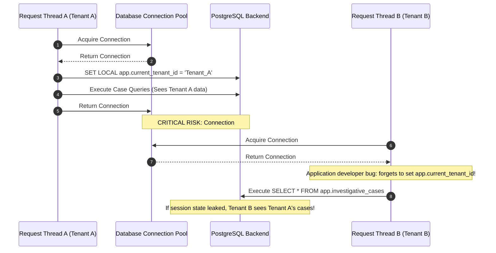

# TTI Gate 4B.3A — Tenant Security & Database-Level Constraints Review

**Document Reference:** `TTI-ARCH-TENCON-001`  
**Product:** Telegram Threat Intelligence (TTI)  
**Lifecycle Stage:** Gate 4B.3A — Physical Database Design Review  
**Author:** Principal Data Architect & Security Architect  
**Date:** October 2026  
**Governance Status:** `PROPOSED SECURITY DESIGN — PENDING IMPLEMENTATION AUTHORIZATION`  
**Parent Specifications:**  
- [`docs/architecture/gate_4b_3a/physical_schema_design.md`](file:///d:/TTI/docs/architecture/gate_4b_3a/physical_schema_design.md)  
- [`docs/architecture/gate_4b_1/tenant_isolation_and_data_ownership.md`](file:///d:/TTI/docs/architecture/gate_4b_1/tenant_isolation_and_data_ownership.md)  
- [`docs/architecture/gate_4a/architecture_decision_register.md`](file:///d:/TTI/docs/architecture/gate_4a/architecture_decision_register.md) (`ADR-004`)  

---

## 1. Executive Summary & Defense-in-Depth Objectives

In a multi-tenant cybersecurity platform serving competing law enforcement agencies and corporate SOCs, software-level data filtering alone (e.g., relying on application developers to remember `WHERE tenant_id = ?` in every query) provides **zero defense-in-depth** and is explicitly rejected as an acceptable security control.

This document establishes the proposed **Database-Level Tenant Security & Constraint Model**, detailing:
1. Proposed PostgreSQL **Row-Level Security (RLS)** policy specifications and session context variables.
2. In-depth analysis of **Connection Pooling & Context Bleed Risks** in high-throughput ASGI/FastAPI environments.
3. Database constraint mechanics preventing cross-tenant access, case contamination, and existence oracle probing.
4. Retention reconciliation distinguishing logical database row deletion, physical object deletion, and immutable compliance audit trails.

> [!WARNING] Security Baseline Caveat
> The RLS policies, connection-pooling conventions, and database constraints in this document are **proposed design specifications**. They have not been tested or implemented in executable DDL. Formal validation must be executed via automated multi-tenant penetration fixtures in Gate 5 prior to production deployment.

---

## 2. Row-Level Security (RLS) Policy Architecture (Provisional Proposal)

### 2.1 Session Context Variable Convention
Under the proposed design, every database connection servicing a tenant request must establish an in-transaction session context before executing any SQL statement:
```
SET LOCAL app.current_tenant_id = 'c7a8b920-4e31-4e2b-98f1-289d012480a1';
SET LOCAL app.current_user_id   = '8f4c2b9a-10d9-482a-b620-c8b417e990c8';
```

### 2.2 Fail-Closed Session Context Evaluation
To prevent un-authenticated queries from bypassing security, the context evaluation function fails closed:
* If `app.current_tenant_id` is missing, null, or empty string:
  - The function returns `NULL`.
  - The RLS policy evaluates to `FALSE`.
  - The database returns zero rows for `SELECT` and raises an access violation for `INSERT`/`UPDATE`/`DELETE`.

### 2.3 Proposed Table-Level RLS Policies

The following policy templates are proposed for all tables in the `app` schema:

```
-- 1. Investigative Cases Policy
ALTER TABLE app.investigative_cases ENABLE ROW LEVEL SECURITY;
ALTER TABLE app.investigative_cases FORCE ROW LEVEL SECURITY;

CREATE POLICY tenant_isolation_cases ON app.investigative_cases
    AS RESTRICTIVE
    USING (tenant_id = NULLIF(current_setting('app.current_tenant_id', true), '')::UUID)
    WITH CHECK (tenant_id = NULLIF(current_setting('app.current_tenant_id', true), '')::UUID);

-- 2. Case Message Associations (Bridge Entity) Policy
ALTER TABLE app.case_message_associations ENABLE ROW LEVEL SECURITY;
ALTER TABLE app.case_message_associations FORCE ROW LEVEL SECURITY;

CREATE POLICY tenant_isolation_case_messages ON app.case_message_associations
    AS RESTRICTIVE
    USING (tenant_id = NULLIF(current_setting('app.current_tenant_id', true), '')::UUID)
    WITH CHECK (tenant_id = NULLIF(current_setting('app.current_tenant_id', true), '')::UUID);

-- 3. Case Notes Policy
ALTER TABLE app.case_notes ENABLE ROW LEVEL SECURITY;
ALTER TABLE app.case_notes FORCE ROW LEVEL SECURITY;

CREATE POLICY tenant_isolation_case_notes ON app.case_notes
    AS RESTRICTIVE
    USING (tenant_id = NULLIF(current_setting('app.current_tenant_id', true), '')::UUID)
    WITH CHECK (tenant_id = NULLIF(current_setting('app.current_tenant_id', true), '')::UUID);

-- 4. Investigation Report Packages Policy
ALTER TABLE app.investigation_report_packages ENABLE ROW LEVEL SECURITY;
ALTER TABLE app.investigation_report_packages FORCE ROW LEVEL SECURITY;

CREATE POLICY tenant_isolation_reports ON app.investigation_report_packages
    AS RESTRICTIVE
    USING (tenant_id = NULLIF(current_setting('app.current_tenant_id', true), '')::UUID)
    WITH CHECK (tenant_id = NULLIF(current_setting('app.current_tenant_id', true), '')::UUID);
```

### 2.4 Restrictive vs. Permissive Invariant
All policies are designated `AS RESTRICTIVE`. This ensures that even if a future developer adds an accidental permissive policy (e.g., `CREATE POLICY allow_all`), PostgreSQL mandates that **all** restrictive policies must evaluate to true, preserving tenant isolation under all conditions.

---

## 3. Connection Pooling & Context Bleed Risks

In high-concurrency Python web applications using connection poolers (e.g., SQLAlchemy Pool, asyncpg, PgBouncer), connections are shared across multiple HTTP request threads. This creates a severe risk of **Session Context Bleed**:



### 3.1 Required Architectural Mitigations:
1. **Mandatory Use of `SET LOCAL` (Transaction-Scoped):**
   - The platform mandates `SET LOCAL` rather than `SET SESSION`. `SET LOCAL` automatically expires and reverts when the active database transaction commits or aborts (`COMMIT` or `ROLLBACK`).
2. **Explicit Connection Check-in Reset Hook:**
   - The connection pooler must be configured with an event listener on connection checkout and check-in executing `DISCARD ALL` or `RESET ALL` to guarantee no residual session variables persist between requests.
3. **Session Variable Pre-Flight Guard:**
   - Application middleware executes an explicit pre-flight check at the start of every database unit of work, confirming that `current_setting('app.current_tenant_id')` matches the validated JWT claim before executing any business query.

---

## 4. Preventing Media Existence Oracle Attacks

### 4.1 The Threat Vector
An adversary attempting to verify whether a seized file (e.g., a specific PDF with known SHA-256 hash $H$) has been uploaded into the platform could submit queries designed to probe the database.

### 4.2 Database-Level Query Construction
To prevent existence leakage:
1. The database exposes **zero public views** joining `evidence.media_artifacts` directly to search queries.
2. Inquiries for evidence downloads execute through an explicit relational path requiring an authorized case association:

```
SELECT 
    m.artifact_id,
    m.storage_vault_locator,
    m.media_sha256_hash,
    m.mime_type
FROM evidence.media_artifacts m
INNER JOIN threat.source_messages msg 
    ON m.source_message_id = msg.message_id
INNER JOIN app.case_message_associations cma 
    ON msg.message_id = cma.message_id
WHERE cma.case_id = :requested_case_id
  AND m.artifact_id = :requested_artifact_id;
```

* **Outcome:** Because `app.case_message_associations` is governed by RLS (`tenant_id = CURRENT_TENANT`), if an investigator from Tenant B requests an artifact pinned only to Tenant A's case, the query returns exactly **0 rows**.
* The application layer receives an empty result and returns `HTTP 404 Not Found`, revealing zero information about whether the media file exists in the storage vault.

---

## 5. Retention, Erasure & Disposal Reconciliation

In accordance with Gate 4A [`ADR-006`](file:///d:/TTI/docs/architecture/gate_4a/architecture_decision_register.md#adr-006) and Gate 4B.1 [`evidence_provenance_and_retention_model.md`](file:///d:/TTI/docs/architecture/gate_4b_1/evidence_provenance_and_retention_model.md), storage immutability remains marked:
# **`PROVISIONAL PENDING RESOLUTION OF DEC-08 AND RELEVANT LEGAL REVIEW`**

### 5.1 Three-Level Disposal Distinction
The physical design strictly distinguishes three tiers of deletion:

```
+----------------------------------------------------------------------------------------------------+
|                                    THREE-LEVEL DISPOSAL TAXONOMY                                   |
+---------------------+-------------------------------+----------------------------------------------+
| Disposal Tier       | Target Subsystem              | Physical Database & Storage Action           |
+---------------------+-------------------------------+----------------------------------------------+
| 1. Logical Database | Relational metadata in `app`  | - Sets `is_tombstone = TRUE` or executes     |
|    Deletion         | schema (e.g., unpin message,  |   `DELETE` on `app.case_message_associations`|
|                     | archive case).                | - Underlying threat records remain intact.   |
+---------------------+-------------------------------+----------------------------------------------+
| 2. Physical Vault   | Binary evidence in `evidence` | - Cryptographic wiping of physical file bytes|
|    Expungement      | vault (e.g., court-ordered    |   in object storage.                         |
|                     | erasure, CSAM removal).       | - Nullifies `payload_storage_locator`.       |
+---------------------+-------------------------------+----------------------------------------------+
| 3. Governed Audit   | Compliance ledger in `audit`  | - **Append-only by default.** Records        |
|    Retention        | schema (`audit_event_records`)|   expungement warrant reference, hash,       |
|                     |                               |   timestamp, and acting officer identities.  |
|                     |                               | - Statutory or judicial suppression of       |
|                     |                               |   tainted audit entries requires the         |
|                     |                               |   proposed controlled exception process.     |
+---------------------+-------------------------------+----------------------------------------------+
```

### 5.2 The Unresolved Retention Dilemma (`DEC-08`)
- If a court issues a formal expungement or suppression order for a specific message, or if illegal contraband is discovered, the platform must have an authorized technical mechanism to expunge the record.
- Hard cloud Object Lock in **Compliance Mode** would make this legally mandated deletion physically impossible, creating severe civil and criminal exposure for the operating entity.
- **Design Invariant:** Therefore, the physical design avoids hardware/cloud Compliance-mode locks (keeping storage immutability strictly **provisional pending resolution of `DEC-08` and legal review**). It supports relational foreign-key constraints with `ON DELETE RESTRICT` for baseline evidence integrity, while deferring automated purge schedules until `DEC-08` is formally resolved by VFRA leadership.
- **Proposed Controlled Exception Process:** To accommodate lawful court-ordered suppression without introducing an unrestricted trigger bypass or relying on role names alone, the platform specifies an engineering design proposal requiring:
  1. *Verified Authorization:* Legally verified judicial suppression docket UID or statutory compliance order.
  2. *Separation of Duties:* Dual-custody cryptographic sign-off from both Compliance Officer and Lead Security Architect.
  3. *Least Privilege:* Execution restricted to an isolated, non-interactive administrative maintenance session outside application runtime (`tti_app_role` has zero bypass capability).
  4. *Reason & Case Reference:* Mandatory docket and rationale tracking.
  5. *Auditable Record:* A non-suppressed meta-audit entry logging the administrative suppression event itself.
  *(This technical exception process remains a design proposal subject to independent security review and testing; no formal compliance approval is claimed).*

---

## 6. Security Summary & Constraint Verification

| Security Control | Physical Enforcement Layer | Verification Method | Status |
| :--- | :--- | :--- | :--- |
| **Fail-Closed Context** | `NULLIF(current_setting('app.current_tenant_id', true), '')` in RLS policies | RLS policy inspection & missing-context tests | **PROPOSED** |
| **Anti-Enumeration** | Restrictive RLS on all `app.*` tables yielding 0 rows on foreign lookups | Uniform HTTP 404 integration tests | **PROPOSED** |
| **Anti-Oracle Media** | Mandatory join across `app.case_message_associations` | Direct hash probe vulnerability scan | **PROPOSED** |
| **Original Evidence Protection** | Foreign keys on `raw_evidence_blobs` have `ON DELETE RESTRICT` | Mutation prevention tests | **PROPOSED** |
| **Append-Only Auditing** | SQL `REVOKE UPDATE, DELETE ON audit.audit_event_records` | Database permission audit | **PROPOSED** |

---

*Next Design Document:* [`indexing_and_query_design.md`](file:///d:/TTI/docs/architecture/gate_4b_3a/indexing_and_query_design.md)
