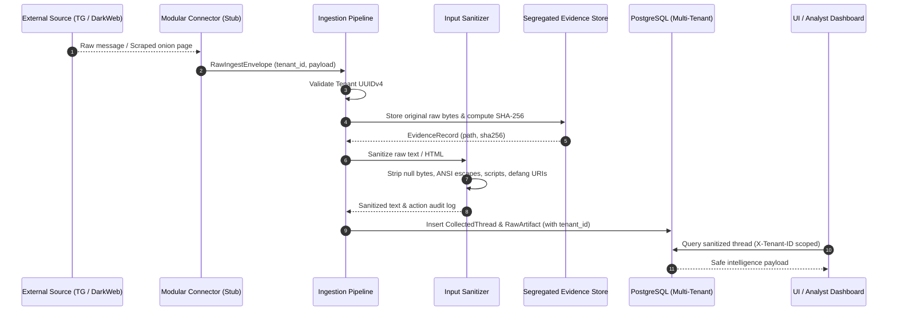

# TTI (Telegram Threat Intelligence) — Data Flow & Ingestion Lifecycle

## 1. Overview

Because TTI collects data from adversarial or unverified channels (underground Telegram groups and dark-web onion forums), **every inbound message, metadata field, and page is classified as completely untrusted input**.

---

## 2. Ingestion Sequence

---

## 3. Step-by-Step Data Flow Stages

### Stage 1: Extraction via Modular Connectors
- Connectors run within sandboxed execution environments.
- Connectors emit a strongly-typed `RawIngestEnvelope` containing `tenant_id`, source metadata, and raw JSON payload.
- In Phase 1, live network operations are deactivated; synthetic payloads are provided for test validation.

### Stage 2: Cryptographic Evidence Preservation
- Before any transformation or text parsing, the exact byte sequence received is persisted into the isolated evidence store:
  `{storage_root}/{tenant_id}/{artifact_id}_{sha256}.raw`
- A cryptographic SHA-256 hash is computed and recorded in the database.
- Files in evidence storage are set with read-only permissions to prevent retroactive alteration.

### Stage 3: Untrusted Input Sanitization (`InputSanitizer`)
The untrusted content is passed through defensive sanitizers:
1. **Length Guard**: Caps input at 1,000,000 characters to prevent denial-of-service memory exhaustion.
2. **Unicode NFC Normalization**: Normalizes varied representations of malicious homoglyphs.
3. **Control Character Removal**: Strips null bytes (`\x00`), backspaces, and terminal control characters.
4. **ANSI Escape Stripping**: Eliminates terminal escape sequences that could hijack CLI or logger displays.
5. **Script & Embed Redaction**: Replaces `<script>`, `<iframe>`, `<object>`, `<embed>` blocks with redaction notices.
6. **Protocol Defanging**: Defangs `javascript:`, `data:`, `file:`, and `vbscript:` URI schemes.
7. **Entity Escaping**: Residual HTML characters (`<`, `>`, `&`, `"`) are escaped for safe UI rendering.

### Stage 4: Relational Persistence
- Records are saved in PostgreSQL with explicit `tenant_id` foreign keys and indexes.
- Database access is strictly compartmentalized; queries must always include `WHERE tenant_id = :active_tenant`.

### Stage 5: Analyst Presentation
- The frontend consumes sanitized intelligence data via `/api/v1/` endpoints.
- Raw evidence files are **never** directly linked or exposed via public static web URLs.
