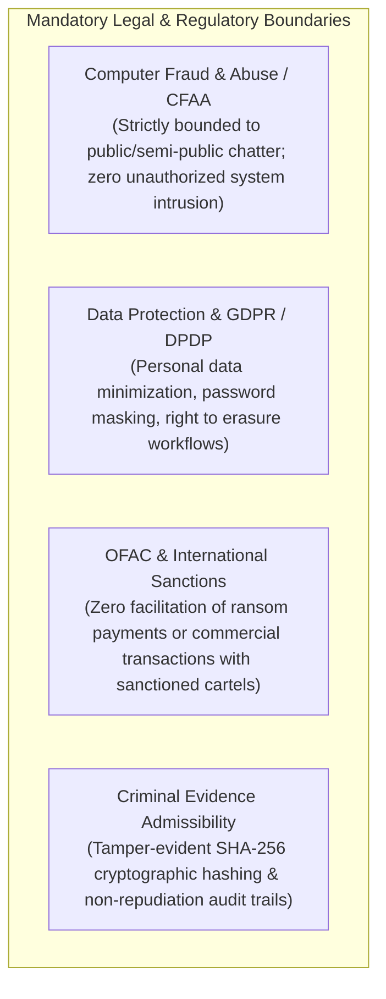

# TTI Assumptions, Constraints & Requirements Traceability

**Document Reference:** `TTI-DOC-PRD-CON-001`  
**Product:** Telegram Threat Intelligence (TTI)  
**Lifecycle Stage:** Gate 3B — Stakeholder Alignment  
**Role:** Senior Product Analyst  
**Date:** 2026-10-28  
**Status:** **ACTIVE BASELINE — PENDING STAKEHOLDER REVIEW**  

---

## 1. Technical Assumptions & Constraints

### 1.1 Ingestion & Protocol Constraints (Telegram MTProto)
1. **Platform Rate-Limiting & Flood Waits:** Telegram enforces server-side rate limits on MTProto client connections. Automated accounts (userbots) that fetch message histories too rapidly trigger `FLOOD_WAIT_X` exceptions (enforcing mandatory wait periods ranging from seconds to hours). Ingestion workers must implement exponential backoff, sliding-window request throttling, and circuit breakers.
2. **Account Lifetime & Ban Risk:** Ingestion phone numbers are subject to platform bans if detected executing non-human automated patterns. The system must operate a pool of rotating virtual SIM sessions and residential proxies, decoupling specific phone numbers from target channels.
3. **Public vs. Semi-Public vs. Private Boundaries:**
   - *Public Channels & Supergroups:* Ingestible via standard invite links or usernames.
   - *Semi-Public Groups:* Require automated join requests and user account presence.
   - *Secret Chats (E2EE):* **Strictly out of bounds.** Telegram Secret Chats use device-to-device MTProto Diffie-Hellman key exchange; intercepting them is cryptographically infeasible and legally prohibited.
4. **Deleted & Edited Messages:** Threat actors frequently edit or delete incriminating messages in Telegram channels. Ingestion workers must log initial message payloads upon receipt; subsequent edits must be recorded as revision records rather than overwriting historical evidence.

### 1.2 Dark-Web Sourcing Constraints (Tor Network)
1. **Network Latency & Circuit Instability:** Tor `.onion` hidden services suffer from high round-trip latency (1,000–5,000 ms) and severe circuit instability. Ingestion crawlers cannot run synchronous request/response pipelines; all dark-web ingestion must operate asynchronously via isolated worker queues (Celery/Redis) with aggressive timeout handling.
2. **DDoS Protection & Captchas:** Cybercrime forums (e.g., Exploit, XSS, BreachForums) frequently deploy custom proof-of-work challenges or CAPTCHAs to block automated scrapers. Automated crawling of these forums is fragile and requires specialized session management or commercial aggregator fallback.

### 1.3 Database & Search Architecture Constraints
1. **Technology Stack Baseline:** In accordance with Phase 1 project commitments, the technical stack is fixed to:
   - *Backend:* Python 3.12+ with FastAPI.
   - *Frontend:* React + TypeScript + Vite.
   - *Database:* PostgreSQL with Alembic migrations.
   - *Caching & Queues:* Redis (with Celery/equivalent workers).
   - *DevOps:* Docker Compose.
2. **Search Indexing Threshold:** PostgreSQL Full-Text Search (with `pg_trgm` and GIN indexes) is suitable for initial MVP scale (<1,000,000 messages). If Phase 1 ingestion velocity exceeds 5,000,000 messages or requires complex fuzzy lucene queries, transitioning to a dedicated search cluster (Elasticsearch / OpenSearch) will become necessary.

---

## 2. Legal, Statutory & Regulatory Constraints



1. **Anti-Hacking Statutes (CFAA / Computer Misuse Act):** TTI is strictly a passive threat intelligence and monitoring platform. Under no circumstances will TTI deploy active offensive payloads, exploit vulnerabilities, or breach third-party servers. All data ingested must be obtained from publicly broadcast communications or leak distributions.
2. **Privacy & Data Protection (GDPR / CCPA / DPDP):** Ingested stealer dumps contain personal identifiable information (PII) of innocent third-party victims (e.g., employee bank logins, personal photos). TTI must implement:
   - Data minimization: Only extracting metadata relevant to cyber defense.
   - Plaintext password masking by default (`P@ssw****`).
   - Audit logging for any analyst unmasking action.
   - Automated purging workflows to comply with legitimate "Right to Erasure" requests.
3. **Sanctions Compliance (OFAC / UN Sanctions):** TTI tracks ransomware cartels and extortion blogs for intelligence purposes only. The platform must never provide features that facilitate extortion payments, cryptocurrency escrow, or communication with sanctioned entities.
4. **Courtroom Admissibility (Chain of Custody):** Digital evidence collected by law enforcement must comply with national rules of evidence (e.g., US Federal Rules of Evidence Rule 902(13)/(14) for self-authenticating electronic records). Hashing records with SHA-256 upon initial capture is mandatory.
5. **Visual Evidence & Screenshot Admissibility Guardrail (`REP-TXT-SCREEN-001`):** Screenshots alone do **NOT** independently establish authenticity or legal admissibility in judicial proceedings. Because images can be manipulated using client-side tools, screenshots serve strictly as visual corroboration to accompany raw message JSON records, network headers, and SHA-256 cryptographic hashes. Screenshot access must be restricted to authorized users via RBAC, and capture limitations or missing fields must be explicitly documented.

---

## 3. Operational & Sourcing Assumptions

1. **Human Specialist Sourcing Requirement:** As corroborated by StealthMole (`Slide 17`) and Intel 471 (`EVID-I471-008`), automated bots alone cannot access high-tier vetted cybercrime syndicates. The platform assumes that VFRA intelligence analysts will manually curate channel invite links, maintain personas, and introduce high-value sources into the crawler fleet.
2. **Infrastructure Operational Overhead:** Operating an automated ingestion fleet requires ongoing operational maintenance: monitoring proxy health, replacing burned virtual phone numbers, updating HTML parsers when forums alter page templates, and tuning OCR confidence thresholds.

---

## 4. Comprehensive Requirements Traceability Matrix

Every capability discussed across the TTI discovery phase is categorized below to ensure absolute governance rigor:

```
+----------------------------------------------------------------------------------------------------+
|                               REQUIREMENTS TRACEABILITY REGISTER                                   |
+--------------------------+-----------------------+-------------------------------------------------+
| Capability / Feature     | Governance Category   | Justification & Boundary Condition              |
+--------------------------+-----------------------+-------------------------------------------------+
| Dual Persona Focus       | CONFIRMED BY PO       | Law Enforcement and Corporate SOC focus.        |
| Ingestion Scope          | CONFIRMED BY PO       | Telegram and Dark-Web sources.                  |
| Administrative Split     | CONFIRMED BY PO       | Platform-Admin Panel and Client-User Panel.     |
| Service Delivery Model   | CONFIRMED BY PO       | Self-directed SaaS + Managed Intelligence Svcs. |
| TXT Report & Screenshots | APPROVED BY VFRA      | REP-TXT-SCREEN-001: Stakeholder confirmation.   |
+--------------------------+-----------------------+-------------------------------------------------+
| Phase 1 MVP Scope        | REQUIRES VFRA APPROVAL| DEC-01: Chat Core + Credential Threat Core.     |
| Ingestion Legal Model    | REQUIRES VFRA APPROVAL| DEC-02: Hybrid Proprietary + Commercial Feeds.  |
| Tenancy Architecture     | REQUIRES VFRA APPROVAL| DEC-05: Shared Ingestion + Isolated Cases.      |
| Operating Budget Ceiling | REQUIRES VFRA APPROVAL| DEC-11: Approved monthly infrastructure spend.   |
| Product Packaging Model  | REQUIRES VFRA APPROVAL| DEC-12: Single Unified Platform vs. Split SKUs. |
+--------------------------+-----------------------+-------------------------------------------------+
| Plaintext Password Store | REQUIRES LEGAL REVIEW | DEC-06: Masked storage vs. plaintext AS IS.     |
| Evidence Hashing Standard| REQUIRES LEGAL REVIEW | DEC-07: Internal SHA-256 vs. RFC 3161 TSA.      |
| Data Retention Policies  | REQUIRES LEGAL REVIEW | DEC-08: 90-day rolling TTL vs. multi-year cases.|
| Telegram Secret Chats    | REQUIRES LEGAL REVIEW | STRICT PROHIBITION: Interception prohibited.   |
| Visual Evidence Admiss.  | REQUIRES LEGAL REVIEW | Non-claim: Screenshots do not prove authenticity|
+--------------------------+-----------------------+-------------------------------------------------+
| Continuous Thread Viewer | PROPOSED FOR EVAL (01)| OPP-001: Replaces StealthMole 1/10 scroll tax.  |
| Recursive AST Parser     | PROPOSED FOR EVAL (02)| OPP-002: Overcomes StealthMole 3-OR limit.      |
| OpenAPI REST & Webhooks  | PROPOSED FOR EVAL (03)| OPP-003: Solves StealthMole zero-API defect.    |
| Enterprise SAML 2.0 / OIDC| PROPOSED FOR EVAL (04)| OPP-004: Standard enterprise SSO integration.   |
| Multi-Tenant RLS / Silos | PROPOSED FOR EVAL (05)| OPP-005: Protects confidential case notes.      |
| Local Cryptographic Store| PROPOSED FOR EVAL (06)| OPP-006: Immutable SHA-256 evidence receipts.  |
| STIX 2.1 / JSON Exporters| PROPOSED FOR EVAL (07)| OPP-007: Standard machine-readable CTI export.  |
| Dual-Tier OCR & Multimodal| PROPOSED FOR EVAL (08)| OPP-008: Cost-efficient text extraction.       |
+--------------------------+-----------------------+-------------------------------------------------+
| Telegram Userbot Fleet   | UNKNOWN / UNSUPPORTED | Proprietary crawler topology undisclosed.       |
| Real-Time Voice STT      | UNKNOWN / UNSUPPORTED | No competitor documents voice note STT.         |
| Deleted Msg Tombstones   | UNKNOWN / UNSUPPORTED | Revisions tracking undocumented by competitors. |
+--------------------------+-----------------------+-------------------------------------------------+
```

---

## 5. Architectural Non-Violation Commitment

In accordance with strict project rules:
1. No application code, tests, database migrations, or connectors have been modified.
2. No live scraping or network probing has been initiated.
3. Drafting of the PRD, SRS, database entity schemas, or final architecture remains on hold pending VFRA stakeholder review of this alignment pack.