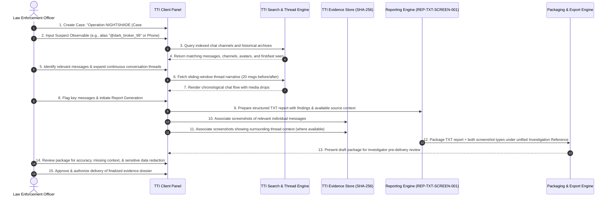
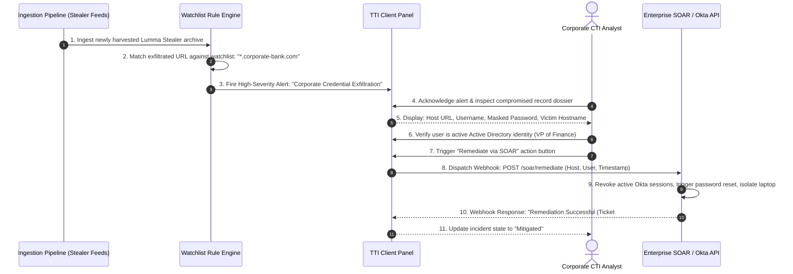
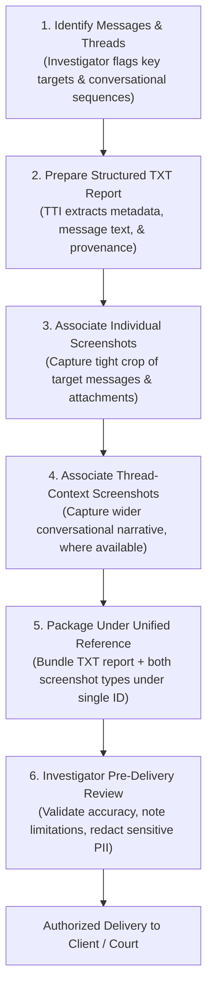

# TTI Customer Workflows & Capability Analysis

**Document Reference:** `TTI-DOC-PRD-WF-001`  
**Product:** Telegram Threat Intelligence (TTI)  
**Lifecycle Stage:** Gate 3B — Stakeholder Alignment  
**Role:** Senior Product Analyst  
**Date:** 2026-10-28  
**Status:** **PROPOSED — PENDING FORMAL STAKEHOLDER REVIEW**  

---

> [!IMPORTANT]
> **Governance Notice:** All workflows and functional breakdowns presented in this document represent **candidate operational models** derived from competitor benchmarking and market discovery. None of these workflows constitute approved system requirements until formally accepted by VFRA stakeholders.

---

## 1. Illustrative Customer Workflows

To evaluate how TTI will deliver value across its confirmed dual market segments (Law Enforcement and Corporate Cybersecurity), four illustrative end-to-end workflows are modeled below.

```mermaid
flowchart TD
    subgraph LEA_Flow["1. Law Enforcement Investigator Workflow"]
        LE1["Case Initiation & Suspect Alias Identification"] --> LE2["Deep Chat Thread History & Media Reconstruction"]
        LE2 --> LE3["Cryptographic Evidence Staging (SHA-256 Hashing)"]
        LE3 --> LE4["Court-Defensible Evidence Dossier Generation"]
    end

    subgraph Corp_Flow["2. Corporate Security Analyst Workflow"]
        CP1["Automated Keyword / Domain Alert Trigger"] --> CP2["Infostealer Log & Credential Triage"]
        CP2 --> CP3["Blast Radius & Compromised Host Verification"]
        CP3 --> CP4["SOAR Webhook Escalation & Credential Revocation"]
    end

    subgraph PlatAdmin_Flow["3. Platform Administrator Workflow (VFRA Ops)"]
        PA1["Collector Fleet Telemetry & Proxy Health Check"] --> PA2["Tenant Provisioning & Quota Scoping"]
        PA2 --> PA3["OCR / AI Ingestion Queue Orchestration"]
        PA3 --> PA4["Managed CTI Service Briefing Authoring"]
    end

    subgraph OrgAdmin_Flow["4. Customer Organization Admin Workflow"]
        OA1["User Onboarding & Departmental RBAC Assignment"] --> OA2["Enterprise Watchlist Configuration"]
        OA2 --> OA3["SAML SSO & SIEM API Credential Management"]
        OA3 --> OA4["Tenant Access Audit Log Review"]
    end
```



---

### 1.1 Law Enforcement Investigator Workflow (Proposed)

* **Persona:** Detective or Intelligence Officer investigating cyber extortion, illicit narcotics trafficking, weapons smuggling, or child exploitation networks on Telegram.
* **Objective:** Establish the identity of a threat actor, preserve their communication history with verifiable forensic integrity, and produce an affidavit-ready court exhibit.



* **Detailed Step-by-Step Breakdown:**
  1. **Case Scoping & Authorization:** The investigator logs in using hardware token 2FA (or department SSO) and creates a designated, compartmentalized Case container with a judicial warrant or case reference number.
  2. **Multi-Identifier Discovery:** The investigator queries known suspect observables: Telegram handles (`@username`), numeric Telegram user IDs, affiliated phone numbers, or cryptocurrency wallet addresses.
  3. **Continuous Thread Navigation:** Rather than reviewing isolated message snippets, the investigator opens the continuous thread view, scrolling backwards and forwards through conversational exchanges to observe accomplice coordination, operational timelines, and pricing negotiations.
  4. **Message & Thread Identification:** The investigator tags specific incriminating messages and identifies relevant surrounding conversation threads for evidentiary inclusion.
  5. **Structured TXT Report Preparation:** TTI prepares a standardized, structured TXT report compiling findings, available source context, channel identifiers, and timestamps.
  6. **Dual-Scope Screenshot Association:**
     - TTI associates captured screenshots of relevant **individual messages**.
     - TTI associates screenshots capturing the **surrounding thread context** where available and authorized.
  7. **Unified Report Packaging:** TTI bundles the structured TXT report and both screenshot types under a single, shared report/investigation reference.
  8. **Investigator Pre-Delivery Review:** The investigator reviews the complete assembled package to verify accuracy, check for missing context or capture limitations, redact any inadvertent third-party sensitive information, and formally authorize release.

---

### 1.2 Corporate Security Analyst Workflow (Proposed)

* **Persona:** SOC Tier 2/3 Analyst or Cyber Threat Intelligence (CTI) Specialist at a financial services firm or critical infrastructure enterprise.
* **Objective:** Detect corporate credential leaks from infostealer malware, assess enterprise exposure, and trigger automated account remediation.



* **Detailed Step-by-Step Breakdown:**
  1. **Automated Surveillance:** The enterprise CTI team maintains permanent watchlists containing corporate domains (`bank.com`), executive names, brand terms, and proprietary software repository names.
  2. **Real-Time Detection:** An infostealer log archive parsed from a dark-web drop or public Telegram channel triggers an exact match on `vpn.bank.com`.
  3. **Triage & Contextual Analysis:** The analyst receives an alert notification and inspects the victim record: infected machine hostname, victim IP address, local infection path, and compromised employee email.
  4. **Mitigation Dispatch:** The analyst initiates an automated remediation webhook directly from the interface. The webhook signals the enterprise SOAR platform (e.g., Palo Alto Cortex XSOAR, Splunk SOAR, or Microsoft Sentinel) to terminate active enterprise sessions and quarantine the infected host.
  5. **Executive Threat Briefing:** The analyst tags the event to generate a weekly threat briefing illustrating trend metrics for executive leadership.

---

### 1.3 Platform Administrator Workflow — VFRA Operations (Proposed)

* **Persona:** VFRA Infrastructure Engineer, Ingestion Operations Lead, or In-House Senior Threat Analyst.
* **Objective:** Oversee platform collector health, provision new customer tenants, manage AI/OCR worker pipelines, and author managed intelligence advisories.

* **Detailed Step-by-Step Breakdown:**
  1. **Fleet Health Monitoring:** The platform administrator accesses the **Platform-Admin Panel** dashboard, reviewing real-time telemetry: active Telegram MTProto client sessions, rate limit throttling states (`FLOOD_WAIT_X`), Tor SOCKS5 proxy pool latencies, and ingestion message ingress velocity (msgs/sec).
  2. **Collector Session Rotation:** When a monitoring session encounters platform friction or rate-limiting, the admin triggers automated proxy failover or rotates session credentials from the reserve account pool.
  3. **Tenant Lifecycle & Scoping:** A new law enforcement client signs a service agreement. The administrator provisions a dedicated tenant, assigns administrative accounts, scopes subscription quotas (allowed concurrent queries, watchlist capacity, API rate limits), and configures data retention windows.
  4. **AI & Pipeline Worker Orchestration:** The admin inspects background processing queues (Redis/Celery workers), monitoring OCR job throughput (Tesseract worker cluster) and vision model inference queues to ensure zero backlog.
  5. **Managed Intelligence Delivery:** Utilizing the internal threat hunting console, VFRA analysts curate a specialized intelligence briefing on an emerging ransomware syndicate, authoring a white-label CTI advisory dispatched directly to subscriber client-user panels.

---

### 1.4 Customer Organization Administrator Workflow (Proposed)

* **Persona:** Customer IT Director, Chief Information Security Officer (CISO), or Police Cyber Division Technical Lead.
* **Objective:** Manage internal organizational access, enforce least-privilege role boundaries, manage enterprise integrations, and audit user activity.

* **Detailed Step-by-Step Breakdown:**
  1. **User Onboarding & Departmental RBAC:** The organization admin logs into the Client-User Admin settings, creating user accounts and assigning granular roles:
     - *Investigator / Senior Analyst:* Full search, continuous thread view, case creation, and evidence export permissions.
     - *Junior Analyst / Triage:* Search and alert triage permissions; export restricted.
     - *Internal Auditor / Compliance Officer:* Read-only access to user search history and audit logs; zero operational case access.
  2. **Enterprise Identity Integration:** The admin configures enterprise Single Sign-On (SAML 2.0 / OIDC) connecting the organization's Okta or Microsoft Entra ID directory.
  3. **Watchlist & Alert Rule Management:** The admin establishes baseline organizational watchlists that apply across all departmental analysts (e.g., mandatory monitoring of all corporate subsidiary domains).
  4. **API Token & Integration Governance:** The admin generates scoped API keys for ingestion into the enterprise SIEM/SOAR, defining IP CIDR allowlists and rotation schedules.
  5. **Compliance Audit Inspection:** To ensure adherence to internal privacy guidelines and prevent unauthorized surveillance by staff, the admin reviews tamper-evident audit logs recording every search query executed by internal personnel.

---

### 1.5 Approved Reporting Workflow: Structured TXT Report & Dual-Scope Screenshots

**Feature Reference:** `REP-TXT-SCREEN-001`  
**Requirement Baseline:** *Every applicable investigation report must support a TXT report accompanied by both relevant-message screenshots and thread-context screenshots, subject to source availability and authorized access.*  
**Approval Status:** **APPROVED BY VFRA**  
**Approval Basis:** Stakeholder confirmation supplied by the project owner.  
**Scope Boundary:** Core reporting requirement confirmed. Operational capture modality, retention schedules, and formal evidence standards remain pending stakeholder decisions.  

To bridge human-readable threat reporting with verifiable visual evidence, this proposed reporting workflow specifies the end-to-end lifecycle for compiling, packaging, and reviewing Telegram investigative deliverables.



#### 1.5.1 The 6-Step Reporting Lifecycle
1. **Message & Thread Identification:** The investigator analyzes chat telemetry and tags specific Telegram messages, indicators, and associated conversational threads relevant to the case.
2. **Structured TXT Report Preparation:** TTI prepares a structured plain-text (`.txt`) report compiling the investigation findings, extracted message bodies, and available source context.
3. **Individual-Message Screenshot Association:** TTI generates or associates screenshots focusing on the specific relevant individual messages (including visible sender handle, message ID, timestamp, and media previews).
4. **Thread-Context Screenshot Association:** Where technically feasible and authorized, TTI generates or associates wider screenshots capturing the surrounding thread context (messages immediately preceding and following the target) to preserve narrative flow and conversational dynamics.
5. **Unified Packaging:** TTI packages the structured TXT report, the individual-message screenshots, and the thread-context screenshots into a single, cohesive bundle registered under a unique, shared report/investigation reference (e.g., `TTI-REP-2026-0042`).
6. **Investigator Pre-Delivery Review:** Before authorized delivery or external disclosure, the investigator conducts a mandatory pre-flight review of the entire package to verify factual accuracy, record any missing context or capture limitations, redact any inadvertent third-party sensitive data, and confirm authorization.

#### 1.5.2 Proposed TXT Report Contents & Structure
The structured TXT report is designed for maximum interoperability, human readability, and forensic clarity. It supports the following fields:

* **Report & Investigation Identifiers:** Unique Report Reference ID, Parent Case ID, Warrant/Ticket Reference, and Investigating Officer/Analyst ID.
* **Collection Timestamp & Timezone:** Exact acquisition date, time, and timezone (UTC by default, with local timezone offset where available).
* **Channel & Message Identifiers:** Telegram Channel/Supergroup Name, Public Handle (`@channel`), Channel ID (`-100...`), Message ID, and Sender Handle/User ID (when exposed by the platform).
* **Relevant Message Content & Context:** Plaintext message content, reply-to references, forwarded-from provenance, and chronological sequence markers.
* **Cross-References to Supporting Screenshots:** Explicit file name pointers linking specific message paragraphs to their corresponding individual screenshot (`SCR-INDIV-<id>.png`) and thread-context screenshot (`SCR-THREAD-<id>.png`).
* **Collection Provenance & Known Limitations:** Documentation of the collection collector, source visibility, language/encoding, and explicit recording of unavailable fields or capture limitations.

> [!NOTE]
> **Source Variance Boundary:** Not all Telegram sources expose every field. In anonymous channels, forwarded drops, deleted threads, or private forums with masked sender identities, certain metadata attributes will be unavailable. The TXT report explicitly records missing fields as `NOT_AVAILABLE_FROM_SOURCE` rather than omitting them silently.

#### 1.5.3 Dual-Scope Screenshot Handling & Governance
To ensure that visual evidence is handled responsibly and defensibly:

1. **Distinction Between Screenshot Scopes:**
   - **Individual-Message Screenshots (`SCR-INDIV`):** High-resolution, focused captures centered strictly on the incriminating message, stolen data snippet, or malware drop.
   - **Thread-Context Screenshots (`SCR-THREAD`):** Panoramic captures displaying the conversational backdrop, including earlier planning chatter, counter-responses, and subsequent accomplice confirmations.
2. **Context Preservation:** Ingestion workers and rendering engines preserve surrounding conversational context wherever technically possible and permitted by data minimization rules.
3. **Capture Limitations & Missing Content Logging:** If a thread has been partially pruned by threat actors, if media downloads failed due to rate limits, or if end-user rendering truncated long posts, the system explicitly annotates the report with a `CAPTURE_LIMITATION_LOG`.
4. **Role-Based Access Restrictions:** Screenshots frequently contain graphic, illicit, or sensitive personal data. Access to raw screenshot files is strictly restricted to authorized case investigators and administrators via fine-grained RBAC.
5. **Retention & Deletion Lifecycle:** Retention schedules for image binaries (which consume significantly more storage than text records) must be defined with VFRA stakeholders (e.g., purged after 90 days for corporate incident tickets, or preserved for statutory limitation periods for active police cases).
6. **Legal Authenticity & Admissibility Disclaimer:**
   > [!CAUTION]
   > **Legal Disclaimer:** Screenshots alone do **NOT** independently establish authenticity or legal admissibility in judicial proceedings. Because image files can be fabricated or manipulated using client developer tools, screenshots in TTI serve exclusively as visual corroboration to accompany raw message JSON payloads, server headers, and cryptographic SHA-256 hashes.

---

## 2. Shared Platform vs. Customer-Specific Capabilities Analysis

To ensure architectural modularity and avoid premature monolithic assumptions, this section analyzes which capabilities can be shared across all customer personas versus those that require strict domain divergence.

```
+----------------------------------------------------------------------------------------------------+
|                               SHARED VS. CUSTOMER-SPECIFIC CAPABILITY MATRIX                       |
+--------------------------+-----------------------+-----------------------+-------------------------+
| Functional Dimension     | Shared Core Baseline  | Law Enforcement Needs | Corporate SOC Needs     |
+--------------------------+-----------------------+-----------------------+-------------------------+
| 1. Case & Incident Mgmt  | Shared case container | Judicial warrant tags,| Incident tickets linked |
|                          | data structures and   | strict compartment-   | to enterprise SIEM/SOAR |
|                          | entity tagging models.| alization, multi-badge| alerts and MTTR tracking|
|                          |                       | collaboration silos.  | metrics.                |
+--------------------------+-----------------------+-----------------------+-------------------------+
| 2. Evidence & Reporting  | Structured TXT reports| Tamper-evident SHA-256| JSON IOC feeds, STIX 2.1|
|                          | with screenshot refs  | cryptographic hashes, | bundles, executive board|
|                          | & dual-scope screens  | dual-scope screens,   | slides, trend metrics.  |
|                          | (REP-TXT-SCREEN-001,  | court-ready affidavits|                         |
|                          |  Approved by VFRA).   |                       |                         |
+--------------------------+-----------------------+-----------------------+-------------------------+
| 3. Threat Monitoring     | Keyword, regex, and   | Illicit contraband    | Corporate domain, brand,|
|                          | indicator matching    | keywords, suspect     | VIP executive names,    |
|                          | rule engine.          | handles, weapons,     | third-party suppliers,  |
|                          |                       | child safety terms.   | infostealer credentials.|
+--------------------------+-----------------------+-----------------------+-------------------------+
| 4. Permissions & Audit   | Role-Based Access     | Warrant-based audit   | Corporate SOC tiering   |
|                          | Control (RBAC) and    | logging, zero cross-  | (Tier 1/2/3), enterprise|
|                          | immutable audit logs. | agency visibility,    | SCIM 2.0 automated user |
|                          |                       | internal affairs logs.| provisioning.           |
+--------------------------+-----------------------+-----------------------+-------------------------+
| 5. Integrations & Exports| Standard REST API and | Case dossier packages,| Direct SIEM/SOAR hooks, |
|                          | export serializers.   | GraphML, .mtgx        | Webhook dispatchers,    |
|                          |                       | (Maltego link files). | TAXII 2.1 server feeds. |
+--------------------------+-----------------------+-----------------------+-------------------------+
| 6. Privacy & Retention   | Encrypted storage     | Multi-year / permanent| 90–180 day rolling TTL, |
|                          | (AES-256) and secure  | evidentiary retention | strict GDPR right-to-   |
|                          | deletion workflows.   | tied to statutory     | erasure / employee PII  |
|                          |                       | limitation periods.   | redaction requirements. |
+--------------------------+-----------------------+-----------------------+-------------------------+
```

### 2.1 Detailed Dimension Deep-Dives

#### Dimension 1: Case and Incident Management
* **Shared Platform Core:** Unified PostgreSQL relational schema managing `Cases`, `Entities`, `Notes`, `Tags`, and `Attachments`.
* **LEA Distinction:** Cases require legal scoping parameters: Court Reference Number, Investigating Officer ID, Warrant Expiration Date, and cryptographic sealing states. Strict case compartmentalization is essential—investigators on Case A must not see Case B even within the same police department without explicit authorization.
* **Corporate Distinction:** Incidents are operational rather than judicial. They link directly to corporate ticketing systems (Jira, ServiceNow) and track Mean Time to Detect (MTTD) and Mean Time to Remediate (MTTR).

#### Dimension 2: Evidence Handling and Reporting
* **Shared Platform Core:** Common document generation engine supporting structured TXT reports accompanied by dual-scope screenshots (individual messages and thread context) bundled under a shared investigation reference (`REP-TXT-SCREEN-001`), alongside tabular CSV/XLSX spreadsheets and PDF summaries.
* **LEA Distinction:** **Forensic Chain-of-Custody.** High evidentiary burden inspired by Maltego Evidence and Hunchly: raw message JSON payloads, images, and dual-scope screenshots must be sealed with SHA-256 hashes, recorded timestamps, and non-repudiation audit receipts to survive courtroom defense challenges.
* **Corporate Distinction:** **Actionable Telemetry.** Primary output is machine-readable intelligence (STIX 2.1, JSON IOC lists, CSV dumps of compromised credentials) formatted for automated ingestion into SIEM firewalls and endpoint protection agents.

#### Dimension 3: Threat Monitoring and Alerting
* **Shared Platform Core:** Streaming watchlist engine matching ingested chat messages against target expressions (keywords, regex patterns, indicators).
* **LEA Distinction:** Monitoring targets illicit contraband marketplaces, extremist propaganda, threat actor aliases, and organized crime networks.
* **Corporate Distinction:** Monitoring targets corporate domain names (`@company.com`), executive names, trademark terms, confidential code repositories, and infostealer malware logs exfiltrating corporate single-sign-on credentials.

#### Dimension 4: User Permissions and Audit Trails
* **Shared Platform Core:** Fine-grained Role-Based Access Control (RBAC) enforcing permissions on search, view, export, and administrative actions.
* **LEA Distinction:** Internal security policies require tamper-evident audit trails that log every query executed by an officer to prevent corrupt unauthorized background checks. Cross-tenant or cross-department leaks are catastrophic.
* **Corporate Distinction:** Seamless integration with enterprise Identity Providers via SAML 2.0 (Okta, Entra ID) and automated lifecycle provisioning via SCIM 2.0.

#### Dimension 5: Integrations and Exports
* **Shared Platform Core:** OpenAPI 3.1 RESTful API endpoints providing programmatic access to search and export functionality.
* **LEA Distinction:** Exports tailored for link-analysis tools (GraphML, Maltego `.mtgx` case containers) and court-ready exhibits.
* **Corporate Distinction:** Real-time push integrations: automated Webhooks, TAXII 2.1 server feeds, and certified connectors for enterprise SIEM/SOAR platforms (Cortex XSOAR, Splunk, Microsoft Sentinel).

#### Dimension 6: Privacy, Data Retention, and Access
* **Shared Platform Core:** AES-256 encryption-at-rest for databases and media storage; TLS 1.3 encryption-in-transit.
* **LEA Distinction:** Long retention horizons: criminal investigations may take 3 to 7 years to reach trial, requiring evidentiary data to remain frozen and immutable throughout the statute of limitations.
* **Corporate Distinction:** Subject to strict data privacy mandates (GDPR, CCPA, DPDP). Storing employee credentials or personal data scraped from stealer dumps requires data minimization, automated masking, and automated 90-to-180-day retention purging workflows.

---

## 3. Architectural Reservation (Non-Premature Decision)

> [!CAUTION]
> **Architectural Boundary:** This document **deliberately does NOT decide** whether the divergent requirements of Law Enforcement and Corporate Cybersecurity necessitate:
> 1. Two separate, standalone product builds, OR
> 2. A single unified multi-tenant platform with dynamic license-driven feature flags and tenant configuration profiles, OR
> 3. Hybrid private cloud / on-premises appliance deployments for LEAs alongside multi-tenant SaaS for corporate clients.
>
> That structural determination belongs strictly to **Research Gate 4 (Architecture Strategy)** and depends directly on VFRA stakeholder resolution of the Decision Register.