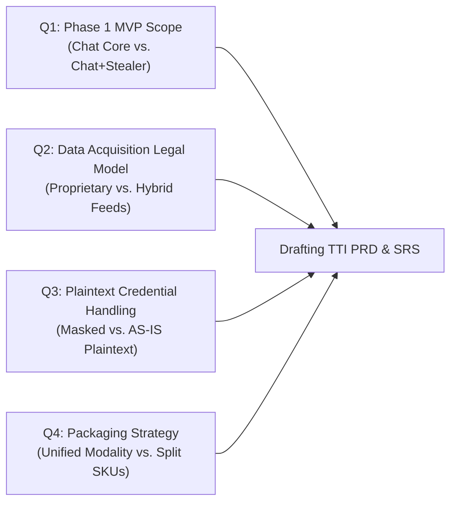

# TTI Open Questions & Decision Questionnaire for VFRA Leadership

**Document Reference:** `TTI-DOC-PRD-QST-001`  
**Product:** Telegram Threat Intelligence (TTI)  
**Lifecycle Stage:** Gate 3B — Stakeholder Alignment  
**Role:** Senior Product Analyst  
**Date:** 2026-10-28  
**Status:** **ACTION REQUIRED — AWAITING STAKEHOLDER DELIBERATION**  

---

## 1. Executive Briefing & Triage Model

To enable VFRA leadership to efficiently allocate decision-making capacity, all outstanding open questions have been organized into a **Three-Tier Urgency Triage Model**:

```
+----------------------------------------------------------------------------------------------------+
|                                    DECISION TRIAGE HIERARCHY                                       |
+--------------------------+-----------------------+-------------------------------------------------+
| Triage Tier              | Project Phase Gate    | Operational Consequence                        |
+--------------------------+-----------------------+-------------------------------------------------+
| TIER 1: BLOCKING         | Immediate Gate 3B/4   | PRD & SRS drafting CANNOT begin until decided   |
| TIER 2: ARCHITECTURAL    | Architecture Gate 4   | System & Database design CANNOT finalize        |
| TIER 3: DEFERRED         | Post-MVP / Phase 2+   | Safely deferred without delaying engineering    |
+--------------------------+-----------------------+-------------------------------------------------+
```

---

## 2. Tier 1: Immediate Blocking Questions (Required for PRD & SRS Sign-Off)

The following four questions represent **hard gates**. Product requirements cannot be authored without definitive answers to these strategic items:



---

### Question 1.1: What is the confirmed functional boundary for the Phase 1 MVP?

* **Context:** In Gate 3 research, we identified that StealthMole offers 14 modular search tables, Recorded Future offers massive enterprise knowledge graphs, and Maltego focuses on link analysis. Attempting to build full parity in Phase 1 creates catastrophic delivery delay.
* **The Decision:**
  - `[ ]` **Option A (Ultra-Lean Chat Core):** Focus exclusively on Telegram channel monitoring, continuous thread reading, and keyword alert notifications. Exclude stealer credentials, dark-web scrapers, and visual link graphing.
  - `[X]` **Option B (Recommended — Focused Chat + Credential Threat Core):** Telegram continuous thread viewer, keyword alert engine, infostealer log ingestion pipeline (Host, User, Masked Password), and basic evidence export (PDF/JSON with SHA-256). Exclude Tor crawlers and visual node-link canvas (Phase 2).
  - `[ ]` **Option C (Full Suite Parity):** Telegram, Tor crawlers, 4 stealer modules, and visual canvas simultaneously.
* **Product Analyst Recommendation:** **Option B.** It solves StealthMole's primary usability defect (unmetered chat reading) while delivering immediate corporate ROI (stealer alerts) within a realistic 3–5 month engineering window.
* **Impact if Unresolved:** Engineers cannot write API schemas, database migrations, or UI mockups without knowing if credential and case modules are in scope.

---

### Question 1.2: What is VFRA's legal and sourcing policy for threat data collection?

* **Context:** Scraping Telegram channels and indexing dark-web dumps involves platform Terms of Service (ToS), anti-scraping countermeasures, and jurisdictional cybercrime statutes.
* **The Decision:**
  - `[ ]` **Option A (Proprietary Collection Fleet Only):** VFRA operates all scraping infrastructure in-house (MTProto userbots, Tor proxies, account pools).
  - `[ ]` **Option B (Third-Party Commercial Feeds Only):** TTI purchases normalized data feeds from established aggregators, avoiding direct scraping.
  - `[X]` **Option C (Recommended — Hybrid Model):** Ingest public/semi-public Telegram channels directly via proprietary VFRA collectors; evaluate commercial data partnerships for deep Tor forums and stealer log feeds where infrastructure costs are prohibitive.
* **Product Analyst Recommendation:** **Option C.** Direct collection of Telegram channels establishes core corporate IP, while commercial data feeds for complex Tor forums de-risks initial legal and proxy management overhead.
* **Impact if Unresolved:** Ingestion connector architecture (`backend/app/connectors/`) cannot be designed without knowing if connectors interface with raw MTProto sessions or commercial JSON REST feeds.

---

### Question 1.3: What is VFRA's policy on storing and revealing compromised employee credentials?

* **Context:** StealthMole (ULP Binder) and Intel 471 store and display plaintext passwords exfiltrated by infostealer malware (RedLine, Lumma). This enables corporate SOCs to detect Active Directory password reuse, but exposes TTI to immense GDPR liability and makes the database a high-value hacking target.
* **The Decision:**
  - `[ ]` **Option A (Plaintext Storage AS IS):** Store and display plaintext passwords directly in the database and UI (matching StealthMole and Intel 471).
  - `[X]` **Option B (Recommended — Masked Storage with Audited Unmasking):** Encrypt passwords at rest; mask them in the UI (`P@ssw****`) by default; require a high-privilege permission and generate an immutable audit log to reveal the plain string.
  - `[ ]` **Option C (Salted One-Way Hashes Only):** Never store or display plaintext passwords; store only cryptographic hashes.
* **Product Analyst Recommendation:** **Option B.** Maximizes utility for enterprise security teams while mitigating mass data theft risks and satisfying European/global data protection audit requirements.
* **Impact if Unresolved:** Database schema for `backend/app/database/` and encryption-at-rest keys cannot be finalized.

---

### Question 1.4: How should TTI be packaged for Law Enforcement versus Corporate SOCs?

* **Context:** Law enforcement officers require judicial warrant tagging, evidentiary chain-of-custody (SHA-256), and departmental case compartmentalization. Corporate security analysts require fast SIEM/SOAR webhooks, brand watchlists, and MTTR tracking.
* **The Decision:**
  - `[X]` **Option A (Recommended — Single Unified Platform with Role-Based Profiles):** A single platform with modular feature flags. A tenant configured as `LE_AGENCY` sees judicial and evidence modules; a tenant configured as `CORPORATE_SOC` sees incident ticketing and SOAR automation.
  - `[ ]` **Option B (Two Distinct Product SKUs):** Two separate product releases with separate codebases: "TTI Law Enforcement Edition" and "TTI Enterprise Threat Intelligence".
* **Product Analyst Recommendation:** **Option A.** Drastically reduces engineering overhead, avoids split codebase maintenance, and enables cross-selling modular capabilities.
* **Impact if Unresolved:** Frontend UI routing architecture and database tenant configuration schemas cannot proceed.

---

### Question 1.5: How should the approved TXT report and dual-scope screenshots be governed? (REP-TXT-SCREEN-001)

* **Context:** Requirement `REP-TXT-SCREEN-001` has been **APPROVED BY VFRA** (via stakeholder confirmation supplied by the project owner): every applicable investigation report must support a TXT report accompanied by both relevant-message screenshots and thread-context screenshots, subject to source availability and authorized access. The operational and governance dimensions below remain open for stakeholder confirmation:
* **Detailed Dimensions for VFRA Confirmation:**
  1. **Required TXT Format & Encoding:**
     - *Question:* What character encoding and format layout is required for the TXT deliverable?
     - *Options:* Plain UTF-8 text with ASCII section delimiters (Recommended) vs. GitHub-Flavored Markdown (`.md`) vs. strict key-value pairs (`KEY: VALUE`).
     - *Recommendation:* Standard UTF-8 plain text with human-readable headers and explicit field keys for maximum parser and cross-platform compatibility.
  2. **Screenshot Capture Trigger Modality:**
     - *Question:* Should screenshots be captured automatically during background ingestion, triggered manually on-demand by investigators, or both?
     - *Options:* Investigator-selected on-demand only (Recommended for Phase 1) vs. Automated capture on all alert triggers vs. Hybrid.
     - *Recommendation:* Investigator-selected on demand for Phase 1 to control headless browser rendering load and disk storage consumption; evaluate automated capture on high-severity watchlist alerts for Phase 2.
  3. **Cryptographic Manifest, Hashing & Timestamps:**
     - *Question:* Does the report package require an accompanying cryptographic manifest, SHA-256 hashes, or external timestamps?
     - *Options:* Simple folder bundle without manifest vs. Standard package with internal `manifest.json` containing SHA-256 hashes and UTC timestamps (Recommended) vs. External RFC 3161 TSA signed tokens.
     - *Recommendation:* Package an internal `manifest.json` recording SHA-256 hashes of the TXT file and all `.png` screenshots to ensure verifiable integrity without external API costs.
  4. **Retention & Export Policies for Visual Assets:**
     - *Question:* What retention schedule applies to screenshot image binaries compared to lightweight text records?
     - *Options:* Identical retention to text records vs. Tiered retention: screenshots auto-purged after 90–180 days unless locked to an active criminal case container (Recommended).
     - *Recommendation:* Tiered retention to prevent rapid disk exhaustion while protecting judicial evidence.
  5. **Report Template Specialization (LEA vs. Corporate):**
     - *Question:* Are distinct report layout templates required for Law Enforcement versus Corporate clients?
     - *Options:* Single universal template with optional metadata blocks (Recommended) vs. Two strictly separated template engines.
     - *Recommendation:* Single universal template supporting optional conditional sections (e.g., Judicial Warrant block displayed for LEA tenants; SOC Ticket / Asset block displayed for Corporate tenants).
* **Impact if Unresolved:** Export service architecture (`backend/app/reports/`), headless screenshot worker design, and storage quota policies cannot be finalized.

---

## 3. Tier 2: Architectural Alignment Questions (Required for Gate 4 Architecture)

These questions directly govern technical architecture, cloud infrastructure sizing, and database selection:

---

### Question 2.1: What tenant isolation architecture is acceptable to VFRA's target clients?
* **Question:** Can corporate and law enforcement clients share a single database cluster with Row-Level Security (RLS), or do clients require physical/schema isolation?
* **Recommended Direction:** Ingested public threat intelligence (Telegram messages, breach logs) resides in a shared, read-only data layer. All customer cases, evidence notes, watchlists, and search audit logs reside in tenant-isolated PostgreSQL schemas (`Option B`).
* **Why it matters:** Informs PostgreSQL multi-tenancy implementation and Alembic migration patterns in `backend/app/database/`.

---

### Question 2.2: Is an internal SHA-256 evidence ledger sufficient for initial LEA pilot trials?
* **Question:** Does VFRA require formal RFC 3161 Trusted Timestamp Authority (TSA) integration at launch, or is an internal, tamper-evident SHA-256 ledger sufficient for Phase 1?
* **Recommended Direction:** Implement an internal SHA-256 cryptographic ledger for Phase 1 (`Option B`), architecting the evidence service to allow pluggable RFC 3161 TSA microservice integration in Phase 2.
* **Why it matters:** Avoids third-party TSA integration dependencies and recurring API verification fees during the prototype/pilot phase.

---

### Question 2.3: What is the initial monthly operational infrastructure budget ceiling?
* **Question:** What monthly cloud infrastructure budget has VFRA allocated for hosting, residential proxy pools, virtual SIMs, and GPU/OCR compute?
* **Recommended Direction:** Budget **$1,500 – $3,500 / month** (`Growth Tier`), allowing up to 1,500 monitored channels, reliable residential proxy rotation, managed PostgreSQL, and modest GPU compute for OCR/AI triage.
* **Why it matters:** Sizing collector worker pools and choosing between managed cloud services vs self-hosted VPS nodes depends directly on this ceiling.

---

## 4. Tier 3: Deferred Strategic & Commercial Questions (Can Safely Remain Open for Phase 2+)

The following strategic questions do **NOT** block Phase 1 engineering and can be resolved during later stages:

| Item ID | Topic | Strategic Question | Why It Can Safely Wait |
| :---: | :--- | :--- | :--- |
| **`DEF-01`** | **Commercial Pricing Model** | Will TTI bill based on monthly query credits (like StealthMole), per-monitored-channel tiers, or flat annual user seats? | Internal metering services can track all three metrics; commercial billing tiers can be configured prior to commercial sales launch. |
| **`DEF-02`** | **Maltego Transform Hub** | Should VFRA package TTI as a commercial transform partner on the Maltego Transform Hub? | Developing Maltego transforms requires a stable public REST API (`backend/app/api/v1/`). Once the API exists in Phase 2, transforms can be written in under two weeks. |
| **`DEF-03`** | **TAXII 2.1 Native Server** | Does TTI need to operate an embedded TAXII 2.1 STIX server? | Corporate SOCs can ingest JSON/STIX files via standard REST webhooks in Phase 1; dedicated TAXII servers are only needed for legacy TIP platforms. |
| **`DEF-04`** | **On-Premises / Air-Gapped Appliances** | Will VFRA offer on-premises physical appliance deployments for military/defense clients? | Requires mature Docker packaging and air-gapped data update mechanisms; reserved for Phase 3 enterprise expansion. |
| **`DEF-05`** | **Voice Note Speech-to-Text** | Should TTI transcribe Telegram audio voice messages automatically? | Gate 3 verified that no competitor documents this capability in standard tiers; high GPU compute cost makes this an R&D evaluation candidate for Phase 2. |

---

## 5. Stakeholder Decision Sign-Off Sheet (Template)

```
================================================================================
                    VFRA STAKEHOLDER DECISION SIGN-OFF FORM
================================================================================

Project: Telegram Threat Intelligence (TTI)
Review Date: ____________________
Reviewer Name: ____________________          Title: ____________________

--------------------------------------------------------------------------------
DECISION SELECTIONS (Check One Per Item):
--------------------------------------------------------------------------------

1. Phase 1 MVP Scope (DEC-01):
   [ ] Option A: Ultra-Lean Chat Core Only
   [ ] Option B: Chat Core + Credential Threat Core (Recommended)
   [ ] Option C: Full Suite Parity

2. Sourcing Legal Model (DEC-02):
   [ ] Option A: Direct Proprietary Scraping Only
   [ ] Option B: Commercial Data Aggregator Partnerships Only
   [ ] Option C: Hybrid Direct Telegram + Partnered Tor Feeds (Recommended)

3. Credential & Password Handling (DEC-06):
   [ ] Option A: Plaintext Storage AS IS
   [ ] Option B: Masked Storage with Audited Unmasking (Recommended)
   [ ] Option C: Salted Hashes Only

4. Product Packaging (DEC-12):
   [ ] Option A: Single Unified Platform with Role Profiles (Recommended)
   [ ] Option B: Two Distinct Product SKUs

5. Approved Infrastructure Monthly Budget (DEC-11):
   [ ] Tier 1: Bootstrap (<$1,000 / mo)
   [ ] Tier 2: Growth ($1,500 - $3,500 / mo - Recommended)
   [ ] Tier 3: Enterprise ($5,000+ / mo)

6. TXT Report & Dual-Scope Screenshots (DEC-13 / REP-TXT-SCREEN-001):
   [X] Core Requirement APPROVED BY VFRA (Stakeholder confirmation supplied by project owner)
   Pending Implementation Selections:
   - Capture Modality: [ ] Manual on-demand  [ ] Full automated  [ ] Hybrid (Recommended)
   - Manifest/Hashing: [ ] Internal manifest.json + SHA-256 (Recommended)  [ ] External RFC 3161 TSA
   - Retention:        [ ] 90-180d rolling for tickets / locked for active cases (Recommended)

--------------------------------------------------------------------------------
FORMAL APPROVAL:
Signature: ______________________________      Date: ________________________
================================================================================
```