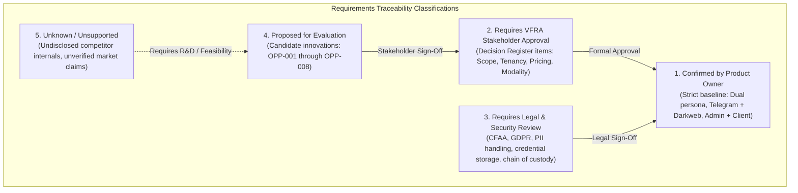

# TTI Product Direction & Strategic Alignment Baseline

**Document Reference:** `TTI-DOC-PRD-DIR-001`  
**Product:** Telegram Threat Intelligence (TTI)  
**Lifecycle Stage:** Gate 3B — Stakeholder Alignment  
**Role:** Senior Product Analyst  
**Date:** 2026-10-28  
**Status:** Baseline Established — Pending Stakeholder Sign-Off  

---

## 1. Executive Summary & Context

The purpose of **Research Gate 3B** is to establish a rigorous, evidence-backed stakeholder alignment baseline for **Telegram Threat Intelligence (TTI)** before initiating formal Product Requirements Documents (PRD), System Requirements Specifications (SRS), or final system architecture.

During Gates 2, 2A, 3, and 3A, the team conducted an exhaustive audit of the threat intelligence and digital investigation landscape, benchmarking the primary reference platform (**StealthMole v3.3**) and four major commercial competitors (**Recorded Future**, **Maltego**, **Intel 471**, and **ShadowDragon**). 

This research revealed significant market capabilities, pricing dynamics, and structural limitations across incumbent offerings. However, in strict adherence to project governance, **competitor capabilities do not constitute approved TTI requirements**. This document defines the confirmed product direction, identifies customer market boundaries, and establishes the formal requirements traceability model for VFRA Engineering.

---

## 2. Confirmed Product Direction Baseline

The following core parameters represent the **confirmed product direction baseline** approved for TTI discovery:

```
+----------------------------------------------------------------------------------------------------+
|                                    TTI CONFIRMED BASELINE SCOPE                                    |
+--------------------------+-------------------------------------------------------------------------+
| Dimension                | Confirmed Parameter                                                     |
+--------------------------+-------------------------------------------------------------------------+
| Product Identity         | Telegram Threat Intelligence (TTI)                                      |
| Primary Target Segments  | Dual Focus: Law Enforcement Agencies (LEA) & Corporate Cybersecurity   |
| Intelligence Scope       | Telegram and Dark-Web sources (subject to verified permissions/methods) |
| Operational Modalities   | Distinct Platform-Admin Panel and Client-User Panel                     |
| Business / Delivery Mode | Customer Self-Directed Investigations & Managed Intelligence Services   |
+--------------------------+-------------------------------------------------------------------------+
```

### 2.1 Confirmed Target Market Segments
1. **Law Enforcement Agencies (LEAs):**
   - National and regional police departments, cybercrime divisions, counter-narcotics units, and intelligence services.
   - Core needs: Tracking criminal syndicates, deanonymizing illicit actors, establishing tamper-evident chains of custody, generating court-admissible forensic evidence, and correlating chat aliases across jurisdictional boundaries.
2. **Corporate Cybersecurity Organizations:**
   - Enterprise Security Operations Centers (SOCs), Cyber Threat Intelligence (CTI) teams, and Corporate Security/Brand Protection units.
   - Core needs: Detecting employee credential exfiltration (infostealer logs), identifying brand abuse, brand impersonation, intellectual property theft, pre-attack ransomware reconnaissance, and monitoring targeted extortion campaigns.

### 2.2 Confirmed Intelligence Scope
- **Telegram Intelligence:** Monitoring public broadcast channels, open discussion groups, semi-public communities, and threat actor chat networks.
- **Dark-Web Intelligence:** Ingesting Tor hidden services (`.onion`), illicit paste sites, and cybercrime forums, subject to confirmed collection feasibility, infrastructure capacity, and legal clearance.
- **Boundary Condition:** Collection is strictly bounded to public and semi-public environments. Under no circumstances will TTI attempt to intercept or bypass end-to-end encrypted (E2EE) Telegram Secret Chats.

### 2.3 Confirmed Administrative & User Modalities
- **Platform-Admin Panel (VFRA Operations):**
  - Administrative surface for VFRA engineering, system administrators, and internal intelligence analysts.
  - Core functions: Tenant provisioning, collection collector orchestration, ingestion health monitoring, proxy pool management, audit logging, model/OCR job monitoring, and managed service report authoring.
- **Client-User Panel (Customer Organizations):**
  - Customer-facing surface accessed by authenticated investigators and security analysts.
  - Core functions: Thread navigation, indicator querying, alert triage, watchlist management, visual relationship mapping, evidence staging, and export generation.

### 2.4 Confirmed Business & Delivery Models
- **Self-Directed Customer Platform (SaaS / Private Deployment):** Allowing client analysts to query indexed databases, configure custom keyword watchlists, inspect conversational threads, and export findings.
- **Managed Intelligence Services (Service Bureau):** Enabling VFRA's in-house threat analysts to utilize the platform to produce bespoke cyber intelligence reports, periodic threat landscape briefings, and urgent adversary flash alerts for contracted enterprise and government clients.

---

## 3. Market Problem Statement & TTI Value Proposition

Cross-platform research (Gates 2 through 3A) identified critical operational friction points in incumbent platforms that define TTI's potential market opportunity:

```
+----------------------------------------------------------------------------------------------------+
|                                    INCUMBENT MARKET FRICTION POINTS                                |
+---------------------+-------------------------------------+----------------------------------------+
| Competitor Platform | Documented Market Friction          | TTI Opportunity (Proposed Direction)   |
+---------------------+-------------------------------------+----------------------------------------+
| StealthMole v3.3    | Aggressive scroll metering (1 query | Smooth, unmetered narrative chat       |
|                     | per 10 messages scrolled); no REST  | navigation; first-class REST API &     |
|                     | API; 3-OR Boolean search ceiling.   | unconstrained recursive AST search.    |
+---------------------+-------------------------------------+----------------------------------------+
| Recorded Future     | Prohibitive enterprise cost; macro  | Cost-effective conversational focus;   |
|                     | entity-centric rather than full     | full narrative chat thread context     |
|                     | conversational chat reading.        | rather than isolated entity cards.     |
+---------------------+-------------------------------------+----------------------------------------+
| Maltego             | No native continuous crawler; relies| Native centralized collection buffer;  |
|                     | entirely on on-demand third-party   | continuous historical archiving        |
|                     | transforms with depleting credits.  | without per-query third-party fees.    |
+---------------------+-------------------------------------+----------------------------------------+
| Intel 471           | Focuses almost exclusively on closed| Accessible, targeted threat platform   |
|                     | cybercrime cartels; high price tier | bridging public/semi-public Telegram   |
|                     | inaccessible to mid-market teams.   | channels and dark-web leak boards.     |
+---------------------+-------------------------------------+----------------------------------------+
| ShadowDragon        | Specializes in external social OSINT| Dedicated threat intelligence core     |
|                     | across 140+ jurisdictions; lacks    | emphasizing stealer log analysis, IOCs,|
|                     | dedicated malware/stealer telemetry.| and deep chat narrative reconstruction.|
+---------------------+-------------------------------------+----------------------------------------+
```

---

## 4. Requirements Traceability Governance

To ensure that unconfirmed assumptions or competitor capabilities are never prematurely converted into project requirements, all requirements across the TTI project lifecycle are strictly partitioned into five governance classifications:



1. **Category 1: Confirmed by Product Owner:** Formal project baselines that have received explicit confirmation from leadership.
2. **Category 2: Requires VFRA Stakeholder Approval:** Strategic decisions regarding business model, release phasing, tenant boundaries, and operational investments.
3. **Category 3: Requires Legal & Security Review:** Items involving statutory compliance, criminal evidence admissibility, personal data processing, and intelligence sourcing liability.
4. **Category 4: Proposed for Evaluation:** Technical opportunities identified during competitor benchmarking (e.g., candidate opportunities `OPP-001` through `OPP-008`) that are subject to cost/benefit analysis.
5. **Category 5: Unknown / Unsupported by Available Evidence:** Capabilities where public documentation does not disclose technical mechanisms; strictly forbidden from being treated as functional requirements.

---

## 5. Scope Boundary & Anti-Goals for Gate 3B

To maintain complete documentation integrity and avoid architectural drift:
- **No Software Code Modifications:** No application code, database migrations, Dockerfiles, or tests may be modified.
- **No Connector Activation:** No Telegram scraping bots, MTProto sessions, or dark-web Tor proxies may be spawned or configured.
- **No Premature Architecture Drafting:** Formal PRD, SRS, database entity-relationship models, and component deployment topologies will not be drafted until stakeholder decisions in this pack are formally reviewed and resolved.