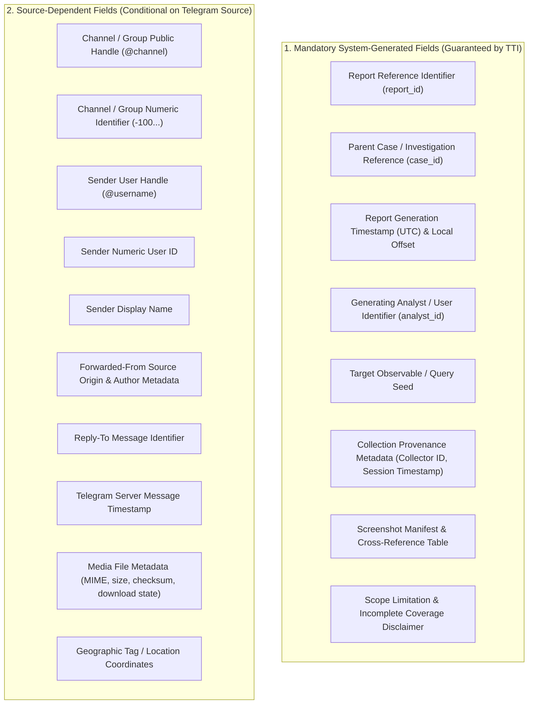

# TTI Gate 3B.1 — Reporting Requirements Review

**Document Reference:** `TTI-DOC-PRD-REV-001`  
**Feature Scope:** `REP-TXT-SCREEN-001` (TXT Investigation Report with Dual-Scope Screenshot Evidence)  
**Lifecycle Stage:** Gate 3B.1 — Requirements Review  
**Review Mode:** Documentation-Only Verification *(No code or architecture changes)*  
**Approval Status:** **`APPROVED BY VFRA`**  
**Approval Basis:** Stakeholder confirmation supplied by the project owner.  
**Review Date:** 2026-10-28  

---

## 1. Executive Verdict & Review Summary

### Verdict: **PASS**

### Summary Justification
An independent product analysis review was performed on the reporting workflow requirement (`REP-TXT-SCREEN-001`) across all Gate 3B documents in `docs/product/gate_3b/`. The review confirmed:
1. **Identifier & Status Uniformity:** The feature ID `REP-TXT-SCREEN-001` and its formal approval status `APPROVED BY VFRA` (with approval basis recorded as stakeholder confirmation supplied by the project owner) are synchronized across all Gate 3B product documents.
2. **Approved Scope Preservation:** The approved requirement mandates that every applicable investigation report must support a TXT report accompanied by both relevant-message screenshots and thread-context screenshots, subject to source availability and authorized access.
3. **Field Separation Rigor:** Mandatory fields guaranteed by TTI's export engine are strictly separated from source-dependent fields that rely on Telegram channel configurations or user privacy settings.
4. **Structured Packaging Standards:** The deliverable is defined as a unified container containing a UTF-8 TXT report, distinguishable individual-message screenshots, thread-context screenshots, and a shared report reference.
5. **Trigger Modality Preserved as Open Decision:** The capture trigger modality (investigator-selected vs. automated vs. hybrid) remains an open decision in the stakeholder register.
6. **Evidentiary Integrity Clarification:** The review establishes that SHA-256 hashes detect bit-level post-capture alteration but do **not** independently prove message authenticity or courtroom admissibility.
7. **Retention & Legal Standards Guardrails:** Retention windows, evidence admissibility standards, and regulatory mandates remain strictly unapproved pending formal VFRA executive and legal sign-off.
8. **Collection Non-Completeness Transparency:** Explicit rules require documenting missing or inaccessible messages without implying complete conversational coverage.
9. **Traceability Table:** All approved acceptance criteria are mapped to validation methods and their confirmed approval status.

---

## 2. Check 1: Feature ID & Approval Status Consistency Audit

The review verified that the feature identifier and approval status are synchronized across all Gate 3B documents:

| Document Path | Document Purpose | Identifier Referenced | Recorded Approval Status | Verification Finding |
| :--- | :--- | :---: | :---: | :---: |
| [`customer_workflows.md`](file:///D:/TTI/docs/product/gate_3b/customer_workflows.md#15-approved-reporting-workflow-structured-txt-report--dual-scope-screenshots) | Workflow specification & sequence | `REP-TXT-SCREEN-001` | `APPROVED BY VFRA` | **ALIGNED** |
| [`feature_opportunity_register.md`](file:///D:/TTI/docs/product/gate_3b/feature_opportunity_register.md#rep-txt-screen-001-structured-txt-report-with-dual-scope-screenshot-evidence) | Primary feature catalog entry | `REP-TXT-SCREEN-001` | `APPROVED BY VFRA` | **ALIGNED** |
| [`stakeholder_decision_register.md`](file:///D:/TTI/docs/product/gate_3b/stakeholder_decision_register.md#dec-13-reporting-deliverables--dual-scope-screenshot-packaging-rep-txt-screen-001) | Decision brief (`DEC-13`) | `REP-TXT-SCREEN-001` | `CONFIRMED (APPROVED BY VFRA)` | **ALIGNED** |
| [`open_questions_for_vfra.md`](file:///D:/TTI/docs/product/gate_3b/open_questions_for_vfra.md#question-15-how-should-the-approved-txt-report-and-dual-scope-screenshots-be-governed-rep-txt-screen-001) | Leadership questionnaire & sign-off | `REP-TXT-SCREEN-001` | `APPROVED BY VFRA` (Core Req) | **ALIGNED** |
| [`assumptions_and_constraints.md`](file:///D:/TTI/docs/product/gate_3b/assumptions_and_constraints.md#4-comprehensive-requirements-traceability-matrix) | Traceability & legal constraints | `REP-TXT-SCREEN-001` | `APPROVED BY VFRA` | **ALIGNED** |
| [`gate_3b_report.md`](file:///D:/TTI/docs/product/gate_3b/gate_3b_report.md#31-tier-1-decisions-that-must-be-answered-before-prdsrs-approval) | Deliverables audit & decision triage | `REP-TXT-SCREEN-001` | `APPROVED BY VFRA` | **ALIGNED** |

---

## 3. Check 2: Mandatory vs. Source-Dependent Field Separation

To prevent ingestion failures and avoid assuming that every Telegram channel or message exposes identical metadata, report fields are partitioned into two distinct categories:



### 3.1 Field Availability Matrix

| Field Name | Category | Guaranteed Availability | Source Dependency / Behavior When Unavailable |
| :--- | :---: | :---: | :--- |
| `report_id` | **Mandatory** | **100%** | System-generated UUID / sequential reference (`TTI-REP-YYYYMMDD-XXXX`). |
| `case_id` | **Mandatory** | **100%** | Assigned parent case or operational reference. |
| `generated_at_utc` | **Mandatory** | **100%** | System acquisition timestamp formatted in ISO 8601 UTC. |
| `analyst_id` | **Mandatory** | **100%** | Authenticated user ID of the generating investigator. |
| `query_seed` | **Mandatory** | **100%** | Target observable, handle, or keyword triggering the report. |
| `collector_id` | **Mandatory** | **100%** | Internal identifier of the ingestion collector session. |
| `screenshot_manifest` | **Mandatory** | **100%** | Array of associated screenshot filenames and hashes. |
| `limitations_disclaimer`| **Mandatory** | **100%** | Standardized disclaimer documenting observed sample boundaries. |
| `channel_handle` | *Source-Dependent* | Conditional | Present if channel is public; recorded as `NOT_AVAILABLE_FROM_SOURCE` if private. |
| `channel_id` | *Source-Dependent* | Conditional | Extracted via MTProto; recorded as `NOT_EXPOSED` if forwarded from hidden entity. |
| `sender_username` | *Source-Dependent* | Conditional | Present if user has public `@handle`; null if user opted out or deleted. |
| `sender_user_id` | *Source-Dependent* | Conditional | Visible in open groups; null in anonymous broadcast channels. |
| `sender_display_name` | *Source-Dependent* | Conditional | Present if profile readable; recorded as `UNKNOWN_SENDER` if masked. |
| `forward_provenance` | *Source-Dependent* | Conditional | Null if direct message or if forwarder enabled privacy protection. |
| `reply_to_msg_id` | *Source-Dependent* | Conditional | Present only if target message was a direct reply to another post. |
| `msg_server_timestamp`| *Source-Dependent* | Conditional | Extracted from Telegram server header; null if post corrupted. |
| `media_metadata` | *Source-Dependent* | Conditional | Null if message is text-only; logged as `DOWNLOAD_FAILED` if media expired. |
| `geo_coordinates` | *Source-Dependent* | Rare (<0.1%) | Extracted only if message explicitly included a live/static Telegram location. |

---

## 4. Check 3: Proposed Package Contents & Container Structure

The proposed reporting package is structured as a self-contained archive ensuring that text findings, visual evidence, and provenance metadata remain permanently coupled under a shared reference:

```
TTI_REPORT_[REPORT_ID]/
├── report.txt                         # Plain UTF-8 text report containing all findings & metadata
├── manifest.json                      # Machine-readable inventory with file checksums & timestamps
├── screenshots/
│   ├── individual/                    # Focused individual-message captures
│   │   ├── SCR-INDIV-[MSG_ID_1].png
│   │   └── SCR-INDIV-[MSG_ID_2].png
│   └── thread_context/                # Panoramic surrounding thread captures
│       ├── SCR-THREAD-[MSG_ID_1].png
│       └── SCR-THREAD-[MSG_ID_2].png
└── attachments/                       # Optional raw media drops (if authorized & downloaded)
    └── [ATTACHMENT_HASH].[EXT]
```

### 4.1 Deliverable Component Specifications
1. **UTF-8 TXT Report (`report.txt`):** Plain text encoded strictly in UTF-8 (without BOM) utilizing standard LF line endings and human-readable delimited sections. Designed for parsing by external SIEMs, case management databases, or direct terminal viewing.
2. **Individual-Message Screenshots (`SCR-INDIV-*`):** Focused, high-resolution PNG captures showing the specific target post, sender handle, timestamp, and any embedded media.
3. **Thread-Context Screenshots (`SCR-THREAD-*`):** Wide-angle PNG captures displaying the chronological sequence of preceding and succeeding messages (typically 5–15 messages before and after) to illustrate conversational dynamics.
4. **Manifest & Checksum File (`manifest.json`):** JSON index listing every file in the package, its MIME type, byte size, SHA-256 hash, and relation to the parent report.
5. **Shared Report Reference:** All files, folder names, and internal document headers are branded with the identical unique investigation reference (e.g., `TTI-REP-2026-0042`).

---

## 5. Check 4: Capture Trigger Modality as an Open Decision

The technical trigger for capturing screenshots remains an **OPEN DECISION** recorded under [`DEC-13`](file:///D:/TTI/docs/product/gate_3b/stakeholder_decision_register.md#dec-13-reporting-deliverables--dual-scope-screenshot-packaging-rep-txt-screen-001) and [`open_questions_for_vfra.md`](file:///D:/TTI/docs/product/gate_3b/open_questions_for_vfra.md#question-15-how-should-the-approved-txt-report-and-dual-scope-screenshots-be-governed-rep-txt-screen-001):

```
+----------------------------------------------------------------------------------------------------+
|                               SCREENSHOT CAPTURE MODALITY TRADE-OFFS                               |
+-------------------+----------------------------+-----------------------------+---------------------+
| Modality Option   | Technical Mechanism        | Operational Benefits        | Technical Trade-offs|
+-------------------+----------------------------+-----------------------------+---------------------+
| Option 1: Manual  | Investigator triggers      | Zero wasted compute/storage;| Risk of missing     |
| (On-Demand)       | capture via "Capture View" | captures restricted to      | deleted messages if |
|                   | action in Client Panel UI. | verified relevant threads.  | capture is delayed. |
+-------------------+----------------------------+-----------------------------+---------------------+
| Option 2: Full    | Automated headless browser | Guarantees zero missed      | Massive headless    |
| (Automated)       | renders every incoming     | messages even if threat     | browser CPU load;   |
|                   | ingested chat message.     | actors delete posts later.  | rapid disk blowout. |
+-------------------+----------------------------+-----------------------------+---------------------+
| Option 3: Hybrid  | Automated capture on high- | Protects critical alert data| Balanced compute;   |
| (Recommended)     | priority alert matches;    | while conserving storage for| minor configuration |
|                   | manual capture for triage. | general channel background. | complexity.         |
+-------------------+----------------------------+-----------------------------+---------------------+
```

* **Capture Modality Status:** `PROPOSED — PENDING VFRA APPROVAL` (Core requirement is approved; operational trigger modality selection remains pending). VFRA leadership will confirm whether Phase 1 launches with Option 1 (Manual on-demand) or Option 3 (Hybrid).

---

## 6. Check 5: SHA-256 Data Integrity vs. Legal Authenticity / Admissibility

A critical legal guardrail is established regarding the role and limitation of cryptographic hashing:

```
+----------------------------------------------------------------------------------------------------+
|                          WHAT SHA-256 CRYPTOGRAPHIC HASHING PROVIDES                               |
+----------------------------------------------------------------------------------------------------+
| 1. Tamper Detection: Detects any subsequent modification, byte corruption, or alteration of the   |
|    stored TXT report, manifest, or PNG screenshot files post-acquisition.                          |
| 2. Verification of Record: Proves that the file presented today matches the exact bit-level        |
|    representation generated at the recorded timestamp.                                             |
| 3. Internal Non-Repudiation: Verifies that the exported deliverable has not been altered since     |
|    investigator sign-off.                                                                          |
+----------------------------------------------------------------------------------------------------+
|                        WHAT SHA-256 CRYPTOGRAPHIC HASHING DOES NOT PROVIDE                         |
+----------------------------------------------------------------------------------------------------+
| 1. Does NOT establish message authenticity (i.e. does not prove the message was genuinely authored |
|    by the account owner, nor that the account was not spoofed or compromised).                     |
| 2. Does NOT prove real-world identity (does not resolve pseudonymous handles to physical persons).  |
| 3. Does NOT independently confer courtroom admissibility (admissibility requires corroborating     |
|    server headers, witness foundation, judicial warrants, and compliance with statutory rules).   |
+----------------------------------------------------------------------------------------------------+
```

> [!CAUTION]
> **Mandatory Disclaimer:** Screenshots and SHA-256 hashes in TTI serve strictly as **digital integrity controls and visual corroboration**. They do **not** independently satisfy judicial standards of electronic evidence without proper chain-of-custody foundation.

---

## 7. Check 6: Unapproved Standards Register

In accordance with strict project governance, all parameters governing retention, evidence standards, and statutory compliance remain **explicitly unapproved** pending formal confirmation:

| Dimension | Proposed Parameter | Governing Reference | Current Approval Status | Confirmation Prerequisite |
| :--- | :--- | :---: | :---: | :--- |
| **Screenshot Retention Period** | 90–180 days for corporate tickets; indefinite lock for active cases. | `DEC-08` / `DEC-13` | **UNAPPROVED / PROPOSED** | Requires VFRA CFO/CISO storage budget approval. |
| **Cryptographic Evidence Standard**| Internal SHA-256 ledger (Phase 1); pluggable RFC 3161 TSA (Phase 2). | `DEC-07` / `OPP-006` | **UNAPPROVED / PROPOSED** | Requires Law Enforcement Liaison review. |
| **Legal Admissibility Framework** | Compliance with US FRE 902(13)/(14) & UK PACE Act standards. | `TTI-DOC-PRD-CON-001` | **UNAPPROVED / PROPOSED** | Requires Chief Legal Counsel statutory review. |
| **PII & Password Redaction** | Masked storage (`P@ssw****`) with permission-gated audit logs. | `DEC-06` | **UNAPPROVED / PROPOSED** | Requires Data Protection Officer sign-off. |

---

## 8. Check 7: Incomplete Conversation Coverage & Missing Message Disclosure

To ensure that reports do not mislead investigators or prosecutors by implying complete surveillance coverage of a threat group, every generated report must include standardized disclosure language:

### 8.1 Inherent Collection Blind Spots
1. **Pre-Ingestion Deletions:** Messages deleted by channel administrators or authors prior to ingestion worker connection are unrecoverable.
2. **Ephemeral / Self-Destructing Content:** Telegram media sent with self-destruct timers (`TTL`) or via temporary view-once mechanisms cannot be permanently indexed.
3. **Flood Wait Ingestion Gaps:** Temporary rate-limiting delays (`FLOOD_WAIT_X`) may introduce chronological ingestion latency during high-velocity message bursts.
4. **Restricted Administrative Discussions:** Closed administrator discussion threads within supergroups cannot be accessed without privileged member accounts.

### 8.2 Mandatory Report Header Disclaimer
Every generated `report.txt` must prepend the following standardized scope notice:
```
================================================================================
                       TTI INVESTIGATION REPORT DISCLAIMER
================================================================================
This report reflects digital data observed and collected from accessible Telegram
channels and threads at the specified timestamps. It represents an observed sample
and DOES NOT certify complete, exhaustive, or uninterrupted coverage of all
communications within the target group. Messages deleted prior to collection,
ephemeral content, or discussions within restricted permissions may be omitted.
================================================================================
```

---

## 9. Check 8: Acceptance Criteria Traceability & Validation Matrix

The 5 approved acceptance criteria for `REP-TXT-SCREEN-001` are linked below to their validation methods and governance status:

| Criterion ID | Acceptance Criterion Statement | Approval Status | Primary Validation Method | Target Subsystem |
| :---: | :--- | :---: | :--- | :--- |
| **`AC-REP-01`** | **Common Reference Association:** The TXT report and all associated screenshots share a unique, common report reference ID. | `APPROVED BY VFRA` | **Automated Integration Test:** Script verifies that `report.txt`, `manifest.json`, and all PNG filenames contain matching `report_id` string. | `backend/app/reports/` |
| **`AC-REP-02`** | **Dual-Scope Screenshot Distinction:** Individual-message and thread-context screenshots are programmatically and visually distinguishable. | `APPROVED BY VFRA` | **Automated Test & Manual Review:** Verification of distinct directory paths (`individual/` vs `thread_context/`) and naming prefixes (`SCR-INDIV` vs `SCR-THREAD`). | `backend/app/evidence/` |
| **`AC-REP-03`** | **Internal Cross-Referencing:** Report narrative and message entries explicitly reference their supporting screenshot identifiers. | `APPROVED BY VFRA` | **Parser Validation Test:** Regular expression scan verifying every mentioned message entry links to a valid screenshot filename in the manifest. | `backend/app/reports/` |
| **`AC-REP-04`** | **Limitation & Incomplete Data Logging:** Missing metadata fields and capture limitations are documented explicitly as `NOT_AVAILABLE_FROM_SOURCE` or `LIMITATION_LOG`. | `APPROVED BY VFRA` | **Automated Boundary Testing:** Ingestion of synthetic Telegram posts with null usernames, hidden IDs, and expired media to verify error logging. | `backend/app/reports/` |
| **`AC-REP-05`** | **Pre-Delivery Review Workflow:** Authorized users can inspect, review, and redact the assembled package before final export authorization. | `APPROVED BY VFRA` | **End-to-End User Acceptance Test:** Verification that Client Panel UI presents a staging review modal with approve/redact controls before release. | `frontend/src/` & `backend/app/api/` |

---

## 10. Audit Conclusion & Gate Sign-off

- **Audit Review Verdict:** **PASS**.
- **Requirement Status:** Requirement `REP-TXT-SCREEN-001` is formally **`APPROVED BY VFRA`** based on stakeholder confirmation supplied by the project owner. Every applicable investigation report must support a TXT report accompanied by both relevant-message screenshots and thread-context screenshots, subject to source availability and authorized access.
- **Pending Stakeholder Decisions:** Operational capture trigger modality, retention schedules, evidence standards, timestamping, and legal admissibility frameworks remain explicitly unconfirmed and pending.
- **Implementation Status:** **ZERO IMPLEMENTATION INITIATED**. All application software code, database schemas, connectors, and architecture remain locked.
- **Next Action Boundary:** In strict adherence to governance instructions, implementation of report generation or screenshot capture will not proceed without explicit authorization. Work on the PRD, SRS, or architecture implementation remains on hold pending VFRA leadership review and approval of the remaining open decisions.