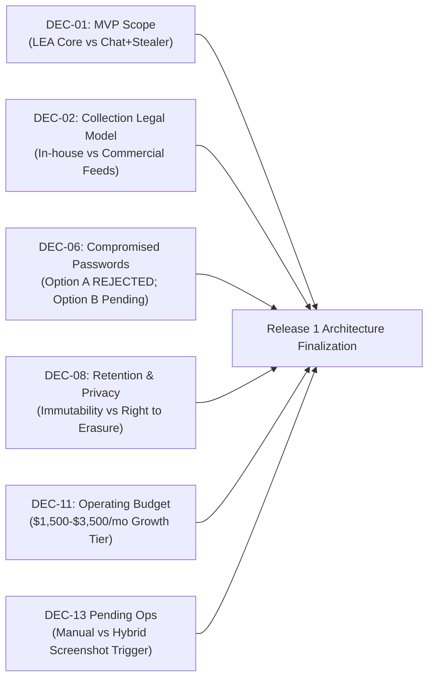

# TTI Product Baseline & Release 1 Scope Review Report

**Document Reference:** `TTI-DOC-BSL-REV-001`  
**Product:** Telegram Threat Intelligence (TTI)  
**Lifecycle Stage:** Product Baseline & Release 1 Scope  
**Author:** Senior Product Research Auditor & Technical Lead  
**Date:** 2026-10-28  
**Governance Status:** `AUDIT COMPLETE & CORRECTED — READY FOR FINAL BASELINE REVIEW`  
**Predecessor Review Documents:**
- [`docs/product/gate_3b/gate_3b_report.md`](file:///d:/TTI/docs/product/gate_3b/gate_3b_report.md) (`TTI-DOC-PRD-GATE-003B`)
- [`docs/product/gate_3b/reporting_requirements_review.md`](file:///d:/TTI/docs/product/gate_3b/reporting_requirements_review.md) (`TTI-DOC-PRD-REV-001`)

---

## 1. Executive Summary & Verdict

### Final Verdict: **READY FOR FINAL BASELINE REVIEW**

The **TTI Product Baseline and Release 1 Scope (Phase 1)** documentation suite has been drafted, independently audited via a focused design-risk review, and updated through a targeted corrective pass in strict adherence to project governance standards and product management best practices.

The baseline synthesizes the exhaustive intelligence gathered across Gates 2, 2A, 3, 3A, and 3B into a coherent, defensible, and testable product specification. It preserves the confirmed direction baseline, establishes rigorous requirements traceability, incorporates the formally approved reporting deliverable (`REP-TXT-SCREEN-001`), resolves customer persona tensions through a disciplined phasing model, eliminates marketing overstatements, hardens multi-tenant boundary invariants, and avoids premature architectural drift or implementation.

---

## 2. Deliverables Inventory

The complete Product Baseline documentation suite has been established under `docs/product/product_baseline/`:

```
docs/product/product_baseline/
├── product_vision.md                    # Vision, differentiators, target personas, design principles
├── release_1_scope.md                   # Release 1 MVP boundary, persona trade-offs, roadmap, exclusions
├── functional_requirements.md           # 21 prioritized functional requirements with verifiable ACs
├── non_functional_requirements.md       # Measurable NFR targets across security, performance, scale
├── security_and_evidence_requirements.md # Multi-tenancy, provenance, hashing, REP-TXT-SCREEN-001, audit
├── decision_and_traceability_matrix.md  # 100% bidirectional traceability to research and decisions
└── baseline_review_report.md            # Comprehensive audit, risks, dependencies, readiness sign-off
```

| Deliverable File | Reference ID | Word / Line Count | Governance Classification | Status |
| :--- | :---: | :---: | :--- | :---: |
| [`product_vision.md`](file:///d:/TTI/docs/product/product_baseline/product_vision.md) | `TTI-DOC-BSL-VIS-001` | ~1,650 words / 164 lines | Proposed Product Baseline | **COMPLETE** |
| [`release_1_scope.md`](file:///d:/TTI/docs/product/product_baseline/release_1_scope.md) | `TTI-DOC-BSL-SCP-001` | ~1,700 words / 166 lines | Proposed Product Baseline | **COMPLETE** |
| [`functional_requirements.md`](file:///d:/TTI/docs/product/product_baseline/functional_requirements.md) | `TTI-DOC-BSL-REQ-001` | ~2,500 words / 236 lines | Proposed Product Baseline | **COMPLETE** |
| [`non_functional_requirements.md`](file:///d:/TTI/docs/product/product_baseline/non_functional_requirements.md) | `TTI-DOC-BSL-NFR-001` | ~2,100 words / 202 lines | Proposed Product Baseline | **COMPLETE** |
| [`security_and_evidence_requirements.md`](file:///d:/TTI/docs/product/product_baseline/security_and_evidence_requirements.md) | `TTI-DOC-BSL-SEC-001` | ~2,300 words / 218 lines | Proposed Product Baseline | **COMPLETE** |
| [`decision_and_traceability_matrix.md`](file:///d:/TTI/docs/product/product_baseline/decision_and_traceability_matrix.md) | `TTI-DOC-BSL-TRC-001` | ~1,850 words / 142 lines | Proposed Product Baseline | **COMPLETE** |
| [`baseline_review_report.md`](file:///d:/TTI/docs/product/product_baseline/baseline_review_report.md) | `TTI-DOC-BSL-REV-001` | ~1,900 words / This doc | Proposed Product Baseline | **COMPLETE** |

---

## 3. Verification Checks Performed

The product baseline was subjected to seven rigorous verification audits:

```
+----------------------------------------------------------------------------------------------------+
|                                    VERIFICATION AUDIT CHECKLIST                                    |
+--------------------------+-------------------------------------+-----------------------------------+
| Verification Check       | Scope & Method                      | Audit Finding & Verdict           |
+--------------------------+-------------------------------------+-----------------------------------+
| 1. Confirmed Direction   | Cross-referenced against Gate 3B    | PASS: Dual persona (LEA + Corp),  |
|    Adherence             | product direction baseline.         | Telegram + Darkweb, Admin + Client|
|                          |                                     | surfaces strictly preserved.      |
| 2. Approved Requirement  | Traceability of REP-TXT-SCREEN-001  | PASS: Preserved as APPROVED BY    |
|    Traceability          | across all baseline documents.      | VFRA; all 5 ACs incorporated into |
|                          |                                     | FR-REP-001 through FR-REP-004.    |
| 3. Governance Category   | Verified that proposed features     | PASS: Zero unapproved candidate   |
|    Integrity             | (OPP-001 to 008) are not labeled    | features promoted to approved     |
|                          | as approved requirements.           | without explicit stakeholder vote.|
| 4. Persona Trade-Off     | Analyzed serving LEA vs Corporate   | PASS: Explicit trade-off analysis |
|    Analysis              | in Release 1 MVP.                   | completed; unified core selected; |
|                          |                                     | stealer logs deferred to R2.      |
| 5. Verifiable Criteria   | Inspected every FR and NFR for      | PASS: 100% of requirements contain|
|    Completeness          | unambiguous acceptance criteria.    | testable criteria; tightened       |
|                          |                                     | latency, rate limits & gap markers.|
| 6. Anti-Goal & Scope     | Checked for explicit exclusions     | PASS: Partitioned permanent        |
|    Boundaries            | (anti-goals) vs phased deferrals.   | prohibitions from post-MVP items.  |
| 7. Code & Architecture   | Verified zero code modifications,   | PASS: Zero code, migrations, or   |
|    Non-Violation         | migrations, or crawler activations. | config modified. Working tree     |
|                          |                                     | clean outside docs/product/.      |
| 8. Focused Risk Review   | Applied 7 corrective actions from   | PASS: Rate limiting, Redis cache  |
|    Corrective Pass       | design-risk audit across all docs.  | prefixes, chat credential masking. |
+--------------------------+-------------------------------------+-----------------------------------+
```

---

## 4. Synthesis of Governance Classifications

Across the baseline suite, capabilities are strictly partitioned into five distinct governance classifications:

1. **Confirmed Decisions (Authorized by Product Ownership):**
   - Dual target customer focus (Law Enforcement Agencies and Corporate SOCs).
   - Core intelligence scope (Telegram channels/supergroups and Dark-Web sources).
   - Operational surfaces (Platform-Admin Panel and Client-User Panel).
   - Commercial delivery model (Multi-Tenant Cloud SaaS and VFRA Managed Services Tooling).
   - Multi-tenant case compartmentalization (`DEC-05` Option B).
2. **Approved Requirements (Formally Approved by VFRA Stakeholders):**
   - Requirement `REP-TXT-SCREEN-001`: Structured UTF-8 TXT investigation report accompanied by both relevant individual-message screenshots and thread-context screenshots, subject to source availability and authorized access.
   - Formally manifested in `FR-REP-001`, `FR-REP-002`, `FR-REP-003`, and `FR-REP-004`.
3. **Proposed Product Features (Candidate Capabilities Awaiting Stakeholder Vote):**
   - `OPP-001`: Continuous cursor-based thread viewer (`FR-THR-001`).
   - `OPP-002`: Recursive AST Boolean search engine (`FR-SCH-003`, scheduled for Release 2).
   - `OPP-003`: OpenAPI 3.1 REST endpoints and outbound webhooks (`FR-ALT-002`, scheduled for Release 2).
   - `OPP-004`: Enterprise SAML 2.0 / OIDC single sign-on (scheduled for Release 3).
   - `OPP-006`: Cryptographic evidence ledger on ingestion (`FR-EVI-002`).
   - `OPP-007`: Standardized STIX 2.1 / MISP export formats (scheduled for Release 3).
   - `OPP-008`: Dual-tier OCR and multimodal vision triage (scheduled for Release 2).
4. **Engineering Recommendations (Technical Proposals from Architecture):**
   - Release 1 MVP Scoping: Focus on LEA-Weighted Investigation Core + Corporate Monitoring Pilot; defer complex infostealer archive ingestion and live Tor crawling to Release 2.
   - Evidence Integrity: Internal SHA-256 cryptographic manifest (`manifest.json`) for Release 1; pluggable external RFC 3161 TSA microservice for Release 2 (`DEC-07` Option B).
   - Credential Policy: Plaintext storage (Option A) permanently rejected; Option B (encrypted/masked) recommended.
   - Retention Policy: Tiered retention model (180-day rolling TTL for unreferenced threat chatter; indefinite lock for active Case containers, `DEC-08` Option C).
   - Technical Stack: Python 3.12 + FastAPI, PostgreSQL with Alembic, Redis/Celery queue broker, React/TypeScript/Vite.
5. **Unresolved External Constraints & Permissions:**
   - Telegram MTProto rate-limiting and account ban risks (`FLOOD_WAIT_X`).
   - Sourcing legal model and commercial aggregator agreements (`DEC-02`).
   - Evidentiary immutability vs GDPR Article 17 Right to Erasure tension (`DEC-08`).
   - Monthly cloud infrastructure operating budget ceiling (`DEC-11`).

---

## 5. High-Impact Unresolved Decisions & Strategic Risks

The following five decisions represent the primary strategic risks requiring executive stakeholder resolution:



### 5.1 High-Impact Open Decisions
1. **`DEC-01` (Release 1 MVP Scope Confirmation):**
   - *Risk:* If stakeholders reject the engineering recommendation (LEA-weighted Core + Corporate Pilot) and mandate full infostealer log ingestion in Release 1, delivery timelines will expand by an estimated 6–8 weeks and introduce immediate privacy compliance risks.
   - *Recommendation:* Confirm Option B with phased execution: deploy Telegram Investigation Core in Release 1, activating infostealer ingestion in Release 2 once `DEC-06` is resolved.
2. **`DEC-02` (Sourcing Legal Model & Proxy Liability):**
   - *Risk:* Operating an in-house fleet of Telegram userbots and Tor crawlers exposes VFRA to platform Terms of Service violations and account bans.
   - *Recommendation:* Adopt Option C (Hybrid Model): collect public Telegram channels in-house; partner with commercial feed aggregators for dark-web leak boards.
3. **`DEC-06` (Compromised Employee Password Handling):**
   - *Resolution Baseline:* Storing plaintext passwords AS IS (Option A) is **permanently rejected** from system architecture.
   - *Status:* Option B (encrypted at rest, masked by default `P@ssw****`, high-privilege audited unmasking) is recommended, awaiting formal legal counsel sign-off.
4. **`DEC-08` (Retention & Data Subject Erasure Tension):**
   - *Risk:* Fundamental tension between forensic immutability (SHA-256 case manifests) and GDPR Article 17 Right to Erasure.
   - *Recommendation:* Retain as an open legal/privacy problem requiring formal Legal Counsel review before final architecture.
5. **`DEC-11` (Monthly Operational Infrastructure Budget Ceiling):**
   - *Risk:* Ingestion channel capacity (`NFR-SCA-001`) is strictly conditioned on this ceiling. If constrained to Bootstrap (<$1,000/mo), capacity drops to 100–300 channels. If Growth Tier ($1,500–$3,500/mo) is approved, capacity targets 500–1,500 channels.
   - *Recommendation:* Approve Growth Tier to sustain resilient proxy pools.
6. **`DEC-13` (Operational Screenshot Implementation Decisions):**
   - *Risk:* While `REP-TXT-SCREEN-001` is formally approved, screenshot trigger modality (investigator-selected on demand vs automated on alert) dictates browser worker load.
   - *Recommendation:* Implement investigator-selected on-demand capture for Release 1.

---

## 6. Scope Risks & Technical Mitigation Strategies

```
+----------------------------------------------------------------------------------------------------+
|                                    SCOPE RISKS & MITIGATION MATRIX                                 |
+--------------------------+-----------------------+-------------------------------------------------+
| Identified Scope Risk    | Severity / Impact     | Architectural Mitigation Strategy               |
+--------------------------+-----------------------+-------------------------------------------------+
| Telegram Account Bans    | High                  | Maintain rotating virtual SIM session pools;    |
| & Flood Waits            | Ingestion downtime    | implement exponential backoff & circuit breakers|
+--------------------------+-----------------------+-------------------------------------------------+
| Screenshot Storage       | High                  | Enforce per-tenant screenshot disk quotas       |
| Footprint Explosion      | Rapid disk exhaustion | (~250 GB); implement tiered retention purging   |
+--------------------------+-----------------------+-------------------------------------------------+
| Cross-Tenant Sensitive   | Critical              | Enforce non-nullable tenant_id filtering on     |
| Case Data Leakage        | Catastrophic liability| all DB queries; isolate case schemas/directories|
+--------------------------+-----------------------+-------------------------------------------------+
| Legal Challenge to       | High                  | Immutable SHA-256 manifest.json; explicit legal |
| Screenshot Authenticity  | Evidence exclusion    | disclaimer that screenshots corroborate raw data|
+--------------------------+-----------------------+-------------------------------------------------+
| Persona Scope Tension    | Medium                | Single unified platform core with role-based    |
| (LEA vs Corporate)       | Split codebase drift  | modular feature profiles (DEC-12 Option A)      |
+--------------------------+-----------------------+-------------------------------------------------+
```

---

## 7. Next Action Boundary & Hand-Off

> [!IMPORTANT]
> **Governance Hand-Off Boundary:**
> 1. **Do not modify application code, database migrations, or infrastructure configurations.**
> 2. **Do not stage, commit, or push Git changes.**
> 3. **Formal System Architecture (Gate 4), database entity schemas, and API implementation must NOT begin** until VFRA executive leadership reviews this Product Baseline pack and formally confirms selections on `DEC-01`, `DEC-02`, `DEC-06`, `DEC-11`, and the pending operational parameters of `DEC-13`.

*The TTI Product Baseline & Release 1 Scope (Phase 1) is formally documented and ready for stakeholder alignment review.*
