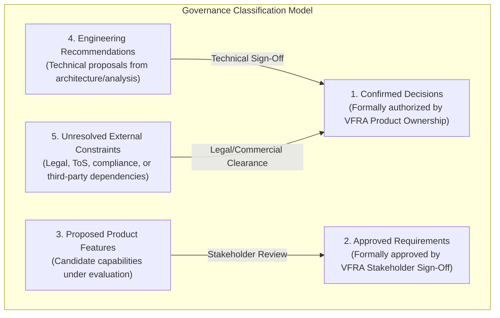
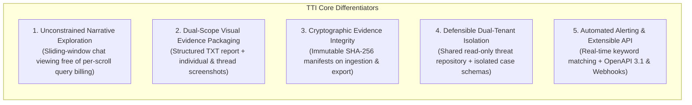
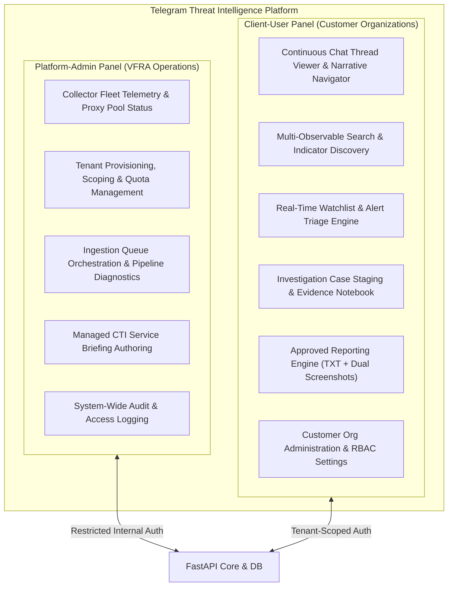

# TTI Product Vision & Strategic Baseline

**Document Reference:** `TTI-DOC-BSL-VIS-001`  
**Product:** Telegram Threat Intelligence (TTI)  
**Lifecycle Stage:** Product Baseline & Release 1 Scope  
**Author:** Product Research & Architecture Team  
**Date:** 2026-10-28  
**Governance Status:** `PROPOSED PRODUCT BASELINE — PENDING STAKEHOLDER REVIEW`  
**Predecessor Documents:**
- [`docs/product/gate_3b/product_direction.md`](file:///d:/TTI/docs/product/gate_3b/product_direction.md) (`TTI-DOC-PRD-DIR-001`)
- [`docs/product/gate_3b/stakeholder_decision_register.md`](file:///d:/TTI/docs/product/gate_3b/stakeholder_decision_register.md) (`TTI-DOC-PRD-DEC-001`)
- [`docs/product/gate_3b/assumptions_and_constraints.md`](file:///d:/TTI/docs/product/gate_3b/assumptions_and_constraints.md) (`TTI-DOC-PRD-CON-001`)

---

## 1. Executive Summary & Purpose

**Telegram Threat Intelligence (TTI)** is an intelligence and forensic investigation platform purpose-built to discover, reconstruct, analyze, and preserve conversational threat activity conducted across Telegram channels, supergroups, and affiliated dark-web threat vectors.

Contemporary threat intelligence platforms (TIPs) and Open Source Intelligence (OSINT) tools treat messaging platforms as disconnected data dumps, flattening rich conversational threads into fragmented search hits or isolated entity cards. TTI is designed to preserve and navigate the **narrative continuity** of digital communications, enabling investigators to observe criminal planning, illicit transactions, and coordinated threat campaigns as they organically unfold over time.

This document establishes the strategic baseline, target persona definitions, core market differentiators, foundational design principles, and operational modalities governing the development of TTI.

---

## 2. Governance Classification & Authority Boundaries

To ensure complete transparency and prevent unconfirmed assumptions from being treated as architectural commitments, all statements in this baseline are governed by five explicit classifications:



1. **Confirmed Decision:** Formally authorized project baselines established by project leadership (e.g., dual target market focus, intelligence source scope, administrative panel separation, delivery models).
2. **Approved Requirement:** Formally approved requirements with verified stakeholder sign-off (specifically `REP-TXT-SCREEN-001`: Structured TXT report accompanied by relevant-message screenshots and thread-context screenshots).
3. **Proposed Product Feature:** Candidate capabilities identified during benchmarking (e.g., candidate opportunities `OPP-001` through `OPP-008`) awaiting formal stakeholder selection.
4. **Engineering Recommendation:** Architectural patterns, technical sizing, and phasing recommendations proposed by engineering to optimize delivery velocity and system reliability.
5. **Unresolved External Permission / Constraint:** Items subject to external legal advice, platform Terms of Service, infrastructure budgets, or commercial feed agreements.

---

## 3. Target Customer Segments & Operational Problem Statements

TTI is engineered as a **hybrid platform** serving two distinct primary target customer segments. While both segments operate against threat actors leveraging Telegram, their core operational workflows, compliance requirements, and desired outcomes differ significantly:

```
+----------------------------------------------------------------------------------------------------+
|                                    TARGET CUSTOMER COMPARISON MATRIX                               |
+--------------------------+-------------------------------------+-----------------------------------+
| Dimension                | Law Enforcement Agencies (LEAs)     | Corporate Cybersecurity (SOC/CTI) |
+--------------------------+-------------------------------------+-----------------------------------+
| Governance Status        | CONFIRMED DECISION                  | CONFIRMED DECISION                |
| Primary Personas         | Detectives, Cyber Investigators,    | SOC Analysts, CTI Specialists,    |
|                          | Digital Forensic Specialists        | Brand Protection Investigators    |
| Threat Focus             | Illicit contraband networks,        | Infostealer credential dumps,     |
|                          | cyber extortionists, violent        | corporate brand impersonation,    |
|                          | extremism, organized crime          | pre-attack ransomware chatter     |
| Core Operational Need    | Reconstructing full conversation    | Real-time keyword & domain alerts,|
|                          | threads, cross-channel alias        | blast-radius triage, rapid session|
|                          | tracking, court-defensible exports  | revocation via SOAR webhooks      |
| Evidentiary Standard     | Strict chain of custody, tamper-    | High confidence, actionable IOCs, |
|                          | evident SHA-256 hashes, timestamps  | auditable security incident notes |
| Compartmentalization     | Hard case silos, warrant references,| Enterprise tenant isolation,      |
|                          | cross-investigator need-to-know     | least-privilege role permissions  |
+--------------------------+-------------------------------------+-----------------------------------+
```

> [!NOTE]
> **Proposed Release 1 Scope Weighting (Engineering Recommendation):**
> While both customer segments remain confirmed strategic priorities, engineering recommends that Release 1 focus on delivering a robust, testable core weighted toward Law Enforcement investigation workflows (thread exploration, case containers, and approved reporting), while providing corporate cybersecurity teams with a targeted brand and domain monitoring pilot. Full corporate parity (ingestion of multi-gigabyte infostealer dumps and active SOAR webhooks) is scheduled for Release 2. This phasing minimizes initial regulatory risk while validating the core Telegram engine.

### 3.1 Law Enforcement Agencies (LEAs)
- **Primary Operational Mandate:** De-anonymize illicit actors, trace criminal coordination across chat groups, establish the chronological sequence of criminal conspiracies, and compile forensic evidence dossiers suitable for judicial proceedings.
- **Critical Market Pain Point:** Incumbent tools (e.g., StealthMole v3.3) impose aggressive micro-metering penalties (consuming 1 query credit per 10 messages scrolled), making conversational context exploration prohibitively expensive. Furthermore, raw database dumps lack visual context and cryptographic provenance, forcing investigators to take manual, unauthenticated desktop screenshots.

### 3.2 Corporate Cybersecurity Organizations
- **Primary Operational Mandate:** Identify compromised employee credentials exfiltrated by infostealer malware (RedLine, Lumma, Vidar, etc.), detect early reconnaissance mentions of corporate brands or executives, and preempt ransomware extortion campaigns.
- **Critical Market Pain Point:** Incumbent enterprise platforms (e.g., Recorded Future) provide high-level entity cards at enterprise-tier price points but fail to provide direct, low-friction conversational thread viewing. Conversely, OSINT tools (e.g., Maltego) rely on on-demand third-party transforms that incur depleting credit fees per lookup and lack continuous historical chat indexing.

---

## 4. Core Differentiators & Value Proposition

TTI establishes a distinct competitive posture across five primary dimensions:



1. **Narrative Thread Exploration Free of Per-Scroll Micro-Metering (`OPP-001`, Proposed):**
   - Eliminates the artificial commercial "1 query per 10 scrolled messages" tax observed in StealthMole (`Slide 51`).
   - Preserves message chronology, reply-to hierarchies, forward provenance, and media drops within an interactive, cursor-driven sliding-window viewer.
   - Distinct from commercial unmetering, backend API endpoints enforce defensive rate limiting and sequence-gap markers to maintain infrastructure stability and audit transparency.
2. **Standardized Dual-Scope Evidence Packaging (`REP-TXT-SCREEN-001`, Approved by VFRA):**
   - Delivers a structured, UTF-8 plain-text investigation report cross-referenced to both **individual-message screenshots** and **panoramic thread-context screenshots**.
   - Integrates a mandatory investigator pre-delivery review workflow to verify accuracy and redact collateral PII prior to external release.
3. **Cryptographic Integrity & Chain of Custody (`OPP-006`, Proposed / Engineering Recommendation):**
   - Generates deterministic SHA-256 digests for all ingested raw payloads, downloaded media artifacts, and compiled report bundles upon creation.
   - Enforces tamper-evident packaging with machine-verifiable manifest structures.
4. **Defensible Multi-Tenancy by Construction (`OPP-005`, Proposed / Engineering Recommendation):**
   - Enforces an architectural separation: ingested public threat intelligence sits in a shared, read-only threat repository, while sensitive customer investigations, watchlists, search logs, and case notes reside in cryptographically and logically isolated tenant partitions.
5. **Modern Interoperability & Automation (`OPP-003`, Proposed):**
   - Solves the legacy "closed web portal" trap of incumbent tools by offering fully documented OpenAPI 3.1 endpoints and outbound alert webhooks for corporate SIEM/SOAR integration.

---

## 5. Intelligence Scope & Collection Boundaries

### 5.1 Confirmed Intelligence Channels
- **Telegram Channels & Supergroups (Confirmed Decision):**
  - Continuous, passive monitoring of public broadcast channels, open discussion groups, and semi-public threat actor communities.
  - Tracking message bodies, revisions (edits), tombstones (deletions), sender metadata, forward sources, and attached media assets.
- **Dark-Web Intelligence (Confirmed Direction / Conditional Scope):**
  - Targeted indexing of Tor hidden services (`.onion`), illicit paste sites, and cybercrime leak forums.
  - Ingestion is strictly subject to source-specific authorization, technical crawler feasibility, and infrastructure capacity constraints.

### 5.2 Explicit Boundary Conditions & Prohibitions
To ensure strict statutory compliance, operational safety, and legal defensibility:

```
+----------------------------------------------------------------------------------------------------+
|                                    STRICT BOUNDARY CONDITIONS                                      |
+--------------------------+-------------------------------------+-----------------------------------+
| Boundary Dimension       | Operational Rule                    | Governance Basis                  |
+--------------------------+-------------------------------------+-----------------------------------+
| Telegram Secret Chats    | STRICT PROHIBITION: Interception    | CFAA / Computer Misuse Acts;      |
|                          | or decryption is strictly barred.   | MTProto E2EE cryptographic barrier|
| Offensive Exploitation   | STRICT PROHIBITION: Zero deployment | Passive threat intelligence only; |
|                          | of active exploits, malware, or C2. | no offensive computer intrusion   |
| Extortion & Ransomware   | STRICT PROHIBITION: Zero commercial | OFAC, sanctions compliance, and   |
| Financial Transactions   | facilitation of extortion payments. | anti-money laundering regulations |
| Plaintext Password Store | STRICT PROHIBITION: Option A        | GDPR / DPDP victim privacy;       |
|                          | (Plaintext AS IS) permanently       | prevention of catastrophic        |
|                          | rejected. Stored encrypted at rest, | honeypot target liability;        |
|                          | masked by default (DEC-06 pending). | engineering recommendation.       |
+--------------------------+-------------------------------------+-----------------------------------+
```

---

## 6. Core Design Principles

Every architectural and functional decision across TTI must adhere to six foundational design principles:

1. **Evidence Defensibility & Non-Repudiation:**
   - Intelligence that cannot be verified in an internal audit or judicial hearing has diminished value. Raw ingested payloads must remain tamper-evident from ingestion to export.
2. **Tenant Isolation by Construction:**
   - Multi-tenancy cannot be an application-level afterthought. Every operational entity, case record, query audit log, and staged evidence file must be structurally bound to an authenticated tenant.
3. **Human-in-the-Loop Operational Governance:**
   - Automated enrichment and alert triggers assist analysts but must not execute irreversible operational actions autonomously. Investigative reports require explicit human review before delivery.
4. **Narrative Exploration Free of Micro-Metering:**
   - Analysts must be empowered to follow conversational leads across time without commercial per-scroll penalties. This freedom of exploration is bounded on the technical layer by defensive API throttling and sequence gap markers to prevent denial-of-service and preserve audit integrity.
5. **Clean Interface Decoupling:**
   - Collection connectors, parsing engines, search indexes, presentation layers, and export generators must maintain strict domain boundaries with standardized schema contracts.
6. **Data Minimization & Ethical Restraint:**
   - Ingested threat telemetry contains victim personal data. The platform extracts only telemetry relevant to threat detection, enforces default masking on sensitive credentials, and supports statutory data purge requests.

---

## 7. Operational Modalities & Platform Surfaces

In accordance with confirmed product direction, TTI provides two strictly separated operational surfaces:



### 7.1 Platform-Admin Panel (VFRA Operations Surface)
- Dedicated administrative interface for VFRA DevOps, infrastructure engineers, and senior intelligence analysts.
- Enforces system-level oversight: monitoring ingestion worker health, MTProto flood-wait states, Tor proxy latencies, OCR worker queues, tenant storage quotas, and managed service advisory authoring.
- *Operational Distinction:* The software delivers the multi-tenant administrative tooling and briefing authoring workflows. Operational managed service commitments (such as 24/7 staffing, contracted response SLAs, and human escalation desks) represent business operational staffing decisions distinct from the software baseline.

### 7.2 Client-User Panel (Customer Investigation Surface)
- High-contrast, focused investigation console for authenticated client analysts.
- Supports conversational thread navigation, indicator querying, alert triage, case workspace management, evidence tagging, and the compilation of approved investigation report packages.

---

## 8. Summary of Product Vision Baseline

| Vision Component | Definition | Baseline Status |
| :--- | :--- | :---: |
| **Product Purpose** | Narrative Telegram threat intelligence and forensic evidence platform. | Confirmed Decision |
| **Target Customers** | Dual-focus: Law Enforcement Agencies and Corporate Cybersecurity Organizations. | Confirmed Decision |
| **Core Differentiator** | Deep thread exploration free of scroll fees and approved dual-scope visual evidence packaging. | Confirmed / Approved |
| **Primary Intelligence Sources** | Telegram channels/supergroups (Direct collection) and Dark-Web (Conditional/hybrid). | Confirmed Direction |
| **Approved Deliverable** | Structured UTF-8 TXT report with relevant-message and thread-context screenshots (`REP-TXT-SCREEN-001`). | **Approved by VFRA** |
| **Delivery Models** | Multi-Tenant Cloud SaaS and VFRA Managed Services Tooling (Operational staffing is separate). | Confirmed Direction |
| **Tenancy Isolation Model** | Shared read-only threat repository + logically/physically isolated customer case workspaces. | Engineering Recommendation |
| **Release Strategy** | Phase 1 MVP focused on cohesive, testable Telegram investigation core before expanding to full dark-web parity. | Engineering Recommendation |
