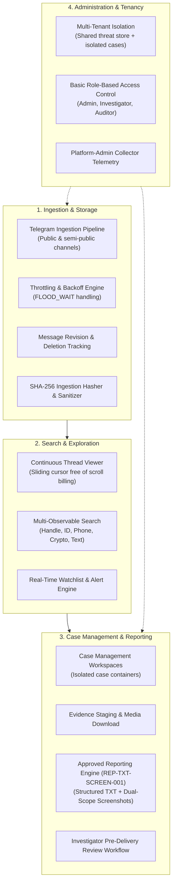
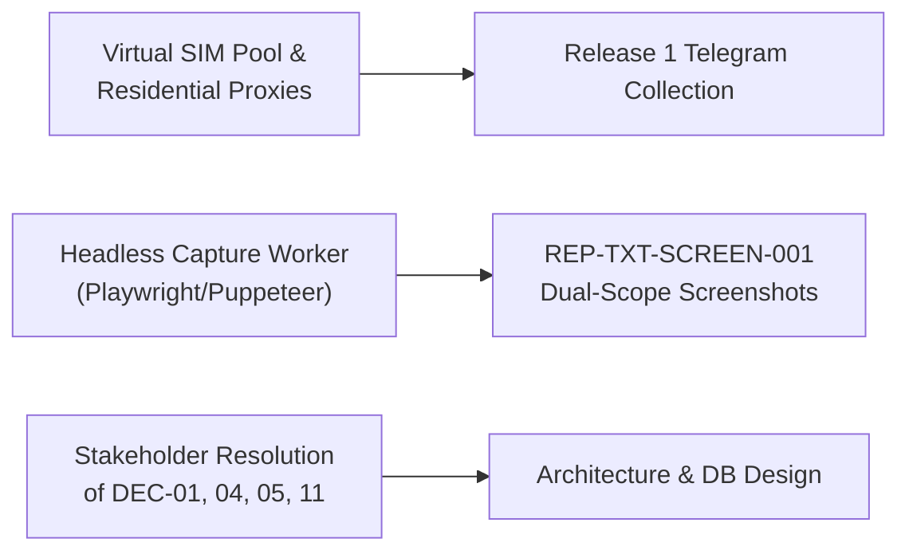

# TTI Release 1 Scope & Lifecycle Phasing Strategy

**Document Reference:** `TTI-DOC-BSL-SCP-001`  
**Product:** Telegram Threat Intelligence (TTI)  
**Lifecycle Stage:** Product Baseline & Release 1 Scope  
**Author:** Product Research & Architecture Team  
**Date:** 2026-10-28  
**Governance Status:** `PROPOSED PRODUCT BASELINE — PENDING STAKEHOLDER REVIEW`  
**Predecessor Documents:**
- [`docs/product/gate_3b/stakeholder_decision_register.md`](file:///d:/TTI/docs/product/gate_3b/stakeholder_decision_register.md) (`DEC-01`, `DEC-04`, `DEC-09`, `DEC-12`, `DEC-13`)
- [`docs/product/gate_3b/feature_opportunity_register.md`](file:///d:/TTI/docs/product/gate_3b/feature_opportunity_register.md) (`REP-TXT-SCREEN-001`, `OPP-001` through `OPP-008`)
- [`docs/product/gate_3b/customer_workflows.md`](file:///d:/TTI/docs/product/gate_3b/customer_workflows.md) (Workflows 1.1 through 1.5)

---

## 1. Executive Summary & Phasing Strategy

The primary objective of **Release 1 (MVP)** is to deliver a rock-solid, cohesive, and defensible foundation for Telegram intelligence collection, thread reconstruction, and evidence reporting.

Attempting to build simultaneous parity with incumbent platforms—such as StealthMole's 14 modular tables, Recorded Future's global knowledge graph, or Maltego's visual link analysis—in an initial release creates catastrophic delivery risk, architectural churn, and unsustainable infrastructure expenditure.

Therefore, this document defines an evidence-traceable, phased delivery model. It analyzes the strategic trade-offs of serving both target customer groups, establishes the concrete functional and technical boundaries for Release 1 (MVP), and schedules advanced capabilities into Release 2 and Release 3.

---

## 2. Customer Segment Serving Strategy & Trade-Off Analysis

A core question in product baseline alignment is whether TTI should attempt to serve both **Law Enforcement Agencies (LEAs)** and **Corporate Cybersecurity (SOC/CTI)** in Release 1, or specialize in one persona first.

```
+----------------------------------------------------------------------------------------------------+
|                               RELEASE 1 PERSONA TRADE-OFF ANALYSIS                                 |
+---------------------+-----------------------------------+------------------------------------------+
| Strategy Option     | Strategic Advantages              | Delivery & Operational Risks             |
+---------------------+-----------------------------------+------------------------------------------+
| Option 1:           | High depth in forensic integrity; | Sacrifices early corporate CTI recurring |
| Specialized LEA     | direct alignment with approved    | subscription revenue; narrow market      |
| Focus First         | reporting (REP-TXT-SCREEN-001);   | validation during initial 6 months.      |
|                     | zero stealer log privacy liability|                                          |
+---------------------+-----------------------------------+------------------------------------------+
| Option 2:           | Faster corporate sales cycle;     | High legal liability on credential       |
| Specialized Corp    | immediate ROI on domain alerts;   | storage (DEC-06 is still OPEN); complex  |
| SOC Focus First     | simple webhook integrations.      | archive ingestion; ignores case/forensics|
+---------------------+-----------------------------------+------------------------------------------+
| Option 3:           | Solves the core Telegram thread   | Requires disciplined scoping to avoid    |
| Unified Core        | problem shared by both personas;  | feature creep; must defer complex stealer|
| Investigation MVP   | delivers approved reporting;      | log processing and Tor crawlers to       |
| (Recommended)       | enables both market validations.  | Release 2.                               |
+---------------------+-----------------------------------+------------------------------------------+
```

### 2.1 The Trade-Off Decision: Unified Core Investigation Engine (Engineering Recommendation)
Rather than developing divergent codebases or prematurely building complex infostealer decompression engines while legal policy (`DEC-06`) remains unresolved, **Option 3 (Unified Core Investigation MVP)** is proposed as an engineering recommendation (not a finalized commercial commitment):

1. **Shared Foundation:** Both customer groups urgently require deep Telegram thread navigation, multi-observable search (handles, user IDs, channels, keywords), and verifiable evidence export free of commercial micro-metering penalties.
2. **LEA-Weighted Release 1 Investigation Core:** Release 1 MVP provides a comprehensive investigation suite for Law Enforcement: compartmentalized Case containers, message tagging, and the approved `REP-TXT-SCREEN-001` structured TXT report + dual-scope screenshots package with mandatory pre-delivery review.
3. **Corporate Monitoring Pilot:** For corporate cybersecurity teams, Release 1 provides an early-access monitoring pilot for brand names, corporate domains, and executive handles across monitored public chatter. Full corporate enterprise parity (automated multi-gigabyte infostealer dump parsing and active SOAR webhooks) is scheduled for Release 2 based on pilot validation.
4. **Strategic Deferrals:** Complex multi-gigabyte infostealer archive ingestion (Host/User/Pass extraction) and live Tor dark-web scraping are deferred to **Release 2**, pending resolution of `DEC-02` (Legal collection model) and `DEC-06` (Compromised password masking).

---

## 3. Release 1 (MVP) Scope Definition

### 3.1 Release 1 Explicit Inclusions

Release 1 is strictly scoped to the following cohesive capabilities:



#### A. Telegram Collection & Ingestion Subsystem
- **Public & Semi-Public Channel Ingestion:** Passive ingestion of text messages, forward origins, channel metadata, reply hierarchies, and attached media previews from designated Telegram channels and supergroups.
- **Resilient Request Throttling:** Client-side rate-limiting with exponential backoff and circuit breaking to gracefully absorb Telegram `FLOOD_WAIT_X` events.
- **Message Revision & Deletion Tracking:** Immutable storage of original message payloads; subsequent message edits are recorded as versioned revisions; message deletions are recorded as tombstones without overwriting evidentiary history.
- **Untrusted Input Sanitization:** Centralized sanitization pipeline enforcing Unicode NFC normalization, null-byte neutralization, terminal escape stripping, and script defanging.

#### B. Search, Thread Navigation & Discovery Subsystem
- **Continuous Cursor-Based Thread Viewer (`OPP-001`):** Sliding-window conversational chat navigator allowing investigators to scroll through chat history without per-scroll query billing penalties, protected by defensive backend API rate limiting and explicit sequence-gap markers.
- **Multi-Observable Search:** Fast full-text and attribute search across message bodies, Telegram usernames (`@handle`), numeric user IDs, phone numbers, and cryptocurrency wallet addresses.
- **Watchlist & Alert Engine:** Automated matching of incoming chatter against user-defined keyword, regex, or handle watchlists with in-app notification dispatch.

#### C. Evidence Staging, Case Management & Reporting Subsystem
- **Compartmentalized Case Workspaces:** Logical case containers enabling investigators to tag messages, attach analytical notes, and stage evidence items under an assigned Case Reference ID.
- **Approved Investigation Reporting Engine (`REP-TXT-SCREEN-001` — Approved by VFRA):**
  - Generates a structured UTF-8 plain-text (`.txt`) report containing report metadata, case references, timestamps, channel identifiers, relevant message bodies, and explicit references to supporting screenshots.
  - Automatically associates **relevant individual-message screenshots** (`SCR-INDIV-<id>.png`).
  - Automatically associates **thread-context screenshots** (`SCR-THREAD-<id>.png`) capturing surrounding conversation dynamics, where available and authorized.
  - Generates a tamper-evident package (`manifest.json` recording SHA-256 digests of all bundled files).
  - Explicitly logs source metadata limitations (`NOT_AVAILABLE_FROM_SOURCE`) and capture limitations (`CAPTURE_LIMITATION_LOG`).
- **Investigator Pre-Delivery Review Workflow:** Mandatory interactive review interface allowing authorized analysts to inspect the assembled report package, verify factual accuracy, and redact sensitive third-party PII prior to delivery.

#### D. Multi-Tenancy & Administration Subsystem
- **Defensible Multi-Tenancy (`DEC-05` Option B):** Shared read-only public threat intelligence store coupled with tenant-isolated database schemas and file directories for customer cases, watchlists, notes, and audit logs.
- **Role-Based Access Control (RBAC):** Distinct roles enforcing least privilege: Platform Administrator, Tenant Administrator, Senior Investigator/Analyst, Junior Analyst (Triage), and Compliance Auditor.
- **Platform-Admin Health Telemetry:** Operational dashboard displaying collection worker status, proxy health, ingestion throughput (msgs/sec), and worker error rates.

---

## 4. Release Phasing Roadmap (Release 1 through Release 3)

```
+----------------------------------------------------------------------------------------------------+
|                                    TTI CAPABILITY RELEASE ROADMAP                                  |
+--------------------------+-----------------------+-----------------------+-------------------------+
| Functional Domain        | Release 1 (MVP)       | Release 2 (Expansion) | Release 3 (Enterprise)  |
+--------------------------+-----------------------+-----------------------+-------------------------+
| Telegram Intelligence    | Public/Semi-Public    | Automated persona-bot | Closed invite network   |
|                          | channels & supergroups| join orchestration    | infiltration tools      |
+--------------------------+-----------------------+-----------------------+-------------------------+
| Threat Thread Viewing    | Continuous sliding-   | Multi-thread split    | Interactive visual tree |
|                          | window thread reader  | comparison view       | branching view          |
+--------------------------+-----------------------+-----------------------+-------------------------+
| Investigation Reporting  | REP-TXT-SCREEN-001    | Formatted PDF dossier | Custom corporate report |
|                          | (TXT + Dual Screens)  | & Excel export        | builder & template SDK  |
+--------------------------+-----------------------+-----------------------+-------------------------+
| Evidence Hashing         | Internal SHA-256      | RFC 3161 Trusted TSA  | Hardware Security Module|
|                          | manifest & ledger     | pluggable integration | (HSM) evidence signing  |
+--------------------------+-----------------------+-----------------------+-------------------------+
| Infostealer Telemetry    | Excluded              | Ingestion of ULP logs | Automated active        |
|                          | (Pending DEC-06)      | with password masking | credential remediation  |
+--------------------------+-----------------------+-----------------------+-------------------------+
| Dark-Web Intelligence    | Excluded              | Tor forum scraper &   | Dedicated I2P and       |
|                          | (Pending DEC-02)      | commercial paste feed | decentralized networks  |
+--------------------------+-----------------------+-----------------------+-------------------------+
| Search & Query Engine    | Full-Text Search +    | Recursive AST Boolean | Distributed OpenSearch  |
|                          | Multi-Observable      | engine (OPP-002)      | cluster + Lucene syntax |
+--------------------------+-----------------------+-----------------------+-------------------------+
| Programmatic Integration | Read-only REST APIs   | OpenAPI 3.1 + Outbound| Native TAXII 2.1 server |
|                          | for search & cases    | Webhooks (SOAR/SIEM)  | & Maltego Transforms    |
+--------------------------+-----------------------+-----------------------+-------------------------+
| AI / Enrichment          | Deterministic parsing | Tier 1 OCR (Tesseract)| Tier 2 Multimodal VLM   |
|                          | & text extraction     | for contraband flyers | vision triage (OPP-008) |
+--------------------------+-----------------------+-----------------------+-------------------------+
| Identity & Auth          | Local DB Auth + 2FA   | Enterprise SAML 2.0 / | Government ID gateway   |
|                          | (TOTP tokens)         | OIDC SSO (OPP-004)    | & PKI smart card auth   |
+--------------------------+-----------------------+-----------------------+-------------------------+
```

### 4.1 Release 2: Expansion & Automation Scope
- **Infostealer Intelligence Module:** Ingestion pipeline for harvested credential logs (Host, Username, Masked Password) with audited reveal controls (`DEC-06`).
- **Dark-Web Intelligence Module:** Tor `.onion` forum crawler and commercial data feed aggregator ingestion (`DEC-02`).
- **Recursive AST Boolean Search (`OPP-002`):** Arbitrary nested Boolean search expressions `((A OR B) AND (C NOT D))` across message archives.
- **Enterprise Automation & Webhooks (`OPP-003`):** Outbound webhook dispatchers for automated incident ticketing into enterprise SOAR platforms (Cortex XSOAR, Splunk, Sentinel).
- **Dual-Tier OCR Engine (`OPP-008`):** Tesseract OCR worker queue for bulk extraction of text from Telegram image attachments and contraband advertisements.
- **RFC 3161 TSA Evidence Microservice (`DEC-07`):** Pluggable integration with external certified Timestamp Authorities for courtroom-grade evidentiary certificates.

### 4.2 Release 3: Enterprise & Defense Ecosystem Scope
- **Visual Link Analysis & Node Graph Canvas:** Interactive entity-relationship visualization (actor handles, crypto wallets, channels, victims) matching Maltego Graph capabilities.
- **Enterprise Federation (`OPP-004`):** SAML 2.0 and OpenID Connect (OIDC) identity federation for Okta, Entra ID, and Ping Identity.
- **TIP Interoperability (`OPP-007`):** Embedded TAXII 2.1 STIX server and official commercial transform packages on the Maltego Transform Hub (`DEF-02`, `DEF-03`).
- **Physical Appliance Deployments (`DEF-04`):** Air-gapped containerized software packaging for classified defense and military networks.

---

## 5. Critical Dependencies & Prerequisite Gates

The execution of Release 1 depends on resolving the following critical technical and governance prerequisites:



1. **Telegram Ingestion Infrastructure (`DEC-03`):** Access to rotating residential proxies and dedicated virtual SIM accounts to establish resilient MTProto client sessions without triggering immediate phone bans.
2. **Headless Browser Rendering Engine:** A sandboxed containerized rendering service (e.g., Playwright / Puppeteer) to render and capture high-resolution individual and thread-context screenshots reliably.
3. **Hardware Storage Allocations:** Local SSD storage volume budgeted to handle screenshot image files (~2–5 MB per screenshot) alongside PostgreSQL database tables.
4. **Stakeholder Alignment Decisions:** Formal confirmation on Tier 1 blocking decisions (`DEC-01` Scope, `DEC-04` Scale, `DEC-05` Tenancy, and `DEC-11` Operating Budget).
   - *Scale Validation Prerequisite:* Channel capacity (whether 100–300 under Bootstrap or 500–1,500 under Growth) is strictly conditional on the approved budget ceiling under `DEC-11` and measured load test benchmarking.

---

## 6. Boundaries: Permanent Anti-Goals vs. Release Roadmap Deferrals

To maintain legal defensibility and engineering discipline, system boundaries are strictly partitioned between **Permanent Invariant Anti-Goals** (capabilities the platform will never pursue) and **Release 1 Phased Roadmap Deferrals** (capabilities scheduled for future engineering phases):

### 6.1 Permanent Invariant Anti-Goals (Non-Negotiable Boundaries)
1. **NO Telegram Secret Chat Interception:** TTI will never attempt to intercept, downgrade, or decrypt Telegram end-to-end encrypted (E2EE) Secret Chats (cryptographically infeasible Diffie-Hellman key exchange; legally prohibited under CFAA/wiretap statutes).
2. **NO Offensive Intrusion or Active Exploitation:** TTI is strictly a passive threat monitoring platform; zero deployment of offensive exploits, active vulnerability probes, or command-and-control infrastructure.
3. **NO Commercial Facilitation of Extortion / Ransom Payments:** TTI tracks extortion chatter for intelligence only; zero escrow, negotiation, or payment forwarding features that breach OFAC sanctions or AML statutes.
4. **NO Plaintext Password Storage:** Plaintext compromised password storage (Option A of DEC-06) is permanently rejected to avoid creating an existential honeypot target and violating data privacy regulations.
5. **NO Automated Unreviewed Report Dispatch:** The system will never automatically dispatch or publish external report deliverables without human investigator pre-delivery review.

### 6.2 Release 1 Phased Roadmap Deferrals (Post-MVP Capabilities)
1. **Live Dark-Web Tor Scraping:** Direct crawling of Tor `.onion` leak boards is deferred to Release 2, pending resolution of `DEC-02` (sourcing legal model).
2. **Automated Infostealer Log Parsing:** Ingestion of multi-gigabyte browser credential archives is deferred to Release 2, pending resolution of `DEC-06` (field-level encryption and unmasking workflows).
3. **External RFC 3161 TSA Evidence Tokens:** Integration with third-party Timestamp Authorities is deferred to Release 2; Release 1 relies on internal SHA-256 manifests.
4. **Voice Note Speech-to-Text Transcription:** Automated audio transcription (`DEF-05`) is deferred to Release 2+ due to GPU compute costs and secondary demand.
5. **On-Premises / Air-Gapped Physical Appliances:** Packaging for disconnected military/police networks (`DEF-04`) is deferred to Release 3. Multi-Tenant Cloud SaaS and Managed Services tooling represent the initial release surface.
