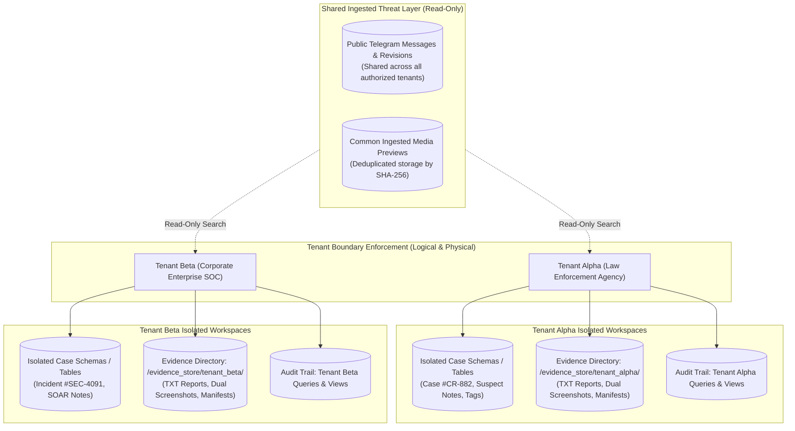
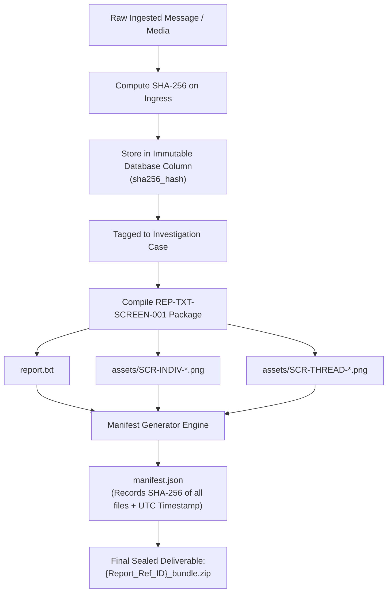

# TTI Security & Evidence Requirements Specification

**Document Reference:** `TTI-DOC-BSL-SEC-001`  
**Product:** Telegram Threat Intelligence (TTI)  
**Lifecycle Stage:** Product Baseline & Release 1 Scope  
**Author:** Product Research & Architecture Team  
**Date:** 2026-10-28  
**Governance Status:** `PROPOSED PRODUCT BASELINE — PENDING STAKEHOLDER REVIEW`  
**Predecessor Documents:**
- [`docs/security_baseline.md`](file:///d:/TTI/docs/security_baseline.md)
- [`docs/product/gate_3b/reporting_requirements_review.md`](file:///d:/TTI/docs/product/gate_3b/reporting_requirements_review.md) (`TTI-DOC-PRD-REV-001`)
- [`docs/product/gate_3b/assumptions_and_constraints.md`](file:///d:/TTI/docs/product/gate_3b/assumptions_and_constraints.md)

---

## 1. Executive Security & Forensic Charter

The core value proposition of **Telegram Threat Intelligence (TTI)** depends upon its ability to collect, preserve, and deliver intelligence that withstands aggressive legal scrutiny, internal compliance audits, and adversarial manipulation.

Because TTI ingests untrusted threat actor communications and serves dual client personas with conflicting privacy requirements (Law Enforcement criminal prosecutions vs Corporate SOC incident response), security and evidence handling are **architectural invariants**.

This document defines the mandatory specifications for tenant isolation, role-based access control (RBAC), source provenance tracking, cryptographic evidence integrity, investigation report generation (`REP-TXT-SCREEN-001`), data retention lifecycle dependencies, and comprehensive auditability.

---

## 2. Multi-Tenant Isolation Architecture



### 2.1 The Shared Ingestion / Isolated Case Hybrid Model (`DEC-05` Option B)
In accordance with engineering recommendations and stakeholder alignment:
1. **Shared Read-Only Threat Repository:**
   - Raw ingested Telegram messages, channel metadata, broadcast timestamps, forward histories, and deduplicated media previews reside in a shared data layer accessible to all authorized tenant queries.
   - This maximizes storage efficiency (avoiding storing 50 copies of a viral malware drop or channel dump) and ensures all clients benefit from common indexing.
   - *Media Access & Existence Oracle Prevention:* To prevent cross-tenant existence enumeration attacks, direct API querying or probing of media assets using raw SHA-256 hashes is strictly prohibited. Access to any media binary requires an authenticated, tenant-scoped Case reference token; unassociated or cross-tenant lookups must return HTTP 404 Not Found.
2. **Strictly Isolated Customer Investigation Workspaces:**
   - All customer-created entities—including active Cases, analytical notes, suspect tags, custom watchlists, search query history, and compiled report bundles—reside in tenant-isolated database partitions (protected by PostgreSQL Row-Level Security or separate PostgreSQL schemas).
   - *Caching & Queue Namespacing:* All tenant-scoped Redis cache entries, user session buffers, and background alert jobs must enforce cryptographic tenant key namespacing: `tenant:{tenant_id}:{subsystem}:{key}`. Shared public threat caches must use `public:threat:{key}` and contain zero tenant annotations.
   - Requests lacking authenticated tenant context must fail closed (HTTP 401 Unauthorized or HTTP 403 Forbidden).
   - Under no circumstances may Tenant A discover or observe the queries, active suspects, cases, or watchlists of Tenant B.
3. **Physical Storage Partitioning:**
   - Evidence deliverables and generated screenshot packages are written strictly to tenant-partitioned filesystem paths:
     `{storage_root}/{tenant_id}/{case_id}/{report_id}/`
   - Strict path traversal guards prevent access outside the specific tenant directory. Direct URL access via static web servers is prohibited; all downloads require authenticated, tenant-scoped API requests.

---

## 3. Role-Based Access Control (RBAC) & Authorization

TTI enforces least privilege across five standardized roles:

```
+----------------------------------------------------------------------------------------------------+
|                                    ROLE-BASED ACCESS CONTROL MATRIX                                |
+------------------------+-------------------+--------------------+------------------+---------------+
| Functional Capability  | Platform Admin    | Tenant Admin       | Senior Invest.   | Junior Analyst| Compliance    |
|                        | (VFRA Ops)        | (Org Lead)         | (Lead Detective) | (Triage)      | Auditor       |
+------------------------+-------------------+--------------------+------------------+---------------+
| Channel Ingestion Fleet| Full Manage/Edit  | No Access          | No Access        | No Access     | No Access     |
| Tenant Provisioning    | Full Create/Scope | No Access          | No Access        | No Access     | No Access     |
| Search Threat Archives | Read-Only         | Full Search        | Full Search      | Full Search   | No Search     |
| Continuous Thread View | Read-Only         | Full View          | Full View        | Full View     | No Access     |
| Create & Manage Cases  | No Access         | Full Manage        | Full Manage      | Read-Only     | No Access     |
| Tag Evidentiary Msgs   | No Access         | Full Tag           | Full Tag         | Read-Only     | No Access     |
| Generate Report & Pkg  | No Access         | Full Generate      | Full Generate    | Blocked       | No Access     |
| Pre-Delivery Review    | No Access         | Full Review/Redact | Full Review/Redact| Blocked      | No Access     |
| Final Export & Deliver | No Access         | Full Export        | Full Export      | Blocked       | No Access     |
| View Org Audit Trail   | System Logs Only  | Org Logs Only      | No Access        | No Access     | Full Org Read |
+------------------------+-------------------+--------------------+------------------+---------------+
```

### 3.1 Role Definitions
1. **Platform Administrator (VFRA Operations):** Manages collector workers, monitors proxy health, provisions customer tenants, and sets data quotas. Prohibited from inspecting confidential customer cases or investigative notes.
2. **Tenant Administrator (Customer Org Lead):** Manages organizational users, assigns roles, configures enterprise watchlists, and manages identity integrations.
3. **Senior Investigator / Lead Analyst:** Full investigative privileges: runs unmetered searches, navigates threads, creates cases, stages evidence, compiles reports, performs pre-delivery review/redaction, and authorizes exports.
4. **Junior Analyst (Triage):** Triages incoming alerts, searches messages, and views threads. Prohibited from creating external case packages or exporting formal deliverables.
5. **Compliance Auditor:** Read-only oversight of all organizational search queries, login timestamps, and export audit trails. Zero operational case creation or data tagging permissions.

### 3.2 Access Control, Quota Metering & Session Security Invariants
In accordance with confirmed requirements (`AC-REQ-001` through `AC-REQ-006`):
1. **Platform Administrator Scoping Boundary (`AC-REQ-001`, `DEC-21`):** Administrative access is restricted to infrastructure, collector fleet telemetry, organization onboarding/approval, and platform-wide access policies. Platform administrators have zero ambient access to browse, search, or inspect private customer investigative cases, analytical notes, or raw evidence binaries. Any emergency exception requires dual-control authorization and mandatory compliance logging.
2. **Organization Approval & Delegated User Governance (`AC-REQ-002`, `AC-REQ-003`):** An organization must be approved by the platform administrator before receiving active platform access. Organization administrators (Tenant Admins) manage only their own organization's users (`tenant_id`) and cannot view, approve, or escalate permissions across tenant boundaries.
3. **Sub-System Least-Privilege Enforcement (`AC-REQ-004`):** Endpoint capabilities are strictly gated by permission tokens tied to approved Product Baseline modules. Missing or elevated permissions fail closed with HTTP 403 Forbidden.
4. **Auditable Credit Quota Accounting (`AC-REQ-005`, `DEC-19`):** Organization usage is bounded by an assigned credit quota. Metered actions deduct credits atomically with idempotency protection. Deductions emit auditable ledger records capturing actor, action, deduction amount, and remaining balance. Zero cross-tenant balance leakage is permitted.
5. **Single Active Authenticated Session Per User Account (`AC-REQ-006`, `DEC-20`):** To prevent credential sharing and session hijacking, the platform enforces single active session semantics at the server level via `iam.active_user_sessions` with `UNIQUE (user_id)`. A second concurrent login for the same user account without displacement authorization is rejected (`HTTP 409 Conflict`). If the user provides explicit displacement authorization (`force_terminate_existing=true`), the existing session is atomically terminated, and the new session is issued. Multi-tenant switching is supported within the active session without triggering concurrency rejection. All session state transitions (creation, rejected concurrency attempts, displacements, expiration, revocation) emit immutable security audit events.

---

## 4. Source Provenance, Data Classification & Sanitization

### 4.1 Data Classification Taxonomy
To ensure proper protection levels, the platform establishes two strictly distinguished data classes:
1. **Public Threat Indicators (Actionable & Sharable):**
   - Technical observables extracted from public chatter: Telegram channel handles/IDs, threat actor handles, broadcast timestamps, malware file hashes (SHA-256), C2 domains and IP addresses, cryptocurrency wallet addresses.
   - *Handling Rule:* Sharable across authorized analysts within tenant scopes; indexed for multi-observable search.
2. **Sensitive Victim Personal Data & Credentials (Strict Minimization & Protection):**
   - Compromised employee passwords, session tokens/cookies, credit card numbers, victim email addresses, personal phone numbers, and identity documents exfiltrated by threat actors.
   - *Handling Rule:* Subject to strict data minimization. Plaintext passwords must never be stored. Suspected credentials embedded in chatter must be masked by default (`P@ssw****`), encrypted at rest with field-level AES-256, and never emitted in application logs.

### 4.2 Ingestion Provenance Capture
Every ingested threat message must capture complete source telemetry to establish forensic origin:
- `channel_id`: Numeric Telegram supergroup/channel identifier (e.g., `-100192837482`).
- `channel_title` & `channel_username`: Public name and handle (where available).
- `message_id`: Unique message sequence ID within the target channel.
- `broadcast_utc_timestamp`: Original publication timestamp reported by Telegram servers.
- `ingestion_utc_timestamp`: Exact timestamp when TTI ingestion worker received the payload.
- `sender_user_id` & `sender_username`: Author identity attributes (where exposed).
- `forward_from_chat_id` & `forward_from_msg_id`: Provenance metadata if the message was forwarded.
- `reply_to_msg_id`: Direct thread hierarchy link.
- `message_thread_id`: Forum supergroup topic identifier (where applicable).

### 4.3 Handling Missing or Anonymized Metadata
In Telegram, threat actors frequently forward messages from deleted accounts, mask author identities, or broadcast anonymously. In accordance with approved reporting rules:
- Missing metadata fields must **never be omitted silently or filled with placeholder fiction**.
- Missing fields must be explicitly recorded as `NOT_AVAILABLE_FROM_SOURCE`.

### 4.4 Input Sanitization & Threat Neutralization Boundary
External chatter contains active malware links, exploit payloads, and malicious formatting designed to compromise analyst workstations or attack platform databases:
- **Unicode NFC Normalization:** Eliminates homoglyph confusion and unicode character exploits.
- **Null-Byte & Control Character Stripping:** Purges `\x00` through `\x1F` (except valid line breaks) to prevent database driver truncation.
- **HTML Defanging:** Redacts script tags, iframe embeds, and dangerous URI protocols (`javascript:`, `data:`, `file:`).
- **Length Ceilings:** Enforces a 1,000,000 character maximum limit to defend against memory exhaustion attacks.
- **Chat-Body Credential Minimization:** Ingestion workers execute heuristic regex detection to identify embedded `user:password` and `email:password` patterns. Because regex is heuristic and imperfect, detected blocks are flagged, masked by default, and encrypted using field-level AES-256; unparsed chat text is preserved without exposing raw secrets in application log files or diagnostic traces.

---

## 5. Evidence Integrity & Cryptographic Hashing



### 5.1 Ingestion Cryptographic Fingerprinting (`OPP-006`)
- Upon receiving any raw message payload or media binary from Telegram, the backend calculates an immutable **SHA-256** cryptographic digest.
- The hash is committed in the same database transaction as the record insert.
- Any future retrieval can re-hash the stored record to verify that zero tampering, administrative alteration, or bit-rot has occurred.

### 5.2 Deliverable Package Manifest (`manifest.json`)
Every approved report bundle generated under `REP-TXT-SCREEN-001` must include a machine-verifiable `manifest.json`:
```json
{
  "report_reference_id": "TTI-REP-2026-0042",
  "case_reference_id": "CASE-2026-CR-882",
  "generated_at_utc": "2026-10-28T22:00:00Z",
  "generated_by_analyst_id": "usr_9921_investigator",
  "hashing_algorithm": "SHA-256",
  "files": [
    {
      "path": "report.txt",
      "size_bytes": 14208,
      "sha256": "e3b0c44298fc1c149afbf4c8996fb92427ae41e4649b934ca495991b7852b855"
    },
    {
      "path": "assets/SCR-INDIV-88201.png",
      "size_bytes": 1284910,
      "sha256": "4b227777d4dd1fc61c6f884f48641d02b4d121d3fd328cb08b5531fcacdabf8a"
    },
    {
      "path": "assets/SCR-THREAD-88201.png",
      "size_bytes": 3841029,
      "sha256": "ef2d127de37b942baad06145e54b0c619a1f22327b2ebbcfbec78f5564afe39d"
    }
  ]
}
```

### 5.3 Legal Admissibility Guardrail & Non-Repudiation Boundary
> [!CAUTION]
> **Legal Admissibility Guardrail:**
> 1. **Cryptographic hashes detect subsequent alteration of files, but do NOT independently prove message authenticity or establish legal admissibility in court.**
> 2. Screenshots can be fabricated on external devices or manipulated using client-side tools before broadcast.
> 3. Within TTI, screenshots serve strictly as **visual corroboration** to accompany raw message JSON payloads, server headers, network timestamps, and cryptographic SHA-256 manifests.
> 4. Admissibility in criminal proceedings remains governed by national rules of evidence (e.g., US FRE 902(13)/(14) or UK PACE Section 69) and judicial witness testimony.
> 5. **Permanent Rejection of Plaintext Credential Storage:** Option A of DEC-06 (storing plaintext compromised passwords AS IS) is permanently rejected from the architectural baseline on legal, regulatory (GDPR/privacy), and operational security grounds to prevent TTI from becoming an attractive honeypot target for threat actors.

---

## 6. Approved Report Generation & Pre-Delivery Governance (`REP-TXT-SCREEN-001`)

### 6.1 Deliverable Package Structure
The deliverable package must be compiled as a standardized `.zip` archive containing:
```
{Report_Ref_ID}_bundle.zip
├── report.txt                  # Structured UTF-8 plain-text report
├── manifest.json               # Cryptographic SHA-256 manifest
└── assets/
    ├── SCR-INDIV-101.png       # Relevant individual-message screenshot
    ├── SCR-THREAD-101.png      # Thread-context screenshot (surrounding messages)
    ├── SCR-INDIV-102.png
    └── SCR-THREAD-102.png
```

### 6.2 Pre-Delivery Review & Sensitive Data Redaction
Before a report bundle can be downloaded or released to clients:
1. **Interactive Review:** The investigator must review the compiled report and supporting screenshots in a dedicated review modal.
2. **PII & Collateral Redaction:** The investigator has tools to mask or redact sensitive collateral information (e.g., innocent bystanders whose chat handles or personal phone numbers appear in the thread screenshot).
3. **Formal Approval Action:** An explicit user confirmation action logs the approving analyst's identity, UTC timestamp, and justification.

---

## 7. Data Retention & Lifecycle Dependencies (`DEC-08`)

The operational handling of data storage is dependent on the resolution of stakeholder decision `DEC-08`. The platform architecture must accommodate two diametrically opposed retention demands:

```
+----------------------------------------------------------------------------------------------------+
|                               RETENTION POLICY TENSION MATRIX (DEC-08)                             |
+--------------------------+-------------------------------------+-----------------------------------+
| Retention Dimension      | Corporate Cybersecurity (SOC)       | Law Enforcement Agencies (LEAs)   |
+--------------------------+-------------------------------------+-----------------------------------+
| Regulatory Driver        | GDPR Art. 17 / CCPA (Right to Purge)| Statutory Criminal Limitation Periods|
| Desired Data Lifespan    | Short / Rolling (90–180 days max)   | Multi-year preservation (3–7+ yrs)|
| Storage Impact           | Predictable, capped disk footprint  | Unbounded growth without case caps|
+--------------------------+-------------------------------------+-----------------------------------+
```

### 7.1 Proposed Tiered Retention Lifecycle (Engineering Recommendation)
To resolve this tension without code fragmentation:
1. **Tier 1 (Ephemeral Threat Chatter):** Ingested public Telegram chatter not tagged to any case follows an automated rolling **180-day Time-To-Live (TTL)**. Unreferenced chatter older than 180 days is purged automatically.
2. **Tier 2 (Case-Locked Judicial Evidence):** Any message, screenshot, or report bundle formally tagged into an active Case is immediately **locked and exempted from automated purge routines**. It remains preserved until the Case is formally closed and authorized for destruction by a designated Case Administrator.
3. **Tier 3 (Screenshot Binary Quotas):** High-resolution screenshots consume significant storage (~1–5 MB each). Organizations receive configurable storage quota allocations (e.g., 250 GB per tenant) with automated warnings when utilization reaches 85%.

### 7.2 Unresolved Regulatory Problem: Evidentiary Immutability vs. Right to Erasure
> [!IMPORTANT]
> **Open Legal & Privacy Challenge (Requires Formal Legal Counsel Review):**
> A fundamental conflict exists between the forensic requirement for immutable cryptographic digests (SHA-256) and statutory data subject rights (GDPR Article 17 "Right to Erasure" / CCPA deletion rights). If an innocent third-party victim demands the deletion of their personal information appearing in an ingested threat drop:
> - Simply deleting the record breaks the cryptographic chain of custody and manifest verification for active case dossiers.
> - Conversely, refusing deletion or retaining cryptographic digests that could facilitate re-identification may breach statutory privacy mandates.
> 
> Rather than prematurely prescribing an unvalidated tombstone mechanism that could retain personal data or hashes unlawfully, this baseline identifies the **Erasure-versus-Evidence-Integrity design as an open policy problem requiring formal Legal Counsel and Compliance Officer determination** before architecture finalization.

---

## 8. Auditability & Tamper-Evident Logging

The platform maintains an append-only, tamper-evident audit ledger capturing all critical user and system actions:

1. **User Authentication:** Logins, logout events, failed credential attempts, and MFA challenges.
2. **Search Query Execution:** Full text of queries executed, indicators searched, date filters applied, and requesting user ID (crucial for LEA internal affairs compliance).
3. **Thread Context Viewing:** Recording which message threads were expanded and viewed.
4. **Credential Unmasking Events:** If compromised passwords are unmasked in future releases (`DEC-06`), recording exact user ID, victim record, and timestamp.
5. **Case Modifications:** Adding/removing evidence tags, editing analyst case notes.
6. **Report Generation & Pre-Delivery Approvals:** Recording report compilation, redaction actions, and final export approval.
