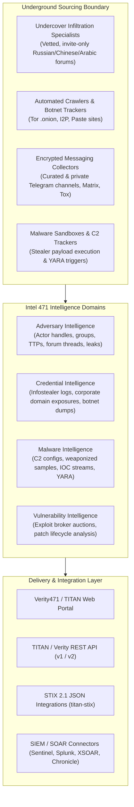

# Intel 471 (TITAN / Verity471) — Product Overview & Architectural Baseline

**Reference:** `TTI-DOC-RES-003-I471-01`  
**Target Platform:** Intel 471 TITAN Cyber Intelligence Platform / Verity471  
**Vendor:** Intel 471 Inc. (Wilmington, DE, USA; backed by Thoma Bravo)  
**Status:** Competitor Research Baseline (Audited)  
**Access Date:** 2026-10-28  
**Source Hierarchy Tier:** Tier 1 (Official Documentation), Tier 2 (API References & GitHub SDKs), Tier 3 (Integration Guides)  

---

## 1. Product Identity, Purpose & Corporate Profile

Intel 471 Inc. is a premier cyber threat intelligence provider specializing in tracking the cybercriminal underground, adversary operations, infostealer malware telemetry, and credential exposure ([Intel 471 Platform](https://intel471.com/)). The company is backed by private equity firm Thoma Bravo.

### 1.1 Core Positioning
Intel 471 positions itself as delivering **adversary-centric intelligence** by fusing automated dark-web/messaging crawlers with deep human intelligence (HUMINT) specialists embedded directly inside vetted, invite-only cybercrime syndicates and underground forums.

### 1.2 Platform Evolution (TITAN $\rightarrow$ Verity471)
- **TITAN Platform:** The legacy flagship SaaS portal and API (`https://api.intel471.com/v1`, client `titan-client-python`) providing Adversary, Credential, and Malware intelligence.
- **Verity471 / Verity API:** Intel 471’s modern cyber intelligence platform (`https://api.intel471.cloud`, PyPI `verity471`). The TITAN interface and legacy API are scheduled for retirement, and enterprise integrations are migrating to the Verity471 architecture (`VERIFIED`, [PyPI: verity471](https://pypi.org/project/verity471/)).

---

## 2. Platform Architecture & High-Level Topology

---

## 3. Product Modules & Licensing

Intel 471 licenses its intelligence modularly through enterprise annual subscriptions:

| Module Name | Core Target & Business Problem | Documented Data Sources | Technical Deliverable |
| :--- | :--- | :--- | :--- |
| **Adversary Intelligence** | Tracking threat actors, cyber extortion cartels, and initial access brokers. | Underground forums (Exploit, XSS, BreachForums), Telegram, dark web. | Detailed actor profiles, historical thread archives, threat alert digests. |
| **Credential Intelligence** | Proactively mitigating account takeover (ATO) by monitoring exfiltrated botnet credentials. | Infostealer logs (RedLine, Lumma, Vidar, Raccoon, Stealc), combo lists. | Structured compromised credential streams (Host, Username, Password, Victim IP). |
| **Malware Intelligence** | Identifying weaponized infrastructure and proactive C2 tracking. | Automated malware execution sandboxes, C2 configuration decryptors. | Real-time `/indicators/stream`, YARA rule packages, IOC feeds. |
| **Vulnerability Intelligence** | Predicting exploitation probability by monitoring weaponization chatter. | Dark-web exploit auctions, proof-of-concept repositories, broker threads. | CVE reports, exploit timeline analysis, threat actor interest metrics. |

---

## 4. Key Terminology & Concepts

- **HUMINT Hybrid Model:** Blending automated web scraping with human specialist undercover interaction in vetted forums where bots are blocked.
- **TITAN API:** The legacy programmatic REST interface (`api.intel471.com/v1`) delivering indicator streams, YARA rules, and report metadata via `titan-client-python` (now deprecated).
- **Verity471 / Verity API:** The modernized SaaS platform and REST API (`api.intel471.cloud`) succeeding TITAN, featuring unified search, expanded telemetry feeds, and the official `verity471` Python library.
- **Stealer Intelligence Pipeline:** Continuous automated ingestion and parsing of infostealer archives into normalized credential events.

---

## 5. Architectural Findings & Key Relevance for TTI

1. **Human Specialist Sourcing Corroboration (`VERIFIED`):** Intel 471 corroborates StealthMole’s design premise (`Slide 17`) that deep cyber underground and Telegram investigation requires specialized human curation alongside automated bots to penetrate vetted channels.
2. **First-Class Credential Streaming (`VERIFIED`):** Intel 471 provides continuous API indicator streams (`/indicators/stream`) for stealer credentials, proving that enterprise SOCs demand automated, programmatic credential ingestion rather than manual Excel exports.
3. **Platform Migration Lesson (`VERIFIED`):** The retirement of TITAN in favor of Verity471 underscores the importance of modular API abstraction: TTI must decouple its internal data schemas from external API contracts to avoid breaking customer integrations as backend models evolve.
