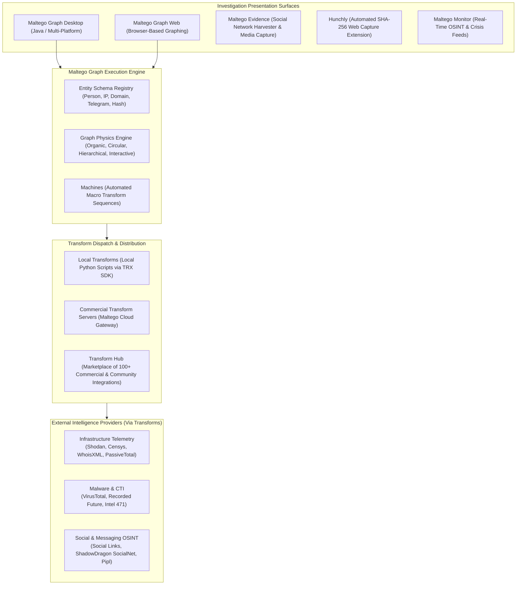

# Maltego — Product Overview & Architectural Baseline

**Reference:** `TTI-DOC-RES-003-MAL-01`  
**Target Platform:** Maltego Graph, Maltego Evidence, Maltego Monitor  
**Vendor:** Maltego Technologies GmbH (Munich, Germany; backed by Charlesbank Capital Partners)  
**Status:** Competitor Research Baseline (Audited)  
**Access Date:** 2026-10-28  
**Source Hierarchy Tier:** Tier 1 (Official Product Docs), Tier 2 (Transform Documentation), Tier 3 (Developer Guides)  

---

## 1. Product Identity, Purpose & Corporate Profile

Maltego is an open-source intelligence (OSINT) and graphical link-analysis platform designed to mine, merge, and map relationships across digital infrastructure, individuals, organizations, and threat groups ([Maltego Official Documentation](https://docs.maltego.com/)). Originally created by Paterva in South Africa, Maltego is now headquartered in Munich, Germany, following its acquisition by Charlesbank Capital Partners in 2023.

### 1.1 Core Positioning
Maltego is primarily an **analytical visualization and link-analysis engine**, rather than an independent threat intelligence collection crawler. It operates on an extensible **Transform Hub** architecture, allowing investigators to connect hundreds of third-party data feeds (e.g., Shodan, VirusTotal, Recorded Future, Intel 471, ShadowDragon) into an interactive node-and-edge graph workspace.

---

## 2. Platform Architecture & High-Level Topology

---

## 3. Product Editions & Licensing Model

Maltego has transitioned from legacy product editions to modern tiered subscription plans (`VERIFIED`, [Maltego Documentation](https://docs.maltego.com/)):

| Edition / Plan | Target Audience | Graph Entity Capacity | Results Per Transform | Commercial Transform Access |
| :--- | :--- | :---: | :---: | :--- |
| **Community Edition (CE) / Basic** | Non-commercial evaluation, students, individual researchers. | **10,000 Entities** per graph. | **24 results** per transform run (historically 12). | Free community transforms only; no commercial hub items. |
| **Maltego Professional** | Commercial investigators, corporate security, boutique consultancies. | Flexible / high-capacity graph limits. | Standard enterprise result returns. | Includes bundled Maltego Data Credits for select commercial hub transforms. |
| **Maltego Enterprise** | Large enterprise SOCs, federal law enforcement, intelligence agencies. | Uncapped large-scale graphing. | Maximum result sets supported by connector. | Dedicated transform servers, SAML 2.0 SSO, multi-user collaboration, custom entity schemas. |
| *Legacy: Maltego Classic* | *(Phased out)* | 10,000 Entities per graph. | 255 results per transform. | Commercial hub items supported. |
| *Legacy: Maltego XL* | *(Phased out)* | 1,000,000 Entities per graph. | 64,000 results per transform. | High-volume enterprise mapping. |

---

## 4. Key Terminology & Concepts

- **Entity:** A node placed on the graph representing a discrete object (e.g., `maltego.Person`, `maltego.IPv4Address`, `maltego.Domain`, `maltego.TelegramAccount`).
- **Transform:** A specific query script that accepts an input entity, executes an API lookup, and returns one or more output entities onto the graph.
- **Transform Hub:** The integrated catalog where investigators install transforms from commercial and open-source data providers.
- **Machine:** An automated script chaining multiple transforms together (e.g., *Company Stalker*, *Footprint L1/L2/L3*).
- **Maltego Evidence:** Specialized social network harvesting platform (formerly Social Network Harvester / SNH Classic by Freezingdata GmbH) designed to automatically capture profile networks, posts, media, and friendship connections.
- **Hunchly:** Specialized browser extension (acquired by Maltego) designed to automatically capture web pages into local encrypted SQLite databases, calculating SHA-256 cryptographic hashes for every MHTML page, image, and attachment, and recording exact timestamps for court-admissible forensic evidence.
- **Maltego Monitor:** Real-time social listening and monitoring dashboard for public safety and situational awareness.

---

## 5. Architectural Findings & Key Relevance for TTI

1. **Analytical Engine vs. Ingestion Crawler (`VERIFIED`):** Maltego does not ingest or store Telegram channels itself; it queries Telegram through third-party transforms (e.g., Social Links, ShadowDragon) or custom Python scripts.
2. **Visual Graph Dominance (`VERIFIED`):** Maltego set the global standard for node-link link analysis. StealthMole’s visual Canvas (`Slide 8`) directly mimics Maltego's node-and-edge layout paradigms.
3. **Investigation File Standard (`VERIFIED`):** Maltego graphs are stored in `.mtgx` files (ZIP container containing XML graph topology and entity properties), enabling offline case exchange between analysts.
