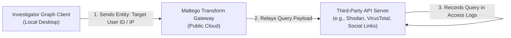

# Maltego — Security, Governance & Operational Risk

**Reference:** `TTI-DOC-RES-003-MAL-04`  
**Target Platform:** Maltego Graph, Maltego Evidence, Transform Hub  
**Status:** Competitor Research Baseline (Audited)  
**Access Date:** 2026-10-28  

---

## 1. Authentication, Licensing & Access Control

- **Client Authentication:** Desktop licenses are validated via activation keys tied to user accounts; modern web editions support **SAML 2.0 Single Sign-On (SSO)** for enterprise deployments (`VERIFIED`, [Maltego Documentation](https://docs.maltego.com/)).
- **Transform Server Authentication:** Access to commercial transforms on the Transform Hub requires individual API keys or pre-purchased Maltego Data Credits.
- **Role Separation in Collaboration:** In Maltego Enterprise collaborative graph servers, permissions can restrict graph editing, transform execution, and export operations between team leads and junior analysts.

---

## 2. Operational Security (OPSEC) & Data Leakage Risks

A critical operational consideration when using Maltego is the **Transform Data Flow** (`VERIFIED`):

### 2.1 The Observable Exposure Risk
- When an investigator runs a transform on an entity (such as a target's private email, internal IP address, or suspect Telegram handle), that value is transmitted across the internet to the transform provider's API.
- **OPSEC Implication:** If investigating sensitive counter-intelligence threats or private internal infrastructure, running public transforms can alert third parties or leak corporate internal IP topology to third-party logs.
- **Countermeasure (Internal Transform Servers):** Maltego allows enterprise customers to deploy internal, on-premises transform servers (iTDS - Internal Transform Distribution Server) to query private databases without routing through the public internet (`VERIFIED`).

---

## 3. Compliance, Forensic Integrity & Data Retention

- **Local Storage Model:** In the desktop client, all graph data, notes, and node coordinates are stored locally on the analyst's workstation in `.mtgx` format, minimizing central cloud data leakage for classified investigations.
- **Forensic Chain-of-Custody (Hunchly & Maltego Evidence):**
  - **Hunchly** generates encrypted local SQLite archives calculating **SHA-256 content hashes** and timestamps for every visited page, image, and raw MHTML DOM capture.
  - **Maltego Evidence** captures and exports structured social network profile trees and post histories with complete audit logs and chain-of-custody metadata.
  - Provides cryptographic proof of unmanipulated web captures for use in legal proceedings and law enforcement affidavits.
- **GDPR Considerations:** Investigating personal identifiers (emails, phone numbers, faces) on graphs constitutes personal data processing under GDPR. Organizations must establish legal bases (e.g., legitimate interest for security investigations) and maintain audit logs.

---

## 4. Key Architectural Lessons for TTI

1. **OPSEC Protection for Telegram Ingestion (`OPP-001`, PROPOSED, NOT APPROVED):** Unlike Maltego’s model of querying external third-party APIs per entity, TTI should maintain a dedicated, isolated internal collection buffer so analyst queries never leave the enterprise boundary.
2. **Forensic Hashing Standard (`OPP-006`, PROPOSED, NOT APPROVED):** Adopt the forensic preservation best practices established by Hunchly and Maltego Evidence by generating SHA-256 content hashes and audit receipts for every stored Telegram message, media attachment, and export.
