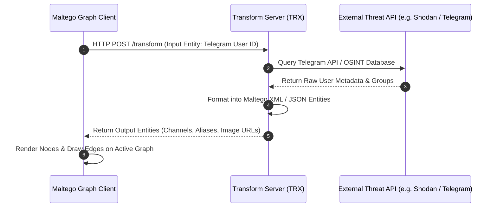

# Maltego — Workflows, Transforms & Integration Architecture

**Reference:** `TTI-DOC-RES-003-MAL-03`  
**Target Platform:** Maltego Graph, Maltego Evidence, Transform Hub  
**Status:** Competitor Research Baseline (Audited)  
**Access Date:** 2026-10-28  

---

## 1. Core Analyst Workflows

### 1.1 Multi-Hop Threat Infrastructure Pivot Workflow
1. **Seed Placement:** An investigator drops a `maltego.Domain` entity onto the graph: `malicious-broker.net` (`VERIFIED`, [Maltego Documentation](https://docs.maltego.com/)).
2. **DNS & WHOIS Resolution:** The analyst runs standard transforms:
   - `To DNS Name [SOA]` $\rightarrow$ identifies nameservers.
   - `To IP Address [DNS]` $\rightarrow$ resolves 3 hosting IP addresses.
3. **Passive DNS & Historical Infrastructure:** The analyst runs third-party transforms (e.g., Shodan or VirusTotal) on the IPs, surfacing historical SSL certificates.
4. **Attribution Pivot:** The SSL certificate serial matches an email address `admin@threat-actor.org`.
5. **Social & Messaging Pivot:** Running Social Links / ShadowDragon transforms on the email uncovers an affiliated Telegram user profile and an active dark-web forum handle.
6. **Layout Clumping:** The analyst clicks **Organic Layout** or **Hierarchical Layout** to auto-cluster the threat actor’s infrastructure network.

### 1.2 Forensic Web Capture & Harvesting Workflow (Hunchly & Maltego Evidence)
1. **Target Identification:** While investigating a Telegram web preview or dark-web paste, an analyst locates an exfiltration notice containing stolen corporate blueprints.
2. **Forensic Web Capture (Hunchly):** The analyst browses the target URL with Hunchly enabled. Hunchly automatically records the session, stores the raw MHTML DOM and media in an encrypted SQLite database, calculates SHA-256 hashes for all assets, and embeds verifiable timestamps.
3. **Deep Profile Harvesting (Maltego Evidence):** To extract the threat actor's full social network and historical post history, the analyst launches Maltego Evidence (SNH Classic), targeting the suspect's social profiles across platforms to download complete follower graphs and post archives.
4. **Graph Integration:** Using official Hunchly transforms and Maltego Evidence export files, the analyst pushes the captured selectors and cryptographic hashes directly onto the Maltego Graph.
5. **Chain-of-Custody Report:** Hunchly and Maltego Evidence generate tamper-evident, court-ready PDF case dossiers containing full-page captures, SHA-256 hash receipts, and investigator attribution.

---

## 2. Technical Transform Architecture & Developer SDK

### 2.1 The Transform Execution Protocol
A Maltego Transform is essentially a standard HTTP/REST or local script execution that follows a strict input/output contract:
- **Input:** XML or JSON payload containing the source entity type, primary value (e.g., `value="192.168.1.1"`), and custom entity properties.
- **Processing:** The transform script queries an external API or database.
- **Output:** XML or JSON response returning an array of new entities, their properties, edge labels, and display weights.



### 2.2 Maltego TRX Python SDK
- Maltego provides an official Python library, **`maltego-trx`**, published on PyPI (`VERIFIED`, [GitHub: maltego-trx](https://github.com/paterva/maltego-trx)).
- Allows developers to build custom local transforms in under 20 lines of Python:
```python
from maltego_trx.transform import DiscoverableTransform
from maltego_trx.maltego import MaltegoMsg, MaltegoTransform

class TelegramToChannels(DiscoverableTransform):
    @classmethod
    def create_entities(cls, request: MaltegoMsg, response: MaltegoTransform):
        user_id = request.Value
        # Execute custom database or Telethon query
        channels = ["@leaks_channel", "@threat_market"]
        for ch in channels:
            response.addEntity("maltego.TelegramChannel", ch)
```

---

## 3. Storage Formats, Exports & Collaboration

- **Graph Storage Format (`.mtgx`):** Maltego graphs are saved as `.mtgx` archives—a standard zip file containing `graph.xml` (node coordinates, edges, labels) and entity attachment assets (`VERIFIED`).
- **Tabular & Visual Exports:**
  - Tabular data exported to CSV, Excel (`.xlsx`), and GraphML.
  - Visual graphs exported to high-resolution PNG, JPG, SVG, and vector PDF.
- **Enterprise Collaboration:**
  - Maltego Enterprise includes multi-user graph collaboration servers, allowing distributed analysts to work concurrently on the same investigation graph with real-time node locking.

---

## 4. Key Architectural Lessons for TTI

1. **Graph Serialization Standard (`OPP-007`, PROPOSED, NOT APPROVED):** TTI should evaluate supporting `.mtgx` or GraphML export formats so that analysts can import Telegram thread link networks directly into Maltego for enterprise correlation.
2. **Forensic Evidence Standards (`OPP-006`, PROPOSED, NOT APPROVED):** Hunchly and Maltego Evidence prove the critical value of cryptographic hashing (SHA-256) and tamper-evident audit logs for legal defensibility.
3. **Pluggable Architecture:** Providing clean REST endpoints allows TTI to easily act as a Transform Hub data provider in the future.
