# Recorded Future — Product Overview & Architectural Baseline

**Reference:** `TTI-DOC-RES-003-RF-01`  
**Target Platform:** Recorded Future Intelligence Cloud  
**Vendor:** Recorded Future, Inc. (Somerville, MA, USA / Mastercard)  
**Status:** Competitor Research Baseline (Audited)  
**Access Date:** 2026-10-28  
**Source Hierarchy Tier:** Tier 1 (Official Product Docs), Tier 2 (API References), Tier 3 (Technical Briefings)  

---

## 1. Product Identity, Purpose & Corporate Profile

Recorded Future is an enterprise cyber threat intelligence (CTI) provider operating the **Recorded Future Intelligence Cloud** ([Recorded Future Platform Docs](https://docs.recordedfuture.com/)). The platform collects, structures, and analyzes threat data across the open web, technical infrastructure telemetry, the dark web, and closed messaging networks (including **Telegram**).

In September 2024, Mastercard completed the acquisition of Recorded Future for \$2.65 billion, expanding its footprint into enterprise fraud prevention, identity security, and threat intelligence.

### 1.1 Core Positioning
Recorded Future positions its platform around automated collection at internet scale fused with machine learning analytics and human analyst curation via the **Insikt Group**. Its foundational core is the **Intelligence Graph®**, a dynamic relational ontology that organizes threat observables, actors, campaigns, and infrastructure into interconnected entities with real-time risk scores.

---

## 2. Platform Architecture & High-Level Topology

```mermaid
flowchart TD
    subgraph Ingestion_Layer["Omni-Source Ingestion Engine"]
        OpenWeb["Open Web / Clear Web\n(Technical blogs, news, repositories)"]
        DarkWeb["Dark Web & Forums\n(Tor .onion, I2P, underground forums)"]
        Messaging["Messaging & Chat Networks\n(Telegram channels, Discord servers)"]
        Technical["Technical Infrastructure\n(DNS, BGP, WHOIS, SSL certs, malware feeds)"]
    end

    subgraph Core_Analytics["Intelligence Graph® Ontology"]
        NLP_Engine["Natural Language Processing (NLP) & Multi-Language Translation"]
        Entity_Resolution["Entity Resolution & Ontology Mapping"]
        Risk_Scoring["Real-Time Dynamic Risk Engine (0-99 Risk Score)"]
        Insikt_Human["Insikt Group (Human Threat Research & Curation)"]
    end

    subgraph Delivery_Surfaces["Modular Product & Delivery Surfaces"]
        Threat_Intel["Threat Intelligence"]
        SecOps_Intel["SecOps Intelligence"]
        Identity_Intel["Identity Intelligence"]
        Attack_Surface["Attack Surface Intelligence (ASI)"]
        Cards["Intelligence Cards™ (Entity Dossiers)"]
    end

    subgraph Consumption_Layer["Integration & Automation Layer"]
        Connect_API["Connect API (REST / JSON)"]
        STIX_TAXII["STIX 2.1 / TAXII 2.1 Server"]
        SIEM_SOAR["SIEM / SOAR Connectors (Splunk, Sentinel, Cortex)"]
        Web_Portal["Analyst Web Portal & Dashboards"]
    end

    Ingestion_Layer --> Core_Analytics
    Core_Analytics --> Delivery_Surfaces
    Delivery_Surfaces --> Consumption_Layer
```

---

## 3. Product Editions & Licensing Model

Recorded Future does not offer a free tier. It packages capabilities into specialized modular subscriptions targeted at specific security personas:

| Product Module / Edition | Target Persona / Team | Primary Capabilities | Documented Sources |
| :--- | :--- | :--- | :--- |
| **Threat Intelligence** | Strategic & Tactical CTI Teams | Threat actor profiling, TTP tracking (MITRE ATT&CK), campaign tracking, dark-web monitoring. | [Recorded Future Threat Intel](https://www.recordedfuture.com/) |
| **SecOps Intelligence** | SOC Tier 1/2/3 & Incident Response | Automated IOC enrichment, SIEM alert triage, dynamic risk lists, firewall blocklist integration. | [Recorded Future SecOps](https://docs.recordedfuture.com/) |
| **Identity Intelligence** | Identity Access & Fraud Teams | Detection of corporate employee and customer credentials leaked via stealer malware and dark web. | [Recorded Future Identity](https://www.recordedfuture.com/) |
| **Vulnerability Intelligence** | Vulnerability & Patch Management | Real-time risk prioritization of CVEs based on active dark-web exploitation and weaponization chatter. | [Recorded Future Vulnerability](https://docs.recordedfuture.com/) |
| **Attack Surface Intelligence (ASI)** | External Threat Surface Teams | Continuous automated asset discovery, exposed subdomains, shadow IT, and cloud misconfigurations. | [Recorded Future ASI](https://www.recordedfuture.com/) |
| **Payment Fraud Intelligence** | Financial Fraud Teams | Monitoring of stolen credit card dumps, BIN exposure, ATM skimming networks, and checkout malware. | [Recorded Future Payment](https://www.recordedfuture.com/) |
| **Geopolitical Intelligence** | Physical Security & Executive Protection | Macro-level geopolitical instability, unrest, travel risk, and nation-state conflict monitoring. | [Recorded Future Geopolitical](https://www.recordedfuture.com/) |

---

## 4. Key Terminology & Concepts

- **Intelligence Graph®:** The underlying knowledge graph modeling entities (actors, IPs, hashes, CVEs, companies) and the relationships between them.
- **Intelligence Cards™:** Single-pane-of-glass dynamic profile cards generated for individual entities (e.g., IP Card, Hash Card, Threat Actor Card).
- **Risk Score (0–99):** A real-time calculated score indicating threat severity, backed by specific documented risk rules (e.g., "Observed in Stealer Malware Log", "Active C2").
- **Insikt Group:** Recorded Future's proprietary threat research arm conducting original human investigations, source validation, and actor profiling.
- **Connect API:** The primary programmatic interface allowing external systems to query entity intelligence, risk lists, and alerts.

---

## 5. Architectural Findings & Key Relevance for TTI

1. **Graph Ontology vs. Raw Message Ingestion (`VERIFIED`):** Recorded Future prioritizes extracting structured entities into its Intelligence Graph rather than presenting uncurated, end-to-end chat scrolling. For Telegram data, Recorded Future provides structured sightings, snippets, and actor associations.
2. **First-Class API Architecture (`VERIFIED`):** Every entity, risk rule, and report is programmatically accessible via REST (`Connect API`) and standardized STIX 2.1 / TAXII feeds, setting the enterprise standard for SIEM/SOAR interoperability.
3. **High Commercial Barrier (`VENDOR CLAIM` / `VERIFIED`):** Recorded Future operates exclusively on annual enterprise contracts with high entry costs, leaving a significant market gap for specialized, mid-market, or modular platforms focused specifically on deep Telegram thread investigation.
