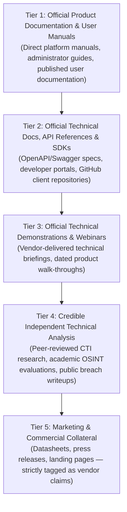

# TTI Research Gate 3 — Competitor Research Methodology & Governance

**Reference:** `TTI-DOC-RES-003-METH`  
**Status:** Approved Research Framework  
**Date:** 2026-10-28  
**Project:** Telegram Threat Intelligence (TTI)  
**Applicability:** All Gate 3 Competitor Intelligence Deliverables  

---

## 1. Objective and Operating Boundaries

This document defines the formal research methodology, evidence hierarchy, classification taxonomy, and governance boundaries used to conduct the **TTI Research Gate 3 Competitor Deep Dive**.

### 1.1 Scope of Competitor Analysis
Gate 3 investigates four primary enterprise cyber threat intelligence (CTI) and digital investigation platforms:
1. **Recorded Future** (Intelligence Cloud, Intelligence Graph, Connect API)
2. **Maltego** (Maltego Graph, Maltego Evidence, Maltego Monitor, Transform Hub)
3. **Intel 471** (TITAN Cyber Intelligence Platform, Verity471, TITAN API)
4. **ShadowDragon** (Horizon Investigate, Horizon Monitor, SocialNet, MalNet)

*StealthMole User Manual v3.3* (December 2024 / March 2025), audited under Gate 2 and Gate 2A (`TTI-DOC-RES-002`, `TTI-DOC-RES-002A-AUDIT`), serves as the existing functional and query-metering baseline.

### 1.2 Operating Restrictions
- **Research Only:** No feature implementation, architectural modifications, database migrations, or configuration changes to the TTI application.
- **No Live Collection:** No activation of Telegram MTProto collection, dark-web crawling, proxy rotation, or external account scraping.
- **Confidentiality:** Strict protection of proprietary data; no disclosure of private company data or unverified credentials.
- **Preservation of User Work:** All existing repository assets and git branches remain preserved.

---

## 2. Source Hierarchy & Verification Protocol

Research must adhere strictly to a 5-tier evidence hierarchy. Online sources must record the access date and direct URL:



### Source Rules:
1. **Direct Citation:** Every factual claim must cite an exact section, URL, slide number, or API endpoint.
2. **Inaccessible Sources:** If a source is gated behind customer login (e.g., paywalled customer support portals), the document must explicitly record the source limitation as `UNKNOWN / ACCESS RESTRICTED` rather than speculating on its contents.
3. **Primary Source Integrity:** When marketing claims conflict with technical API documentation, technical documentation takes precedence.

---

## 3. Evidence Classification Taxonomy

Every capability, parameter, architectural model, or limitation is tagged with one of five standardized statuses:

| Status Code | Definition | Usage Criteria |
| :--- | :--- | :--- |
| **`VERIFIED`** | Explicitly supported by cited documentation. | Directly illustrated in manuals, user guides, or verified API endpoints. |
| **`VENDOR CLAIM`** | Asserted by the vendor; not independently verified. | Extracted from sales decks, marketing press releases, or promotional webinars without technical confirmation. |
| **`INFERENCE`** | Logical technical deduction by the research team. | Reasonable interpretation of system mechanics (e.g., API rate-limit mechanics derived from HTTP header specifications); explicitly disclaimed as an inference. |
| **`UNKNOWN`** | Insufficient or restricted evidence. | Feature is absent from reviewed sources or gated behind proprietary customer access. |
| **`TTI PROPOSAL`** | Candidate architectural feature for TTI. | Potential future capability inspired by competitor analysis; strictly labeled as **`PROPOSED, NOT APPROVED`**. |

### The Non-Assumed Absence Rule:
> **Crucial Audit Mandate:** Silence in a reviewed document must **NEVER** be converted into a definitive claim of competitor absence. If a feature (e.g., SAML 2.0, REST API, cryptographic hashing) is not mentioned in reviewed user documentation, it must be classified as **`UNKNOWN / NOT DOCUMENTED IN REVIEWED SOURCES`**, not as "unsupported" or "lacking."

---

## 4. TTI Proposal Discipline

All potential TTI opportunities identified through competitor analysis must adhere to rigorous proposal discipline:
1. **No Automatic Copying:** A feature present in Recorded Future, Maltego, Intel 471, or StealthMole is not automatically included in TTI requirements.
2. **Standard Evaluation Template:** Every proposal must evaluate:
   - Target User / Analyst Problem
   - Documented Evidence Supporting the Problem
   - Expected Strategic Value for TTI
   - Technical Complexity & Operating Infrastructure Costs
   - Privacy, Legal & Security Implications (e.g., GDPR, CFAA, Telegram ToS)
   - Open Questions Requiring Company Confirmation
3. **Approval Boundary:** All candidate features remain **`PROPOSED — NOT APPROVED`** until the formal TTI Product Requirements Document (PRD) and Architecture Review Gate.

---

## 5. Directory Structure & Deliverable Map

Gate 3 research is organized into modular documentation trees under `docs/research/competitors/`:

```
docs/research/competitors/
├── research_methodology.md              <-- This governance baseline
├── cross_platform_comparison.md         <-- Comparative matrix across all 5 platforms
├── gate_3_report.md                     <-- Final audit summary and Gate 3 verdict
├── recorded_future/
│   ├── product_overview.md
│   ├── module_inventory.md
│   ├── workflows_and_integrations.md
│   ├── security_and_governance.md
│   ├── limitations_and_unknowns.md
│   └── evidence_register.md
├── maltego/
│   ├── product_overview.md
│   ├── module_inventory.md
│   ├── workflows_and_integrations.md
│   ├── security_and_governance.md
│   ├── limitations_and_unknowns.md
│   └── evidence_register.md
├── intel_471_titan/
│   ├── product_overview.md
│   ├── module_inventory.md
│   ├── workflows_and_integrations.md
│   ├── security_and_governance.md
│   ├── limitations_and_unknowns.md
│   └── evidence_register.md
└── shadowdragon_horizon/
    ├── product_overview.md
    ├── module_inventory.md
    ├── workflows_and_integrations.md
    ├── security_and_governance.md
    ├── limitations_and_unknowns.md
    └── evidence_register.md
```
