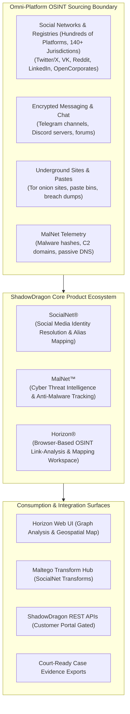

# ShadowDragon (Horizon & SocialNet) — Product Overview & Architectural Baseline

**Reference:** `TTI-DOC-RES-003-SD-01`  
**Target Platform:** ShadowDragon Horizon®, SocialNet®, MalNet™  
**Vendor:** ShadowDragon LLC (Cheyenne, WY, USA)  
**Status:** Competitor Research Baseline (Audited)  
**Access Date:** 2026-10-28  
**Source Hierarchy Tier:** Tier 1 (Official Documentation), Tier 2 (Integration Specs), Tier 3 (Partner Briefings)  

---

## 1. Product Identity, Purpose & Corporate Profile

ShadowDragon LLC is a specialized digital investigation and open-source intelligence (OSINT) software provider ([ShadowDragon Official Website](https://shadowdragon.io/)). The company develops targeted intelligence tools tailored for law enforcement, corporate fraud investigators, defense analysts, and cyber threat intelligence teams.

### 1.1 Core Positioning
ShadowDragon specializes in **identity resolution, digital footprint mapping, and social cyber attribution**. Its core strength lies in rapidly correlating online handles, email addresses, phone numbers, and avatars across hundreds of public social media platforms, messaging networks (including **Telegram**), discussion forums, and corporate registries across 140+ jurisdictions to identify the real-world persons or threat actors behind cyber events.

---

## 2. Platform Architecture & High-Level Topology

---

## 3. Product Suite Breakdown

The ShadowDragon suite is organized into distinct standalone and combinable products:

| Product Name | Core Functionality | Primary Supported Data Sources | Target Investigator Persona |
| :--- | :--- | :--- | :--- |
| **Horizon®** | All-in-one browser-based link-analysis and investigation workspace. | Integrated feeds from SocialNet, MalNet, and external APIs. | Law enforcement detectives, intelligence analysts, corporate fraud investigators. |
| **SocialNet®** | Deep social media intelligence and alias correlation engine. | Hundreds of social platforms, corporate registries across 140+ jurisdictions, Telegram, dark web. | OSINT specialists, threat actor profilers, cybercrime investigators. |
| **MalNet™** | Cyber threat intelligence and malware infrastructure tracking. | Malware IOCs, C2 domains, MD5/SHA-256 hashes, passive DNS. | SOC tier 2/3 analysts, incident responders, malware researchers. |
| **OOTB Transforms** | Pre-packaged transform packages for third-party graph tools. | SocialNet and MalNet data queries. | Maltego users requiring commercial OSINT social enrichment. |

---

## 4. Key Terminology & Concepts

- **Identity Resolution:** The algorithmic process of connecting disparate online usernames, email addresses, phone numbers, and profile avatars across multiple platforms to a single entity.
- **Horizon Investigate:** The visual graph and timeline interface inside Horizon for mapping relational links.
- **Horizon Monitor:** Continuous alerting dashboard monitoring social and dark-web channels for targeted keywords.
- **SocialNet Transforms:** The commercial integration package published on the Maltego Transform Hub enabling one-click social pivoting.

---

## 5. Architectural Findings & Key Relevance for TTI

1. **Identity Attribution Specialization (`VERIFIED`):** ShadowDragon proves the immense value of bridging chat observables (e.g., a Telegram `@alias` or numeric user ID) to external social footprints (GitHub, VK, breach dumps).
2. **Dual Workspace Modality (`VERIFIED`):** Horizon provides both link-analysis graphing and geospatial map plotting, directly paralleling StealthMole’s Canvas and Dark Map dual modality.
3. **Integration-First Distribution (`VERIFIED`):** Rather than competing exclusively against link-analysis platforms, ShadowDragon became essential by providing the premier social transform package for Maltego, illustrating the strategic advantage of open API interoperability.
