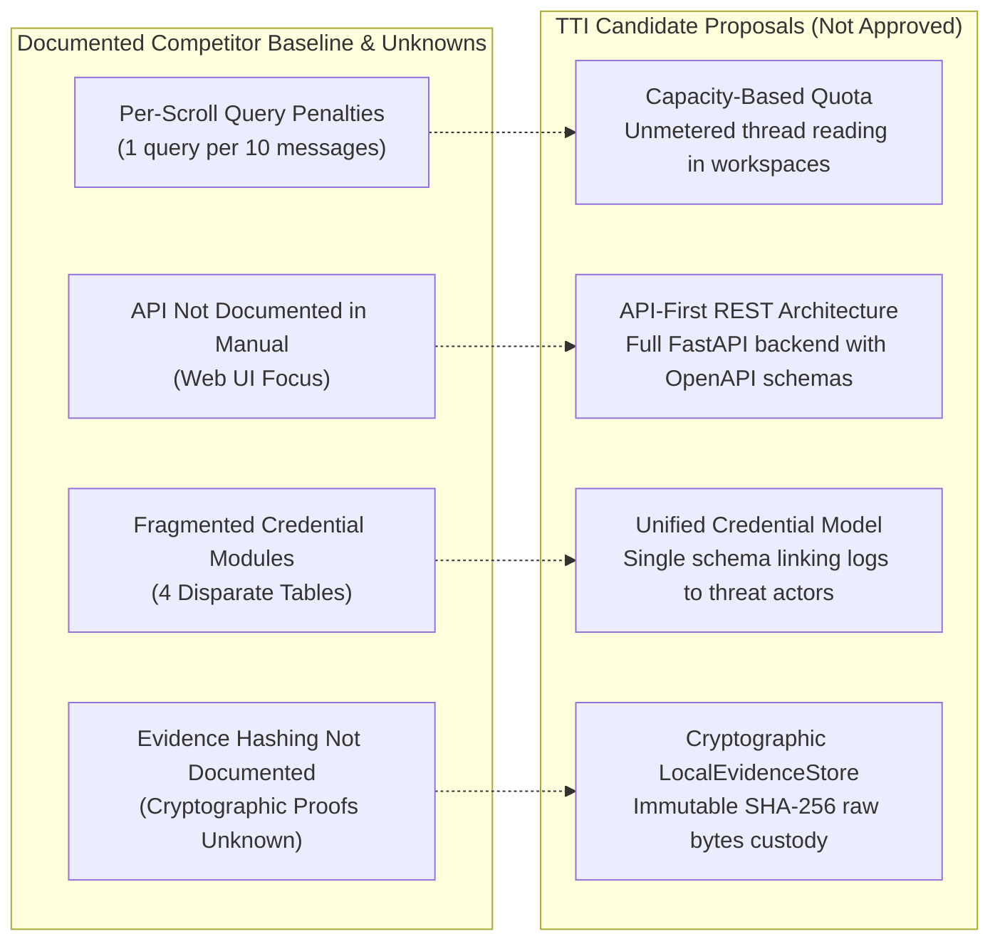

# StealthMole — Product Limitations, Unknowns & Architectural Gaps

**Reference:** `TTI-DOC-RES-002-SM-09`  
**Primary Source:** *StealthMole — User Manual v3.3* (December 2024 / March 2025; 53 physical PDF pages, 52 presentation slides)  
**Document Status:** Grounded Gap & Constraint Analysis (Audited Baseline)  
**Citation Convention:** Dual reference standard: `Slide X (PDF p. Y)`.

---

## 1. Documented Product Limitations (Source-Verified)

The following operational constraints and limitations are directly documented within *StealthMole User Manual v3.3*:

### 1.1 Chat-Scroll Query Metering Penalty (*Slide 51 / PDF p. 52*)
- **Limitation**: In Telegram Tracker, scrolling up or down in the chat preview panel deducts **1 query credit for every 10 messages scrolled**.
- **Operational Impact**: An investigator reviewing conversational context around a data dump (e.g., 200 messages) burns 20 query credits merely reading historical context.
- **Consequence**: Users are financially disincentivized from performing exhaustive contextual reading of message threads.

### 1.2 Export Quota Depletion (*Slide 52 / PDF p. 53*)
- **Limitation**: In the credential search modules (Compromised Data Set, Combo Binder, Credential Lookout, ULP Binder), clicking `Export` deducts queries based on the **total number of pages exported**.
- **Operational Impact**: Bulk audits of large corporate domains (e.g., 50 pages of stealer records) rapidly drain monthly organization quotas.

### 1.3 License-Gated Forensic Inspection (*Slide 16 / PDF p. 17, Slide 26 / PDF p. 27*)
- **Limitation**: Standard enterprise users cannot download exfiltrated archive files, view desktop screenshots, or view webcam photos. These capabilities require an elevated **Investigation License** tier.
- **Operational Impact**: Tier 1 analysts cannot verify whether a desktop screenshot contains sensitive internal IP without escalation to higher-tier licensed users.

### 1.4 Boolean Operator Caps (*Slide 49 / PDF p. 50*)
- **Limitation**: Search queries enforce strict combinatorial ceilings:
  - Maximum of **3 `OR` operators** per query.
  - Maximum of **5 combined boolean operators** (`AND`, `OR`, `NOT`) per query.
- **Operational Impact**: Complex multi-domain or multi-hash search strings must be manually partitioned into multiple disjoint searches, each incurring query consumption charges.

---

## 2. Capabilities Not Documented in Reviewed Sources (Explicit Unknowns)

To adhere to rigorous research audit standards, capabilities not described in *User Manual v3.3* are classified as **UNKNOWN / NOT DOCUMENTED IN THIS MANUAL** rather than assumed to be absent in the vendor's unreviewed enterprise or backend infrastructure:

| Capability / Dimension | Status in User Manual v3.3 | Technical & Architectural Unknown |
| :--- | :--- | :--- |
| **Programmatic REST API** | *Not documented in the reviewed source*. | The manual describes Web UI interactions and Excel exports; programmatic API endpoints, webhook feeds, and STIX/TAXII integrations are not documented. Whether an enterprise API exists under a separate developer license is unknown. |
| **Enterprise Authentication (SAML/SSO)** | *Not documented in the reviewed source*. | Manual documents standard email/password login and password resets (*Slide 2*); Okta/Azure AD SAML single sign-on is not documented. |
| **Multi-Tenant Data Segregation** | *Not documented in the reviewed source*. | The underlying database architecture, tenant isolation guarantees, and encryption-at-rest models are proprietary and undisclosed in user manuals. |
| **Custom Telegram Ingestion / Channel Onboarding** | *Not documented in the reviewed source*. | Telegram data is described as "collected by OSINT specialists" (*Slide 17*). The manual does not document whether an enterprise customer can request or dynamically onboard custom private channels. |
| **Regular Expression (Regex) Full-Text Search** | *Not documented in the reviewed source*. | The manual documents boolean operators and specific indicator prefixes; arbitrary regular expression pattern matching across message bodies is not documented. |
| **Cryptographic Evidence Chain-of-Custody** | *Not documented in the reviewed source*. | The manual documents HTML/text snapshots (*Slide 16*); SHA-256 cryptographic non-repudiation or tamper-verification hashing is not documented. |
| **SIEM / SOAR Forwarding Integrations** | *Not documented in the reviewed source*. | Alerting is documented via in-platform MoleSight dashboards and automated emails (*Slide 13*); native Splunk, Microsoft Sentinel, or webhook connectors are not documented. |

---

## 3. Operational & Technical Dependencies

1. **Human Specialist Ingestion Bottleneck**:
   - As documented on Slide 17, Telegram intelligence relies on collection by "OSINT specialists."
   - *Dependency*: If collection relies on human specialist discovery and manual feed curation, coverage of rapidly emerging, ephemeral, or private Telegram channels may lag behind fully automated ingestion pipelines.
2. **Tor / Dark-Web Infrastructure Volatility**:
   - Darkweb Tracker PRO provides historical snapshots (*Slide 16*) because onion services experience high churn, takedowns, and DDoS attacks.
   - *Dependency*: Snapshots reflect historical crawler visits; live site availability cannot be guaranteed.

---

## 4. Key Design Lessons & Architectural Proposals for TTI

The analysis of documented baseline constraints in StealthMole reveals four prime architectural candidate proposals for **Telegram Threat Intelligence (TTI)** (`STATUS: PROPOSED, NOT APPROVED`):

1. **Capacity-Based Query Model (`OPP-001`, `PROPOSED, NOT APPROVED`)**:
   Eliminate per-scroll chat penalties. Allow analysts to read entire conversational histories without deducting query credits, establishing TTI as an analyst-friendly platform. Requires Redis-backed message chunk caching.
2. **API-First Architecture (`OPP-003`, `PROPOSED, NOT APPROVED`)**:
   Ensure every capability accessible via the frontend dashboard is exposed via clean, strongly-typed REST API endpoints (`/api/v1/`) to facilitate automated SIEM/SOAR integration.
3. **Unified Credential Exposure Model (`OPP-007`, `PROPOSED, NOT APPROVED`)**:
   Instead of segregating stealer logs across Compromised Data Set, Combo Binder, Credential Lookout, and ULP Binder, evaluate providing a single normalized entity model with faceted filters (Stealer, Combo, Breach).
4. **Cryptographic Evidence Chain-of-Custody (`OPP-006`, `PROPOSED, NOT APPROVED`)**:
   Evaluate hashing every raw ingested chat message and media file with SHA-256 before text parsing, providing legally defensible evidence verification in an immutable ledger.
