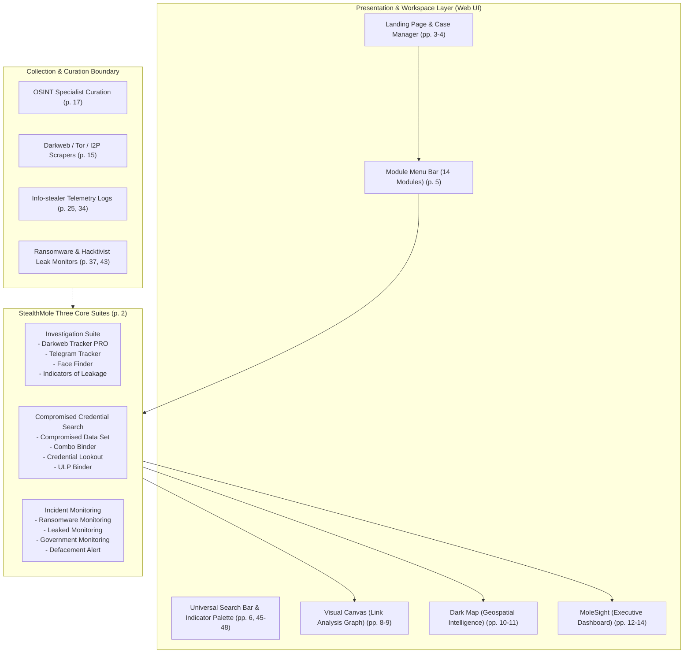

# StealthMole — Product Overview & Architectural Baseline

**Reference:** `TTI-DOC-RES-002-SM-01`  
**Primary Source:** *StealthMole — User Manual v3.3* (December 2024 / March 2025; 53 physical PDF pages, 52 presentation slides; `D:\StealthMole - User Manual v3.3.pdf`)  
**Publisher:** StealthMole Intelligence Pte. Ltd. (HQ: Singapore; R&D: South Korea)  
**Document Status:** Gate 2 Complete Product Deep Dive (Audited Baseline)  
**Citation Convention:** Dual reference standard: `Slide X (PDF p. Y)` (where physical PDF page is `Slide + 1`).  
**Relevance:** Competitive reference for Telegram Threat Intelligence (TTI)

---

## 1. Product Identity & Purpose

StealthMole is an enterprise cyber threat intelligence (CTI) and digital investigation platform designed to track cybercriminals, uncover data leaks, and monitor threats across the **Dark Web** (Tor, I2P), the **Deep Web**, and encrypted messaging networks (principally **Telegram**) (*User Manual v3.3, pp. 1, 15, 17*).

The vendor positions the platform as "The Easiest Intelligence," employing an analytical workflow summarized as:  
$$\text{Search} \longrightarrow \text{Add to Canvas} \longrightarrow \text{Connect / Pivot} \longrightarrow \text{Profile Threat}$$

---

## 2. Platform Architecture & High-Level Topology

---

## 3. High-Level Taxonomy of the 14 Module Groups

According to the official *Index* (*User Manual v3.3, p. 2*), the platform organizes its 14 capabilities into three functional suites and core platform utilities:

| Suite / Group | Module Name | Primary Objective | Manual Reference |
| :--- | :--- | :--- | :--- |
| **Core Platform** | **Platform & Case Management** | Case creation, saved cases, user quota tracking, module configuration. | Pages 3–11 |
| **Executive Analytics**| **MoleSight** | Executive dashboard with customizable widgets, metrics, and email alerts. | Pages 12–14 |
| **Investigation Suite** | **Darkweb Tracker PRO** | Deep and dark-web indexing, HTML snapshots, linked observables. | Pages 15–16 |
| | **Telegram Tracker** | Curated Telegram channel/group monitoring, message preview, GPS, AI captioning. | Pages 17–19 |
| | **Face Finder** | AI-powered facial recognition across dark-web and Telegram media. | Pages 20–22 |
| | **Indicators of Leakage (IoL)**| Curated datasets linked to specific breaches, incidents, and campaigns. | Pages 23–24 |
| **Compromised Credentials** | **Compromised Data Set** | Device-level info-stealer dumps, victim IPs, machine names, stealer paths. | Pages 25–27 |
| | **Combo Binder** | Aggregated username/password combinations from breach dumps. | Pages 28–30 |
| | **Credential Lookout** | Domain-level corporate account breaches with Excel exports. | Pages 31–33 |
| | **ULP Binder** | Stealer log credentials structured in URL:Login:Password format. | Pages 34–36 |
| **Incident Monitoring** | **Ransomware Monitoring** | Real-time tracking of ransomware gangs, claimed victims, and proof URLs. | Pages 37–38 |
| | **Leaked Monitoring** | Corporate/private sector breach intelligence feed. | Pages 39–40 |
| | **Government Monitoring** | Public sector and national critical infrastructure leak alerts. | Pages 41–42 |
| | **Defacement Alert** | Defaced website alerts with bad actor tracking and AI verification. | Pages 43–44 |

---

## 4. Technical Glossary (StealthMole Terminology)

- **Case**: A named profiling container (`CREATE NEW CASE`, `LOAD MY CASES`) that saves canvas graphs, added nodes, custom edges, and research notes (*User Manual v3.3, p. 4*).
- **Node**: An individual entity placed onto the Canvas (keyword search result, channel, user, IP, or custom tag) (*p. 8*).
- **Edge**: A directional or labeled visual connection connecting two nodes (*p. 8*).
- **Dark Map (DM)**: Geospatial mapping interface replacing the Canvas with a global map plotting geolocation markers for IPs, leaked images, and Telegram entities (*p. 10*).
- **MoleSight Block**: An individual dashboard widget displaying output charts, metrics, or tables from a selected module (*p. 13*).
- **Investigation License**: An elevated enterprise license tier granting advanced capabilities, such as downloading raw leaked files, viewing webcam/desktop screenshots, and viewing thumbnail previews (*pp. 16, 26*).
- **Query Consumption**: The metering mechanism where user subscription queries are deducted for searches, detail clicks, pagination, and scrolling chat messages (*pp. 50–52*).

---

## 5. Architectural Findings & Key Candidate Proposals for TTI (Proposed, Not Approved)

1. **Dual Visualization Modalities**: StealthMole provides both a relational Link Graph (Canvas) and a Geospatial Map (Dark Map). *Candidate Proposal (Proposed, Not Approved)*: TTI should evaluate link-analysis graph capabilities for chat thread connections, but prioritize message thread reconstruction before geospatial mapping.
2. **Collection Reliance on Human Specialists**: StealthMole explicitly notes that Telegram data is "collected by OSINT specialists" (*Slide 17*). *Candidate Proposal (Proposed, Not Approved)*: TTI must evaluate whether collection will rely on human curation, automated MTProto gateways, or hybrid collection pipelines.
3. **Severe Query Consumption Friction**: Charging 1 query credit for every 10 chat messages scrolled (*Slide 51*) creates substantial friction for analysts reading long threat threads. *Candidate Proposal (Proposed, Not Approved)*: TTI should evaluate adopting a capacity-based or flat investigation model to encourage deep thread reading.
