# StealthMole — Search Syntax & Query Consumption Deep Dive

**Reference:** `TTI-DOC-RES-002-SM-07`  
**Primary Source:** *StealthMole — User Manual v3.3* (December 2024 / March 2025; Pages 45–52)  
**Document Status:** Grounded Syntax & Metering Analysis (Audited Baseline)  
**Citation Convention:** Dual reference standard: `Slide X (PDF p. Y)`.  
**Appendices Covered:**
- Appendix 1: Search Indicators (Slides 45–48 / PDF pp. 46–49)
- Appendix 2: Search Operators (Slide 49 / PDF p. 50)
- Appendix 3: How Queries are Consumed (Slides 50–52 / PDF pp. 51–53)

---

## 1. Complete Search Indicator Reference (Appendix 1)

StealthMole organizes search indicators into 13 distinct logical categories (*User Manual v3.3, pp. 45–48*):

### 1.1 Network & Infrastructure Indicators (*p. 45*)
| Indicator | Syntax | Description in Manual |
| :--- | :--- | :--- |
| **Tor Domain** | `tor:` | Search relevant information to searched [Tor Domain] (e.g., `tor:abcdef...onion`). |
| **Tor URL** | `torurl:` | Search relevant information to searched [Tor URL]. |
| **I2P Domain** | `i2p:` | Search relevant information to searched [I2P Domain] (e.g., `i2p:example.i2p`). |
| **I2P URL** | `i2purl:` | Search relevant information to searched [I2P URL]. |
| **Domain** | `domain:` | Search relevant information to searched [Domain / Deep web Domain]. |
| **URL** | `url:` | Search relevant information to searched [URL / Deep web URL]. |
| **IP Address** | `ip:` | Search relevant information to searched [IP] (IPv4/IPv6). |
| **Shorten URL** | `shorten:` | Search relevant information to searched [Shorten URL] (e.g., bit.ly, t.co). |

### 1.2 Technical & Intelligence Infrastructure (*p. 45*)
| Indicator | Syntax | Description in Manual |
| :--- | :--- | :--- |
| **Server-Status** | `serverstatus:` | Search relevant information to searched Apache [Server-status] URL. |
| **SSH Public Key**| `sshkey:` | Search relevant information to searched [SSH Public Key] fingerprint. |
| **SSL Public Key**| `sslkey:` | Search relevant information to searched [SSL Public Key] fingerprint / serial. |
| **PGP Public Key**| `pgp:` | Search relevant information to searched [PGP Public Key] fingerprint. |
| **Analytics ID** | `analyticsid:` | Search relevant information to searched [Google Analytics ID] (`UA-...` / `G-...`). |
| **AdSense ID** | `adsense:` | Search relevant information to searched [Google Adsense ID] (`pub-...`). |

### 1.3 Personal & Identity Observables (*p. 46*)
| Indicator | Syntax | Description in Manual |
| :--- | :--- | :--- |
| **Email** | `email:` | Search relevant information to searched [Email] address. |
| **User ID** | `id:` | Search relevant information to searched [ID / Username]. |
| **Phone Number** | `tel:` | Search relevant information to searched [Phone number]. |
| **Social Security**| `kssn:` | Search relevant information to searched [SSN / KSSN (Korean SSN)]. |
| **Credit Card** | `creditcard:` | Search relevant information to searched [Credit Card] or [Credit Card BIN] number. |

### 1.4 Cryptocurrency Wallets (*p. 46*)
| Indicator | Syntax | Description in Manual |
| :--- | :--- | :--- |
| **Bitcoin** | `bitcoin:` | Search relevant information to searched [Bitcoin] address (`1...`, `3...`, `bc1...`). |
| **Ethereum** | `ethereum:` | Search relevant information to searched [Ethereum] address (`0x...`). |
| **Monero** | `monero:` | Search relevant information to searched privacy-coin [Monero] address (`4...`, `8...`). |

### 1.5 Social Media (SNS) & Messenger Observables (*pp. 46–47*)
| Category | Indicator | Syntax | Description in Manual |
| :--- | :--- | :--- | :--- |
| **Social Networks**| Twitter / X | `twitter:` | Search relevant information to searched [Twitter] link or handle. |
| | Facebook | `facebook:` | Search relevant information to searched [Facebook] profile link. |
| | Instagram | `instagram:` | Search relevant information to searched [Instagram] profile link. |
| | LinkedIn | `linkedin:` | Search relevant information to searched [Linkedin] link. |
| | Snapchat | `snapchat:` | Search relevant information to searched [Snapchat] link. |
| | Naver Band | `band:` | Search relevant information to searched [Band] link. |
| **Messengers** | **Telegram** | `telegram:` | Search relevant information to searched [Telegram] channel or link. |
| | Discord | `discord:` | Search relevant information to searched [Discord] server invite or user link. |
| | Line | `line:` | Search relevant information to searched [Line] messenger link. |
| | KakaoTalk | `kakaotalk:` | Search relevant information to searched [KakaoTalk] ID or open chat link. |
| | Session | `session:` | Search relevant information to searched decentralized [Session] messenger ID. |
| | Tox | `tox:` | Search relevant information to searched encrypted [Tox] ID. |

### 1.6 File, Cloud & Hash Observables (*pp. 47–48*)
| Indicator | Syntax | Description in Manual |
| :--- | :--- | :--- |
| **Cloud Hosting** | `filehosting:`, `googledrive:`, `pastebin:` | Search file sharing links, Google Drive IDs, and Pastebin dumps. |
| **File Types** | `image:`, `document:`, `exefile:`, `compressed:`, `video:`, `audio:`, `otherfile:` | Search by file name or cryptographic file hash. |
| **Hash String** | `hash:`, `hashstring:` | Search general hash or hash embedded directly in page/message contents. |
| **Security IOCs** | `ioc:`, `malware:`, `cve:` | Search generic IOC, malware sample hash, or CVE vulnerability ID. |
| **Leaked Files** | `leakedemailfile:`, `blueprint:` | Search specific leaked email archives or leaked engineering blueprints. |

### 1.7 Specialized Telegram, Facial & Geospatial Indicators (*p. 48*)
| Indicator | Syntax | Description in Manual |
| :--- | :--- | :--- |
| **Telegram User** | `telegram.user:` | Search specific Telegram numeric User ID. |
| **Telegram Channel**| `telegram.channel:` | Search specific Telegram Channel ID. |
| **Telegram Message**| `telegram.message:` | Search specific Telegram Message ID. |
| **Face Image** | `face:` | Search face image filename or image hash. |
| **Location (GPS)** | `gps:` | Search geographic location formatted as `gps:latitude, longitude, radius` (e.g., `gps:1.28, 103.85, 100`). |
| **Incident Dossiers**| `iol:`, `in:iol:` | Search data linked to a tagged breach, or search text within an IoL dataset. |
| **Custom Tags** | `customtag:` | Search user-defined custom annotations on Canvas. |

---

## 2. Search Operators & Grammar Rules (Appendix 2, p. 49)

StealthMole implements boolean logic and targeted scoping operators:

| Operator | Rule / Syntax | Example | Execution Constraints Documented |
| :--- | :--- | :--- | :--- |
| **AND** | `X AND Y` | `Singapore AND ransomware` | Both terms must be present. Up to 5 combined boolean operators allowed. |
| **OR** | `X OR Y` | `LockBit OR BlackCat OR Akira` | Either term present. **Maximum of 3 `OR` operators** allowed per query. |
| **NOT** | `X NOT Y` | `database NOT test` | Results include X but exclude Y. Counted toward 5-operator ceiling. |
| **site:** | `site:domain` | `site:breached.to`, `site:xyz.onion` | Limits search to exact domain. Requires full domain address (perfect match). |
| **inurl:** | `inurl:pattern` | `inurl:quantum445...onion/` | Limits search to URLs matching specific pattern (like search). |

---

## 3. Metered Query Consumption Model (Appendix 3, pp. 50–52)

StealthMole enforces a strict per-action metering model where user subscription credits ("Queries") are decremented on specific UI interactions:

```mermaid
graph TD
    subgraph Darkweb_Tracker["Darkweb Tracker PRO (p. 50)"]
        D1["Keyword Search Submission"] --> |1 Query| Quota[User Query Balance]
        D2["Category Icon Click"] --> |1 Query| Quota
        D3["Click Result Row (Detail View)"] --> |1 Query| Quota
        D4["Next / Previous Page Navigation"] --> |1 Query| Quota
    end

    subgraph Telegram_Tracker["Telegram Tracker (p. 51)"]
        T1["Keyword Search Submission"] --> |1 Query| Quota
        T2["Category Icon Click"] --> |1 Query| Quota
        T3["Click Result Row (Detail View)"] --> |1 Query| Quota
        T4["Next / Previous Page Navigation"] --> |1 Query| Quota
        T5["Chat Window Scroll Up/Down"] --> |1 Query per 10 Messages| Quota
    end

    subgraph Credential_Modules["Credential Search Modules (CDS, CB, CL, UB) (p. 52)"]
        C1["Keyword Search Submission"] --> |1 Query| Quota
        C2["Next / Previous Page Navigation"] --> |1 Query| Quota
        C3["Export to Excel"] --> |N Queries per Page Exported| Quota
    end
```

### 3.1 Detailed Consumption Rules by Module
1. **Darkweb Tracker PRO (*p. 50*)**:
   - Submitting a keyword search: **1 query**.
   - Selecting an information category: **1 query**.
   - Clicking a search result to open Detail View: **1 query**.
   - Clicking Next/Previous pagination button: **1 query**.
2. **Telegram Tracker (*p. 51*)**:
   - Submitting a keyword search: **1 query**.
   - Selecting an information category: **1 query**.
   - Clicking a message to open Detail View: **1 query**.
   - Clicking Next/Previous pagination: **1 query**.
   - **Scrolling Conversation Thread**: **1 query is consumed for every 10 messages scrolled up or down**.
3. **Compromised Credential Modules (CDS, CB, CL, UB) (*Slide 52 / PDF p. 53*)**:
   - Submitting a keyword search: **1 query**.
   - Pagination (Next/Previous): **1 query**.
   - **Excel Export**: Consumes queries based on the **number of pages exported**.
4. **Undocumented Module Metering in Appendix 3**:
   - *Audit Finding*: Appendix 3 provides explicit consumption rules only for Darkweb Tracker PRO (Slide 50), Telegram Tracker (Slide 51), and Credential modules (CDS, CB, CL, UB; Slide 52).
   - Metering mechanisms for Incident Monitoring modules (Ransomware, Leaked, Government, Defacement Alert), Face Finder, Indicators of Leakage, and MoleSight are **NOT DOCUMENTED** in the reviewed manual.

---

## 4. Analytical Critique & Operational Friction

### 4.1 The Friction of Chat-Scroll Metering
In digital threat intelligence, threat actors rarely deliver all relevant context in a single isolated message. Conversations unfold across dozens or hundreds of conversational messages (negotiations, proof drops, pricing disputes, code snippets).  
- In StealthMole, an analyst reading a 200-message chat context around a threat alert burns **20 queries merely by scrolling through the chat history**.
- **Impact**: Analysts are financially disincentivized from performing exhaustive contextual reading of message threads.

### 4.2 TTI Candidate Proposal (`OPP-001`, PROPOSED, NOT APPROVED)
- Evaluate rejecting micro-metering on chat scrolling in TTI.
- **Proposed Architecture**: Provide full chronological thread reconstruction for authorized workspaces under a **predictable capacity tier** (e.g., unlimited reading of ingested threads, rate-limited by concurrent API tokens to prevent automated scraping abuse rather than penalizing human analysts). Status: Candidate design proposal; subject to infrastructure cost and caching evaluation.
