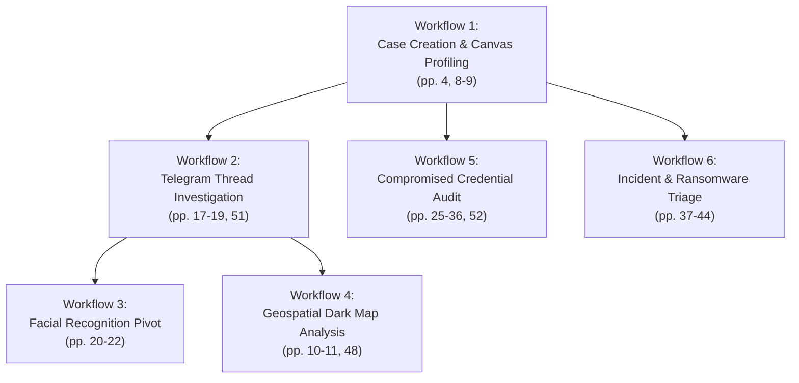

# StealthMole — Documented User Workflows & Investigation Playbooks

**Reference:** `TTI-DOC-RES-002-SM-08`  
**Primary Source:** *StealthMole — User Manual v3.3* (December 2024 / March 2025; Pages 3–52)  
**Document Status:** Grounded Workflow Analysis (Audited Baseline)  
**Citation Convention:** Dual reference standard: `Slide X (PDF p. Y)`.

---

## 1. Overview of Core Investigation Workflows

This document synthesizes the operational workflows documented across the *StealthMole User Manual v3.3*, illustrating how analysts navigate between search lists, the visual Canvas, the geospatial Dark Map, and specialized intelligence modules.

---

## 2. Workflow 1: Case Creation & Visual Canvas Profiling

### Operational Objective
Initialize a persistent investigative container, execute multi-indicator queries, and map relational links between suspects and digital infrastructure (*User Manual v3.3, pp. 4, 8–9*).

### Step-by-Step Procedure
1. **Access Landing Page**: Log in to the platform at `https://stealthmole.com/` (*p. 3*).
2. **Initialize Case**: Click `CREATE NEW CASE` on the landing page (*p. 4*).
3. **Execute Primary Query**: Enter a search observable into the top search bar (e.g., `domain:darkleak-forum.onion`) (*p. 6*).
4. **Inspect Category Counters**: View the category icons; note the numerical hit badges for *Darkweb*, *Telegram*, *Credentials*, and *Files* (*p. 16*).
5. **Populate Canvas**: Select relevant result items and click `Add to Canvas`. The entity appears as a Node with red highlighted text (*p. 8*).
6. **Establish Relational Links**:
   - Click a node and drag an edge to another entity on the canvas (*p. 8*).
   - Right-click the newly created edge to select `Edit edge label` (e.g., `Admin Contact`) or `Change edge color` (*p. 9*).
7. **Apply Layout Algorithm**: Select `Physics layout` to auto-cluster dense networks or `Hierarchical layout` to display organizational trees (*p. 8*).
8. **Add Analyst Notes**: Create a `Text Area` node recording investigative hypotheses (*p. 16*).
9. **Save & Exit**: Return to landing page; verify case appears in `LOAD MY CASES` with Title, Node count, and Last update timestamp (*p. 4*).

---

## 3. Workflow 2: Telegram Thread Investigation & Context Drill-Down

### Operational Objective
Investigate illicit threat actor communications, extract attached media, review message threads, and profile the channel operator (*User Manual v3.3, pp. 17–19, 51*).

### Step-by-Step Procedure
1. **Select Module**: Click the **Telegram Tracker** icon in the left-hand service menu bar (*pp. 5, 17*).
2. **Execute Targeted Channel Search**: Input channel indicator: `telegram.channel:1827364500` or plain keyword (e.g., `exfiltration archive`) (*pp. 18, 48*). *(Consumes 1 query)*.
3. **Filter by Category**: Click the `[MESSAGE INFO]` category icon to isolate chat logs (*p. 18*). *(Consumes 1 query)*.
4. **Open Detail Inspection**: Click the target message row. The Detail View window opens on the right (*p. 18*). *(Consumes 1 query)*.
5. **Review Media & AI Caption**:
   - Inspect channel profile picture under *Preview Image* (*p. 18*).
   - If an image was shared in the post, inspect the automated *AI Caption* (e.g., "Image of database structure printout") (*p. 19*).
6. **Expand Context History**: In the *Preview Message* panel, scroll upward 30 messages to identify the initial offer and buyer negotiation (*p. 18*). *(Consumes 3 queries: 1 per 10 messages scrolled)*.
7. **Pivot to Canvas**: Right-click the sender's Telegram User ID and select `Add to Canvas` (*p. 9*).

---

## 4. Workflow 3: Facial Recognition Cross-Platform Pivot

### Operational Objective
Identify an unknown cybercriminal avatar or leaked photograph by cross-referencing biometric features across the dark web and Telegram (*User Manual v3.3, pp. 20–22*).

### Step-by-Step Procedure
1. **Source Discovery**: In Telegram Tracker, an analyst spots a passport or selfie posted in a fraud channel (*p. 18*).
2. **Canvas Staging**: Add the image result as an Image Node onto the active Canvas (*p. 21*).
3. **Trigger Conjunction Search**: Right-click the Image Node and select `Search -> Face Finder` (*p. 21*).  
   *(Alternative: Open Face Finder module directly and drag-and-drop a local file via `Search by Upload Image`)*.
4. **Evaluate Similarity Matches**: The Face Finder result list displays matched faces tagged with a **Similarity Percentage** (e.g., `96.8% Similar`) (*p. 22*).
5. **Cross-Platform Correlation**: Click a matching face result. The detail pane reveals the same face was previously used as an avatar on a Russian underground Tor forum 8 months prior (*p. 22*).
6. **Bridge Graph**: Connect the Telegram user node to the forum profile node on the Canvas (*p. 8*).

---

## 5. Workflow 4: Geospatial Dark Map Clustering & Radius Search

### Operational Objective
Identify the physical location of threat infrastructure or localized data leak sources (*User Manual v3.3, pp. 10–11, 48*).

### Step-by-Step Procedure
1. **Identify Geotagged Observables**: During Darkweb or Telegram searches, locate results tagged with `GPS Included` (*p. 11*).
2. **Switch to Dark Map**: Click the `DM` toggle button on the Canvas navigation bar (*p. 10*).
3. **Examine Map Pins**:
   - Red pins indicate active query results (*p. 10*).
   - Dark blue pins represent previously saved case nodes (*p. 10*).
4. **Toggle Layers**: Use the map controller to enable/disable specific layer types: *View IP*, *View Image*, *View Telegram User*, *View Telegram Channel*, *View GPS* (*p. 10*).
5. **Execute Radius Search**:
   - Left-click on the map near a dense pin cluster to drop a GPS coordinate pin (*p. 11*).
   - Right-click the GPS pin and select *Search based on geolocation* (*p. 11*).
   - The system executes a query formatted as `gps:latitude, longitude, radius` (e.g., `gps:1.35, 103.81, 25`), surfacing all dark-web or Telegram posts originating within a 25km radius (*p. 48*).

---

## 6. Workflow 5: Enterprise Credential Audit & Excel Export

### Operational Objective
Audit corporate domain exposure across malware stealer logs (RedLine, Lumma) and generate an executive remediation spreadsheet (*User Manual v3.3, pp. 25–27, 52*).

### Step-by-Step Procedure
1. **Access Module**: Open **Compromised Data Set** from the left dock (*p. 25*).
2. **Execute Domain Query**: Search `domain:enterprise-corp.com url:/adfs/ls/` (*p. 27*). *(Consumes 1 query)*.
3. **Filter by Temporal Window**: Append temporal operators: `domain:enterprise-corp.com after:2024-01-01` (*p. 27*).
4. **Inspect Device Telemetry**: Click a hit row. The Detail View opens (*p. 26*):
   - Review *Victim Computer Username* and *Machine Name*.
   - Review *Stealer Type* (e.g., `LummaC2 Stealer`) and *Stealer Path*.
   - Review leaked credentials (*Host*, *User*, *Password* provided AS IS).
5. **Export for Incident Response**: Click the `Export` button (*p. 26*). The platform exports all matching rows into an `.xlsx` Excel spreadsheet.  
   *(Consumes queries proportional to the number of exported pages, p. 52)*.

---

## 7. Workflow 6: Incident & Ransomware Triage

### Operational Objective
Monitor extortion leak blogs in real time to verify whether an enterprise client or supplier has been compromised (*User Manual v3.3, pp. 37–40*).

### Step-by-Step Procedure
1. **Open Incident Board**: Select **Ransomware Monitoring** from the menu (*p. 37*).
2. **Filter by Industry Sector**: Enter query filtered by `Industrial Sector: Healthcare` (*p. 38*).
3. **Review Victim Claim**: Locate a newly detected victim posted today (*p. 38*):
   - Note the `*Claimed* Victim` name.
   - Note the attributed `Ransomware Gang`.
   - Inspect the `Ransomware URL` proof link.
4. **Cross-Check with Private Sector Leaks**: Switch to **Leaked Monitoring** (*p. 39*); search the same corporate name to check if source code or internal email archives are also being auctioned on dark-web forums.
5. **Configure Automated Alerting**: Navigate to **MoleSight** (*p. 12*), create a new Block for `Source Module: Ransomware Monitoring` with input `domain:healthcare-provider.org`, and toggle the email notification switch to receive alerts upon future mentions (*p. 13*).
