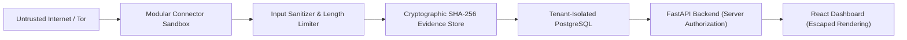

# TTI (Telegram Threat Intelligence) — Security Baseline

## 1. Governance & Security Notice

> [!WARNING]
> **Phase 1 Security Baseline Notice**:
> In Phase 1, authentication, tenant isolation, and cryptographic evidence verification serve as **architectural baselines and scaffolding**. They are **NOT** yet production-ready.
> Full JWT signature verification, fine-grained Role-Based Access Control (RBAC), KMS/HSM evidence signing, and automated penetration testing will be implemented in subsequent phases.

---

## 2. Non-Negotiable Security Rules

The following rules govern all development and contributions to TTI:

1. **Zero Real Credentials in Repositories**:
   - Under no circumstances shall real Telegram API credentials (`api_id`, `api_hash`, bot tokens) or dark-web forum credentials be hardcoded or committed to git.
   - All configuration is externalized via `.env` (excluded via `.gitignore`).
2. **No Unlicensed / Unauthorized Live Scraping**:
   - Live scraping is disabled in Phase 1 (`TTI_TELEGRAM_CONNECTOR_ACTIVE=false`, `TTI_DARKWEB_CONNECTOR_ACTIVE=false`).
   - Connectors run exclusively in inert stub mode with synthetic test fixtures.
3. **Defense Against Untrusted Input**:
   - Every external message, post, page, or title is treated as untrusted and potentially hostile.
   - All inputs must be processed through `InputSanitizer` prior to database indexing or analyst display.
4. **Tenant Isolation by Construction**:
   - Multi-tenancy is not an afterthought. Every intelligence entity, thread, message, analysis result, alert, and raw evidence file must mandate a non-nullable `tenant_id`.
   - Backend APIs must enforce tenant verification independently of the client.
5. **Segregation of Evidence Storage**:
   - The directory housing raw intelligence artifacts (`./evidence_store`) must remain physically isolated from frontend static directories.
   - Raw evidence is accessed solely through authenticated, authorized backend API endpoints.
6. **No Unrestricted Autonomous Actions**:
   - The AI and decision subsystems must require human-in-the-loop confirmation before escalating threat status, blocking IPs, or triggering critical external webhooks.
   - Live reinforcement learning and autonomous self-modifying loops are strictly prohibited.

---

## 3. Defense-in-Depth Architecture

### 3.1 Input Sanitization Matrix

| Threat Vector | Mitigation Strategy | Component |
| :--- | :--- | :--- |
| **XSS / HTML Injection** | Redact `<script>`, `<iframe>`, escape residual HTML entities | `InputSanitizer` |
| **Terminal Hijacking** | Strip ANSI escape sequences (`\x1B[...]`) | `InputSanitizer` |
| **Null Byte Poisoning** | Strip `\x00` - `\x1F` control characters | `InputSanitizer` |
| **Malicious URI Protocols** | Defang `javascript:`, `data:`, `file:` URIs | `InputSanitizer` |
| **DoS Memory Exhaustion** | 1,000,000 character length limit ceiling | `InputSanitizer` |
| **Evidence Tampering** | Immutable SHA-256 digest calculated on ingestion | `LocalEvidenceStore` |
| **Cross-Tenant Leakage** | `tenant_id` UUID foreign keys and directory partitioning | `TenantAwareModel` |

---

## 4. Operational Boundaries for Phase 1

- Live Telegram collection: **DEACTIVATED**
- Live Dark-Web collection: **DEACTIVATED**
- Tor proxy socks socket: **DEACTIVATED**
- Authentication token validation: **STUB SCAFFOLD** (Phase 2 milestone)
- Database schema: **INITIALIZED (Alembic migration 0001)**
