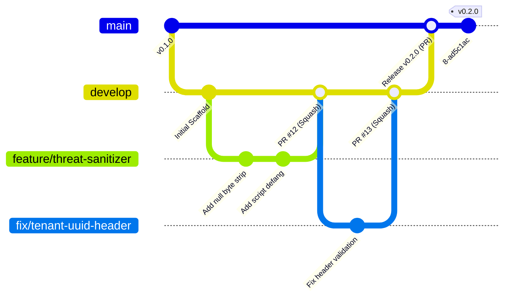

# VFRA Engineering — Git Branching & Release Strategy

## 1. Branching Model Overview

The **VFRA Engineering** GitHub Organization follows a modified **Trunk-Based / GitFlow Hybrid** optimized for high-reliability, security-centric development.



---

## 2. Core Branches

### 2.1 `main` (Production Branch)
- **Role**: Represents production-grade, deployable code. Every commit on `main` is tagged with a semantic release version.
- **Protection**: Highest level. Direct commits and force pushes are strictly disabled. Changes enter `main` exclusively via approved Pull Requests from `develop` or release branches.

### 2.2 `develop` (Integration Branch)
- **Role**: Primary collaborative integration branch where validated features are aggregated for pre-release testing and QA verification.
- **Protection**: Protected branch. Direct commits and force pushes are disabled. Changes enter `develop` exclusively via Pull Requests from feature or bugfix branches.

---

## 3. Supporting Branch Naming Conventions

All working branches must use the following prefix formats:

| Branch Type | Naming Pattern | Example | Purpose |
| :--- | :--- | :--- | :--- |
| **Feature** | `feature/<issue-#>-<short-description>` | `feature/42-telegram-rate-limiter` | New capability or module |
| **Bug Fix** | `fix/<issue-#>-<short-description>` | `fix/55-ansi-escape-parser` | Non-critical bug fix |
| **Security Patch** | `security/<issue-#>-<short-description>` | `security/61-tenant-traversal-guard` | Security boundary fix or patch |
| **Chore / Infra** | `chore/<short-description>` | `chore/update-postgres-docker-tag` | Dependency bumps, CI updates, formatting |
| **Documentation** | `docs/<short-description>` | `docs/add-tor-routing-diagram` | Architectural documentation updates |
| **Release Cut** | `release/v<major>.<minor>.<patch>` | `release/v0.2.0` | Release stabilization branch |

---

## 4. Branch Protection Rules (Mandatory Settings)

For `main` and `develop` on all organization repositories:

| Protection Setting | Value | Rationale |
| :--- | :--- | :--- |
| **Require a pull request before merging** | **Enabled** | Prevents unreviewed direct commits |
| **Require approvals** | **1 approval** (2 for security-sensitive paths) | Ensures peer validation |
| **Dismiss stale pull request approvals when new commits are pushed** | **Enabled** | Prevents sneaking unreviewed changes into an approved PR |
| **Require review from Code Owners** | **Enabled** | Enforces routing to security/backend/frontend leads |
| **Require status checks to pass before merging** | **Enabled (Strict)** | Code must build and pass tests against latest base |
| **Mandatory Status Checks** | `backend-test`, `frontend-build`, `security-scan` | Guarantees test integrity |
| **Require linear history (Squash or Rebase merge)** | **Enabled** | Maintains a clean, bisectable commit log |
| **Do not allow bypassing the above settings** | **Enabled** | Enforces rules even for Organization Owners |
| **Do not allow force pushes** | **Enabled** | Preserves commit history |
| **Do not allow deletions** | **Enabled** | Protects permanent branch records |

---

## 5. Pull Request Merge Strategy

- **Default Merge Type**: **Squash and Merge** (`--squash`)
  - Condenses feature iteration commits into a single, clean commit on the base branch.
  - The squash commit message must follow Conventional Commits:
    ```text
    feat(connectors): implement darkweb forum thread pagination (#42)
    ```
- **Rebase and Merge**: Permitted only for multi-commit release merges where preserving distinct release sub-steps is beneficial.
- **Merge Commits**: Disabled by default to prevent noisy non-linear branch graphs.

---

## 6. Release Management & Version Tagging

We adhere strictly to [Semantic Versioning 2.0.0](https://semver.org/):

$$\text{v}\langle\text{MAJOR}\rangle.\langle\text{MINOR}\rangle.\langle\text{PATCH}\rangle$$

- **MAJOR**: Incompatible API breaking changes or major phase transitions.
- **MINOR**: Backwards-compatible features added (e.g., Phase 2 connector sandbox completed).
- **PATCH**: Backwards-compatible bug fixes or security patches.

### Release Workflow:
1. When `develop` reaches milestone completion, a release branch is cut: `release/v0.2.0`.
2. Integration smoke tests and QA verification are completed on the release branch.
3. PR is opened to merge `release/v0.2.0` into `main`.
4. Upon merge, a **GitHub Release** is created with a signed Git tag:
   ```bash
   git tag -s v0.2.0 -m "Release v0.2.0 — Phase 2 Authentication & Connector Sandbox"
   git push origin v0.2.0
   ```
5. `main` is merged back into `develop` to ensure release patches are propagated.
