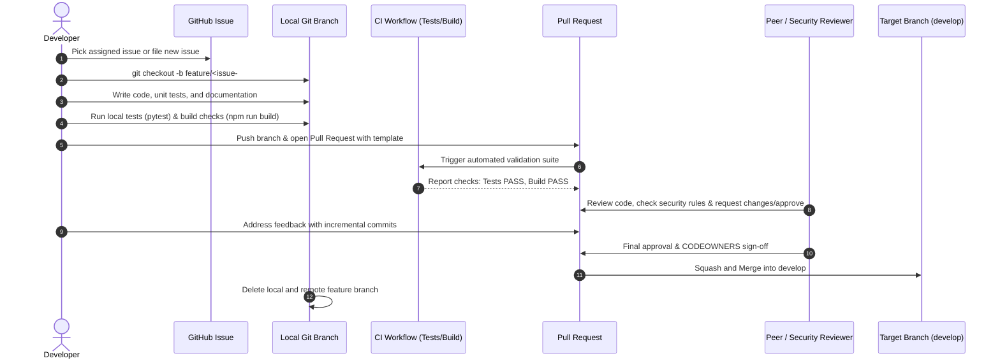

# Contributing to VFRA Engineering Projects

Thank you for contributing to **VFRA Engineering**. This document defines the standard engineering workflow, commit conventions, and code review standards expected of all team members and contributors.

---

## 1. Development Lifecycle Overview



---

## 2. Step-by-Step Developer Workflow

### Step 1: Issue Association
- Every change should correspond to an open GitHub Issue (Bug Report or Feature Request).
- Self-assign the issue or confirm assignment with the Team Lead before writing code.

### Step 2: Branch Creation
- Always branch off the latest `develop` branch:
  ```bash
  git checkout develop
  git pull origin develop
  git checkout -b feature/42-telegram-rate-limiter
  ```
- Use standard branch prefixes: `feature/`, `fix/`, `security/`, `chore/`, `docs/`.

### Step 3: Local Verification Before Pushing
Before opening a Pull Request, you must verify that all automated checks pass on your local machine:

**Backend (Python)**:
```powershell
# Run backend test suite
.\backend\.venv\Scripts\pytest backend/tests -v
```

**Frontend (React/TypeScript)**:
```powershell
# Verify TypeScript types and production bundle
cd frontend
npm run build
```

**Security Check**:
Ensure no credentials, temporary test dumps, or private evidence files are staged:
```powershell
git status
```

### Step 4: Commit Message Conventions
We enforce [Conventional Commits](https://www.conventionalcommits.org/):

| Type | When to Use | Example |
| :--- | :--- | :--- |
| `feat:` | New feature or functionality | `feat(ingestion): add regex sanitizer for defanging URIs` |
| `fix:` | Bug fix | `fix(auth): reject non-UUID tenant identifiers with 400` |
| `security:` | Security fix, credential scrub, or hardening | `security(evidence): enforce tenant path traversal protection` |
| `refactor:` | Code reorganization without functional change | `refactor(database): split model definitions into modular subpackages` |
| `test:` | Adding or improving tests | `test(connectors): add unit tests for darkweb stub pagination` |
| `docs:` | Documentation changes only | `docs(architecture): add sequence diagram for untrusted ingestion` |
| `chore:` | Tooling, dependencies, CI configuration | `chore(deps): bump fastapi to 0.115.0 and pydantic to 2.10.0` |

**Format**:
```text
<type>(<scope>): <imperative summary>

[Optional body explaining context, rationale, and security considerations]

[Optional issue link: Fixes #42]
```

---

## 3. Pull Request Etiquette & Guidelines

1. **Use the Template**: All PRs must fill out the repository's `PULL_REQUEST_TEMPLATE.md`.
2. **Atomic Changes**: Keep PRs focused on a single logical change. Large PRs (>500 lines) should be decomposed into incremental reviewable units.
3. **Reviewer Respect**: Respond to all reviewer comments professionally. If a change is requested, make the adjustment or explain the technical rationale.
4. **No Self-Merging**: Never bypass required reviews or merge your own PR without designated peer approval.
5. **Clean Merges**: PRs are merged via **Squash and Merge** to maintain a linear history.

---

## 4. Code Quality & Architecture Non-Negotiables

- **Untrusted Input**: Never render or store un-sanitized external input. Always route through `InputSanitizer`.
- **Tenant Isolation**: Always pass and enforce `tenant_id` on database queries and evidence storage.
- **Evidence Integrity**: Never modify an existing evidence file in-place; all evidence writes are immutable and hash-verified.
- **Documentation**: Update relevant `docs/` and docstrings whenever APIs, interfaces, or configurations change.
