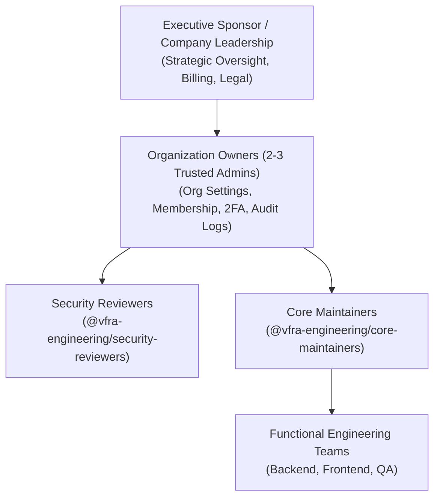

# VFRA Engineering — Organization Charter

## 1. Mission & Purpose

The **VFRA Engineering** GitHub Organization is established to provide a unified, secure, and auditable software development environment for VFRA’s engineering teams. 

Its primary objectives are:
1. **Centralized Code Ownership**: Ensure all source code, infrastructure definitions, and architectural documentation are owned by the organization rather than personal individual accounts.
2. **Security & Zero-Trust Posture**: Enforce strict access control, multi-factor authentication, secret scanning, and segregated evidence handling.
3. **Reproducible Engineering**: Maintain standard CI/CD workflows, code review baselines, branch protection policies, and semantic release versioning.
4. **Scalable Team Collaboration**: Enable seamless collaboration across backend, frontend, security, and quality assurance disciplines while maintaining strict least-privilege boundaries.

---

## 2. Scope & Applicability

This charter applies to:
- All repositories created within the organization (starting with `tti`).
- All members, contractors, and bot accounts granted access to the organization.
- All automation, deployment keys, personal access tokens (PATs), and CI/CD pipelines connected to organization assets.

### Out of Scope:
- Storing production database dumps, customer PII, live credential archives, or uncontained threat binaries.
- Individual personal side projects or unapproved third-party tooling.

---

## 3. Governance & Ownership Hierarchy

### 3.1 Organization Owners (Administrators)
- **Roster Constraint**: Limited strictly to **2 to 3 trusted technical leaders**. Single-owner setups are prohibited to prevent lockouts, and broad owner distribution is prohibited to maintain tight security perimeter control.
- **Authority**:
  - Manage billing, plan tiers, and organization-level authentication (SAML/SSO).
  - Enforce Organization-wide Two-Factor Authentication (2FA).
  - Grant repository creation rights and team administrative roles.
  - Review organization audit logs and handle emergency security revocations.

### 3.2 Security Reviewers (`@vfra-engineering/security-reviewers`)
- Technical authority on cryptography, authorization models, tenant isolation, input sanitization, and secret management.
- Mandatory approvers in `CODEOWNERS` for any change touching security boundaries, authentication logic, or evidence storage paths.

### 3.3 Core Maintainers (`@vfra-engineering/core-maintainers`)
- Repository-level administrators responsible for branch protection enforcement, CI/CD configuration, dependency maintenance, and release tagging.

### 3.4 Functional Contributors (Backend, Frontend, QA)
- Engineers granted write access through team memberships to specific repositories following the principle of least privilege.

---

## 4. Governance Policies & Approval Gates

The following actions **require formal management / executive approval** and must never be executed unilaterally:

| Action / Decision | Approval Required | Documented Via |
| :--- | :--- | :--- |
| **Selecting or changing GitHub Billing Plan** (e.g., Free vs. Team vs. Enterprise) | Executive Sponsor / CFO | Written Approval / Finance Ticket |
| **Publishing any repository as Public** | Executive Sponsor + Legal Lead | Formal Exception Request |
| **Integrating Third-Party GitHub Apps / OAuth Integrations** | Security Reviewer + Org Owner | Security Review Ticket |
| **Setting up Enterprise Single Sign-On (SAML/SSO)** | IT Operations + Org Owner | Infrastructure Change Order |
| **Legal Licensing / Open-Source Dual Licensing** | Legal Lead | Legal Clearance Notice |
| **Modifying Organization-wide Base Permissions** | Org Owners (Unanimous) | Governance Log Entry |

---

## 5. Amendments & Review Cadence

This charter is reviewed **semi-annually** by the Organization Owners and engineering leadership. Any proposed amendment requires review and sign-off by all designated Organization Owners.
