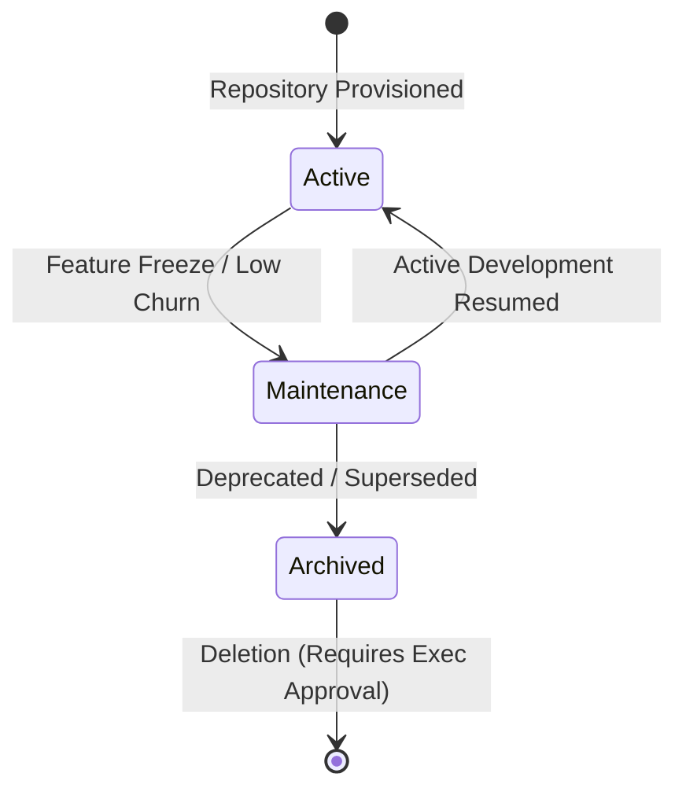

# VFRA Engineering — Repository Standards & Governance

## 1. Repository Visibility Policy

> [!IMPORTANT]
> **Strictly Private by Default**:
> Every repository created under the **VFRA Engineering** GitHub Organization must be set to **Private**.
> 
> Publishing any repository or fork as Public requires formal written approval from both **Executive Leadership** and the **Legal Lead**.

---

## 2. Naming Conventions

All repositories must adhere to consistent, descriptive naming rules:

| Category | Pattern | Examples | Description |
| :--- | :--- | :--- | :--- |
| **Core Applications** | `<project-name>` (lowercase, hyphenated) | `tti`, `vfra-portal` | Primary standalone service or platform |
| **Shared Libraries** | `lib-<domain>-<name>` | `lib-threat-sanitizer`, `lib-common-crypto` | Internal reusable Python/TS libraries |
| **Infrastructure / DevOps**| `infra-<scope>` | `infra-terraform`, `infra-kubernetes` | Cloud orchestration and cluster manifests |
| **Documentation & Blueprints**| `<topic>-docs` or `<topic>-blueprint` | `vfra-engineering-org-blueprint`, `security-docs` | Architecture and operational documentation |
| **Special Organization Repo**| `.github` | `.github` | Organization-wide default templates & health files |

### Rules:
- Use only lowercase alphanumeric characters and hyphens (`[a-z0-9-]`).
- Do not use underscores, spaces, or camelCase.
- Avoid vague names such as `app`, `test`, `backend-new`, or personal identifiers (`john-dev`).

---

## 3. Mandatory Repository Files

Every production repository in the organization must include the following standard files before the first merge to `main`:

```text
<repository-root>/
├── .github/
│   ├── CODEOWNERS               # Mandatory path-based reviewer assignments
│   ├── PULL_REQUEST_TEMPLATE.md # Standard PR checklist
│   ├── ISSUE_TEMPLATE/          # Structured YAML issue forms
│   │   ├── bug_report.yml
│   │   └── feature_request.yml
│   └── workflows/               # CI/CD pipelines (lint, test, build, security scan)
├── .env.example                 # Environment variable template with safe defaults
├── .gitignore                   # Multi-tier ignore rules (excludes credentials, evidence, builds)
├── CONTRIBUTING.md              # Workflow and branch conventions
├── LICENSE                      # Proprietary software license notice
└── README.md                    # Project overview, tech stack, architecture, and setup instructions
```

---

## 4. Proprietary Licensing Notice

Until and unless approved for open-source release, all repositories must carry the following proprietary notice in `LICENSE`:

```text
CONFIDENTIAL AND PROPRIETARY — VFRA ENGINEERING
Copyright (c) 2026 VFRA. All rights reserved.

This source code and accompanying documentation are the confidential and proprietary
property of VFRA. Unauthorized copying, distribution, modification, public display,
or reverse engineering of this software, via any medium, is strictly prohibited.
```

---

## 5. Secrets Management & Zero-Credential Rule

1. **Zero Hardcoded Secrets**:
   - No passwords, API tokens, JWT private keys, Tor proxy credentials, session hashes, or cloud access keys may ever be committed to git history.
   - Pre-commit hooks (`gitleaks` or `trufflehog`) should be configured locally to prevent accidental commits.
2. **Repository vs. Organization Secrets**:
   - Organization Secrets are restricted to org-wide tooling (e.g., SonarQube, unified Docker registry).
   - Repository-specific secrets (e.g., CI database credentials, deployment tokens) must be stored under **Repository Settings &rarr; Secrets and Variables &rarr; Actions**.
   - Production secrets must be managed in dedicated external key management systems (AWS Secrets Manager, HashiCorp Vault, or Azure Key Vault) and injected into execution environments at runtime, never stored statically in GitHub.

---

## 6. Repository Lifecycle & Archival Rules



### 6.1 Provisioning
- Repositories can only be created by **Organization Owners** or **Core Maintainers**.
- Every repository must have an assigned **Lead Maintainer** and a designated **CODEOWNERS** file upon creation.

### 6.2 Maintenance & Inactivity
- Repositories with no active development for 6 months undergo maintenance review.
- Automated dependency scanning (Dependabot) continues running during maintenance.

### 6.3 Archival Procedure
When a project reaches end-of-life:
1. Update `README.md` with an archival notice pointing to successor repositories or documentation.
2. Ensure all open Pull Requests and Issues are closed or migrated.
3. An Org Owner sets the repository to **Archived (Read-Only)** in GitHub settings.
4. Repository deletion is **strictly restricted** and requires written approval from Executive Leadership to protect historical intellectual property and audit trails.
