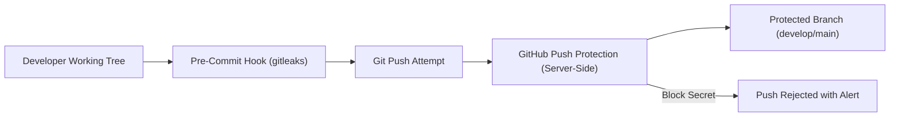

# VFRA Engineering — Security Policy & Governance

## 1. Security Overview & Commitment

Security is the foremost operational constraint across all **VFRA Engineering** projects. Because projects like **TTI (Telegram Threat Intelligence)** handle adversarial telemetry and untrusted intelligence, our security posture operates under a strict **Zero-Trust** paradigm.

---

## 2. Sensitive Data & Credential Restrictions

The following assets are **STRICTLY PROHIBITED** from ever being committed to any repository or artifact:

| Restricted Category | Examples | Enforcement Mechanism |
| :--- | :--- | :--- |
| **API Keys & Secrets** | Telegram API credentials, OpenAI keys, Tor control passwords, database passwords | GitHub Secret Scanning, Push Protection, Pre-commit hooks |
| **Private Keys & Certificates** | SSH private keys (`id_rsa`), SSL/TLS certs (`*.pem`, `*.key`), PFX archives | `.gitignore`, Automated static analysis |
| **Customer / Client PII** | Real corporate user identities, email dumps, customer credentials | Immediate repository wipe & rotation |
| **Raw Exploit Payloads** | Active ransomware binaries, weaponized shellcode, live zero-day exploits | Quarantine store isolation (air-gapped) |
| **Evidence Files** | Scraped raw HTML archives, un-sanitized forum dumps, PCAP network captures | Segregated evidence filesystem (`evidence_store/`) |

---

## 3. Secret Detection & Prevention Controls



### 3.1 Local Pre-Commit Safeguards
Developers are required to run secret scanning tooling before committing:
```bash
# Recommended local hook
pip install pre-commit
pre-commit install
```

### 3.2 GitHub Secret Scanning & Push Protection
- **Push Protection**: Enabled organization-wide. Blocks commits containing known credential formats (AWS, Telegram, Slack, GitHub tokens) before they are accepted by GitHub.
- **Secret Scanning Alerts**: If a secret is inadvertently committed to a non-protected branch, an immediate high-priority alert is dispatched to the Security Reviewers.

### 3.3 Secret Exposure Response Procedure
If a credential is ever committed to version control:
1. **Immediate Revocation**: Revoke/rotate the secret at the provider immediately. Merely deleting the commit does not secure an exposed token.
2. **Git History Scrub**: Use `git-filter-repo` or BFG Repo-Cleaner to purge the sensitive commit from the entire repository history.
3. **Audit Log Inspection**: Review access logs for the exposed token to identify any unauthorized access during the exposure window.
4. **Incident Post-Mortem**: File a confidential security incident report documenting root cause and preventative remediation.

---

## 4. Multi-Tenant Isolation & Evidence Integrity

Projects storing multi-tenant intelligence (such as TTI) must enforce:
1. **Model-Level Tenant Scoping**: Every database entity representing client-owned data must inherit from `TenantAwareModel` with a non-nullable `tenant_id`.
2. **Backend-Enforced Authorization**: Frontend state is considered untrusted. Tenant context and access privileges must be verified on the backend API.
3. **Physical Evidence Segregation**: Raw intelligence artifacts must never be saved in or served from frontend static directories. Evidence must be stored in tenant-partitioned paths (`evidence_store/{tenant_id}/`) and verified with SHA-256 checksums.

---

## 5. Security Review Triggers (`CODEOWNERS`)

Any Pull Request modifying the following paths requires **mandatory review and sign-off** by `@vfra-engineering/security-reviewers`:

- `*/core/security.py` — Authentication, tenant extraction, and authorization logic
- `*/database/models/*` — Entity schema definitions and tenant scoping mixins
- `*/evidence/*` — Evidence storage, hashing, and retrieval algorithms
- `*/ingestion/sanitizer.py` — Untrusted payload sanitization and defanging regexes
- `.github/workflows/*` — CI/CD pipelines, secret references, and build actions
- `infra/*` — Dockerfiles, Compose orchestration, and network binding configurations

---

## 6. Vulnerability Disclosure & Internal Reporting

If a developer, team member, or authorized auditor discovers a potential security vulnerability within any VFRA Engineering repository:

### 6.1 Private Reporting Channel
- **DO NOT** open a public or general GitHub Issue.
- Use **GitHub Private Vulnerability Reporting** located under the repository's **Security &rarr; Advisories** tab.
- Alternatively, email `security@vfra.local` (or designated internal security contact).

### 6.2 SLA for Vulnerability Triage
- **Critical / High Severity**: Triage within 4 hours; patch deployment within 24 hours.
- **Medium Severity**: Triage within 24 hours; patch deployment within 7 days.
- **Low / Informational**: Triage within 48 hours; remediation in next scheduled sprint.

---

## 7. Compliance & Regulatory Disclaimer

> [!NOTE]
> This security policy establishes engineering best practices and architectural guardrails for VFRA Engineering. It does not constitute a formal certification under ISO 27001, SOC 2, HIPAA, or PCI-DSS. Formal compliance claims, external audit attestations, and customer-facing security agreements require explicit executive leadership and legal counsel approval.
