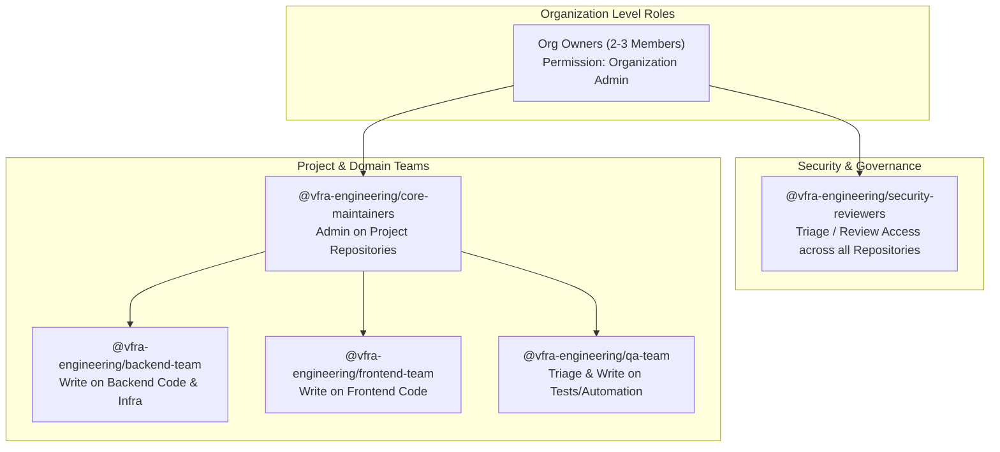
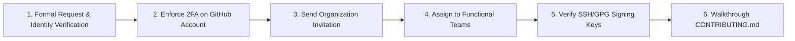

# VFRA Engineering — Team Structure & Access Control

## 1. Principles of Access Control

The **VFRA Engineering** GitHub Organization adheres to two core access principles:
1. **Least Privilege**: Members are granted only the minimum permissions necessary to perform their roles.
2. **Team-Based Permissioning**: Permissions are **never** assigned to individual user accounts on repositories. All repository access is managed via GitHub Teams.

---

## 2. Organization Team Topology

---

## 3. Team Definitions & Responsibilities

### 3.1 Organization Owners (`@vfra-engineering/owners`)
- **Size**: Strictly 2 to 3 trusted administrators.
- **Responsibilities**:
  - Manage billing, plan tiers, and organization-wide settings.
  - Enforce mandatory Two-Factor Authentication (2FA).
  - Handle member invitations, security revocations, and team creation.
  - Monitor organization audit logs for anomalies.

### 3.2 Security Reviewers (`@vfra-engineering/security-reviewers`)
- **Responsibilities**:
  - Review all modifications to authorization logic, cryptographic functions, tenant scoping, and evidence storage.
  - Designated mandatory reviewers in `CODEOWNERS`.
  - Triage Dependabot / Secret Scanning / CodeQL security alerts.
  - Review all third-party dependencies before adoption.

### 3.3 Core Maintainers (`@vfra-engineering/core-maintainers`)
- **Responsibilities**:
  - Repository maintainers with `Admin` or `Maintain` permission on specific repositories.
  - Configure and enforce branch protection rules.
  - Manage repository-level GitHub Actions secrets and environments.
  - Oversee release cuts, semantic version tagging, and deployment pipelines.

### 3.4 Backend Team (`@vfra-engineering/backend-team`)
- **Scope**: Backend application services, database schemas, migration scripts, connectors, and API routing.
- **Responsibilities**:
  - Python / FastAPI service architecture and performance.
  - PostgreSQL schema maintenance and Alembic migration integrity.
  - Implementation of connector interfaces and input sanitization boundaries.
  - Authoring comprehensive unit and integration tests.

### 3.5 Frontend Team (`@vfra-engineering/frontend-team`)
- **Scope**: User interfaces, dashboards, state management, and API clients.
- **Responsibilities**:
  - React, TypeScript, and Vite frontend architecture.
  - UI component design and responsive cyber-defense aesthetics.
  - Client-side error handling, session display, and diagnostic panels.

### 3.6 QA & Test Automation Team (`@vfra-engineering/qa-team`)
- **Scope**: Automated test suites, end-to-end regression testing, synthetic test data harnesses.
- **Responsibilities**:
  - Authoring integration and regression tests.
  - Validating test coverage across multi-tenant boundaries.
  - Verifying sanitizer resilience against edge-case payload injections.

---

## 4. Permission Matrix

| Role / Team | Organization Role | Default Repo Perm | Project Repos (e.g. `tti`) | Security Repos (`.github`) |
| :--- | :--- | :--- | :--- | :--- |
| **Org Owners** | Owner | Admin | Admin | Admin |
| **Security Reviewers** | Member | Read | Write / Triage + Codeowner | Write / Codeowner |
| **Core Maintainers** | Member | Read | Maintain / Admin | Read |
| **Backend Engineers** | Member | None / Read | Write | Read |
| **Frontend Engineers**| Member | None / Read | Write | Read |
| **QA Engineers** | Member | None / Read | Write / Triage | Read |
| **Contractors / Guests** | Member | None | Read / Write (Scoped strictly) | None |

> [!NOTE]
> **Base Permissions Setting**: The organization's **Base permissions** setting must be set to **No permission** or **Read**. Members gain Write access strictly through team membership on specific repositories.

---

## 5. Member Onboarding Standard Operating Procedure (SOP)

When a new engineer joins the engineering organization:

1. **Prerequisite**: Engineer must provide their corporate email and existing GitHub username.
2. **2FA Verification**: Engineer must verify that hardware-backed or authenticator-app 2FA is active on their personal GitHub account.
3. **Invitation**: An Org Owner issues an invitation with `Member` role.
4. **Team Assignment**: Engineer is added to their designated functional team (e.g., `@vfra-engineering/backend-team`).
5. **Key Registration**: Engineer registers SSH keys and GPG commit-signing keys on GitHub.
6. **Access Verification**: Engineer clones the repository, confirms pre-commit hooks, and runs test suites locally.

---

## 6. Member Offboarding Standard Operating Procedure (SOP)

When a team member transitions off the project or leaves the company:

1. **Immediate Revocation (< 1 hour of notification)**:
   - An Org Owner removes the user from the **VFRA Engineering** GitHub Organization.
   - Removing the user automatically revokes access to all private repositories, teams, discussions, and internal assets.
2. **Token & Key Invalidation**:
   - Invalidate any deploy keys, personal access tokens (PATs), or OAuth authorizations created by the user.
   - Rotate any shared repository secrets or environment variables the departing member had direct access to.
3. **Audit & Reassignment**:
   - Reassign open Issues and active Pull Requests assigned to the departed user.
   - Verify audit log to confirm no unauthorized cloning or export occurred prior to departure.

---

## 7. Quarterly Access Audit Cadence

Every 90 days, the Organization Owners must perform an access review:
- Verify that every member is still an active employee/contractor.
- Verify that team assignments reflect current project responsibilities.
- Audit external collaborators (must be 0 unless formal exception approved).
- Review all active Organization Webhooks, GitHub Apps, and OAuth integrations.
- Record audit completion in the internal compliance ledger.
